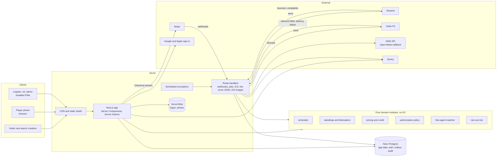

# Architecture

Status: draft v1, 2026-11-11. Library facts marked ✔ were checked against current documentation through Context7 or Vercel's docs on this date. Prices are list prices as I understand them and should be re-checked before anyone budgets from them.

## 1. Stack decisions

| Area | Decision | One-line reason |
|---|---|---|
| Framework | Next.js 16 (App Router), React 19, TypeScript strict | Already chosen; 16.4 is current ✔ |
| Rendering model | Cache Components (`cacheComponents: true`, `'use cache'`, `cacheTag`, `cacheLife`) ✔ | Public pages get a static shell and tagged data that is invalidated the moment a score or schedule changes |
| Request interception | `proxy.ts` ✔ (Next 16 renamed `middleware.ts`) | Coarse "signed in or not" redirects only |
| ORM | **Drizzle** | SQL-shaped and typed, no code generation step, tiny cold start, and it expresses partial unique indexes and check constraints that this model leans on. Prisma is friendlier but heavier and hides the SQL the scheduler and ledger need |
| Database driver | `drizzle-orm/neon-http` for reads and single statements; `drizzle-orm/neon-serverless` (WebSocket pool) where an interactive transaction is needed ✔. A Postgres on `localhost` (local development, end-to-end tests in CI) uses `drizzle-orm/node-postgres` instead ([ADR 0007](adr/0007-end-to-end-tests-on-local-services.md)) | HTTP is fastest for one query; payments and schedule publishing need real transactions |
| Auth | **Better Auth** with its Drizzle adapter, magic-link plugin, Google sign-in and (P2) passkeys ✔. No passwords | Sessions and users live in our own Postgres, it is the actively developed option for Next.js, and it has first-party plugins for what we need |
| TypeScript | `strict`, `noUncheckedIndexedAccess`, `exactOptionalPropertyTypes`, no `any`; branded types for IDs | A `TeamId` cannot be passed where a `GameId` is expected; the compiler catches a class of bugs tests would miss |
| Errors | Domain functions return a typed result (`ok`, or a named failure); only unexpected failures throw | Callers must handle "team is full" or "deadline passed" explicitly, and the UI can show the right message |
| Mutations | Server Actions, each a thin wrapper: validate with Zod, authorize, call a service function. Route handlers only for webhooks, jobs and feeds | Least code for a web-only product; the service layer can sit behind an API later without a rewrite |
| Forms | Native form elements with `useActionState`; no form library outside the admin schedule board | Works before JavaScript loads and keeps bundles small |
| AI (P2, optional) | Anthropic TypeScript SDK, server-side only, behind a monthly spend cap | See section 16 |
| UI | Tailwind CSS v4 with tokens in CSS; shadcn/ui components restyled to the design system | Accessible primitives without shipping a component library's runtime |
| Validation | Zod at every boundary: forms, server actions, webhooks, environment variables | One schema per input, shared by client and server |
| Payments | Stripe Checkout (hosted) and webhooks | Card data never touches our servers |
| Email | Resend through its REST API, templates as functions returning HTML and text ✔ | Simple API, good deliverability. Next.js keeps `react-dom/server` out of server components, so templates build escaped strings; React Email can come back for the outbox's richer messages if a template outgrows that |
| SMS (P3) | Twilio Messaging Service | Handles STOP and HELP at the carrier-facing layer, supports A2P 10DLC registration |
| Weather | **National Weather Service API** first, Open-Meteo behind the same interface as a fallback | See section 7 |
| Files | Vercel Blob | Same platform, signed client uploads |
| Jobs | A Postgres outbox drained by scheduled invocations, plus `after()` ✔ for immediate sends | No extra vendor; the message is written in the same transaction as the change that caused it |
| Tests | Vitest, fast-check, Playwright with axe, Lighthouse CI | Unit and property tests for domain logic, real-browser tests for flows and accessibility |
| Lint and format | ESLint (flat config) with `jsx-a11y`, Prettier | Accessibility lint rules matter for the WCAG target |
| Package manager | npm (see [ADR 0001](adr/0001-stack-and-tooling.md)) | No extra setup on CI, Vercel or a reviewer's machine; one app, no workspaces |

### Type assertions

An `as` tells the compiler to stop checking, so the code avoids them and lint enforces the worst cases:

- **Untrusted input** (form fields, query strings, headers, stored JSON) is parsed, never asserted. `parseId` turns a string into a branded ID only if it is a UUID; `isOneOf` narrows a string to a union; Zod validates webhook payloads and the environment.
- **Rows that must exist**, such as an insert's `returning`, go through `required()`, which throws instead of pretending.
- **JSON columns** declare their shape with Drizzle's `$type<T>()`, so reading them needs no cast.
- **Validation narrows types itself**: a parser keeps each checked value in a typed variable (null when invalid) rather than re-reading the raw string with `as` at the end.
- **The few deliberate assertions** live inside small, tested helpers (`parseId`, `recordOf`) with a comment saying why. The scheduler's hot loops read arrays by index with `as number` where the loop bounds prove the index is valid; `noUncheckedIndexedAccess` cannot see that, and those paths run under 100% coverage and property tests.
- **Lint rules:** `no-unnecessary-type-assertion` (type-aware) removes assertions the compiler can already prove, and assertions through `unknown` (`x as unknown as T`) or to `never` are an error everywhere, tests included.

### Flags and changes to the original plan

| Flag | Why it matters | Recommendation |
|---|---|---|
| Vercel Hobby plan | It is for personal, non-commercial use and limits scheduled jobs to once a day. A league that takes payments is commercial | Build on Hobby; move production to Pro (about $20 a month) before taking real money |
| Open-Meteo | Its free tier is for non-commercial use | Use the NWS API as primary (US government, free, no key, no commercial restriction) |
| Resend free tier | About 100 emails a day. One rain-out notice to 180 players exceeds it | Pro tier (about $20 a month) for production |
| Sign in with Apple | Requires an Apple Developer account (about $99 a year) | Ship Google, email link and password in the MVP; add Apple in P2 if the league wants it |
| SMS in the plan | Carrier registration needs the league's legal business details and takes weeks | Start registration as soon as the owners agree; build SMS in P3 |
| Stripe Connect for referees | Monthly per-account and per-payout fees are large next to a $20 game fee | Track what refs are owed in the app; pay by Venmo or cash; revisit Connect only at volume |
| Vercel Cron Jobs | Vercel's docs now describe Cron Jobs as legacy, being migrated to "Schedules" ✔ | Use whichever is current at build time; the handlers are the same route handlers either way |

## 2. System diagram



### Code layout

```
src/
  app/                 routes, layouts, server actions, route handlers
  components/          UI components (design system)
  domain/              pure TypeScript, no imports from app/, db/ or next/*
    scheduler/  standings/  pricing/  authz/  matching/  weather/  fielding/
  db/                  Drizzle schema, migrations, query functions
  services/            I/O adapters: stripe, email, sms, weather, blob, push
  jobs/                job handlers called by route handlers
  emails/              email templates (HTML and plain text)
tests/  e2e/  scripts/seed.ts
```

The rule that makes this testable: `domain/` never imports from anywhere else in `src/`. An ESLint boundary rule enforces it. Everything interesting (the scheduler, tiebreakers, who-can-do-what, price calculation, fielding-rule checks) is a pure function with fast tests.

One Next.js app in one repository. A monorepo would add tooling without adding anything this project needs.

## 3. Rendering strategy by route

With Cache Components, a page's static parts and cached data are prerendered into a shell that is served from the CDN; anything that reads cookies streams in behind a Suspense boundary.

| Route | Strategy | Cache tags | Invalidated when |
|---|---|---|---|
| `/`, `/about`, `/faq`, `/refs`, `/nyc-kickball-league`, `/legal/*` | Fully prerendered; data cached for days | `league` | League settings change |
| `/rules` | Prerendered from MDX in the repository | — | Deploy |
| `/parks/[park]` | Prerendered; cached | `venue:{id}` | Venue edited |
| `/seasons/[season]` | Prerendered; price and spots-left cached for minutes | `season:{id}` | Season edited, registration paid |
| `/seasons/[season]/schedule` | Static HTML, prerendered at build for every public season, refreshed in the background each minute ✔. `?team=` is rewritten to a path segment | `season:{seasonId}` | A schedule version is published (including a rain-out), a score is reported or answered, the season is edited |
| `/seasons/[season]/standings` | Static HTML, prerendered at build for every public season, refreshed in the background each minute ✔ | `season:{seasonId}` | As the schedule |
| `/seasons/[season]/bracket` | Prerendered; cached | `standings:{seasonId}` | A game becomes final or is corrected |
| `/teams/[team]` | Static HTML, prerendered at build for every public team (current season), refreshed in the background each minute ✔. `?season=` is rewritten to a path segment | `team:{slug}`, `season:{seasonId}` | As the schedule; roster changes show within a minute |
| `/games/[game]` | Rendered on request behind its loading state. While the game is on, a small client island polls the live JSON every 10 seconds; a finished game's line score is plain server HTML ✔ | — | — |
| `/events`, `/events/[event]`, `/sponsors/*`, `/news/*`, `/history/*` | Prerendered; cached | `events`, `sponsor:{id}`, `posts` | Admin edits |
| `opengraph-image` for games and teams | Generated with `next/og`, cached | Same as the page | Same as the page |
| `/teams/[team]/calendar.ics` | Route handler, cached | `schedule:{seasonId}` | Schedule published |
| `/api/games/[game]/live` | Route handler; `use cache` for 5 seconds (`LIVE_SCORE_LIFE`) and a 5-second CDN copy ✔ | `game:{id}` | A half-inning is entered, corrected or taken back; who kicks first changes; a score is reported or answered |
| `sitemap.xml`, `robots.txt` | `sitemap.ts`, `robots.ts`, cached daily | `league` | — |
| `/app/**` | Dynamic, streamed with Suspense; never cached across users | — | — |
| `/app/admin/**` | Dynamic. The schedule board is a lazily loaded client component | — | — |

Public pages show the same thing to everyone. "My team" highlighting and the signed-in header are client islands, so a signed-in player still gets the cached page.

**Schedule, standings and team pages** ([ADR 0008](adr/0008-static-public-pages.md)) render everything inside one `use cache` component with the tags above and `PUBLIC_PAGE_LIFE` from `src/lib/public-cache.ts`. `generateStaticParams` lists every public season and team (`src/lib/static-params.ts`), so the build renders those pages as static HTML with the content in the first paint; a build with no database lists one placeholder that renders as not found. A view the build didn't list (a team-filtered schedule, another season's team page) streams in on its first visit behind its loading state, and Next.js stores the finished page for every later visit. A visit more than a minute after the last render still gets the stored page and refreshes it in the background; only a page nobody opened for a day is rendered while the visitor waits. A page that read the query string would render on every request, so `src/proxy.ts` rewrites `?team=` and `?season=` to the optional `[[...team]]` and `[[...season]]` segments, and the address in the browser stays the same.

Mutations are Server Actions. An action that changes public data calls `updateTag` so the person who made the change sees it immediately; webhooks and jobs call `revalidateTag`.

**Live scores** ([ADR 0011](adr/0011-live-scores-by-polling.md)) use polling, not WebSockets. The scorer saves each half-inning with a Server Action, which expires `game:{id}`. While a game is on (from half an hour before its slot until three hours after it ends, or within two hours of the last half entered) the game page asks `/api/games/[game]/live` for a small JSON document every 10 seconds while the tab is visible, and stops once the game is final. The server keeps that answer for 5 seconds and a CDN may keep it 5 more, so a spectator sees a new half within about 15 seconds and a crowd costs one query per game every few seconds. Server-sent events are the upgrade path if it ever feels slow.

## 4. Authentication and authorization

**Sign-in.** Better Auth mounted at `/api/auth/[...all]` ✔. MVP methods: Google and an email magic link. There are no passwords, so there is nothing to forget, reset or leak. Magic links expire in 15 minutes and are single use. Sessions are rows in Postgres referenced by an HTTP-only, secure, same-site cookie.

**Passkeys (P2).** After signing in once, a player can add a passkey and from then on sign in with Face ID, Touch ID or their device PIN, using Better Auth's passkey plugin ✔. This is the consumer version of the "simple but safe" sign-in that Okta gives employees. Okta itself is a single sign-on product that companies buy for their staff, so it does not fit a public league. Sign in with Apple can be added in P2 if the league wants it.

**Staying signed in.** Players use their own phone, tablet or laptop, so sessions last 90 days and renew each time the site is used (`expiresIn` of 90 days, `updateAge` of 1 day ✔). Anyone who opens the site once a season is never asked to sign in again on that device. Two safeguards balance that:
- Sensitive actions (refunds, role changes, Stripe settings, account deletion) require a session that was confirmed in the last 15 minutes (`freshAge` ✔); otherwise the person re-confirms with a passkey or a new magic link.
  Account deletion is the first to enforce it: `isFreshSession` (`src/lib/auth/config.ts`) checks when the session was signed in, and the delete page offers to email a new sign-in link that returns to it. Renewing a session does not make it fresh. Account deletion is turned off in demo mode, so a visitor cannot delete a shared persona.
- File downloads (roster and payment CSVs, a person's own data as JSON) are Route Handlers that check the same permissions as pages, answer `Cache-Control: private, no-store`, and write an audit row for each CSV, since those files carry contact details.
- The account page lists signed-in devices and can sign any of them out.

**Roles.** Two layers, as described in [product-spec.md](product-spec.md):
- A global role on the profile: player, admin or owner.
- Scoped memberships: captain or co-captain of a team-season, referee for a season, member of a sponsor.

**The platform operator** sits above both, and is not a database role ([ADR 0009](adr/0009-platform-operator.md)). `OPERATOR_USER_IDS` in the server's environment names the operator's accounts. The console at `/operator` returns 404 to everyone else and needs a sign-in from the last 15 minutes to change anything. From it the operator sets owners and admins, sets the site status (active, read-only or paused), switches features off, and downloads the league export. Enforcement is on the server: `requirePermission` and `requireSelf` stop every Server Action but the operator's while the site is read-only or paused; scheduled jobs skip their run; and the proxy shows public pages the `/paused` notice while paused. Owners see every operator action in the audit log and can download the same export.

**Checks.** One pure function, `can(actor, action, resource)`, in `domain/authz`. Rules:
1. Every Server Action and every query function that returns non-public data calls it. There is no other way to reach the data layer.
2. `proxy.ts` only redirects signed-out users away from `/app`, and shows public pages the paused notice while the operator has the site paused. It is never the only check.
3. The permissions matrix in the product spec is encoded as a table-driven test: every row and column is asserted.

Postgres row-level security is not used. The app connects as one database role through a pooled HTTP driver, and a single tested policy function is easier to reason about than policy split across two layers.

## 5. Background jobs

### The outbox

Anything that should happen after a change (an email, a text, a push) is a row in `message`, inserted in the same transaction as the change. This guarantees a notice is never sent for a change that rolled back, and never lost for one that committed.

1. The action commits its change and its `message` rows.
2. `after()` drains those rows immediately, so the usual delay is under a second.
3. A scheduled job sweeps every minute for rows that are queued and due, which covers retries, delayed sends (`send_after`) and anything `after()` missed.
4. The worker claims rows with `select … for update skip locked`, applies consent, quiet hours, the monthly budget and the per-user cap, sends, and records the provider's ID, segments and cost.
5. Failures retry with backoff up to five attempts, then stay `failed` and appear on the admin health card.

How a message is never sent twice (`src/db/queries/outbox.ts`, tested in `outbox.db.test.ts`):

- **Writing twice is a no-op.** Every row has a `dedupe_key` that names the notice (for example `payment-reminder/<registration>/7d`); a second insert with the same key is skipped.
- **Claiming is one statement.** `update … where id in (select … for update skip locked)` moves due rows to `sending` with a five-minute claim and bumps `attempts`, so two workers running at once never claim the same row.
- **Only the claim holder records the outcome.** The update that marks a row `sent` or schedules a retry matches on `status = 'sending'` and the `attempts` it claimed with.
- **A stopped worker's rows are retried with the same key.** When a claim lapses, the next sweep claims the row again and sends it with the same `Idempotency-Key: message/<id>`, and the provider delivers it once.
- Retries wait 1, 4, 16 and 64 minutes. A message that cannot be built (unknown template, payload that fails its schema) fails at once.
- Without an email provider, development prints each email to the console; production leaves messages queued until one is configured.

**Rain-out notices** (`src/db/queries/rainout-notices.ts`, tested in `rainout-notices.db.test.ts`). The rain-out screen cancels the date's slots and saves the makeups as a draft; nothing is sent yet. When an admin publishes that draft, `publishVersion` queues the notices in its own transaction, so the new schedule and its emails commit together. A game counts as rained out when the slot it moved from is cancelled. Each active player on both teams of such a game gets one message with that game, where it was and its makeup time (or "no makeup yet"). Games that did not move, or moved for another reason, send nothing. The dedupe key is `rainout/<game>/<rained-out slot>/<person>`, so publishing again, a second draft of the same rain-out, or a retried request never sends twice, while the same game rained out again from a different slot is a new notice. The `rainout` topic is on the email settings page, and the publish action calls `after()` to send right away.

### Scheduled jobs

Times are Eastern. Schedules are written in UTC, so jobs that care about local time run at both candidate UTC hours and exit early when the local hour does not match; that survives daylight-saving changes.

| Job | When | Does |
|---|---|---|
| Outbox sweep | Every minute | Sends due messages, retries failures |
| Rain alerts ✔ | Daily 18:00 (`/api/jobs/rain-alerts`); more often on Pro | Checks the forecast for each game day whose first game starts in the next 30 hours and alerts every admin on "watch" or "likely", once per level per game day |
| Game reminders | Two days before game day, 18:00 | Reminds players of their next game and asks for an RSVP |
| RSVP nudge | The day before game day, 12:00 | Nudges players who have not answered; tells captains where they stand |
| Missing scores | Game days, every 30 minutes from the first slot until midnight | Reminds the ref 30 minutes after a slot ends, both captains (and co-captains) after 2 hours, once each. Games that ended more than two days ago stay on the admin scores list but are not emailed about |
| Score auto-confirm | Hourly | Finalizes reported scores that have gone 24 hours without a dispute |
| Payment reminders | Daily 10:00 | Reminds unpaid players at 7, 3 and 1 days before the deadline. A missed day still sends the closest milestone; each is queued once per registration and deadline |
| Balance charge (P2) | Daily 10:00 | Warns captains 72 hours ahead, then charges the saved card for any unpaid balance |
| Waitlist offers (P2) | Hourly | Expires stale offers and offers the spot to the next entry |
| Sponsor stats rollup (P2) | Daily 3:00 | Aggregates impressions and clicks into `sponsor_stat_daily` |
| Instagram sync (P2) | Every 3 hours | Fetches recent posts from the connected account and copies new images to storage |
| Instagram token refresh (P2) | Weekly | Extends the access token; alerts admins if it fails |
| Demo reset | Daily 4:00, demo deployment only | Restores seed data |

Sub requests need no expiry job: a request closes when its game starts (`sub_request.closes_at`), and every query compares that with the current time ([ADR 0006](adr/0006-sub-claims-hold-spots.md)).

Every job is a route handler under `/api/jobs/*` that checks an `Authorization: Bearer ${CRON_SECRET}` header ✔, is safe to run twice, and logs a heartbeat.

While the project is on Vercel's Hobby plan, `vercel.json` schedules each job once a day, because Hobby refuses to deploy anything more frequent. Each job works out what is due from the data whenever it runs, so moving to Pro only means changing the schedules in `vercel.json` to the frequencies above; no code changes. Until then the outbox relies on `after()` for immediate sends and the daily sweep for retries.

If orchestration grows beyond this (multi-step flows with waits), Vercel's Workflow and Queues products exist ✔ and Inngest is a common alternative. Nothing in the MVP or P2 needs them.

## 6. Webhooks

| Source | Events | Handling |
|---|---|---|
| Stripe | `checkout.session.completed`, `checkout.session.expired`, `payment_intent.succeeded`, `payment_intent.payment_failed`, `charge.refunded`, `charge.dispute.created` | Marks purchases paid or failed, activates registrations and roster spots, records refunds, alerts admins on disputes |
| Twilio (P3) | Inbound messages; delivery status callbacks | STOP, HELP and the join keyword update `sms_consent_event`; statuses update `message`; carrier "unreachable" codes suppress the number |
| Resend | Bounced, complained | Suppresses that address for non-essential mail and flags the profile |

Rules for every webhook:
1. Verify the provider's signature against the raw request body before parsing.
2. Insert into `webhook_event` with a unique `(provider, event_id)`. A duplicate returns 200 at once.
3. Do the work in a transaction, mark the row processed, and return 200. On an error return 500 so the provider retries.
4. The browser returning from Checkout never marks anything paid. Only the webhook does. The return page shows "confirming your payment" and polls for a few seconds.

Refunds follow the same rule ([ADR 0010](adr/0010-promo-codes-applied-in-app.md)). An admin's refund reserves its amount in a `refund` row under a lock on the payment, then calls Stripe with that row's id as the idempotency key; if Stripe refuses, the row is removed. Only `charge.refunded` moves the payment's refunded total, to Stripe's running total and never lower, so a replay or a late event changes nothing and refunds made in Stripe's dashboard count too. The purchase then becomes `partially_refunded` or `refunded`.

## 7. Weather

| | National Weather Service API | Open-Meteo |
|---|---|---|
| Cost and terms | Free, public domain, commercial use fine | Free tier is non-commercial; paid plans for commercial use |
| Key | None; requires a descriptive `User-Agent` | None |
| Data | Hourly precipitation probability and amount, wind, thunder, plus official alerts | Hourly precipitation probability and amount, many models, up to 16 days |
| Coverage | United States only | Global |
| Weak spot | Occasional errors and slow responses; two-step lookup (point, then grid) | Not an official source; licensing |

**Decision: NWS primary, Open-Meteo fallback.** NWS is free for a commercial league and is the source local news quotes; the fallback covers its outages. Built so far ✔ ([ADR 0005](adr/0005-weather-forecast-source.md)): NWS only, with responses held in the data cache rather than `weather_snapshot` rows, so pages still never call the API directly.

How it is built:

- **Client** (`src/services/weather.ts`): the point lookup, then the grid square's hourly forecast, with a `User-Agent` naming the site, a four-second timeout and schema checks. Failures are values.
- **Cache** (`src/lib/weather.ts`): `'use cache'` functions, the grid square for weeks and the hourly forecast with the `hours` profile. A failure is thrown inside the cached function so it is not stored, and comes out as "no forecast".
- **Game page chip** (`src/components/forecast-chip.tsx`): on scheduled games with a pinned park, the temperature at kickoff and the highest chance of rain during the game, streamed in its own Suspense boundary so the rest of the page never waits. Nothing shows when the forecast does not reach the game.
- **Rain alerts** (`src/db/queries/rain-alerts.ts`, `/api/jobs/rain-alerts`): game days come from each season's published schedule. The forecast is read before the transaction, then one message per admin is queued with the dedupe key `rain-alert/<season>/<date>/<level>/<admin>`, so a watch can be followed by a likely alert but neither repeats, and a watch after a likely alert is skipped. The email links to `/app/admin/seasons/<season>/rainout?date=<date>`, which opens with that day's preview. The topic is `rainout`. Tested in `rain-alerts.db.test.ts` against a fixture; no test reaches the network.

**Risk rule** (a pure function in `domain/weather`, evaluated over the hours when games are scheduled):

| Level | Condition |
|---|---|
| Likely | Any game hour with precipitation probability ≥ 70%, or thunderstorms forecast, or an active severe-weather alert |
| Watch | Any game hour with probability 40–69%, or at least half an inch of rain in the 12 hours before first pitch (wet fields) |
| Low | Otherwise |

Thresholds are season settings. The rule only recommends; an admin decides. Built so far ✔: the probability and thunderstorm parts, with the thresholds as constants in `src/domain/weather/forecast.ts`. The wet-field rule, severe-weather alerts and per-season thresholds come later.

## 8. Caching summary

| Layer | What | Lifetime |
|---|---|---|
| CDN | Prerendered shells, images, fonts, OG images, ICS feeds | Until the tag is invalidated |
| Data cache | Query functions marked `'use cache'` with tags | Minutes to days by `cacheLife`, and on demand by tag |
| Forecasts ✔ | NWS grid square and hourly forecast, `'use cache'` | Grid square for weeks; forecast refreshed in the background after an hour |
| Standings | Computed from games inside a cached function | Invalidated when any game in the season is finalized |
| Live score JSON ✔ | `use cache` tagged `game:{id}`, then the CDN | 5 seconds on the server, expired at once by every save; 5 more at the CDN |
| Browser | Service worker: the app shell (offline page, manifest, icons and the versioned files they load) and one public page, the signed-in person's next game (section 14) | Refreshed on each visit to the signed-in home screen and whenever the saved game is opened online |

No Redis in the MVP. Rate limits that need a counter use a small Postgres table.

## 9. Files and images

- **Storage.** Vercel Blob. Uploads go straight from the browser with a short-lived token issued by a Server Action that has already checked permission and file type.
- **Accepted.** PNG, JPEG and WebP up to 2 MB. SVG is accepted only from admins and is sanitized, because an SVG can carry script.
- **Records.** Each upload is an `asset` row with dimensions and size; tables reference assets by ID.
- **Delivery.** `next/image` with explicit width and height so nothing shifts on load.
- **Sizes and placeholders.** See the logo specification in [design-system.md](design-system.md).
- **Waiver and permit documents** are stored privately and served only through an authorized route.

## 10. Environments

| Environment | Hosting | Database | Payments and messages |
|---|---|---|---|
| Local | `next dev` | A personal Neon branch, or a Postgres in Docker | Stripe test mode with the Stripe CLI forwarding webhooks; emails rendered to the console |
| Preview (every pull request) | Vercel preview deployment | A Neon branch created for the preview by the Neon–Vercel integration, migrated and seeded | Stripe test mode; email to a sandbox inbox; scheduled jobs off |
| Demo | A second Vercel project from the same repository, `DEMO_MODE=true` ([ADR 0004](adr/0004-demo-mode.md)) | Its own Neon database, reseeded nightly | Stripe test mode with test cards; no real email or SMS; a banner and one-tap "view as" role switching |
| Production | Vercel Pro, custom domain | Neon main branch with point-in-time restore | Stripe live; Resend; Twilio |

- **Until launch, automatic deployments are off** (`git.deploymentEnabled: false` in `vercel.json`): features are built and checked locally and in CI first, and pushes to pull requests or `main` don't build on Vercel. The live address keeps the last build made before that. Turning them back on, with previews for pull requests and `main` to production, is a launch milestone ([roadmap.md](roadmap.md), section 6).
- Environment variables are validated with a Zod schema at build and at boot; a missing variable fails the build.
- Migrations are generated with `drizzle-kit generate`, reviewed in the pull request, and applied by `drizzle-kit migrate` in the deploy step before the new code serves traffic. Migrations must be backward compatible with the previous deploy.
- The demo exists so recruiters and the league owners can click everything without touching real players' data.

## 11. Continuous integration

Every pull request runs, in this order, and all must pass to merge:

1. Type check, lint, format check.
2. Unit and property tests (Vitest, fast-check) with coverage thresholds.
3. Migration check: the schema and the migration files agree.
4. Build.
5. End-to-end tests (Playwright) against a production build and a freshly seeded Postgres 18 service container, under a 10-minute job limit ([ADR 0007](adr/0007-end-to-end-tests-on-local-services.md)). Smoke tests cover the public pages at a phone size and a desktop size with demo mode off. The core flows run on a second server in demo mode and sign in with one-tap "view as": a captain registers a team with split pay and reaches Stripe Checkout (served by stripe-mock), Stripe's webhook marks the captain's share paid exactly once (the test signs the event with the server's test secret, and a forged one is refused), an admin adds a promo code, a player joins as a free agent and pays with it, takes the quiz and starts a friend code, an admin applies the matcher's suggestion, an admin refunds part of one payment and all of another and a signed `charge.refunded` webhook confirms each, an admin generates and publishes a schedule, a ref enters a score that a captain confirms, and an admin calls a rain-out and publishes the makeups. axe checks every key screen against WCAG 2.2 AA and fails on any violation.
6. Lighthouse CI on a production build against the seeded database: home, sign-in, the content pages, the records page, the public schedule, standings and a team page, with the budgets in [design-system.md](design-system.md#performance-budgets).

Mutation testing on the scheduler runs nightly, not per pull request, because it is slow.

### GitHub workflow

The repository is public under `michael-fesselmeyer`. The history should show real, small steps, which is also what makes it easy to review.

| Step | Rule |
|---|---|
| Issues | Every piece of work is an issue sized to 30–60 minutes, with acceptance criteria, a milestone from [roadmap.md](roadmap.md), and a skill label (`testing-ci`, `auth-payments`, `system-design`, `ai`) |
| Branches | One branch per issue, named `<issue-number>-<slug>`. Nothing is committed directly to `main` |
| Commits | Small Conventional Commits, one idea each: schema, the code that uses it, tests and docs are separate commits |
| Pull requests | One per issue, using the template, with `Closes #N`, what changed, why, and how it was tested |
| Merging | **Rebase and merge, never squash.** A squash turns a pull request's commits into one; rebase keeps each atomic commit on `main`, where GitHub counts it |
| Branch protection | `main` requires a pull request, passing CI and linear history |
| Never | Empty commits, backdated commits, force-pushes to `main`, or splitting a trivial change to raise the count |

Commits are authored with the GitHub no-reply address already set in the global git config, which is what links them to the profile.

Third-party material stays out of the public repository until the league agrees: the rulebook PDF, the real waiver text and any real logo. The rulebook page is built from a file that is ignored by git until then, with a short sample in its place.

## 12. Observability

| Need | Tool |
|---|---|
| Errors, with release and user role attached (never email or name) | Sentry |
| Real-user Core Web Vitals | Vercel Speed Insights |
| Traffic | Vercel Web Analytics (cookieless) |
| Logs | Structured JSON with a request ID, viewable in Vercel |
| Job health | Heartbeat row per job; admin health card shows last run, outbox backlog, failed messages, failed webhooks |
| Alerts | Sentry alerts to email for: webhook failures, outbox backlog older than 5 minutes, a job that missed two runs, a Stripe dispute |
| Uptime | An external ping on `/api/health`, which checks the database |
| Business numbers | Admin dashboard: registrations, revenue, unpaid balances, message cost this month |

## 13. Security

| Topic | Approach |
|---|---|
| Card data | Stripe-hosted Checkout only. We store Stripe IDs, card brand and last four digits |
| Authorization | Checked in every Server Action and data function; tested against the full matrix |
| Input | Zod validation on every Server Action, route handler and webhook; Drizzle parameterizes all SQL |
| Sessions | HTTP-only, secure, same-site cookies; rotation on sign-in; sign-out everywhere |
| Cross-site requests | Server Actions verify origin; route handlers that change state require the session cookie and a same-origin check |
| Content Security Policy | Strict policy with nonces; only Stripe, the blob host and the analytics host allowed |
| Rate limits | See below |
| Personal data | Minimum collected; birth date and emergency contact visible only as listed in [data-model.md](data-model.md); never in logs, URLs or error reports |
| Secrets | Vercel environment variables, separate per environment; no secrets in the repository; secret scanning on GitHub |
| Uploads | Type and size checked; SVG admin-only and sanitized; private documents served through authorized routes |
| Audit | `audit_log` for every admin and captain change, with before and after |
| Admin safety | Destructive actions need a typed confirmation; refunds over a set amount need an owner |
| Backups | Neon point-in-time restore; a monthly restore test into a branch |
| Dependencies | Dependabot and `npm audit` in CI |
| Demo | Separate database and keys; cannot reach production data |

### Rate limits

| Action | Limit |
|---|---|
| Sign-in attempts, magic-link requests | 5 per 15 minutes per email and per IP (Better Auth's built-in limiter) |
| Account creation | 3 per hour per IP |
| Checkout session creation | 10 per hour per user |
| Invite sends | 50 per day per team |
| Sub requests | 3 open per team |
| Announcements | Captain: 3 per day. Admin: 10 per day |
| Score reports | 10 per game per user |
| Waitlist and interest signups | 5 per hour per IP |
| Bar check-ins | 1 per sponsor per user per day (also a unique index) |
| Everything else by IP | Vercel Firewall rule as a coarse backstop |

### Notifications: compliance and cost (SMS, P3)

| Topic | Design |
|---|---|
| Consent | A separate, unchecked checkbox with the full disclosure (who is texting, what about, message frequency, "message and data rates may apply", STOP and HELP). Never bundled with the terms of service. Each consent stores the exact text version, time, IP and source |
| Confirmation | A first text confirms enrollment and repeats STOP and HELP |
| Opt-out | STOP and its standard variants are honored by Twilio at once and mirrored into `sms_consent_event` by webhook. Opt-out is also a toggle in account settings. Any other clear request to stop is honored by an admin within days |
| HELP | Replies with the league name, a support email and STOP instructions |
| Quiet hours | No texts before 9:00 or after 20:00 Eastern. Queued messages wait. Same-day rain-out notices may send from 7:00 because that is the purpose the player signed up for; the disclosure says so |
| Registration | A2P 10DLC brand and campaign registered through Twilio before any message is sent. Needs the league's legal name, tax ID, website, privacy policy and SMS terms pages, a description of the opt-in flow and sample messages. Allow several weeks |
| Cost controls | Plain GSM-7 text under 160 characters so each message is one segment; a monthly budget with a hard stop and an admin alert at 80%; a per-user daily cap; duplicates blocked by `dedupe_key`; low-urgency topics go by email or push only |
| Fallback | If SMS is off, unconsented, undeliverable or over budget, the same message goes by email |
| Growing the list | "Text KICK to the league number" on field signs and bar coasters, answered with a link to finish signing up; a QR code at the home bar; the consent checkbox at registration; the waitlist form |
| Push (P2) | `push_subscription` rows and the Web Push protocol with VAPID keys. The outbox already treats push as a channel |

## 14. Mobile app: PWA first

| | Installable web app (PWA) | React Native with Expo |
|---|---|---|
| Build cost | A manifest, a service worker and a push subscription on top of the site | A second codebase, app-store accounts, review cycles |
| Install | "Add to Home Screen"; no store listing | App Store and Play Store |
| Push | Works on Android and desktop; on iPhone only after the user installs to the home screen (iOS 16.4 and later) | Reliable on both |
| Offline score entry | Entries saved in IndexedDB and sent on reconnect. Android can send in the background; iPhone sends when the app is next opened | Full background sync |
| Reach | Everyone who has the link | Only people who install |
| Portfolio value | Shows service workers, offline design and web push | Shows mobile skills, at the cost of half the schedule |

**Recommendation: PWA.** The people who would install anything are about 30 captains, refs and admins, and what they need (score entry, RSVPs, subs, rain-out control) is forms and lists. The one real weakness is iPhone push, which requires installing first; the installed-app prompt explains that, and email covers anyone who skips it.

Build it the way Next.js documents ✔: `app/manifest.ts`, a small hand-written service worker, and `web-push` for notifications. Add a precaching library only if the hand-written worker becomes a burden.

### How the installable app works

- **Manifest.** `src/app/manifest.ts` (name, `start_url` `/app`, standalone display, icons). The icons are drawn at build time by `src/app/icons/[icon]/route.ts` from the league placeholder that `LogoBadge` draws (a pennant with the league's initials), at 192 and 512 pixels, a maskable 512 with the art inside the safe circle, and a 180-pixel Apple touch icon. A manifest holds one theme color, so the root layout's `viewport` sets the header's surface color per color scheme for light and dark.
- **Service worker.** `public/sw.js`, hand-written, registered by a tiny inline script in production builds only (development never runs it, so it never serves a stale file). It is served with `Cache-Control: no-cache` and a strict content security policy (`next.config.ts`). It handles only:
  - versioned files under `/_next/static/` and the shell files: from its cache when saved, otherwise the network;
  - page loads: always the network first. With no signal, the saved next game (with a note at the top saying it is a saved copy and when it was saved), or else the offline page.
  Everything else is never intercepted: non-GET requests, other sites, `/api/*`, and the client router's data requests (Next.js retries those itself).
- **The next game.** The signed-in home screen picks the person's next game (`pickNextGame` in `src/domain/pwa/offline.ts`: the soonest unfinished, not-called-off game of a team they are rostered on or a game they referee, kept until three hours after kickoff) and posts its path to the worker. The worker accepts only a `/games/<uuid>` path, fetches it **without cookies** so the saved copy is the public page anyone could see, keeps exactly one game, and drops the files no saved page uses any more. Signing out, deleting the account, or having no next game deletes it.
- **What is never cached.** Signed-in screens (`/app/*`, including payments, waivers and admin), API responses and Server Action calls. With no signal they show the offline page, never stale data.
- **Install prompt.** Shown on the signed-in home screen to captains, co-captains, refs and admins only (`offeredInstall`), from their second browser session on, not when already installed, and never again after "Not now" (stored on the device). Chrome and Edge get an Install button that opens the browser's own prompt, which the inline script holds back on every page so players never see it; iPhone gets Safari's "Share, then Add to Home Screen" steps.
- **Tests.** `src/lib/pwa/service-worker.test.ts` runs `public/sw.js` as written against an in-memory Cache Storage and a fake network. `e2e/installable.spec.ts` asks Chrome for installability errors (Lighthouse removed its installability audit in version 12) and checks the offline page and that nothing under `/app` is kept.
- **Not yet.** Push notifications (a later issue), and offline score entry (P3).

Revisit Expo only if, after a season, captains or refs report missed notifications, or the league wants a store presence.

## 15. Estimated monthly cost

Assumptions: about 15 players per team (180, 750 and 3,000 players). Half of players opt in to SMS and receive about 8 texts a month in season. A season is roughly 10 weeks.

| Item | 12 teams | 50 teams | 200 teams | Notes |
|---|---|---|---|---|
| Vercel Pro | $20 | $20 | $20–40 | One seat; usage beyond the included amounts is unlikely before 200 teams |
| Neon Postgres | $0–10 | $15–25 | $30–70 | Free tier works for the demo; production should be on a paid plan for restore history |
| Resend | $20 | $20 | $20–35 | Free tier's daily cap is too low for one league-wide notice |
| Twilio SMS (P3) | about $12 | about $40 | about $150 | Roughly 1.2 cents per text including carrier fees, plus a number and campaign fee of a few dollars |
| Sentry | $0 | $0–26 | $26 | Free tier covers a small league |
| Vercel Blob, analytics | $0 | $0 | $0–10 | Within included usage |
| Domain | about $1.50 | about $1.50 | about $1.50 | About $15–20 a year |
| Apple Developer (optional) | about $8 | about $8 | about $8 | $99 a year, only for Sign in with Apple |
| **Total without SMS** | **about $40–55** | **about $60–90** | **about $100–190** | Excludes the optional Apple fee |
| **Total with SMS** | **about $55–65** | **about $100–130** | **about $250–340** | |

The optional AI features (section 16) have no subscription and are capped at $5 a month by default; realistic use is well under $1 a month.

Not a monthly cost, but the largest number: **Stripe fees** of 2.9% plus 30 cents per card payment. At $85 per player that is about $2.77 per registration: roughly $500 a season at 12 teams, $2,100 at 50 and $8,300 at 200. The league can absorb it, add it as a visible processing fee, or price it in. One-time costs: SMS brand and campaign registration (tens of dollars).

## 16. AI features (P2, optional, off by default)

Two features made the cut because each saves real time. Neither is needed to run a season, and both disappear from the interface when no API key is configured.

| Feature | What it does | Who triggers it |
|---|---|---|
| **Ask the rulebook** | Answers a rules question using only the league's rulebook, quotes the rule, and links each cited rule number to `/rules`. When the rulebook does not cover the question it says so. Every answer ends with "the referee's call is final" | Signed-in players, at the field |
| **Recap draft** | Turns a week's results, standings changes and streaks into a draft recap in the post editor. An admin edits and publishes it; nothing is published automatically | Admins, once a week |

### Design

- **SDK.** The official Anthropic TypeScript SDK (`@anthropic-ai/sdk`), called only from server code in `services/ai`. The API key never reaches the browser.
- **Model.** Read from `AI_MODEL`, defaulting to `claude-opus-5-5`. `claude-haiku-5-5` is the low-cost alternative; which to use is your call (see the cost table).
- **Grounding.** The full rulebook (about 6,000 tokens) goes in the system prompt with prompt caching, so repeat questions read it from cache. The model is told to answer only from that text.
- **Checked output.** The answer comes back as structured output (answer text plus a list of rule numbers), validated with Zod. Every cited rule number must exist in the rulebook or the answer is discarded and the player is pointed to rulebook search.
- **Untrusted input.** A player's question is data, not instructions. It cannot change the system prompt, and the model has no tools and no access to league data.
- **Recap input.** The model receives structured facts computed by the standings module, not free text, so it cannot invent a score.
- **Quality check.** A fixed set of about 30 questions with expected rule numbers is run on demand, not in CI, because each run costs money.

### Cost controls

There is no monthly fee. The API is prepaid and billed per use.

| Control | Detail |
|---|---|
| Off by default | With no `ANTHROPIC_API_KEY`, both features are hidden |
| Monthly cap | A budget in league settings, default $5. Spend is recorded from each response's token usage in `ai_usage`. At the cap, both features switch off until the next month and admins are told |
| Per-person limit | 10 rulebook questions a day |
| Answer cache | Identical questions are answered from a stored answer, at no cost |
| Signed-in only | No anonymous use |

### Estimated cost

List prices as of November 2026: Claude Opus 5.5 at $4 per million input tokens and $20 per million output tokens; Claude Haiku 5.5 at $0.10 and $0.50.

| Use | Tokens | Claude Opus 5.5 | Claude Haiku 5.5 |
|---|---|---|---|
| One recap draft | About 3,000 in, 800 out | About 3 cents | Under a tenth of a cent |
| Recaps for a 10-week season | — | About 30 cents | Under 1 cent |
| One rulebook question | About 6,000 in (mostly cached after the first), 400 out | 1 to 3 cents | Under a tenth of a cent |
| 500 rulebook questions in a season | — | $5 to $15, held to the cap | About 40 cents |

## 17. Instagram connection (P2)

The league already keeps its promotional photos current on Instagram, so the site reads from there instead of asking admins to upload everything twice.

| Step | How it works |
|---|---|
| Connect | An admin opens Settings, chooses "Connect Instagram", and signs in to the league's account on Instagram's own screen. We store the access token encrypted. The account must be a professional (Business or Creator) account |
| Sync | A scheduled job every few hours fetches recent posts: image or video thumbnail, caption, link and date. Each image is copied to our storage, because Instagram's image addresses expire |
| Curate | Admins see synced posts and can feature or hide each one, tag it to a team, event or season, or set it as the cover photo for a page. Nothing appears publicly until it is featured, unless the league turns on "show newest automatically" |
| Show | A photo strip on the home page, tagged photos on team and event pages, and cover photos where chosen. Every photo links back to its post on Instagram |
| Keep alive | Tokens last about 60 days and are refreshed by a weekly job. If refresh fails, admins are told to reconnect and the last synced photos stay up |
| Disconnect | Stops the sync and deletes the token. Admins choose whether synced photos stay or go |

Rules:
- Only the official API is used, with the account owner's sign-in. Photos are never scraped. Instagram's terms forbid scraping, and it breaks without warning.
- A hidden post stays hidden across later syncs. A post deleted on Instagram is removed from the site at the next sync.
- Any player can ask for a photo of them to be hidden; admins hide it in one tap.
- The connection is optional. Without it, the photo areas fall back to uploaded cover images and the placeholders in [design-system.md](design-system.md).

Tables: `social_account` (provider, account name, encrypted token, token expiry, status) and `social_post` (provider post ID, link, caption, taken-at time, media type, our stored asset, featured, hidden, and optional team, event and season tags).

What I know about the API and have not re-checked: Meta retired the old Basic Display API in December 2024; the current route is the Instagram API with Instagram Login, which needs a Meta developer app and a professional account. An app used only by its own account's owner can run without Meta's app review. Confirm all of this against Meta's current documentation before building.
