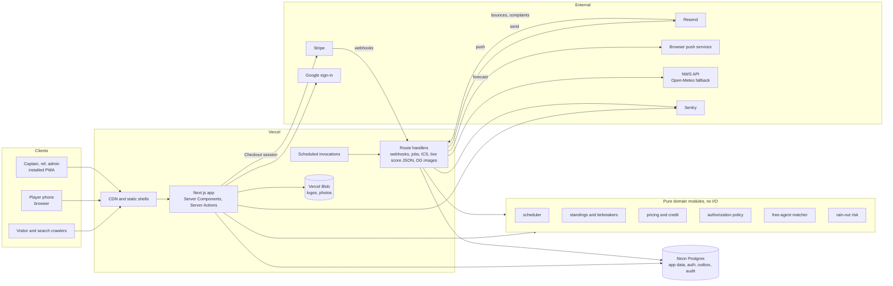

# Architecture

Status: draft v1, 2026-11-11. Library facts marked ✔ were checked against current documentation through Context7 or Vercel's docs on this date. The product runs on free services only ([ADR 0021](adr/0021-free-services-only.md)); the free limits in section 15 were checked against each provider's own pages on 2026-11-13 and should be checked again before launch.

## 1. Stack decisions

| Area | Decision | One-line reason |
|---|---|---|
| Framework | Next.js 16 (App Router), React 19, TypeScript strict | Already chosen; 16.4 is current ✔ |
| Rendering model | Cache Components (`cacheComponents: true`, `'use cache'`, `cacheTag`, `cacheLife`) ✔ | Public pages get a static shell and tagged data that is invalidated the moment a score or schedule changes |
| Request interception | `proxy.ts` ✔ (Next 16 renamed `middleware.ts`) | Coarse "signed in or not" redirects only |
| ORM | **Drizzle** | SQL-shaped and typed, no code generation step, tiny cold start, and it expresses partial unique indexes and check constraints that this model leans on. Prisma is friendlier but heavier and hides the SQL the scheduler and ledger need |
| Database driver | `drizzle-orm/neon-http` for reads and single statements; `drizzle-orm/neon-serverless` (WebSocket pool) where an interactive transaction is needed ✔. A Postgres on `localhost` (local development, end-to-end tests in CI) uses `drizzle-orm/node-postgres` instead ([ADR 0007](adr/0007-end-to-end-tests-on-local-services.md)) | HTTP is fastest for one query; payments and schedule publishing need real transactions |
| Auth | **Better Auth** with its Drizzle adapter, magic-link plugin, Google sign-in and (P2) passkeys ✔. No passwords | Sessions and users live in our own Postgres, it is the actively developed option for Next.js, and it has first-party plugins for what we need |
| TypeScript | `strict`, `noUncheckedIndexedAccess`, `exactOptionalPropertyTypes`, no `any`; branded types for IDs | A `TeamId` cannot be passed where a `GameId` is expected; the compiler catches a class of bugs tests would miss |
| Errors | Domain functions return a typed result (`ok`, or a named failure); only unexpected failures throw | Callers must handle "team is full" or "deadline passed" explicitly, and the UI can show the right message |
| Mutations | Server Actions, each a thin wrapper: validate with Zod, authorize, call a service function. Route handlers only for webhooks, jobs and feeds | Least code for a web-only product; the service layer can sit behind an API later without a rewrite |
| Forms | Native form elements with `useActionState`; no form library outside the admin schedule board | Works before JavaScript loads and keeps bundles small |
| AI | None. No feature calls an AI provider; the weekly recap is drafted from templates | AI providers bill per use, and the product runs on free services only (section 16) |
| UI | Tailwind CSS v4 with tokens in CSS; shadcn/ui components restyled to the design system | Accessible primitives without shipping a component library's runtime |
| Validation | Zod at every boundary: forms, server actions, webhooks, environment variables | One schema per input, shared by client and server |
| Payments | Stripe Checkout (hosted) and webhooks | Card data never touches our servers |
| Email | Resend through its REST API, templates as functions returning HTML and text ✔ | Simple API, good deliverability. Next.js keeps `react-dom/server` out of server components, so templates build escaped strings; React Email can come back for the outbox's richer messages if a template outgrows that |
| Push | The Web Push protocol with the league's own VAPID keys (section 14) | Free on every browser, with no account at a push service |
| Text messages | None | Every text is billed per message; notices go by email and web push |
| Weather | **National Weather Service API** first, Open-Meteo behind the same interface as a fallback | See section 7 |
| Files | Vercel Blob, within the Hobby plan's included storage | Same platform, signed client uploads |
| Jobs | A Postgres outbox drained by scheduled invocations, plus `after()` ✔ for immediate sends | No extra vendor; the message is written in the same transaction as the change that caused it |
| Tests | Vitest, fast-check, Playwright with axe, Lighthouse CI | Unit and property tests for domain logic, real-browser tests for flows and accessibility |
| Lint and format | ESLint (flat config) with `jsx-a11y`, Prettier | Accessibility lint rules matter for the WCAG target |
| Package manager | npm (see [ADR 0001](adr/0001-stack-and-tooling.md)) | No extra setup on CI, Vercel or a reviewer's machine; one app, no workspaces |

### Type assertions

An `as` tells the compiler to stop checking, so the code avoids them and lint enforces the worst cases:

- **Untrusted input** (form fields, query strings, headers, stored JSON) is parsed, never asserted. `parseId` turns a string into a branded ID only if it is a UUID; `isOneOf` narrows a string to a union; Zod validates webhook payloads and the environment.
- **Rows that must exist**, such as an insert's `returning`, go through `required()`, which throws instead of pretending.
- **JSON columns** declare their shape with Drizzle's `$type<T>()`, so reading them needs no cast.
- **Validation narrows types itself**: a parser keeps each checked value in a typed variable (null when invalid) rather than re-reading the raw string with `as` at the end.
- **The few deliberate assertions** live inside small, tested helpers (`parseId`, `recordOf`) with a comment saying why. The scheduler's hot loops read arrays by index with `as number` where the loop bounds prove the index is valid; `noUncheckedIndexedAccess` cannot see that, and those paths run under 100% coverage and property tests.
- **Lint rules:** `no-unnecessary-type-assertion` (type-aware) removes assertions the compiler can already prove, and assertions through `unknown` (`x as unknown as T`) or to `never` are an error everywhere, tests included.

### Flags and changes to the original plan

| Flag | Why it matters | Recommendation |
|---|---|---|
| Vercel Hobby plan | Its terms allow only personal or non-commercial use, and it runs scheduled jobs at most once a day | Stay on Hobby. Whether it may host the live league, which takes payments, is open for launch (section 15, "Hosting and commercial use"). A paid plan is not used |
| Open-Meteo | Its free tier is for non-commercial use | Use the NWS API as primary (US government, free, no key, no commercial restriction) |
| Resend free tier | 100 emails a day and 3,000 a month. One notice to all 180 players of a 12-team league exceeds a day's quota | Stay on the free tier. Push first, email kept for what must go by email, and large sends spread over days (section 15) |
| Sign in with Apple | Requires a paid Apple Developer account | Not planned. Google, email link and passkeys cover sign-in |
| Text messages | Billed per message, with paid carrier registration | Not planned. Notices go by email and free web push |
| AI features | Every AI provider bills per use | Not planned (section 16) |
| Stripe Connect for referees | Monthly per-account and per-payout fees are large next to a $20 game fee | Track what refs are owed in the app; pay by Venmo or cash; revisit Connect only at volume |
| Vercel Cron Jobs | Vercel's docs now describe Cron Jobs as legacy, being migrated to "Schedules" ✔ | Use whichever is current at build time; the handlers are the same route handlers either way |

## 2. System diagram



### Code layout

```
src/
  app/                 routes, layouts, server actions, route handlers
  components/          UI components (design system)
  domain/              pure TypeScript, no imports from app/, db/ or next/*
    scheduler/  standings/  pricing/  authz/  matching/  weather/  fielding/
  db/                  Drizzle schema, migrations, query functions
  services/            I/O adapters: stripe, email, weather, blob, push
  jobs/                job handlers called by route handlers
  emails/              email templates (HTML and plain text)
tests/  e2e/  scripts/seed.ts
```

The rule that makes this testable: `domain/` never imports from anywhere else in `src/`. An ESLint boundary rule enforces it. Everything interesting (the scheduler, tiebreakers, who-can-do-what, price calculation, fielding-rule checks) is a pure function with fast tests.

One Next.js app in one repository. A monorepo would add tooling without adding anything this project needs.

## 3. Rendering strategy by route

With Cache Components, a page's static parts and cached data are prerendered into a shell that is served from the CDN; anything that reads cookies streams in behind a Suspense boundary.

| Route | Strategy | Cache tags | Invalidated when |
|---|---|---|---|
| `/`, `/about`, `/faq`, `/refs`, `/nyc-kickball-league`, `/legal/*` | Fully prerendered; data cached for days | `league` | League settings change |
| `/rules` | Prerendered from MDX in the repository | — | Deploy |
| `/parks/[park]` | Prerendered; cached | `venue:{id}` | Venue edited |
| `/seasons/[season]` | Prerendered; price and spots-left cached for minutes | `season:{id}` | Season edited, registration paid |
| `/seasons/[season]/schedule` | Static HTML, prerendered at build for every public season, refreshed in the background each minute ✔. `?team=` is rewritten to a path segment. The whole page is in the first paint; a view the build didn't list is rendered in full on its first visit (`ensureStatic = "navigation"`, [ADR 0029](adr/0029-season-pages-paint-without-a-loading-state.md)) ✔ | `season:{seasonId}`, `theme-weeks` | A schedule version is published (including a rain-out), a score is reported or answered, the season is edited, a theme week is added, changed or removed |
| `/seasons/[season]/standings` | Static HTML, prerendered at build for every public season, refreshed in the background each minute ✔. Painted in full like the schedule ✔ | `season:{seasonId}` | As the schedule |
| `/seasons/[season]/money` | Static HTML, prerendered at build for every season with a published money summary, refreshed in the background each minute; painted in full like the standings. A season with none is not found ✔ | `season:{seasonId}` | An owner publishes or takes down the season's summary ([ADR 0038](adr/0038-season-money-summary.md)) |
| `/seasons/[season]/bracket` | Static HTML, prerendered at build for every public season, refreshed in the background each minute ✔. `?view=list` is rewritten to a path segment | `season:{seasonId}` | A bracket is published, a playoff score is reported or answered |
| `/teams/[team]` | Static HTML, prerendered at build for every public team (current season), refreshed in the background each minute ✔. `?season=` is rewritten to a path segment. Painted in full like the schedule ✔ | `team:{slug}`, `season:{seasonId}` | As the schedule; roster changes show within a minute |
| `/games/[game]` | Rendered on request behind its loading state. While the game is on, a small client island polls the live JSON every 10 seconds; a finished game's line score is plain server HTML ✔ | — | — |
| `/events`, `/events/[event]` | Static HTML, prerendered at build for every event, refreshed in the background each minute ✔ | `events`, `event:{slug}` | An admin creates, edits, calls off or deletes an event; an RSVP or drop-out (spots left) |
| `/sponsors`, `/sponsors/[sponsor]` | Static HTML from one cached read of every sponsor, its active deals and the latest team of the week; every sponsor page prerendered at build, refreshed in the background each minute ✔ | `sponsors` | A sponsor, deal or team of the week changes, deals are confirmed |
| `/news/*` | Prerendered; cached | `posts` | Admin edits |
| `/records`, `/history` | Static HTML, refreshed in the background each minute ✔ | `season:{seasonId}` for every season they cover | As the schedule |
| `opengraph-image` for games and teams | Generated with `next/og`, cached | Same as the page | Same as the page |
| `/teams/[team]/calendar.ics` | Route handler, cached | `schedule:{seasonId}` | Schedule published |
| `/events/calendar.ics`, `/events/[event]/calendar.ics` | Route handlers; the CDN keeps a copy for five minutes ✔ | — | — |
| `/events/personal/[token]/calendar.ics` | Route handler; never cached (`private, no-store`). The token is the person's id and an HMAC of it and a version with the server's secret, so the link is the key and a reset stops the old one ✔ | — | — |
| `/api/games/[game]/live` | Route handler; `use cache` for 5 seconds (`LIVE_SCORE_LIFE`) and a 5-second CDN copy ✔ | `game:{id}` | A half-inning is entered, corrected or taken back; who kicks first changes; a score is reported or answered |
| `sitemap.xml`, `robots.txt` | `sitemap.ts`, `robots.ts`, cached daily | `league` | — |
| `/app/**` | Dynamic, streamed with Suspense; never cached across users | — | — |
| `/app/admin/**` | Dynamic. The schedule board is a lazily loaded client component | — | — |
| `/app/admin/today` | Dynamic, server-rendered complete with the day's state; a small client island then asks `/app/admin/today/state.json` for fresh state every 10 seconds while the tab is visible (polling, as with live scores in [ADR 0011](adr/0011-live-scores-by-polling.md); no realtime service). Each poll is two reads: the day, then every game on it in one grouped query with its ref, check-in, latest report and halves. The weather comes from the cached forecast (section 7) and is not polled ✔ | — (`private, no-store`: a handful of admins poll it) | — |
| `/app/owner/[season]` | Dynamic (the permission check reads the session); the dashboard's numbers come from one `use cache` read of ten grouped queries in parallel, kept up to five minutes (`OWNER_DASHBOARD_LIFE`, `src/lib/owner-dashboard-cache.ts`). No client script: bars are elements sized in tables and the week chart is server SVG ✔ | `owner-dashboard`, `season:{id}` for every season shown | An expense or a permit cost changes, a summary is published or taken down, the owner presses "Refresh now", or any action that refreshes a season's public pages |

Public pages show the same thing to everyone. "My team" highlighting and the signed-in header are client islands, so a signed-in player still gets the cached page.

**Schedule, standings and team pages** ([ADR 0008](adr/0008-static-public-pages.md)) render everything inside one `use cache` component with the tags above and `PUBLIC_PAGE_LIFE` from `src/lib/public-cache.ts`. `generateStaticParams` lists every public season and team (`src/lib/static-params.ts`), so the build renders those pages as static HTML with the content in the first paint; a build with no database lists one placeholder that renders as not found. A view the build didn't list (a team-filtered schedule, another season's team page) streams in on its first visit behind its loading state, and Next.js stores the finished page for every later visit. A visit more than a minute after the last render still gets the stored page and refreshes it in the background; only a page nobody opened for a day is rendered while the visitor waits. A page that read the query string would render on every request, so `src/proxy.ts` rewrites `?team=` and `?season=` to the optional `[[...team]]` and `[[...season]]` segments, and the address in the browser stays the same.

**Events pages** follow the same pattern with the `events` and `event:{slug}` tags. `/events` has no params to hold a placeholder, so it reads through `readUnlessBuildHasNoDatabase` (`src/lib/build-phase.ts`): a build with no database (the CI build job) still passes, and at request time a failed read throws as usual. Until there is a league, the list is left out of the prerender and read on each visit, so a build that ran before the database was seeded (the end-to-end tests start their servers before they seed) never serves an empty copy. The public schedule also carries the `theme-weeks` tag, so a theme week change shows on its game days at once.

Mutations are Server Actions. An action that changes public data calls `updateTag` so the person who made the change sees it immediately; webhooks and jobs call `revalidateTag`.

An action that changes a season's public data calls `refreshSeasonPages` (`src/lib/public-cache.ts`, [ADR 0018](adr/0018-expire-season-routes-by-path.md)), which expires `season:{id}` and also expires the `/seasons/[season]` and `/teams/[team]` routes by path. The tag alone is not enough for prerendered pages. A page whose tag expired is answered from its route's shell, the prerendered part served while the rest renders, and the build saves cached data in that shell from a full page of the same route. That data carries the season tag, but the shell lists only its path tags, and Next.js checks resumed data only against tags expired in the same request. Without the path expiry, the first visitor after a schedule is published would still see the season's page from the build (#202). `refreshEventPages` does the same for `/events/[event]`, and for `/seasons/[season]` when a theme week changes, since the schedule shows theme weeks. `refreshSponsorPages` expires the `sponsors` tag and `/sponsors` with every sponsor page under it. The cost is that every page of those routes renders again on its next visit, a few queries each.

**Live scores** ([ADR 0011](adr/0011-live-scores-by-polling.md)) use polling, not WebSockets. The scorer saves each half-inning with a Server Action, which expires `game:{id}`. While a game is on (from half an hour before its slot until three hours after it ends, or within two hours of the last half entered) the game page asks `/api/games/[game]/live` for a small JSON document every 10 seconds while the tab is visible, and stops once the game is final. The server keeps that answer for 5 seconds and a CDN may keep it 5 more, so a spectator sees a new half within about 15 seconds and a crowd costs one query per game every few seconds. Server-sent events are the upgrade path if it ever feels slow.

## 4. Authentication and authorization

**Sign-in.** Better Auth mounted at `/api/auth/[...all]` ✔. MVP methods: Google and an email magic link. There are no passwords, so there is nothing to forget, reset or leak. Magic links expire in 15 minutes and are single use. Sessions are rows in Postgres referenced by an HTTP-only, secure, same-site cookie.

**Passkeys (P2).** After signing in once, a player can add a passkey and from then on sign in with Face ID, Touch ID or their device PIN, using Better Auth's passkey plugin (`@better-auth/passkey`) ✔. This is the consumer version of the "simple but safe" sign-in that Okta gives employees. Okta itself is a single sign-on product that companies buy for their staff, so it does not fit a public league. Sign in with Apple can be added in P2 if the league wants it. How it fits together ([ADR 0015](adr/0015-passkeys-and-signed-in-devices.md)):
- The relying party is the site itself (`rpID` and origin from `BETTER_AUTH_URL`), so a passkey made on the league's site works only there.
- The plugin serves the WebAuthn ceremonies at `/api/auth/passkey/*`, because the browser takes part. Adding a passkey needs a sign-in from the last 15 minutes and a writable site (a `hooks.before` guard on top of the plugin's own fresh-session check, `src/lib/auth/passkey-policy.ts`). Listing, renaming and removing go through the account page's Server Actions instead, and their plugin routes are switched off (`disabledPaths`).
- The sign-in page offers "Sign in with a passkey", and the email field offers saved passkeys in its autofill once it is focused. The browser code (`src/lib/auth/passkey-client.ts`) loads with `import()` on that tap or focus, so the sign-in page's first load is unchanged.
- The demo allows passkeys, so visitors can try them; the nightly reset recreates the personas and their passkeys go with them.

**Staying signed in.** Players use their own phone, tablet or laptop, so sessions last 90 days and renew each time the site is used (`expiresIn` of 90 days, `updateAge` of 1 day ✔). Anyone who opens the site once a season is never asked to sign in again on that device. Two safeguards balance that:
- Sensitive actions (refunds, role changes, Stripe settings, account deletion) require a session that was confirmed in the last 15 minutes (`freshAge` ✔); otherwise the person re-confirms with a passkey or a new magic link ✔.
  `isFreshSession` (`src/lib/auth/config.ts`) checks when the session was signed in; renewing a session does not make it fresh. Pages that need it show one prompt, `ConfirmItsYou` (`src/components/confirm-its-you.tsx`): "Confirm with a passkey" when the person has one, which signs in again on the spot, and "Email me a sign-in link", which returns to the same page. Account deletion, adding or removing a passkey, and the operator console use it. Either way is a new sign-in, and a browser that signs in again to the account it already holds ends its old session (`src/lib/auth/replace-session.ts`), so confirming never leaves a duplicate device behind. Account deletion is turned off in demo mode, so a visitor cannot delete a shared persona.
- File downloads (roster and payment CSVs, a person's own data as JSON) are Route Handlers that check the same permissions as pages, answer `Cache-Control: private, no-store`, and write an audit row for each CSV, since those files carry contact details.
- The account page (`/app/profile/security`) lists signed-in devices ✔: one row per live session, named from its browser's User-Agent ("iPhone · Safari", `src/domain/auth/device-name.ts`), with when it signed in and was last used, and "This device" on the current one. The player can sign out any other device or all of them; the page deletes those sessions by id, scoped to the player, and never handles a session token. In the demo, whose personas every visitor shares, only the current device is listed and signing others out is off.

**Roles.** Two layers, as described in [product-spec.md](product-spec.md):
- A global role on the profile: player, admin or owner.
- Scoped memberships: captain or co-captain of a team-season, referee for a season, member of a sponsor.

**The platform operator** sits above both, and is not a database role ([ADR 0009](adr/0009-platform-operator.md)). `OPERATOR_USER_IDS` in the server's environment names the operator's accounts. The console at `/operator` returns 404 to everyone else and needs a sign-in from the last 15 minutes to change anything. From it the operator sets owners and admins, sets the site status (active, read-only or paused), switches features off, and downloads the league export. Enforcement is on the server: `requirePermission` and `requireSelf` stop every Server Action but the operator's while the site is read-only or paused; scheduled jobs skip their run; and the proxy shows public pages the `/paused` notice while paused. Owners see every operator action in the audit log and can download the same export.

**Checks.** One pure function, `can(actor, action, resource)`, in `domain/authz`. Rules:
1. Every Server Action and every query function that returns non-public data calls it. There is no other way to reach the data layer.
2. `proxy.ts` only redirects signed-out users away from `/app`, and shows public pages the paused notice while the operator has the site paused. It is never the only check.
3. The permissions matrix in the product spec is encoded as a table-driven test: every row and column is asserted.

Postgres row-level security is not used. The app connects as one database role through a pooled HTTP driver, and a single tested policy function is easier to reason about than policy split across two layers.

## 5. Background jobs

### The outbox

Anything that should happen after a change (an email or a push) is a row in `message`, inserted in the same transaction as the change. This guarantees a notice is never sent for a change that rolled back, and never lost for one that committed.

1. The action commits its change and its `message` rows.
2. `after()` drains those rows immediately, so the usual delay is under a second.
3. A scheduled job sweeps every minute for rows that are queued and due, which covers retries, delayed sends (`send_after`) and anything `after()` missed.
4. The worker claims rows with `select … for update skip locked`, applies the person's choices and alert limits (quiet hours, the daily cap and the digest; see "Urgent and non-urgent messages" below), keeps email inside the provider's free quota ("The email budget" below, and section 15), sends, and records the provider's ID.
5. Failures retry with backoff up to five attempts, then stay `failed` and appear on the admin health card.

How a message is never sent twice (`src/db/queries/outbox.ts`, tested in `outbox.db.test.ts`):

- **Writing twice is a no-op.** Every row has a `dedupe_key` that names the notice (for example `payment-reminder/<registration>/7d`); a second insert with the same key is skipped.
- **Claiming is one statement.** `update … where id in (select … for update skip locked)` moves due rows to `sending` with a five-minute claim and bumps `attempts`, so two workers running at once never claim the same row.
- **Only the claim holder records the outcome.** The update that marks a row `sent` or schedules a retry matches on `status = 'sending'` and the `attempts` it claimed with.
- **A stopped worker's rows are retried with the same key.** When a claim lapses, the next sweep claims the row again and sends it with the same `Idempotency-Key: message/<id>`, and the provider delivers it once.
- Retries wait 1, 4, 16 and 64 minutes. A message that cannot be built (unknown template, payload that fails its schema) fails at once.
- Without an email provider, development prints each email to the console; production leaves messages queued until one is configured.

**Push copies** (`enqueueMessages` and `drainOutbox` in `src/db/queries/outbox.ts`, tested in `push.db.test.ts`). A message about a push topic (rain-outs, sub requests, scores) also gets a second row with channel `push` and dedupe key `push:<key>` for each person who has a subscribed device and push on for that topic, found in one query for the whole batch. Each copy retries and settles on its own, so a push service that is down never holds up the email.

- **Choices at send time.** Push is opt-in: off for every topic until the person turns it on. The drain reads the push choice again when it sends, so turning a topic off stops pushes already queued (`suppressed`, `opted_out`).
- **One push to every device.** The copy is sent to each of the person's devices. It is `sent` when any device accepted it, `suppressed` (`no_device`) when none is left, and retried with the usual backoff when every device failed for another reason. A retry goes to every device again, so the push carries the message id as its `Topic` header (the push service replaces an undelivered copy) and as the notification's tag (the phone replaces a shown one).
- **Expired subscriptions are removed.** A push service answering 404 or 410 has dropped that subscription; the outbox deletes the device on the spot. A device whose stored keys cannot be used is dropped the same way.
- **Off without keys.** Without `VAPID_PUBLIC_KEY` and `VAPID_PRIVATE_KEY`, push copies are suppressed (`push_off`) and the profile page offers no push. Without an email provider but with push, the drain sends push and leaves email queued.
- Urgent messages go with `Urgency: high`; everything is kept by the push service for up to a day (`TTL`) while a phone is offline.

**Score confirmations** (`src/db/queries/score-confirmations.ts`). When a captain or ref reports a score that still needs an answer, the captains and co-captains who can confirm or dispute it get a `score_confirmation` message (topic `score`) in the same transaction: the other team's for a captain's report, both teams' for a ref's, nobody for an admin's, which is final at once. The dedupe key is `score-confirm/<report>/<person>`, so a retried submit asks once.

**Rain-out notices** (`src/db/queries/rainout-notices.ts`, tested in `rainout-notices.db.test.ts`). The rain-out screen cancels the date's slots and saves the makeups as a draft; nothing is sent yet. When an admin publishes that draft, `publishVersion` queues the notices in its own transaction, so the new schedule and its emails commit together. A game counts as rained out when the slot it moved from is cancelled. Each active player on both teams of such a game gets one message with that game, where it was and its makeup time (or "no makeup yet"). Games that did not move, or moved for another reason, send nothing. The dedupe key is `rainout/<game>/<rained-out slot>/<person>`, so publishing again, a second draft of the same rain-out, or a retried request never sends twice, while the same game rained out again from a different slot is a new notice. The `rainout` topic is on the email settings page, and the publish action calls `after()` to send right away.

**Suspension notices** (`suspendPlayer` in `src/db/queries/discipline.ts`, tested in `discipline.db.test.ts`). When an admin suspends a player from an incident report, the suspension, its audit row and one `suspension` message (topic `discipline`) commit together. The email gives the length, what it blocks and how to appeal (reply, or the league's contact address when one is set), and never who reported it. The dedupe key is `suspension/<id>`. The `discipline` topic is not offered on the email settings page, so a player can't switch off being told they are suspended; the action calls `after()` to send right away. Games served are counted when read, not stored ([ADR 0026](adr/0026-discipline-counted-not-stored.md)).

### Urgent and non-urgent messages

Every kind of message the outbox sends is urgent or non-urgent ([ADR 0019](adr/0019-urgent-and-non-urgent-messages.md)). The table lives in one place in code, `MESSAGE_KINDS` in `src/domain/notifications/kinds.ts`; the email templates and `enqueueMessages` are typed by it, so a new kind does not compile until it is classified, and `kinds.test.ts` checks this table matches it.

| Kind (template) | Urgency | What it is |
|---|---|---|
| `announcement` | non-urgent | Announcements from admins and captains |
| `away_short` | non-urgent | For captains: a week your team may be short because players will be away |
| `books_reminder` | non-urgent | For owners: a permit application window, renewal or insurance expiry coming up |
| `captain_handoff` | urgent | Your team's captaincy offered to you, waiting for your answer |
| `email_budget` | urgent | For admins: urgent email waiting for tomorrow's email allowance |
| `event_news` | non-urgent | Event announcements, and changes or cancellations more than a day ahead |
| `event_notice` | urgent | An event spot that opened for you, or an event cancelled or moved within a day of its start |
| `event_ticket` | urgent | Your event ticket's receipt or refund, or an event spot held for you to buy by a deadline |
| `giveaway_win` | non-urgent | A giveaway you won at a league event |
| `guarantee_failed` | urgent | A captain's card guarantee that could not be charged |
| `guarantee_warning` | urgent | A warning before a captain's card guarantee is charged |
| `instagram_reconnect` | non-urgent | For admins: the Instagram connection needs reconnecting |
| `instagram_storage_full` | non-urgent | For admins: Instagram photo storage is full |
| `merch_receipt` | urgent | Your receipt for an order from the league shop |
| `merch_update` | non-urgent | Your league shop order is ready, or was refunded |
| `new_team` | non-urgent | Answers to new-team requests |
| `payment_reminder` | urgent | Payment deadline reminders |
| `photo_review` | non-urgent | Whether the league used a photo you uploaded |
| `rain_alert` | urgent | Rain alerts for admins the day before games |
| `rainout_notice` | urgent | Rain-outs and makeup times |
| `rebate_credit` | non-urgent | League credit for rained-out games |
| `referral_credit` | non-urgent | League credit for a friend you referred |
| `score_confirmation` | urgent | Scores waiting for your confirmation |
| `score_reminder` | non-urgent | Reminders about games with no score yet |
| `sub_request` | urgent | Teams that need a sub when you're free |
| `sub_update` | urgent | Answers to your sub offers |
| `suspension` | urgent | A suspension, its games and how to appeal |
| `team_role` | non-urgent | Becoming or no longer being a co-captain, and the answer to a captaincy you offered |
| `waitlist_offer` | urgent | A team spot held for you from the waitlist |

The `digest` template carries held messages and is neither: it is never capped but waits out quiet hours. Event notices pick their kind when they are queued (`eventNoticeKind`): a spot that opened for the person, or a cancellation or a change to the time or place within 24 hours of the start (the earlier of the old and new start), is `event_notice`; announcements, other edits and anything further ahead are `event_news`. Both render with the same email.

**The rules** (`decide` in `src/domain/notifications/limits.ts`, unit and property tested) run in the drain, after consent, for each message and channel, in the league's time zone:

- **Urgent** goes at once, always. In the person's quiet hours a push carries `silent: true`, and the service worker shows it without sound or vibration where the platform allows.
- **Non-urgent in quiet hours** goes back to `queued` with `send_after` at the moment quiet hours end, so the next drain after that sends it.
- **Non-urgent outside quiet hours** is sent while the person has had fewer than their daily cap of non-urgent messages on that channel since local midnight (counted from `sent` rows in one query per batch, `message_sent_today_idx`). Over the cap it becomes `held`, with `send_after` at their next digest: 6 pm that day or the next, or the next Sunday at 6 pm for a weekly digest.
- Waiting and holding give back the claim's attempt, since nothing was tried, so neither uses up retries.
- Defaults: a cap of 3, a daily digest, quiet from 10 pm to 8 am. A member can lower the cap (0 means everything that can wait comes in the digest), choose a weekly digest, move quiet hours or turn them off, on the profile page ("How often we message you", `saveAlertLimitsAction`, `requireSelfToChange`). Saving moves messages already held to the next digest under the new choice.
- Local times survive daylight-saving changes: quiet hours end at the first moment the clock reads the end hour (the first reading when an hour repeats, the jump when it is skipped), and the cap's day starts at the first moment of the local date. Property tests run these across zones with 30-minute, one-hour and two-hour changes and changes at midnight.

**The digest job** (`/api/jobs/digests`, `buildDigests` in `src/db/queries/digests.ts`, tested in `digests.db.test.ts`) takes held messages whose `send_after` has passed (`for update skip locked`, inside a transaction) and queues one `digest` email per person listing them, each with its heading, first paragraph and a link to its page. The held rows become `digested` with `digest_id` pointing at the digest, in the same transaction, so a second run finds nothing. A notice held on both email and push is listed once; a held push whose email copy already went out on its own is `suppressed` (`sent_by_email`); a topic turned off since is `suppressed` (`opted_out`). It then drains the outbox, so the digests go out in the same run.

**The email budget** ([ADR 0019](adr/0019-urgent-and-non-urgent-messages.md); `src/domain/notifications/email-budget.ts`, property tested, and `drainOutbox`, tested in `email-budget.db.test.ts`). The email provider's free plan sends 100 emails a UTC day and 3,000 a month and refuses the rest without queuing them (section 15), and a rain-out to the whole league is more than a day's quota. The outbox never goes past it:

- **The limits** come from `EMAIL_DAILY_LIMIT` (default 100), `EMAIL_MONTHLY_LIMIT` (default 3,000) and `EMAIL_RESERVE` (default 10), read straight from the environment. The drain counts the emails it sent since midnight UTC and since the first of the month (UTC; the free plan does not say when its month starts, so the calendar month is the cautious reading), and ordinary messages stop `EMAIL_RESERVE` short of either limit. The reserve is for sign-in links, which are sent outside the outbox and not counted, and for the admins' notice below.
- **Push first.** Each drain sends due pushes before any email: push is free, and a phone that has the news frees an email for someone without push.
- **Then email, in order:** urgent messages for people whose push copy did not go out, then urgent messages for people whose phone already has it, then news that can wait and the digest. The claim orders due rows the same way (`byPriority`), so a large backlog spends the quota where it is needed.
- **When the quota cannot cover an email:** an urgent message whose push copy was sent is `suppressed` (`sent_by_push`): the person has it. Any other urgent message, and the digest, goes back to `queued` with `send_after` at the next midnight UTC, without using a retry. Non-urgent news is `held` for the person's digest. Nothing urgent is dropped.
- **The provider's word wins.** A `429` with `daily_quota_exceeded` or `monthly_quota_exceeded` (another sender on the account, or sign-in links) is treated the same way, without using a retry, and stops the drain from trying more email.
- **Admins are told.** When urgent email had to wait, every admin and owner gets an `email_budget` message, once per UTC day (`email-budget/<date>/<admin>`), saying how many are waiting, when the quota resets in the league's time, and that "Copy for WhatsApp" reaches everyone sooner. It is urgent and may use the reserve.

**Every message says why.** Each email's footer finishes "You got this email because …" and links to the setting that changes it: the email settings, or for the digest the daily limit, digest and quiet hours. A push carries the same reason as a "Because …" line under its text and a "Change alerts" button that opens the push settings.

### Scheduled jobs

Times are Eastern. Schedules are written in UTC, so jobs that care about local time run at both candidate UTC hours and exit early when the local hour does not match; that survives daylight-saving changes.

| Job | When | Does |
|---|---|---|
| Outbox sweep | Every minute | Sends due messages, retries failures, sends messages that waited out quiet hours or for the next day's email quota |
| Digests ✔ | Daily, 18:00 or later (`/api/jobs/digests`) | Gathers each person's held non-urgent messages whose digest is due into one email, then drains the outbox |
| Rain alerts ✔ | Daily 18:00 (`/api/jobs/rain-alerts`) | Checks the forecast for each game day whose first game starts in the next 30 hours and alerts every admin on "watch" or "likely", once per level per game day |
| Game reminders | Two days before game day, 18:00 | Reminds players of their next game and asks for an RSVP |
| RSVP nudge | The day before game day, 12:00 | Nudges players who have not answered; tells captains where they stand |
| Missing scores | Game days, every 30 minutes from the first slot until midnight | Reminds the ref 30 minutes after a slot ends, both captains (and co-captains) after 2 hours, once each. Games that ended more than two days ago stay on the admin scores list but are not emailed about |
| Score auto-confirm | Hourly | Finalizes reported scores that have gone 24 hours without a dispute |
| Payment reminders | Daily 10:00 | Reminds unpaid players at 7, 3 and 1 days before the deadline. A missed day still sends the closest milestone; each is queued once per registration and deadline |
| Guarantee charges ✔ | Daily (`/api/jobs/guarantee-charges`) | Warns each captain with a saved card about 72 hours before the payment deadline, once per deadline, then charges the card off-session for the team's unpaid balance, never sooner than 72 hours after the warning. The database half (warnings and the `balance` purchase) commits first; each Stripe call uses the purchase as its idempotency key, and a charge Stripe could not take is sent again on the next run. A decline fails the purchase and emails the captain; the card is not retried |
| Permit and insurance reminders ✔ | Daily (`/api/jobs/books-reminders`) | Emails every owner 30 and 7 days before a permit application window opens, a permit renews or the newest insurance certificate expires. A missed day still sends the closest reminder; each is queued once per deadline, milestone and owner ([ADR 0034](adr/0034-owners-books-and-permits-in-postgres.md)) |
| Waitlist offers ✔ | Daily (`/api/jobs/waitlist-offers`) | Marks offers whose 48 hours ran out as expired and offers each free team spot to the next captain in line. Offers stop holding their spot the moment they run out, whether or not this has run. Raising a season's team limit, or an admin's "Offer now", sends offers at once |
| Sponsor stats rollup (P2) | Daily 3:00 | Aggregates impressions and clicks into `sponsor_stat_daily` |
| Instagram sync (P2) ✔ | Every 3 hours (`/api/jobs/instagram-sync`; daily on Hobby) | Fetches the 25 newest posts from the connected account, copies new photos and removes posts deleted on Instagram |
| Instagram token refresh (P2) ✔ | Weekly, Mondays (`/api/jobs/instagram-token`) | Extends the access token; if Instagram refuses it, emails every admin once to reconnect |
| Demo reset | Daily 4:00, demo deployment only | Restores seed data |

Sub requests need no expiry job: a request closes when its game starts (`sub_request.closes_at`), and every query compares that with the current time ([ADR 0006](adr/0006-sub-claims-hold-spots.md)).

Every job is a route handler under `/api/jobs/*` that checks an `Authorization: Bearer ${CRON_SECRET}` header ✔, is safe to run twice, and logs a heartbeat.

On Vercel's Hobby plan `vercel.json` schedules each job once a day, because Hobby refuses to deploy anything more frequent. Each job works out what is due from the data whenever it runs, so running a job more often never needs code changes. The outbox relies on `after()` for immediate sends and the daily sweep for retries. The sweep runs at 13:30 UTC (9:30 am in New York in summer, 8:30 am in winter), after default quiet hours end, so messages that waited overnight go out that morning; the digest job runs at 23:00 UTC, after 6 pm in New York all year. If a job needs the frequency above, a free way is a scheduled GitHub Actions workflow that calls the same route with the `CRON_SECRET`, which costs nothing in a public repository; a paid hosting plan is not used ([ADR 0021](adr/0021-free-services-only.md)).

If orchestration grows beyond this (multi-step flows with waits), Vercel's Workflow and Queues products exist ✔ and Inngest is a common alternative. Nothing in the MVP or P2 needs them.

## 6. Webhooks

| Source | Events | Handling |
|---|---|---|
| Stripe | `checkout.session.completed` (payment and setup mode) ✔, `checkout.session.async_payment_succeeded` ✔, `checkout.session.async_payment_failed` ✔, `checkout.session.expired` ✔, `payment_intent.succeeded` ✔, `payment_intent.payment_failed` ✔, `charge.refunded` ✔, `charge.dispute.created` | Marks purchases paid or failed, activates registrations and roster spots, confirms split teams whose fee is covered, credits referrers, saves the captain's guarantee card, settles or fails the guarantee's deadline charge, issues event tickets and frees the spots of expired ticket checkouts, places merch orders and frees the stock of expired merch checkouts, gives back credit from expired checkouts, records refunds (a fully refunded ticket ends and its spot goes to the waitlist; a fully refunded merch order ends and its stock is free again), alerts admins on disputes |
| Resend | Bounced, complained | Suppresses that address for non-essential mail and flags the profile |

Rules for every webhook:
1. Verify the provider's signature against the raw request body before parsing.
2. Insert into `webhook_event` with a unique `(provider, event_id)`. A duplicate returns 200 at once.
3. Do the work in a transaction, mark the row processed, and return 200. On an error return 500 so the provider retries.
4. The browser returning from Checkout never marks anything paid. Only the webhook does. The return page shows "confirming your payment" and polls for a few seconds.

A Checkout session in setup mode saves the captain guarantee's card. Its event names only the SetupIntent, so the route looks up the SetupIntent and the card before the transaction (a failed lookup returns 500 and Stripe sends the event again), and the handler stores Stripe's ids with the brand and last four digits. The guarantee's deadline charge is a PaymentIntent the app creates itself; it is settled only by `payment_intent.succeeded` for a purchase that holds that intent (or that the intent's metadata names and that has none yet), so Checkout's own PaymentIntents pass through untouched ([ADR 0022](adr/0022-captain-guarantee-and-league-credit.md)).

Event tickets use the same Checkout and webhook ([ADR 0027](adr/0027-event-tickets-hold-their-spot.md)). Buying locks the event row, as an RSVP does; the spot is held for the checkout (`event_ticket.held_until`, an hour past Checkout's 31-minute `expires_at`) and counts against the capacity until it is paid, expires or runs out. The webhook takes that event's lock before it changes the purchase, in the same order as a buyer. `checkout.session.completed` makes the ticket paid and its holder going, with a receipt through the outbox; `checkout.session.expired` releases the spot and the credit, and offers the spot to the next person on the waitlist for a day. A ticket's purchase has no season. The Stripe fee comes out of each ticket; no paid Stripe product (Tax, Billing) is used.

Merch orders use the same Checkout and webhook ([ADR 0037](adr/0037-merch-orders-hold-stock-at-checkout.md)). Ordering locks the item row; the order holds its quantity of the size (`merch_order.held_until`, an hour past Checkout's 31-minute `expires_at`), and what is left is the size's stock less paid, fulfilled and live held orders, so nothing is decremented or put back. An item made to order has no limit. The webhook takes the item's lock before it changes the purchase. `checkout.session.completed` makes the order paid, with a receipt through the outbox; `checkout.session.expired` releases the stock and the credit. A merch order's purchase has no season and takes no promo code; league credit applies as at registration. The Stripe fee comes out of each order; no Stripe Tax, Billing or product catalog is used, and no print-on-demand service: admins download a CSV of the orders to make for the league's own printer.

Refunds follow the same rule ([ADR 0010](adr/0010-promo-codes-applied-in-app.md)). An admin's refund reserves its amount in a `refund` row under a lock on the payment, then calls Stripe with that row's id as the idempotency key; if Stripe refuses, the row is removed. Only `charge.refunded` moves the payment's refunded total, to Stripe's running total and never lower, so a replay or a late event changes nothing and refunds made in Stripe's dashboard count too. The purchase then becomes `partially_refunded` or `refunded`. A ticket refund is always the whole ticket: the ticket ends once Stripe accepts the refund (or when `charge.refunded` reports the whole charge back, for a refund made in the dashboard), the credit spent on it returns as a `released` ledger row, and the spot is offered to the waitlist. A ticket paid only with credit ends at once. A merch order refunds the same way: always the whole order, its stock counts as free again once Stripe accepts (or `charge.refunded` reports the whole charge back), and the credit spent on it returns.

## 7. Weather

| | National Weather Service API | Open-Meteo |
|---|---|---|
| Cost and terms | Free, public domain, commercial use fine | Free tier is non-commercial; paid plans for commercial use |
| Key | None; requires a descriptive `User-Agent` | None |
| Data | Hourly precipitation probability and amount, wind, thunder, plus official alerts | Hourly precipitation probability and amount, many models, up to 16 days |
| Coverage | United States only | Global |
| Weak spot | Occasional errors and slow responses; two-step lookup (point, then grid) | Not an official source; licensing |

**Decision: NWS primary, Open-Meteo fallback.** NWS is free for a commercial league and is the source local news quotes; the fallback covers its outages. Built so far ✔ ([ADR 0005](adr/0005-weather-forecast-source.md)): NWS only, with responses held in the data cache rather than `weather_snapshot` rows, so pages still never call the API directly.

How it is built:

- **Client** (`src/services/weather.ts`): the point lookup, then the grid square's hourly forecast, with a `User-Agent` naming the site, a four-second timeout and schema checks. Failures are values.
- **Cache** (`src/lib/weather.ts`): `'use cache'` functions, the grid square for weeks and the hourly forecast with the `hours` profile. A failure is thrown inside the cached function so it is not stored, and comes out as "no forecast".
- **Game page chip** (`src/components/forecast-chip.tsx`): on scheduled games with a pinned park, the temperature at kickoff and the highest chance of rain during the game, streamed in its own Suspense boundary so the rest of the page never waits. Nothing shows when the forecast does not reach the game.
- **Rain alerts** (`src/db/queries/rain-alerts.ts`, `/api/jobs/rain-alerts`): game days come from each season's published schedule. The forecast is read before the transaction, then one message per admin is queued with the dedupe key `rain-alert/<season>/<date>/<level>/<admin>`, so a watch can be followed by a likely alert but neither repeats, and a watch after a likely alert is skipped. The email links to `/app/admin/seasons/<season>/rainout?date=<date>`, which opens with that day's preview. The topic is `rainout`. Tested in `rain-alerts.db.test.ts` against a fixture; no test reaches the network.

**Risk rule** (a pure function in `domain/weather`, evaluated over the hours when games are scheduled):

| Level | Condition |
|---|---|
| Likely | Any game hour with precipitation probability ≥ 70%, or thunderstorms forecast, or an active severe-weather alert |
| Watch | Any game hour with probability 40–69%, or at least half an inch of rain in the 12 hours before first pitch (wet fields) |
| Low | Otherwise |

Thresholds are season settings. The rule only recommends; an admin decides. Built so far ✔: the probability and thunderstorm parts, with the thresholds as constants in `src/domain/weather/forecast.ts`. The wet-field rule, severe-weather alerts and per-season thresholds come later.

**Check-in at the bar** ([ADR 0016](adr/0016-rotating-check-in-code.md)). The sponsor's screen at `/app/sponsor/[sponsor]/code` draws a QR code on the server for `/app/check-in/[sponsor]/[code]`, where the code is an HMAC of the current 5-minute window under the sponsor's secret. A small client island fetches the page again after each turnover and asks the device to keep the screen on. The player's tap runs a Server Action that checks the code again (this window or the one before) and inserts the day's check-in, ignoring a repeat; using a deal checks that it is the sponsor's, turned on and good at that local time, once per visit. Neither touches the cached public pages.

**Event giveaways** ([ADR 0035](adr/0035-free-giveaways-and-the-sign-up-challenge.md)). The admin's screen at `/app/admin/events/[event]/giveaway/code` draws the same rotating QR code under the giveaway's own secret, for `/app/events/[event]/giveaway/enter/[code]`. The player's tap runs a Server Action that checks the code again, then the domain's entry rule (`mayEnter`: the event's audience, not called off, not ticketed, inside the entry window, not entered yet), then inserts the entry under a share lock on the giveaway, ignoring a repeat. The draw is a Server Action too: it locks the giveaway, reads every entry in entry order, picks winners with `crypto.randomInt`, writes them, the audit row and one `giveaway_win` message per winner in one transaction, and asks the outbox to send soon. Nothing in it reads a payment.

**The sign-up challenge** reads every team's active roster spots, with when each player joined and signed the season's waiver, in one query per season (`seasonSignups`), and the domain ranks them (`rankTeams`). The team page, the leaderboard at `/app/seasons/[season]/challenge`, the admin's challenge page and the admin dashboard all use it; only the confirmed winner is stored. All of these are signed-in pages, read at request time.

## 8. Caching summary

| Layer | What | Lifetime |
|---|---|---|
| CDN | Prerendered shells, images, fonts, OG images, ICS feeds | Until the tag is invalidated |
| Data cache | Query functions marked `'use cache'` with tags | Minutes to days by `cacheLife`, and on demand by tag |
| Forecasts ✔ | NWS grid square and hourly forecast, `'use cache'` | Grid square for weeks; forecast refreshed in the background after an hour |
| Standings | Computed from games inside a cached function | Invalidated when any game in the season is finalized |
| Owner dashboard ✔ | The dashboard's numbers, `use cache` tagged `owner-dashboard` and each season's tag | At most five minutes; expired at once by the books' actions, publishing a summary and "Refresh now" |
| Photos ✔ | Instagram copies and members' approved photos read inside the public pages' `'use cache'`, tagged `photos` and `member-photos`; the images through the image optimizer | Expired at once by the actions that change them (with the routes' paths); five minutes for an image's address once it is taken down |
| Live score JSON ✔ | `use cache` tagged `game:{id}`, then the CDN | 5 seconds on the server, expired at once by every save; 5 more at the CDN |
| Browser | Service worker: the app shell (offline page, manifest, icons and the versioned files they load) and one public page, the signed-in person's next game (section 14) | Refreshed on each visit to the signed-in home screen and whenever the saved game is opened online |

No Redis in the MVP. Rate limits that need a counter use a small Postgres table.

## 9. Files and images

- **Storage.** Vercel Blob. Uploads go straight from the browser with a short-lived token issued by a Server Action that has already checked permission and file type.
- **Accepted.** PNG, JPEG and WebP up to 2 MB. SVG is accepted only from admins and is sanitized, because an SVG can carry script.
- **Records.** Each upload is an `asset` row with dimensions and size; tables reference assets by ID.
- **Delivery.** `next/image` with explicit width and height so nothing shifts on load.
- **Sizes and placeholders.** See the logo specification in [design-system.md](design-system.md).
- **Synced Instagram photos** are the exception: they are stored in Postgres (`social_image`) and served from `/media/instagram/[image]`, because they arrive from a job rather than a browser upload and the project has no Blob store yet ([ADR 0023](adr/0023-instagram-photos-stored-in-postgres.md), section 17).
- **Receipts, permit documents and the insurance certificate** are also stored in Postgres (`books_file`), for the same reason ([ADR 0034](adr/0034-owners-books-and-permits-in-postgres.md)). A photo is resized on the server with sharp to at most 1,600 pixels on its longer side and stored once as WebP without its metadata; the owners' page shrinks a camera photo in the browser first, so it uploads quickly on a weak signal (Server Actions accept up to 4 MB, `next.config.ts`). A PDF is kept as uploaded if it is 1 MB or less, recognized by its first bytes. Each file is at most 1 MB, and a league's files at most 50 MB together. They are served only from `/app/books/files/[file]` (owners and the operator) and `/app/games/[game]/permit/document` (that game's ref and captains), with `Cache-Control: private, no-store`, `nosniff` and `default-src 'none'`; there is no public address and no CDN copy.
- **Merch photos** are stored in Postgres the same way (`merch_image`, one WebP at most 1000 px wide, metadata dropped), uploaded by admins through a Server Action (JPEG, PNG or WebP up to 3 MB; Server Actions accept up to 4 MB), at most 4 per item and 10 MB in all, and served from `/media/merch/[image]` only while the item is in the shop ([ADR 0037](adr/0037-merch-orders-hold-stock-at-checkout.md)). Admin screens read them from `/app/admin/merch/photos/[image]`, which also serves a hidden item's photos.
- **Friend league logos** follow the Instagram exception: an admin's upload (PNG, JPEG or WebP up to 800 KB) is shrunk on the server to one WebP that fits in 192 × 192, stored in Postgres (`friend_logo`, at most 100 KB each and 5 MB in all) and served from `/media/friends/[logo]`. SVG is not accepted. A new upload gets a new address, so a copy can be cached for a day.
- **Member photos** are stored in Postgres too (`member_photo`), one shrunk JPEG each, for the same reasons and under hard limits; videos are not accepted ([ADR 0039](adr/0039-member-photos-in-postgres.md), section 18).
- **Waiver documents** are stored privately and served only through an authorized route.

## 10. Environments

| Environment | Hosting | Database | Payments and messages |
|---|---|---|---|
| Local | `next dev` | A personal Neon branch, or a Postgres in Docker | Stripe test mode with the Stripe CLI forwarding webhooks; emails rendered to the console |
| Preview (every pull request) | Vercel preview deployment | A Neon branch created for the preview through Neon's API ([ADR 0003](adr/0003-free-hosting-and-secrets.md)), migrated and seeded | Stripe test mode; email to a sandbox inbox; scheduled jobs off |
| Demo | A second Vercel project from the same repository, `DEMO_MODE=true` ([ADR 0004](adr/0004-demo-mode.md)) | Its own Neon database, reseeded nightly | Stripe test mode with test cards; no real email; a banner and one-tap "view as" role switching |
| Production | A free hosting plan (section 15, "Hosting and commercial use"), the league's own domain | The production branch on Neon's free plan, with its restore window | Stripe live; Resend's free tier; web push |

- **Until launch, automatic deployments are off** (`git.deploymentEnabled: false` in `vercel.json`): features are built and checked locally and in CI first, and pushes to pull requests or `main` don't build on Vercel. The live address keeps the last build made before that. Turning them back on, with previews for pull requests and `main` to production, is a launch milestone ([roadmap.md](roadmap.md), section 6).
- Environment variables are validated with a Zod schema at build and at boot; a missing variable fails the build.
- Migrations are generated with `drizzle-kit generate`, reviewed in the pull request, and applied by `drizzle-kit migrate` in the deploy step before the new code serves traffic. Migrations must be backward compatible with the previous deploy.
- The demo exists so recruiters and the league owners can click everything without touching real players' data.

## 11. Continuous integration

Every pull request runs these checks, and all must pass to merge:

1. Type check, lint, format check.
2. Unit and property tests (Vitest, fast-check) with coverage thresholds.
3. Migration check: the schema and the migration files agree.
4. Build: once with no database to read, which proves the fallback in `src/lib/static-params.ts`, and once for each of the end-to-end and Lighthouse checks, shared by that check's shards. After the first build, `npm run check:route-js` holds every route's first-load JavaScript, signed-in screens included, to its budget in [design-system.md](design-system.md#performance-budgets).
5. End-to-end tests (Playwright) against a production build made from the seeded league, as production builds against the real database, and a freshly seeded Postgres 18 service container, under a 10-minute job limit ([ADR 0007](adr/0007-end-to-end-tests-on-local-services.md)). Smoke tests cover the public pages at a phone size and a desktop size with demo mode off. The flows run on a second server in demo mode and sign in with one-tap "view as"; every screen under `/app` and `/operator` but Instagram's sign-in return is exercised by at least one of them ([End-to-end coverage](#end-to-end-coverage)). One test walks a whole season across features, so a change that breaks the hand-off between two screens fails even when each screen's own flow still passes. Stripe calls go to stripe-mock, and the tests sign Stripe's webhook events with the flows server's test secret (a forged one is refused). axe checks every key screen against WCAG 2.2 AA and fails on any violation. The flows server treats the demo admin as the platform operator, so the operator console can be reached; its site-wide switches run on their own after the rest (`npm run test:e2e:site-wide`), because read-only and paused change the site for every test at once.
6. Lighthouse CI on a production build made from, and run against, the seeded database: every public page (`lighthouserc.json`), with the budgets in [design-system.md](design-system.md#performance-budgets). `scripts/lighthouse-server.mjs` starts the server and warms every page, the routes they link to and their static files before the first measurement. Each metric's median of five runs on a pinned phone profile is held to its budget ([ADR 0028](adr/0028-steady-lighthouse-measurement.md)).

### End-to-end coverage

Every signed-in screen and download, and the flow in `e2e/` that reaches it, by `goto` or by clicking through. `screens.spec.ts` loads a screen as its persona at a phone and a desktop width in both themes, with axe and a check that nothing scrolls sideways; the other specs walk a flow through it. Paths are under `e2e/flows/` unless they start with `site-wide/`. A new screen gets a row here and a spec in the same pull request.

**The whole season** (`season-journey.spec.ts`): an admin creates a season, adds a venue, a field, permits and game slots, and opens registration with a waiver. A captain registers a team with split pay, signs and pays through the signed test webhook, and makes an invite link; a player joins by it and pays their share. A free agent registers and the admin builds a second team around them. The admin publishes the schedule and a signed-out visitor sees it. A player left in the pool picks up a sub spot that the captain approves. The game already played gets a score from one captain that the other confirms, the public standings count it, and the admin rains out the last game day, which queues the notices. The season's dates are relative to today, so one game day is always behind and two ahead; every wait is on visible state.

| Screen | Specs |
|---|---|
| `/app` | Every flow lands here after "view as"; `score` and `live-score` (a ref's Score link), `awards` (Vote link) |
| `/app/profile` | `account` (email settings, data download, delete link); every flow that completes a persona's profile |
| `/app/profile/security` | `passkey` |
| `/app/profile/delete` | `account` (off in the demo) |
| `/app/profile/export` (JSON) | `account` |
| `/app/events`, `/app/events/[event]` | `screens`; `events` (RSVP, waitlist) |
| `/app/vote`, `/app/vote/[poll]` | `awards` |
| `/app/shop`, `/app/shop/[item]` | `merch` (a replacement jersey with credit applied) |
| `/app/subs` | `season-journey` (claims a spot); `screens` |
| `/app/join/[token]` | `season-journey` |
| `/app/games/[game]/score` | `score` (ref reports, captain confirms); `season-journey` (captain reports, other captain confirms) |
| `/app/games/[game]/live` | `live-score` |
| `/app/seasons/[season]` | `registration`, `season-journey` (pay, all set) |
| `/app/seasons/[season]/register` | `registration`, `season-journey` (team with split pay, free agents), `age-check` (under the minimum, then of age at phone width) |
| `/app/seasons/[season]/waiver` | `registration`, `season-journey`, `age-check` (the age confirmation) |
| `/app/seasons/[season]/quiz` | `registration` |
| `/app/seasons/[season]/new-team` | `team-formation` (ask, approved, declined with a reason) |
| `/app/seasons/[season]/team` | `registration`, `season-journey` (invite link, enter score, find subs), `team-formation`, `admin-tools` (CSV links) |
| `/app/seasons/[season]/team/requests` | `team-formation` (a conflict and a preference); `screens` |
| `/app/seasons/[season]/team/subs` | `season-journey` (post a request, approve the claim); `screens` |
| `/app/seasons/[season]/team/announcements` | `announcements` |
| `/app/seasons/[season]/export/roster.csv`, `payments.csv` | `admin-tools` (team and season files) |
| `/app/admin` | `screens`; `owner-dashboard` (Owner dashboard link); `game-day` (Game day screen link) |
| `/app/admin/today`, `state.json` | `game-day` (the ref checks in on their phone and the admin's open screen shows it within 15 seconds without a reload; a captain finds nothing) |
| `/app/owner/[season]`, `dashboard.csv`, `summary`; `/seasons/[season]/money` | `owner-dashboard` (read, download, fold a category, publish, a visitor reads it; a captain finds nothing) |
| `/app/admin/credit` | `registration` (league credit) |
| `/app/admin/audit` | `admin-tools` (export and role changes, operator filter); `site-wide/operator` (status and feature switches); `screens` |
| `/app/admin/events`, `/new`, `/[event]` | `screens`; `events` (create, attendees) |
| `/app/admin/waivers` | `registration`, `season-journey`, `team-formation` |
| `/app/admin/seasons`, `/new` | `screens`; `registration`, `season-journey`, `team-formation` |
| `/app/admin/seasons/[season]` | `registration` (status, promo codes link), `announcements`, `rollover` (the new season's notice) |
| `/app/admin/seasons/[season]/rollover` | `rollover` (preview, leave a team out, rename, create the draft) |
| `…/announcements` | `announcements` (one team) |
| `…/awards` | `awards` |
| `…/fields` | `season-journey` (venue, field, permits, slots) |
| `…/free-agents` | `registration` (matcher), `season-journey` (build a team from the pool) |
| `…/new-teams` | `team-formation` (approve, decline) |
| `…/playoffs` | `screens` |
| `…/promo-codes` | `registration`; `screens` |
| `…/rainout` | `rainout`, `season-journey` |
| `…/rebates` | `screens` |
| `…/recap` | `screens` |
| `…/referees` | `screens` |
| `…/registrations` | `registration` (refunds), `admin-tools` (CSV); `screens` |
| `…/requests` | `team-formation`; `screens` |
| `…/schedule` | `schedule`, `rainout`, `season-journey` |
| `…/scores` | `screens` |
| `…/shirts` | `screens` |
| `…/team-of-the-week` | `sponsors` |
| `…/waitlist` | `registration` (a full season's waitlist) |
| `/app/admin/merch`, `/new`, `/[item]` | `merch` (create, fulfill) |
| `/app/admin/merch/orders.csv` | `merch` (the printer's CSV) |
| `/app/admin/merch/photos/[image]` | Not reached: the flow adds no photo; `merch.db.test.ts` covers the caps |
| `/app/admin/instagram`, `/photos/[image]` | `instagram` (connect, feature a post, disconnect) |
| `/app/admin/instagram/callback` | Not reached: the test fixture connects without Instagram's sign-in, so its return has no browser test |
| `/app/admin/friends`, `/new`, `/[friend]` | `screens`; `friends` (add a league with a logo after a refused http link, edit it, then a signed-out visitor sees it on `/friends`) |
| `/app/admin/league.json` | `admin-tools`; `site-wide/operator` (while paused) |
| `/app/sponsor` | `screens` |
| `/app/sponsor/[sponsor]`, `/code`, `/report` | `sponsors` |
| `/app/check-in/[sponsor]` | `screens` |
| `/app/check-in/[sponsor]/[code]` | `sponsors` |
| `/app/admin/events/[event]/giveaway`, `/code` | `drive` (add a giveaway, show its code, close entry, draw) |
| `/app/events/[event]/giveaway`, `/enter/[code]` | `drive` (a made-up code, enter once, scan again) |
| `/app/admin/seasons/[season]/challenge` | `drive` (start the challenge, confirm the winner) |
| `/app/seasons/[season]/challenge` | `drive` (the leaderboard, the winner) |
| `/app` (giveaway won), `/app/seasons/[season]/team` (challenge progress), `/app/admin` (sign-up rate) | `drive` |
| `/operator` | `admin-tools` (export, roles); `site-wide/operator` (read-only, paused, features); `screens` |

Flows that run side by side share the four personas, so each works in its own season or on data no other flow checks, and the Stripe helpers pick a person's payment by season.

### How the checks run

The workflow is `.github/workflows/ci.yml`; pull request hygiene (branch, commits and text) is a separate workflow. The jobs are arranged so the slowest work runs side by side and nothing is built twice for the same purpose:

| Job | What it does | Runs after |
|---|---|---|
| What changed | Lists the files the pull request changes on `main` and decides whether they can reach the app | — |
| Lint, types, tests, build | Format check, ESLint, `tsc`, unit tests with coverage, the build with no database, and every route's first-load JavaScript against its budget | What changed |
| Migrations | Migration consistency, schema drift, apply twice, database tests, seed twice | What changed |
| Production build for end-to-end, for Lighthouse | Two builds side by side, both against the seeded league, each with the address its servers run on. Each uploads `.next` (without its cache) as an artifact | What changed |
| End-to-end shard 1–2 | Downloads its build, seeds its own database, starts both servers and runs half the Playwright tests (`--shard`), which takes half the smoke tests and half the flows from each (`playwright.config.ts` lists the flows between the two smoke projects for this). Shard 2 then runs the operator's site-wide switches on their own (`npm run test:e2e:site-wide`) | Production build for end-to-end |
| Lighthouse shard 1–4 | Downloads its build, seeds its own database and audits every fourth page of `lighthouserc.json` with the same five runs and the same budgets (`scripts/lighthouse-shard.mjs`) | Production build for Lighthouse |
| End-to-end, Lighthouse | Pass only when every shard passed | Their shards |
| Secret scan | gitleaks over the whole history | — |

- **Required check names stay fixed.** `main`'s ruleset (`.github/rulesets/main.json`) requires `Lint, types, tests, build`, `Migrations`, `End-to-end`, `Lighthouse` and `Secret scan`. The shards report through one aggregating job with the required name, so adding or removing a shard never changes what the ruleset waits for.
- **One build per check, shared by its shards.** Both builds read the seeded league, so the public season and team pages are prerendered the way production serves them: the flows check that their actions refresh those pages (the schedule flow sees "Coming soon" before publishing and the games right after), and Lighthouse measures them as served. The seed is deterministic, so a shard that reseeds its own database serves exactly the league its build was prerendered from. Each build gets the address its servers run on. Playwright starts the downloaded build when `E2E_PREBUILT=true`; a local run still builds first.
- **Caches.** `setup-node` caches npm's download cache, each build restores `.next/cache` (Turbopack's build cache) keyed on the lockfile and the sources, and the end-to-end shards cache Playwright's Chromium.
- **Documentation-only changes.** When every changed file is Markdown or under `docs/`, outside `src/`, `e2e/`, `drizzle/`, `scripts/`, `public/`, `assets/` and `.github/`, the build, unit tests, migrations, end-to-end and Lighthouse work is skipped and the required checks report success. The format check (Prettier also checks Markdown), the secret scan and pull request hygiene still run. Anything else, including any config file or `package*.json`, runs everything, and so does every push to `main`.
- **Timing.** Before this layout a pull request took about 12–14 minutes, almost all of it Lighthouse auditing 13 pages × 5 runs on one runner. The pull request that introduced it records the before and after times.

Mutation testing on the scheduler runs nightly, not per pull request, because it is slow.

### GitHub workflow

The repository is public under `michael-fesselmeyer`. The history should show real, small steps, which is also what makes it easy to review.

| Step | Rule |
|---|---|
| Issues | Every piece of work is an issue sized to 30–60 minutes, with acceptance criteria, a milestone from [roadmap.md](roadmap.md), and a skill label (`testing-ci`, `auth-payments`, `system-design`, `ai`) |
| Branches | One branch per issue, named `<issue-number>-<slug>`. Nothing is committed directly to `main` |
| Commits | Small Conventional Commits, one idea each: schema, the code that uses it, tests and docs are separate commits |
| Pull requests | One per issue, using the template, with `Closes #N`, what changed, why, and how it was tested |
| Merging | **Rebase and merge, never squash.** A squash turns a pull request's commits into one; rebase keeps each atomic commit on `main`, where GitHub counts it |
| Branch protection | `main` requires a pull request, passing CI and linear history |
| Never | Empty commits, backdated commits, force-pushes to `main`, or splitting a trivial change to raise the count |

Commits are authored with the GitHub no-reply address already set in the global git config, which is what links them to the profile.

Third-party material stays out of the public repository until the league agrees: the rulebook PDF, the real waiver text and any real logo. The rulebook page is built from a file that is ignored by git until then, with a short sample in its place.

## 12. Observability

| Need | Tool |
|---|---|
| Errors, with release and user role attached (never email or name) | Sentry's free Developer plan |
| Real-user Core Web Vitals | Vercel Speed Insights, within Hobby's included events |
| Traffic | Vercel Web Analytics (cookieless), within Hobby's included events |
| Logs | Structured JSON with a request ID, viewable in Vercel |
| Job health | Heartbeat row per job; admin health card shows last run, outbox backlog, failed messages, failed webhooks |
| Alerts | Free email alerts from Sentry's Developer plan for: webhook failures, outbox backlog older than 5 minutes, a job that missed two runs, a Stripe dispute. The admin health card shows the same, and a free limit nearing its end (section 15) |
| Uptime | The one uptime monitor included in Sentry's free plan, on `/api/health`, which checks the database |
| Business numbers | Admin dashboard: registrations, revenue, unpaid balances, emails sent today and this month against the free quota |

## 13. Security

| Topic | Approach |
|---|---|
| Card data | Stripe-hosted Checkout only. We store Stripe IDs, card brand and last four digits |
| Authorization | Checked in every Server Action and data function; tested against the full matrix |
| Input | Zod validation on every Server Action, route handler and webhook; Drizzle parameterizes all SQL |
| Sessions | HTTP-only, secure, same-site cookies; rotation on sign-in; sign-out everywhere |
| Cross-site requests | Server Actions verify origin; route handlers that change state require the session cookie and a same-origin check |
| Content Security Policy | Strict policy with nonces; only Stripe, the blob host and the analytics host allowed |
| Rate limits | See below |
| Personal data | Minimum collected; birth date and emergency contact visible only as listed in [data-model.md](data-model.md); never in logs, URLs or error reports |
| Secrets | Vercel environment variables, separate per environment; no secrets in the repository; secret scanning on GitHub |
| Uploads | Type and size checked; SVG admin-only and sanitized; private documents served through authorized routes |
| Audit | `audit_log` for every admin and captain change, with before and after |
| Admin safety | Destructive actions need a typed confirmation; refunds over a set amount need an owner |
| Backups | Neon's restore window (6 hours on the free plan) and its one free manual snapshot; a monthly restore test into a branch |
| Dependencies | Dependabot and `npm audit` in CI |
| Demo | Separate database and keys; cannot reach production data |

### Rate limits

| Action | Limit |
|---|---|
| Sign-in attempts, magic-link requests | 5 per 15 minutes per email and per IP (Better Auth's built-in limiter) |
| Account creation | 3 per hour per IP |
| Checkout session creation | 10 per hour per user |
| Invite sends | 50 per day per team |
| Sub requests | 3 open per team |
| Announcements | Captain: 3 per day. Admin: 10 per day |
| Score reports | 10 per game per user |
| Waitlist and interest signups | 5 per hour per IP |
| Bar check-ins | 1 per sponsor per user per day (also a unique index) |
| Giveaway entries | 1 per giveaway per user (a unique index), only with a current code from the event |
| Everything else by IP | Vercel Firewall rule as a coarse backstop |

### Notifications: channels and opt-out

| Topic | Design |
|---|---|
| Channels | Email and web push. Both are free; text messages are not used because every text is billed ([ADR 0021](adr/0021-free-services-only.md)) |
| Opt-out | Every email has a one-click unsubscribe for its topic, in the body and in the `List-Unsubscribe` header, so leaving a topic is as quick as replying STOP to a text. Game-critical notices (rain-outs, schedule changes) stay on by default but can be switched to push or to the site only |
| Quiet hours | Push waits until 9:00 Eastern, except same-day rain-out notices, which may go from 7:00 |
| Group chats | "Copy for WhatsApp" puts a ready-made message on the clipboard for a captain or admin to paste into the team or league chat. It costs nothing and reaches everyone the chat reaches |
| Push ✔ | `push_subscription` rows and the Web Push protocol with VAPID keys, sent by the outbox alongside email (section 14, "Push notifications") |

## 14. Mobile app: PWA first

| | Installable web app (PWA) | React Native with Expo |
|---|---|---|
| Build cost | A manifest, a service worker and a push subscription on top of the site | A second codebase, app-store accounts, review cycles |
| Install | "Add to Home Screen"; no store listing | App Store and Play Store |
| Push | Works on Android and desktop; on iPhone only after the user installs to the home screen (iOS 16.4 and later) | Reliable on both |
| Offline score entry | Entries saved in IndexedDB and sent on reconnect. Android can send in the background; iPhone sends when the app is next opened | Full background sync |
| Reach | Everyone who has the link | Only people who install |
| Portfolio value | Shows service workers, offline design and web push | Shows mobile skills, at the cost of half the schedule |

**Recommendation: PWA.** The people who would install anything are about 30 captains, refs and admins, and what they need (score entry, RSVPs, subs, rain-out control) is forms and lists. The one real weakness is iPhone push, which requires installing first; the installed-app prompt explains that, and email covers anyone who skips it.

Build it the way Next.js documents ✔: `app/manifest.ts`, a small hand-written service worker, and the Web Push protocol for notifications (written with Node's crypto rather than the `web-push` package, [ADR 0014](adr/0014-web-push-without-a-library.md)). Add a precaching library only if the hand-written worker becomes a burden.

### How the installable app works

- **Manifest.** `src/app/manifest.ts` (name, `start_url` `/app`, standalone display, icons). The icons are drawn at build time by `src/app/icons/[icon]/route.ts` from the league placeholder that `LogoBadge` draws (a pennant with the league's initials), at 192 and 512 pixels, a maskable 512 with the art inside the safe circle, and a 180-pixel Apple touch icon. A manifest holds one theme color, so the root layout's `viewport` sets the header's surface color per color scheme for light and dark.
- **Service worker.** `public/sw.js`, hand-written, registered by a tiny inline script in production builds only (development never runs it, so it never serves a stale file). It is served with `Cache-Control: no-cache` and a strict content security policy (`next.config.ts`). It handles only:
  - versioned files under `/_next/static/` and the shell files: from its cache when saved, otherwise the network;
  - page loads: always the network first, fetched with `cache: "no-cache"` so the browser checks with the server every time, as it does for a page load without the worker. Public pages send `stale-while-revalidate` for the CDN, and a plain `fetch` from the worker lets Chrome answer with its stored copy from the last day, so a visitor would see a page from before an admin's change once (#204). It costs nothing extra: a page load without the worker asks the server too. With no signal, the saved next game (with a note at the top saying it is a saved copy and when it was saved), or else the offline page.
  Everything else is never intercepted: non-GET requests, other sites, `/api/*`, and the client router's data requests (Next.js retries those itself).
  It also keeps the outbox for scores entered with no signal (below).
- **The next game.** The signed-in home screen picks the person's next game (`pickNextGame` in `src/domain/pwa/offline.ts`: the soonest unfinished, not-called-off game of a team they are rostered on or a game they referee, kept until three hours after kickoff) and posts its path to the worker. The worker accepts only a `/games/<uuid>` path, fetches it **without cookies** so the saved copy is the public page anyone could see, keeps exactly one game, and drops the files no saved page uses any more. Signing out, deleting the account, or having no next game deletes it.
- **The permit at the field.** For the game's ref and captains only, the home screen also names the game's permit page (`/app/games/<uuid>/permit`, ADR 0034). The worker accepts it only for the same game as the saved game page, and saves it and its document **with** the person's cookies, because the server shows them only to those people. Signing out deletes them with the game. With no signal, the permit page opens from the saved copy and its document from the cache.
- **What is never cached.** Signed-in screens (`/app/*`, including payments, waivers and admin), API responses and Server Action calls, apart from the permit above. With no signal they show the offline page, never stale data.
- **Install prompt.** Shown on the signed-in home screen to captains, co-captains, refs and admins only (`offeredInstall`), from their second browser session on, not when already installed, and never again after "Not now" (stored on the device). Chrome and Edge get an Install button that opens the browser's own prompt, which the inline script holds back on every page so players never see it; iPhone gets Safari's "Share, then Add to Home Screen" steps.
- **Tests.** `src/lib/pwa/service-worker.test.ts` runs `public/sw.js` as written against an in-memory Cache Storage and a fake network. `e2e/installable.spec.ts` asks Chrome for installability errors (Lighthouse removed its installability audit in version 12) and checks the offline page and that nothing under `/app` is kept.
- **Offline score entry** ([ADR 0025](adr/0025-offline-scores-keep-the-servers-version.md)). With no signal, the score screen's final score form and the live scorer's half-inning, correction and end-of-game buttons hand the entry to the worker instead of submitting, each with a key made on the phone. The worker saves it in IndexedDB (`kb-outbox`) and sends it to `POST /api/games/[game]/offline` (a JSON route the worker can call, with the same permission and paused-site checks as the score screens' Server Actions). It sends at once, on Background Sync where the browser has it, and whenever a score screen or the home screen opens or the browser comes back online, which is how iPhones send. While entries wait and the browser says it is online, an open screen keeps asking, after 2 seconds and then twice as long each time up to 30, because the `online` event often comes before the connection (or the worker's view of it) works. Entries go oldest first and sending stops at the first that can't go yet, so halves arrive in order; an entry signed out or refused for the site being paused waits, and one the server answered moves to the outcomes the screens show until the person taps OK. The live scorer shows waiting halves as if entered, so the next half comes up at once, and queues new ones behind any still waiting. The server writes an `offline_receipt` for each key first, so a resend gets the first answer and changes nothing, and it never lets a late entry replace a score that changed after the entry was made. Signing out drops entries not yet sent. Taking back a half and switching who kicks first need a signal. Code: `src/domain/scores/offline.ts` (rules), `src/db/queries/offline-scores.ts`, `src/lib/pwa/score-outbox.ts` (the pages' side), `src/components/offline-outbox.tsx`. `service-worker.test.ts` runs the outbox against an in-memory IndexedDB, and `e2e/flows/offline-score.spec.ts` enters a score and two halves in Playwright's offline mode.

### Push notifications

- **Protocol.** Written against the standards with Node's crypto ([ADR 0014](adr/0014-web-push-without-a-library.md)): `src/lib/push/web-push.ts` encrypts each message for one device (RFC 8291, `aes128gcm`) and signs a VAPID token (RFC 8292); `src/services/push.ts` posts it and reports sent, gone or failed. The outbox does the rest (section 5, "Push copies").
- **Opting in.** The profile page has a "Push notifications" section under the email settings, one checkbox per push topic, all off at first. Saving with a topic ticked asks the browser for permission, subscribes this device with the league's public key and saves the device and the choices in one Server Action (`savePushSettingsAction`, `requireSelfToChange`). The endpoint must be https and the keys the right size before anything is stored. "Turn off push on this device" unsubscribes the browser and forgets the device. A browser has one endpoint, so a shared phone belongs to whoever subscribed it last.
- **Where it works.** Android and desktop browsers, and iPhone only once the app is on the home screen (iOS 16.4 and later); elsewhere the section says why it can't. It needs the service worker, so only production builds offer it.
- **The service worker** shows each push with the league icon, its text and a "Because …" line saying why the person got it, and, on a tap, opens the page the message links to, moving an open window there when there is one. Where the browser shows buttons, "Change alerts" opens the push settings instead. A push sent in quiet hours (only urgent ones are) is shown silently. It only ever opens a path on this site.
- **Data.** `push_subscription` holds the endpoint, the device's keys and its browser. The personal data export lists a person's devices by browser and date, without endpoints or keys; deleting an account deletes them.
- **Tests.** `src/lib/push/web-push.test.ts` checks the encryption against RFC 8291's worked example. Outbox and sender tests deliver to a recorded push endpoint (`recordedPushEndpoint` in `src/lib/push/test-device.ts`) that decrypts each request with a test device's keys, as a phone would; no test reaches a real push service. `service-worker.test.ts` runs the push and click handlers of `public/sw.js` as written.

Revisit Expo only if, after a season, captains or refs report missed notifications, or the league wants a store presence.

## 15. Free-tier budget

The product costs nothing to run ([ADR 0021](adr/0021-free-services-only.md)). No service has a payment method on file, so a free limit can stop a service but never bill it. This section lists each service's free limit, from the provider's own page as read on 2026-11-13, what the app does as it nears that limit, and the expected use at three league sizes.

Assumptions for the estimates (rough, to be replaced with real numbers after a season):

- About 15 players per team: 180, 750 and 3,000 players. A season is about 10 weeks with one game day a week, and a team plays once a game day.
- In season, a player opens the site about 5 times a week and views about 5 pages each time. A page view is about 10 requests, most of them for files the browser then keeps.
- Live scoring: about 2,000 polls of the live score route per game, from the phones watching it (ADR 0011).
- Email: about 3 emails a player a week in season (a game reminder, an RSVP nudge or a score confirmation, an announcement), plus sign-in links and payment reminders around registration.

| Service | Free limit (source) | 12 teams | 50 teams | 200 teams | As the limit nears |
|---|---|---|---|---|---|
| **Hosting**: Vercel Hobby | A month includes 1,000,000 function invocations, 4 hours of Active CPU, 360 GB-hours of memory, 100 GB of Fast Data Transfer, 1,000,000 CDN requests and 5,000 image transformations. Scheduled jobs run at most once a day. Over a limit, the feature stops until 30 days have passed; nothing is billed ([Hobby plan](https://vercel.com/docs/plans/hobby), [Cron Jobs usage](https://vercel.com/docs/cron-jobs/usage-and-pricing)) | About 250,000 CDN requests, 50,000 invocations and under an hour of CPU | About 1,000,000 CDN requests, 200,000 invocations and about 2 hours of CPU: at the limit | 3 to 4 million CDN requests, 800,000 invocations and 6 or more hours of CPU: over the limit | Public pages stay static (section 3), so most views cost a CDN request and no function. In season an admin checks the usage page in Vercel's dashboard each week. Planned: near the limit, the live score poll slows from 10 to 30 seconds and link prefetching is turned off for signed-in screens. At 200 teams the free plan does not fit, and the league must choose a different free host or the maintainer must authorize a paid plan |
| **Database**: Neon Free | 1 GB of storage per project; 100 CU-hours of compute per project a month (about 400 hours at 0.25 CU), scaling to zero after 5 minutes idle; 5 GB of public network transfer a month; a 6-hour restore window. Out of compute or transfer, the database is suspended until the next month; over storage, writes are blocked. Nothing is billed ([Neon plans](https://neon.com/docs/introduction/plans), [Neon pricing](https://neon.com/pricing)) | Under 100 MB stored; about 45 CU-hours (awake about 6 hours a day at 0.25 CU) | Under 300 MB; about 90 CU-hours (awake about 12 hours a day): near the limit | Under 1 GB without photos; 150 or more CU-hours: over the limit | Compute is capped at 0.25 CU so a busy hour cannot use up the month. Public pages read cached data and do not wake the database. Photos and files stored in Postgres have hard caps, because storage is shared with every table: 25 MB of Instagram copies ([ADR 0023](adr/0023-instagram-photos-stored-in-postgres.md)), 50 MB of the owners' files ([ADR 0034](adr/0034-owners-books-and-permits-in-postgres.md)), 10 MB of merch photos ([ADR 0037](adr/0037-merch-orders-hold-stock-at-checkout.md)), 5 MB of friend league logos and 100 MB of member photos, at most 1 MB each and 10 uploads per person a day ([ADR 0039](adr/0039-member-photos-in-postgres.md)); together 190 MB, under a fifth of the free storage. Member uploads close with a clear message when the 100 MB is used, until admins delete older photos. In season an admin checks CU-hours in Neon's console each week. When compute is suspended, public pages still serve from the CDN, but signed-in screens cannot load until the next month |
| **Email**: Resend Free | 100 emails a day (a UTC day) and 3,000 a month, 3 domains, 10 requests a second. Over quota a send is refused with `daily_quota_exceeded` or `monthly_quota_exceeded`, not queued and not billed ([Resend pricing](https://resend.com/pricing), [account quotas and limits](https://resend.com/docs/knowledge-base/account-quotas-and-limits)) | About 2,300 a month, but one reminder to all 180 players is more than a day's quota | About 9,700 a month: three times the limit | About 39,000 a month: thirteen times the limit | Built (section 5, "The email budget"): the outbox counts its own sends and stops 10 short of the day's and the month's quota, keeping those for sign-in links and the admins' notice; a refusal for quota waits until the next UTC day instead of failing; pushes go first, urgent email goes to people without push first, and an urgent message whose push went out needs no email when the quota is short; news over the quota goes in the digest; admins hear when urgent email waits. Still planned: reminders spread over the three days before game day. At 50 teams and above, email carries sign-in links, receipts and the digest, while rain-outs reach everyone by push, the site banner and "Copy for WhatsApp". A second free provider (Mailjet's free plan: 200 a day and 6,000 a month, [Mailjet pricing](https://www.mailjet.com/pricing/)) is an option the maintainer can approve |
| **Web push**: browsers' push services | No fee and no account: the app signs each push with its own VAPID keys ([RFC 8292](https://www.rfc-editor.org/rfc/rfc8292)), as Safari does too ([Apple: sending web push](https://developer.apple.com/documentation/usernotifications/sending-web-push-notifications-in-web-apps-and-browsers)). No provider publishes a sending quota | A few hundred pushes a week | A few thousand a week | Over ten thousand a week | Nothing to manage. Each push is one request from the outbox, so it counts as part of the hosting invocations above |
| **Weather**: National Weather Service API | No fee and no key; a `User-Agent` is required. The rate limit is not published; a request over it can be retried after about 5 seconds ([NWS API](https://www.weather.gov/documentation/services-web-api)) | Under 100 requests a day: one park, with the grid square cached for weeks and the forecast for an hour | The same | The same, per park | Forecasts are cached (section 7), so pages never call the API. On an error the game page shows no forecast and the rain-alert job tries again on its next run |
| **Owners' files in Postgres**: part of the Neon Free storage above | 1 GB shared with every table. The books keep at most 1 MB a file and 50 MB in all, enforced in code and by a database check ([ADR 0034](adr/0034-owners-books-and-permits-in-postgres.md)) | About 30 receipts and 2 permits a season: about 10 MB | About 25 MB | 50 MB within a few seasons: at the cap | At the cap an upload is refused with a message that says to download the books and remove receipts from old seasons; nothing is deleted on its own. The owners' screens show the space used |
| **Member photos in Postgres**: part of the Neon Free storage above | 1 GB shared with every table. At most 1 MB a photo, 10 uploads per person a day and 100 MB in all, enforced in code and by database checks ([ADR 0039](adr/0039-member-photos-in-postgres.md)) | A few hundred photos a season at about 300 KB: up to 100 MB | At the cap within a season or two | At the cap | Rejected photos are deleted at once. At the cap uploads close with a message, and the review queue shows the space used and asks admins to download and delete older photos; nothing is deleted on its own (section 18) |
| **File storage**: Vercel Blob on Hobby | 1 GB stored, 10,000 simple and 2,000 advanced operations, and 10 GB of data transfer a month. Over a limit, Blob cannot be used until 30 days have passed; nothing is billed ([Blob usage and pricing](https://vercel.com/docs/vercel-blob/usage-and-pricing)) | Logos and sponsor images: about 50 MB | About 200 MB | Under 1 GB | Uploads are limited to 2 MB (section 9). Members' photos are not stored here but in Postgres, capped at 100 MB (Database row, section 18) |
| **Error monitoring**: Sentry Developer | 1 user, 5,000 errors, 1 uptime monitor, 1 cron monitor, email alerts, 30 days of history ([Sentry pricing](https://sentry.io/pricing/)). Events over quota are not accepted ([quotas](https://docs.sentry.io/pricing/quotas/)) | Tens of errors a month | Hundreds | Under a thousand, barring a bad release | Planned with the Sentry setup: the same error is grouped, and browser errors are sampled. A burst from one bad release can use up the quota, so the admin health card also lists failed webhooks, jobs and messages, which needs no outside service |
| **Analytics**: Vercel Web Analytics and Speed Insights on Hobby | Web Analytics: 50,000 events a month; Hobby cannot buy more, and collection stops after a 3-day grace period ([Web Analytics limits](https://vercel.com/docs/analytics/limits-and-pricing)). Speed Insights: 10,000 events over the last 30 days, then collection pauses ([Speed Insights limits](https://vercel.com/docs/speed-insights/limits-and-pricing)) | About 20,000 page views a month | About 80,000: over the limit | About 325,000: over the limit | Planned with the analytics setup: only public pages are counted, which are the ones search and sign-up depend on, and Speed Insights samples a share of visits. The site keeps working when collection stops |
| **CI**: GitHub Actions | Free on standard GitHub-hosted runners in public repositories ([GitHub Actions billing](https://docs.github.com/en/billing/concepts/product-billing/github-actions)) | No charge | No charge | No charge | The repository stays public. A private repository would have only a small included allowance and would need the checks cut down |
| **Payments**: Stripe | No setup or monthly fee. 2.9% + 30¢ per successful domestic card payment, 1.5% more for an international card, $15 per dispute ([Stripe pricing](https://stripe.com/pricing)) | About $500 in fees a season (180 payments of $85), plus about 75¢ per $15 event ticket and about $1 per $25 shirt | About $2,100 | About $8,300 | Fees come out of each payment the league receives, event tickets and merch included, so the product itself never pays Stripe. The league chooses to absorb them, add them as a visible processing fee, or price them in. Paid Stripe add-ons, such as Stripe Tax, Billing or a custom domain for Checkout, are not used |

Not in the table, because they cost the product nothing: the league's domain, which the league already owns and renews; Google sign-in; and the National Weather Service fallback, Open-Meteo, whose free tier is for non-commercial use only and stays unused unless that changes.

### Hosting and commercial use

Vercel's Terms of Service allow the Hobby plan only for "personal or non-commercial use" ([Vercel Terms of Service](https://vercel.com/legal/terms), section 4). Neither the terms nor the [fair use guidelines](https://vercel.com/docs/limits/fair-use-guidelines) define commercial use, but a site that takes registration fees for a league may well count. Payments go through Stripe's hosted Checkout to the league's own account, which does not change that.

Free alternatives, from each provider's own pages:

| Host | Free allowance | Fit |
|---|---|---|
| Cloudflare Workers, with the OpenNext adapter for Next.js | 100,000 requests a day, 10 ms of CPU per request, 5 scheduled triggers ([Workers pricing](https://developers.cloudflare.com/workers/platform/pricing/), [limits](https://developers.cloudflare.com/workers/platform/limits/)). OpenNext supports Next.js 16 ([OpenNext for Cloudflare](https://opennext.js.org/cloudflare)). The [self-serve agreement](https://www.cloudflare.com/terms/) has no non-commercial clause | Scheduled jobs could run more often than once a day. The 10 ms CPU limit is tight for server rendering (Cloudflare says rendering typically takes 10 to 20 ms), and OpenNext gives the free plan a 3 MiB compressed size limit. Both need a trial build |
| Netlify Free | 300 credits, spent on bandwidth, compute, requests and deploys ([Netlify pricing](https://www.netlify.com/pricing/)) | Commercial use on the free plan is not stated on the pricing page; its subscription agreement needs reading |
| Render Free | Web services sleep after 15 minutes idle and take about a minute to wake; 750 hours a month ([Render free instances](https://render.com/docs/free)) | Render says not to use free instances for production, so it does not fit |

Also possible: ask Vercel whether a volunteer-run league's registration site fits the Hobby plan. **Open question for launch** ([open-questions.md](open-questions.md), question 51): the maintainer decides which host serves the live league before real payments start. The app depends on Vercel only through `vercel.json` (its scheduled jobs and deployment settings), the address Vercel gives each deployment (`src/lib/env.ts`) and the environment variables in its dashboard, so moving is mostly a deployment change, after a trial build on the new host.

## 16. AI features: not planned

No feature calls an AI provider, because every provider bills per use and the product runs on free services only ([ADR 0021](adr/0021-free-services-only.md)). The rulebook is a searchable page instead ([product-spec.md](product-spec.md), section 6), and the weekly recap is drafted from templates over the week's results, rankings, streaks and records (`src/domain/stats/recap.ts`), for an admin to edit and send.

## 17. Instagram connection (P2) ✔

The league already keeps its promotional photos current on Instagram, so the site reads from there instead of asking admins to upload everything twice. Built on the Instagram API with Instagram Login, version v27.0, checked against Meta's reference in November 2026 ([ADR 0023](adr/0023-instagram-photos-stored-in-postgres.md)).

| Step | How it works |
|---|---|
| Connect | An admin opens **Instagram** from the admin dashboard and chooses "Connect Instagram". A Server Action sets a random state in an httpOnly cookie (ten minutes, admin path only) and sends them to Instagram's own sign-in, asking only for `instagram_business_basic`. The callback checks the state, exchanges the code for a short-lived token and that for a 60-day one, reads the account's ID and username, stores the token encrypted and runs the first sync. The account must be a professional (Business or Creator) account |
| Sync | A scheduled job reads the 25 newest posts: caption, link, type, date, and the photo to copy (the image, a video's thumbnail or a carousel's cover). New photos are downloaded, only from Instagram's CDNs over https, only JPEG, PNG or WebP up to 2 MB, then shrunk to one WebP copy at most 1000 px wide with its metadata dropped (sharp, the library Next.js uses for images) and stored in `social_image`, because Instagram's image addresses expire. Instagram is called outside any transaction; each account's changes are written in one |
| Storage limits | To stay on the free database tier, the site keeps only the 30 newest posts plus every featured post and cover, deleting older ones with their photos at each sync, and at most 25 MB of photos in all. When the cap is reached, the sync copies the newest photos that fit, stops cleanly, shows "Photo storage is full" on the admin screen and emails each admin once a month ([ADR 0023](adr/0023-instagram-photos-stored-in-postgres.md)) |
| Curate | Admins see every synced post and can feature or hide it, tag it to a team or an event, set it as the cover of the home page or its team's page, and describe it for screen readers. Nothing appears publicly until it is featured, unless the league turns on "show new posts". Every change is in the audit log |
| Show | A photo grid on the home page (the cover first, then the newest featured photos), on team pages (photos tagged to the team) and on event pages (photos tagged to the event). Images go through the image optimizer at the size each cell needs, with the props worked out on the server (`getImageProps`) so the pages ship no image component JavaScript, and load lazily below the fold. Every photo links back to its post on Instagram |
| Keep alive | Tokens last 60 days and are refreshed by a weekly job (Instagram refreshes only tokens at least a day old). If Instagram refuses the token, the account is marked "needs reconnecting", every admin is emailed once and the dashboard says so; the photos already synced stay up |
| Disconnect | Stops the sync and deletes the token. Admins choose whether synced photos stay or go |

Rules:
- Only the official API is used, with the account owner's sign-in. Photos are never scraped. Instagram's terms forbid scraping, and it breaks without warning.
- A hidden post stays hidden across later syncs, because a sync refreshes only caption, link and type. A post deleted on Instagram is removed at the next sync when it is at least as new as the oldest post read (or always, when the account has fewer than 25 posts); older ones cannot be told apart from posts that are merely old.
- Any player can ask for a photo of them to be hidden; admins hide it in one tap. Hiding expires the `photos` cache tag and the prerendered home, team and event routes by path (`refreshPhotoPages`, as `refreshSeasonPages` does), so every public page drops the photo on its next request, and the photo's address answers 404 once caches expire, within five minutes at the CDN and in the image optimizer.
- The connection is optional and off until `INSTAGRAM_APP_ID` and `INSTAGRAM_APP_SECRET` are set. They are read from the raw environment like `DEMO_MODE`, checked where they are used, and a half or malformed pair leaves it off rather than stopping the site. Without it, the jobs skip, the admin screen says so, and the photo areas render nothing; photos synced earlier stay as they were.
- Tests never reach the network: the client takes an injected `fetch`, and `src/services/instagram-fixture.ts` plays back responses recorded in the shape of the real API (`src/services/fixtures/instagram`), drawing a small PNG for each photo. `INSTAGRAM_FIXTURE=true` uses the same fixture in development and in the demo, never in the league's production build.

Tables: `social_account` (provider, account ID and username, encrypted token, token expiry and last refresh, status, "show new posts", last sync and last problem), `social_post` (provider post ID, link, caption, taken-at time, media type, featured, hidden, team and event tags, cover, alt text) and `social_image` (our copy of the photo). See [data-model.md](data-model.md), section 2.5.

## 18. Member photos (P2) ✔

Players take the best photos of game days and events, and the league wants to repost them on its socials (product-spec.md, section 9). Photos only: videos would not fit the free storage ([ADR 0039](adr/0039-member-photos-in-postgres.md)).

| Step | How it works |
|---|---|
| Upload | A player or captain opens **Share a photo** from the signed-in home or a "Share a photo" link on a team, event or game page (which picks that page's tag). They choose a photo, tag at least one of: a published game of one of their teams from the last 30 days through today, a public event in the same window, or one of their teams; add an optional caption; and tick the required "The league may repost this on its socials", whose time is stored as the consent. The page shrinks a photo over 1.5 MB to 2048 px on a canvas before sending it, so a camera file goes up as a few hundred kilobytes; without JavaScript the form posts the file as it is |
| Check | The Server Action checks the first bytes are a JPEG, PNG or WebP (a video, an iPhone HEIC or anything else gets its own message), that sharp decodes it as that same format, and that it is under 4 MB and 50 megapixels. It is turned the way the camera held it, shrunk to at most 1440 px on its longest side and stored as one JPEG at quality 82, 72 or 62, whichever first fits 1 MB. Sharp writes no metadata, so a phone's location never reaches the database |
| Limits | 10 uploads per person in any 24 hours, and 100 MB of stored photos for the league. Uploads for one league take turns under a transaction lock, so two cannot both fit the last space. When the storage is full the upload page and the review queue say so, and uploads open again when admins delete older photos. Server Actions accept bodies up to 4 MB (`next.config.ts`), under the host's 4.5 MB request limit |
| Review | **Member photos** in the admin dashboard lists photos waiting, oldest first, from the private route `/app/photos/[photo]` (the uploader and admins only). Admins approve one, download its stored copy to post on Instagram, or reject it with an optional note only admins see. Rejecting deletes its bytes at once. The uploader gets one non-urgent `photo_review` message (topic `photos`) either way, never with the note. Approved photos can be downloaded or taken down later |
| Show | Approved photos appear on the public pages of their tags: the team page, the event page (once it has started) and the game page (from kickoff), newest first, with their captions. They are read inside each page's `'use cache'`, tagged `member-photos`; approving, taking down or deleting a shown photo, and deleting an account, expire the tag and the team, event and game routes by path (`refreshMemberPhotoPages`). Images go through the image optimizer from `/media/photos/[photo]`, which answers only for approved photos, with the props worked out on the server (`getImageProps`), so the pages ship no image component JavaScript |
| Delete | The uploader can delete any of their photos at any time from Share a photo. Deleting an account deletes every photo the person uploaded. Approve, reject and delete are in the audit log |
