# Data model

Status: draft v1, 2026-11-11. Postgres on Neon, schema defined in Drizzle. Table and column names are final enough to build from; types are Postgres types.

## 1. Conventions

| Rule | Detail |
|---|---|
| Primary keys | `id uuid` default `gen_random_uuid()` |
| Audit fields on every table | `created_at timestamptz not null default now()`, `updated_at timestamptz not null`, `created_by uuid null` referencing `user` |
| Soft delete | `deleted_at timestamptz null` on teams, events, sponsors, posts and assets. Money, signatures, consent and audit rows are never deleted |
| Money | Integer cents in `*_cents` columns; currency is USD |
| Time | `timestamptz` in UTC. The league's time zone (`America/New_York`) lives on `league` and is applied when rendering and when generating slots |
| Enums | Postgres enums, named `<table>_<column>` |
| Flexible settings | `jsonb` with a Zod schema in code; nothing queried often lives in JSON |
| Names | Tables singular, snake_case |

The tables Better Auth owns (`user`, `session`, `account`, `verification`, `rate_limit`, and `passkey` from its passkey plugin) keep its names and shapes. Everything about a person that the league cares about is in `profile`.

- `session` is one signed-in browser. The account page lists a person's live sessions as their signed-in devices (named from `user_agent`) and deletes one to sign that device out. Signing in again on a browser that already holds a session for the same account ends the old session, so each browser appears once.
- `rate_limit` holds the sign-in rate-limit counters, so every server instance counts against one limit: `key` (unique) is the client's IP address and the auth path, `count` the requests in the current window, and `last_request` the time of the latest one in milliseconds since the epoch, as Better Auth writes it (indexed, for the sweep). It is not linked to an account. Better Auth deletes rows older than its longest window when a counter restarts, and the daily outbox job deletes any untouched for a day (`pruneRateLimits`).
- `passkey` holds a person's passkeys: the public key, the WebAuthn credential id (indexed, for sign-in), a signature counter, `device_type` (`singleDevice` or `multiDevice`), `backed_up`, `transports`, the authenticator model (`aaguid`) and a `name` the person can change. Deleting the user cascades to it.

A change history is kept two ways: `audit_log` records who changed what for admin-visible actions, and append-only tables (`waiver_signature`, `credit_entry`, `score_report`, `schedule_version`) are their own history.

## 2. Entity diagrams

One diagram per domain keeps them readable. Columns shown are the important ones; audit fields are omitted.

### 2.1 People, league, seasons, teams

```mermaid
erDiagram
  user ||--|| profile : has
  user ||--o| emergency_contact : "may keep"
  user ||--o{ registration : makes
  registration ||--o{ away_week : "will miss"
  league ||--o{ league_member : "has roles for"
  user ||--o{ league_member : "belongs to"
  league ||--o{ season : runs
  league ||--o{ team : has
  league ||--o{ rule_set : defines
  league ||--o{ waiver : publishes
  season ||--o{ division : "may split into"
  season ||--o{ team_season : enters
  season ||--o{ registration : collects
  season }o--|| waiver : requires
  rule_set ||--o{ division : governs
  team ||--o{ team_season : "plays as"
  division |o--o{ team_season : groups
  team_season ||--o{ roster_membership : has
  registration ||--o| roster_membership : "placed as"
  team_season ||--o{ invite : issues
  registration ||--o| free_agent_profile : "answers quiz"
  friend_group ||--o{ registration : links
  waiver ||--o{ waiver_signature : "signed as"
  user ||--o{ waiver_signature : signs
  season ||--o{ team_formation_request : receives
  team_formation_request |o--o| team_season : "creates on approval"
  team ||--o{ team_keep_off : "keeps off"
  user ||--o{ team_keep_off : "kept off by"
  team_season ||--o{ captain_handoff : "offers captaincy"
  season ||--o| season_shirts : "orders shirts as"

  profile {
    uuid user_id PK
    text first_name
    text last_name
    text phone_e164
    timestamptz phone_verified_at
    enum gender "woman, man, nonbinary, self_described, undisclosed"
    enum lineup_gender "woman, man: which side of the fielding rule the player counts toward"
    enum shirt_size "xs, s, m, l, xl, xxl, xxxl"
    date birth_date
    text stripe_customer_id
    uuid avatar_asset_id FK
  }
  emergency_contact {
    uuid user_id PK, FK
    text sealed "name, relationship, phone and first-aid note, encrypted"
    timestamptz updated_at
  }
  league {
    uuid id PK
    text name
    text slug UK "public pages at /l/slug, except the default league's"
    text sport "kickball, football, softball..."
    text timezone
    bool is_default "the league at the site's own URLs; exactly one"
    jsonb branding "primary and secondary colors, logo asset ids"
    jsonb contact "email, phone, social links, WhatsApp link"
    enum site_status "active, read_only, paused; operator only, read from the default league's row for the whole site"
    text_array disabled_features "features the operator switched off; the default league's row for the whole site"
    smallint minimum_age "18 to 99, default 18"
    boolean pickem_own_games "players may pick their own team's games; default true"
    boolean admins_confirm_rainouts "admins may confirm rain-outs too; owners only, default false"
  }
  league_member {
    uuid league_id PK, FK
    uuid user_id PK, FK
    enum role "player, admin, owner (Postgres type profile_global_role)"
  }
  season {
    uuid id PK
    uuid league_id FK
    text name
    text slug
    enum status "draft, registration_open, registration_closed, in_progress, playoffs, completed"
    enum visibility "league or private: a private league or tournament (ADR 0049)"
    date starts_on
    date ends_on
    timestamptz registration_opens_at
    timestamptz registration_closes_at
    timestamptz payment_deadline_at
    smallint minimum_age "null uses the league's"
    smallint playoff_min_games "1 to 30; null for no minimum"
    enum fee_model "per_team, per_player"
    int team_fee_cents
    int player_fee_cents
    int free_agent_fee_cents
    timestamptz early_bird_ends_at
    int early_bird_discount_cents
    int max_teams
    int roster_min
    int roster_max
    int games_per_team_per_day "1 or 2"
    uuid waiver_id FK
    uuid default_rule_set_id FK
    int crossover_games "games a team plays against the other division, 0 to 10"
    bool crossovers_count "crossover results count in division standings"
    bool combined_final "two division champions meet in one bracket's final"
    jsonb fielding_rules "max fielders, max per gender, minimum to play, minimum own players"
    jsonb tiebreakers "ordered list"
    jsonb rebate_policy "threshold and method"
  }
  division {
    uuid id PK
    uuid season_id FK
    text name UK "unique in its season"
    text slug UK "for the division's public schedule"
    uuid rule_set_id FK "optional"
    int sort_order
  }
  rule_set {
    uuid id PK
    uuid league_id FK
    text name UK "for example Competitive rules; unique in the league"
    int innings "1 to 15, or open"
    int time_limit_minutes "10 to 240, or open"
    jsonb options "bunting, stealing"
  }
  team {
    uuid id PK
    uuid league_id FK
    text name
    text slug UK
    text color_hex
    uuid logo_asset_id FK
  }
  team_season {
    uuid id PK
    uuid team_id FK
    uuid season_id FK
    uuid division_id FK "with season_id, a division of this season"
    enum status "forming, pending_payment, confirmed, waitlisted, withdrawn"
    enum payment_mode "full, split"
    int share_cents
    int target_roster_size
    int seed
    text vibe "set by captain for matching"
  }
  registration {
    uuid id PK
    uuid season_id FK
    uuid user_id FK
    enum kind "team_member, free_agent"
    enum status "pending_waiver, pending_payment, active, waitlisted, cancelled, refunded"
    uuid friend_group_id FK
    uuid waiver_signature_id FK
    enum shirt_status "none, ordered, received"
    smallint age_confirmed_min "the age the player confirmed"
    timestamptz age_confirmed_at
  }
  away_week {
    uuid id PK
    uuid registration_id FK
    date week_start "the week's Monday, league time"
  }
  roster_membership {
    uuid id PK
    uuid team_season_id FK
    uuid registration_id FK
    enum role "captain, co_captain, player"
    enum status "invited, active, removed"
    timestamptz started_at
    timestamptz ended_at
    bool shares_contact "visible to teammates"
  }
  invite {
    uuid id PK
    uuid team_season_id FK
    text token_hash UK
    text email
    enum status "open, accepted, revoked, expired"
    timestamptz expires_at
  }
  free_agent_profile {
    uuid registration_id PK
    jsonb answers "kicking, fielding, running, vibe, availability"
    int skill_score "1 to 5"
    int vibe_score "1 social to 5 competitive"
    bool would_captain
    text notes "up to 200 characters"
  }
  friend_group {
    uuid id PK
    uuid season_id FK
    text code UK "6 characters, no look-alikes"
    uuid created_by FK
  }
  waiver {
    uuid id PK
    uuid league_id FK
    int version
    text title
    text body_md
    text body_sha256
    timestamptz effective_at
  }
  waiver_signature {
    uuid id PK
    uuid waiver_id FK
    uuid user_id FK
    uuid season_id FK
    text signed_name
    timestamptz signed_at
    inet ip
    text user_agent
    text body_sha256 "hash of the exact text shown"
    smallint age_confirmed_min "the age the player confirmed"
    timestamptz age_confirmed_at
  }
  team_formation_request {
    uuid id PK
    uuid season_id FK
    uuid requested_by FK
    text proposed_name
    int expected_size
    enum payment_mode "full, split"
    text note
    enum status "pending, approved, declined, withdrawn"
    uuid decided_by FK
    timestamptz decided_at
    text decline_reason
    uuid team_season_id FK "the team approval created"
    uuid left_team_season_id FK "the team the requester left"
  }
  captain_handoff {
    uuid id PK
    uuid team_season_id FK
    uuid from_user_id FK "the captain handing over"
    uuid to_user_id FK "the teammate offered it"
    enum status "pending, accepted, declined, cancelled"
    uuid created_by FK "the captain or an admin"
    timestamptz created_at
    timestamptz decided_at
  }
  team_keep_off {
    uuid id PK
    uuid team_id FK
    uuid user_id FK "the person kept off; null until the address has an account"
    text email "the address as typed, lower case"
    text reason "private, 1 to 300 characters"
    uuid added_by FK
    timestamptz created_at
  }
  season_shirts {
    uuid season_id PK,FK
    enum sizes "shirt_size[]: what sign-up forms offer, xs to xxl by default"
    enum status "not_placed, placed, received"
    timestamptz placed_at
    timestamptz received_at
    int cost_cents "optional, 1 to 10,000,000"
    text vendor "optional, up to 80 characters"
    uuid expense_id FK "unique: the books expense made from the order"
    uuid updated_by FK
    timestamptz updated_at
  }
```

Notes:
- `team` is the lasting identity (name, colors, logo, history). `team_season` is that team's entry in one season; rosters, payments and games hang off it.
- `registration` is one person's entry in one season and carries the waiver and payment state. `roster_membership` puts a registration on a team and keeps history when someone moves teams mid-season.
- `away_week` is a week of a season a player says they'll miss, named by its Monday in the league's time zone, so a game falls in one week whatever night the league plays. It hangs off the registration, so it belongs to one person in one season. A player changes only this week and later; weeks already gone keep what they had. Captains see, for each game still to come, how many players are available that week, who is away, and whether they can still field a full lineup under the fielding rule; nothing is stored about that. When a player's change leaves a week with a game short, each of the team's other captains gets one `away_short` email for that week, with a link to ask for a sub.
- `profile.lineup_gender` exists because the fielding rule counts two groups. How nonbinary players are counted is the league's call; the default is that the player chooses **(A)**. The kicking-order rule uses the same answer, and a player who has not chosen counts toward neither side ([ADR 0030](adr/0030-kicking-order-sides.md)).
- Divisions are optional ([ADR 0040](adr/0040-divisions-and-crossover-games.md)). A season with none plays as one pool; with divisions, each `team_season` joins one through `division_id`, which with `season_id` references `division (id, season_id)`, so a team can only be in a division of its own season. A team with no division in a divided season plays as a pool of its own. A division has an optional `rule_set` from its league; deleting a rule set leaves its divisions without one. A division a bracket crowns cannot be deleted.
- A game has no division of its own: a crossover game belongs to two. The teams' divisions say which division's schedule shows a game and whether it is a crossover; the season's `crossover_games`, `crossovers_count` and `combined_final` say how many crossovers the scheduler plays, whether they count in the division standings, and how the playoffs are seeded.
- A captain is a `roster_membership` with `role = captain`. There is no captain column on `team_season`, so there is one source of truth.
- `free_agent_profile` holds a free agent's quiz answers: how they rate their own kicking, fielding and running (still learning, solid or a strength), whether they're competitive or here for fun, and how many game nights they can make (`version: 2` in the JSON). `skill_score` is the three ratings averaged on the 1 to 5 scale. Answers from the quiz's first version (`version: 1`: experience, positions, availability, vibe and whether they'd captain) stay as saved and still read back, so the matcher keeps using their positions and captain answer; new answers leave `would_captain` false, and the admin picks a new team's captain. The scores are worked out from the answers when they are saved, so admins can sort the pool and the matcher (`src/domain/matcher`) reads them without parsing JSON. The row stays after the player is placed, so the matcher can describe a team's vibe and experience.
- `friend_group` keeps a few free agents who signed up together on the same team: one starts it and shares the code, the others enter it in their quiz. A group holds up to 4 registrations (`registration.friend_group_id`), checked when someone joins. The code is unique across seasons, so a typo never lands in another season's group.
- Players on a team built from the free-agent pool keep `registration.kind = free_agent` and pay the free-agent fee; per team, the new team's fixed share is that fee, for anyone the captain invites later ([ADR 0012](adr/0012-free-agent-matching.md)).
- A team has one main captain, who makes final decisions and handles payment, and commonly one to three co-captains (`role = co_captain`, no limit in the schema). The captain, or an admin, makes a teammate a co-captain or a player again; a co-captain can step down. Co-captains have the captain's team tools (kicking orders, sub requests, scores, the payments view, the private list) but can't hand the team over, change co-captains or change the captain's role. Paying the team fee and withdrawing the team stay with the main captain ([ADR 0042](adr/0042-captain-handoff-and-co-captains.md)).
- `captain_handoff` is a captain's offer of the captaincy to a teammate. The captain keeps the role until the teammate accepts; then, in one transaction, the old captain becomes a co-captain and the teammate the captain (the `roster_membership_one_captain` index never sees two). One offer waits per team season (unique where `status = 'pending'`); a new one cancels the last, withdrawing is quiet, and an offer whose captain has changed or whose teammate has left is closed when answered. No offer is made or accepted while a team-fee checkout is open. Deleting either account cancels a waiting offer.
- `team_keep_off` is a team's private "not on my team" list ([ADR 0036](adr/0036-not-on-my-team-list.md)). It hangs off the lasting `team`, so it carries over from season to season; one row per person per team (unique `(team_id, user_id)` and `(team_id, email)`). A captain or admin adds an email address, and the list answers and shows it the same way whether or not the address has an account, so it never tells a captain who is a league member: an address with no account yet is kept with `user_id` null, and the account created for it later takes it on at sign-up. The team's own list shows each entry as the address typed, never a name; admins also see the account's name when there is one. A person on it sees the team's invite link as expired, is never suggested for the team by the matcher (an admin placing them anyway is warned and the override audited), and never hears of or sees the team's sub requests. Nothing else reads it. `league.export_keep_off_entries` (off by default, owners only) decides whether a person's own export lists the rows about them. The audit log records who added or removed whom, never the reason.
- `team_formation_request` is a player's ask to start a team ([information architecture, 2.7](information-architecture.md#27-start-a-new-team-p2)). A person has at most one `pending` request per season. Approval creates the `team` and its `team_season` in `forming` status, priced as of the day they asked, and makes the requester its captain: their registration is reused (a free agent becomes a team member) or created, and any active spot on another team is ended, with `left_team_season_id` recording which captain was told. A requester who paid for their own spot keeps it as their share, so the team splits its fee; one whose spot was covered by their old captain's team fee owes again ([ADR 0013](adr/0013-new-team-approval-moves-the-player.md)). The request row is locked while an admin answers it, so two admins cannot both decide it.
- `season_shirts` is a season's shirt order. A season without a row offers the default sizes and has no order yet; the row is made the first time an admin changes either. A player's size lives only on `profile.shirt_size`: every sign-up form (registering a team, joining as a free agent, joining by invite) asks for one from the season's `sizes` and saves it there, so the profile and the order never disagree. A size the season doesn't offer counts as no size. The order counts sign-ups that hold a spot (`pending_waiver`, `pending_payment`, `active`), never waitlisted, cancelled or refunded ones. Placing the order sets `placed_at` once and marks those players' `registration.shirt_status` `ordered`; later sign-ups stay `none`, so shirt tracking shows who joined after it. Receiving it marks every `ordered` shirt `received`. Once placed, the sizes are fixed. `expense_id` links the one "shirts" expense an owner adds to the books from the order; after that the cost changes only in the books. Paid replacement jerseys (`merch_order` for a `team_jersey` item, section 2.3) for the season's teams are listed with the order and its vendor CSV. The reminder to pick a size is a `shirt_size_reminder` message keyed `shirt-size/<registration id>`, so each sign-up is asked once ever.

The age check, as built ([ADR 0041](adr/0041-age-check-at-registration.md), with the default from [ADR 0050](adr/0050-minimum-age-defaults-to-18.md)): `league.minimum_age` (18 to 99, 18 by default, the profile's floor) is the youngest a player may be; `season.minimum_age` overrides it for one season when set. Registering a team, joining as a free agent, joining by invite and signing the waiver each need the player to confirm they meet it, checked against the birth date already on their profile (which registration requires), so a player it shows as too young can't confirm their way in. The registration or signature stores `age_confirmed_min` and `age_confirmed_at`, set together (a check constraint); rows from before the check, and registrations an admin makes for someone (an approved new-team request), have neither, and the waiver still asks.

### 2.2 Fields, schedule, games, scores

```mermaid
erDiagram
  venue ||--o{ field : contains
  field ||--o{ permit_window : "permitted for"
  season ||--o{ permit_window : uses
  season ||--o{ blackout : excludes
  season ||--o{ slot : offers
  field ||--o{ slot : hosts
  permit_window ||--o{ slot : "cut into"
  season ||--o{ schedule_version : has
  season ||--o{ game : contains
  schedule_version ||--o{ game_placement : places
  game ||--o{ game_placement : "placed by"
  slot ||--o{ game_placement : holds
  team_season ||--o{ game : plays
  team_season ||--o{ team_constraint : states
  game ||--o{ score_report : receives
  game ||--o{ score_confirmation : needs
  game ||--o{ game_period : "scored by"
  game ||--o{ offline_receipt : "sent offline"
  game ||--o{ game_rsvp : collects
  game ||--o{ game_attendance : "played in"
  game ||--o{ game_lineup : "kicks in"
  game_lineup ||--o{ game_lineup_spot : holds
  game ||--o{ sub_request : "may need"
  sub_request ||--o{ sub_claim : gets
  season ||--o{ bracket : "ends with"
  bracket ||--o{ bracket_match : has
  bracket_match |o--|| game : "played as"
  venue ||--o{ weather_snapshot : "forecast for"
  season ||--o{ rainout : records

  venue {
    uuid id PK
    text name
    text slug UK
    text address
    numeric lat
    numeric lng
    text neighborhood
  }
  field {
    uuid id PK
    uuid venue_id FK
    text name
    int sort_order
    text notes
  }
  permit_window {
    uuid id PK
    uuid field_id FK
    uuid season_id FK
    timestamptz starts_at
    timestamptz ends_at
    text permit_number
    enum status "requested, confirmed, lost"
    int cost_cents "this window's share of the permit's cost"
    uuid document_file_id FK "books_file, section 2.8"
    date application_opens_on
    date application_closes_on
    date renews_on
  }
  blackout {
    uuid id PK
    uuid season_id FK
    date on_date
    uuid field_id FK "null means all fields"
    text reason
  }
  slot {
    uuid id PK
    uuid season_id FK
    uuid field_id FK
    uuid permit_window_id FK
    timestamptz starts_at
    timestamptz ends_at
    int time_index "0 is the earliest slot of the day"
    enum kind "regular, makeup_reserve, playoff"
    enum status "open, cancelled"
  }
  schedule_version {
    uuid id PK
    uuid season_id FK
    int version_no
    uuid parent_version_id FK
    enum status "draft, published, superseded"
    enum origin "generated, manual_edit, rainout, playoffs"
    bigint seed
    jsonb input_snapshot "exact scheduler input"
    jsonb metrics "fairness metrics"
    jsonb violations "empty when valid"
    timestamptz published_at
    uuid published_by FK
    text note
  }
  game {
    uuid id PK
    uuid season_id FK
    int round_no
    uuid team_a_id FK "team_season"
    uuid team_b_id FK "team_season"
    enum kind "regular, playoff, exhibition"
    enum status "scheduled, in_progress, final, postponed, cancelled, forfeit"
    uuid slot_id FK "placement in the published version"
    int score_a
    int score_b
    int innings_played
    uuid forfeit_by FK "team_season"
    timestamptz finalized_at
    uuid kicks_first FK "team_season kicking in the top of each inning"
  }
  game_placement {
    uuid id PK
    uuid schedule_version_id FK
    uuid game_id FK
    uuid slot_id FK "null means unplaced"
    bool locked "manual pin"
  }
  game_day_status {
    uuid id PK
    uuid season_id FK
    date date "league time; unique with season_id"
    enum state "on, watching, delayed, off"
    timestamptz decide_by "set exactly when watching"
    text reason "up to 120 characters"
    uuid set_by FK
    timestamptz set_at
  }
  game_day_status_game {
    uuid status_id PK,FK
    uuid game_id PK,FK
    timestamptz new_starts_at "delayed only"
  }
  team_constraint {
    uuid id PK
    uuid team_season_id FK
    enum kind "unavailable, prefer, avoid"
    date on_date
    int time_index
    int weight
    text reason
  }
  score_report {
    uuid id PK
    uuid game_id FK
    uuid reported_by FK
    enum reporter_role "referee, captain, admin"
    int score_a
    int score_b
    int innings_played
    enum outcome "normal, forfeit_a, forfeit_b, called"
    text client_id UK "idempotency key from the device"
    timestamptz reported_at
  }
  score_confirmation {
    uuid id PK
    uuid game_id FK
    uuid team_season_id FK
    uuid user_id FK
    enum status "confirmed, disputed"
    text note
  }
  game_period {
    uuid id PK
    uuid game_id FK
    int period_no "inning number, 1 to 20"
    enum half "top, bottom"
    int runs "0 to 99"
    uuid entered_by FK "who entered or last corrected it"
    timestamptz entered_at
  }
  game_lineup {
    uuid id PK
    uuid game_id FK
    uuid team_season_id FK
    int run_breaks "runs of 3 or more of one side when saved"
    uuid updated_by FK "who saved it last"
  }
  game_lineup_spot {
    uuid id PK
    uuid lineup_id FK
    int position "1 to 40"
    uuid user_id FK
    bool pickup "an approved sub, who kicks last"
  }
  offline_receipt {
    uuid key PK "made on the phone"
    uuid user_id FK "who saved it"
    uuid game_id FK
    enum kind "score, half, end"
    jsonb result "the answer the phone got"
    timestamptz entered_at "by the phone's clock"
    timestamptz received_at
  }
  game_rsvp {
    uuid id PK
    uuid game_id FK
    uuid user_id FK
    uuid team_season_id FK
    enum status "in, out, maybe"
  }
  game_attendance {
    uuid game_id PK
    uuid user_id PK
    uuid team_season_id FK "the team they played for"
    enum method "scan, marked"
    uuid recorded_by FK "null when that account is deleted"
    timestamptz recorded_at
  }
  sub_request {
    uuid id PK
    uuid game_id FK
    uuid team_season_id FK "the team asking"
    uuid requested_by FK
    int needed "1 to 11"
    int women_needed "spots only a woman can take"
    int men_needed "spots only a man can take"
    text note
    enum status "open, filled, cancelled"
    timestamptz closes_at "game time"
  }
  sub_claim {
    uuid id PK
    uuid sub_request_id FK
    uuid user_id FK
    enum status "pending, approved, declined, withdrawn"
    enum lineup_gender "copied from the profile when claimed"
    timestamptz claimed_at
    timestamptz decided_at
    uuid decided_by FK
  }
  bracket {
    uuid id PK
    uuid season_id FK
    uuid division_id FK "the division it crowns; null for the season's bracket"
    enum format "single_elimination"
    enum status "draft, published, complete"
    int size "teams, 2 to 32"
    jsonb seeds "seed number and team entry, frozen from the standings"
    uuid schedule_version_id FK "the version that placed it"
    uuid champion_id FK
    jsonb diagnostics
  }
  bracket_match {
    uuid id PK
    uuid bracket_id FK
    text code UK "r{round}m{position}"
    int round_no
    int position
    jsonb source_a "seed number or winner of a match"
    jsonb source_b
    uuid team_a_id FK "null until known"
    uuid team_b_id FK
    uuid slot_id FK "reserved by the bracket placement"
    uuid game_id FK "set once both teams are known"
    uuid winner_id FK
  }
  weather_snapshot {
    uuid id PK
    uuid venue_id FK
    date for_date
    text provider
    enum risk "low, watch, likely"
    jsonb hourly
    timestamptz fetched_at
  }
  rainout {
    uuid id PK
    uuid season_id FK
    date on_date
    jsonb scope "fields and times cancelled"
    uuid decided_by FK
    uuid schedule_version_id FK
    int games_affected
    int games_unplaced
  }
```

Notes:
- A `game` is a matchup and keeps its identity for the whole season. Where it is played is a `game_placement` inside a `schedule_version`. Generating, editing or rescheduling creates a new version with its own placements, so any two versions can be compared row by row and nothing is overwritten.
- `game.slot_id` copies the placement from the published version so public pages need one join. It is written only when a version is published, inside the same transaction.
- Slots are cut from requested and confirmed permit windows, minus blackouts, when an admin asks (the fields screen). Cutting again keeps a slot's id when its field and start are unchanged, so versions that use it stay intact. A slot no permit covers any more is deleted, or set to `cancelled` when a version uses it. Slots entered without a permit are left alone. A cancelled slot stays cancelled, because a rain-out cancels slots the same way.
- Team A and team B are neutral names because home and away are decided at the field.
- `game_day_status` is a season's status for one game day (issue #383): on, watching the weather until `decide_by`, delayed or off. One row per season and date (unique), updated in place under a row lock and audited as `game_day.status`; a check keeps `decide_by` set exactly when watching. `game_day_status_game` lists the games a delayed or off status touches, with a delayed game's `new_starts_at`, and is replaced with the status. Nothing here changes a slot or a game: games that are off are rescheduled by the rain-out flow. `set_by` moves to the kept account in a merge.
- `game_period` is named for periods, not innings, so a second sport can reuse it. It holds live scoring ([ADR 0011](adr/0011-live-scores-by-polling.md)): one row per half-inning, entered in order and corrected in place. The line score and the score at the last complete inning are worked out from these rows, never stored. Which team kicks in the top half is on the game (`kicks_first`, one of its two teams), set when live scoring starts. The final score still comes from a `score_report`, so a game scored live is confirmed like any other.
- Kicking orders ([ADR 0030](adr/0030-kicking-order-sides.md)): a team has at most one `game_lineup` per game, and saving again replaces its `game_lineup_spot` rows in one transaction. Only players who said they're in, and approved pickups, can be saved into it. Players' lineup genders are never copied into it; they are read from `profile` (or `sub_claim` for a pickup) when the team's captains open the builder. `run_breaks` records how many runs of more than two of one side the order had when saved, so the ref and the other captain see that the order breaks the rule without seeing anyone's side. A saved order is never blocked for breaking the rule.
- `offline_receipt` holds one row per score entry made on a phone with no signal and sent later ([ADR 0025](adr/0025-offline-scores-keep-the-servers-version.md)): a final score (`score`), a half-inning (`half`) or ending a live-scored game (`end`). It is written before the entry is applied, in the same transaction, and keeps the answer the phone got, so a resend of the same key gets that answer again and changes nothing. A final score from the phone also uses the key as its report's `client_id`. Rows go with their game, and deleting an account deletes its rows, since an answer can name the other captain.
- Standings are computed from `game` rows on demand and cached (see [architecture.md](architecture.md)). There is no standings table to drift out of date.
- A playoff `game` (`kind = playoff`, `round_no` null) exists only once both its teams are known, so a game never has an empty side. Until then its `bracket_match` holds the slot the bracket placement reserved, and that slot's kind becomes `playoff` so rain-out makeups and new regular-season schedules leave it alone. A season has one bracket, or one per division (`bracket.division_id`) when its divisions do not meet in a combined final ([ADR 0040](adr/0040-divisions-and-crossover-games.md)). Brackets drafted together share one schedule version and are published together.
- Schedule versions keep playoff placements apart from the round robin: the round-robin rules never judge a bracket, and a version made from another (an edit or a rain-out) carries the parent's playoff placements over. When a result fills both sides of the next match, its game is created and a new `playoffs` version with it is published by the league itself (`published_by` null).
- `team_season.seed` is written when the bracket is made, from the standings with the season's tiebreakers.
- Sub requests ([ADR 0006](adr/0006-sub-claims-hold-spots.md)): a team has at most one live (`open` or `filled`) request per game, and none for playoff games. `women_needed` and `men_needed` reserve spots for the fielding rule; the rest of `needed` is open to anyone eligible. A `pending` or `approved` claim holds a spot, so a request never has more of those than `needed`; the request is `filled` once approved claims take every spot, and opens again if an approved sub withdraws. A request past `closes_at` (the game's start) is closed whatever its status, so no job sweeps it. Claims are written under a lock on the request row, which is what stops two players taking the last spot.
- League history is computed on demand like the standings: a completed season's champion is its complete bracket's `champion_id`, or the top of its final standings when it had no bracket, and a team's all-time record adds up its seasons' regular-season standings. Nothing about history is stored.

Field check-in, as built ([ADR 0063](adr/0063-field-check-in.md)): `game_attendance` records who played in a game and for which team. A player on either roster, or a sub approved for that game, checks in by scanning the game's rotating code on game day (`method` `scan`); the game's captains, its ref or an admin tick players in or out (`marked`) from game day until 7 days after it (admins at any time). Games played are counted from these rows for the season, for any team, and compared with `season.playoff_min_games`; nothing is stored. The code's key is derived from the server's auth secret and the game id, so no secret is stored per game.

### 2.3 Money

```mermaid
erDiagram
  user ||--o{ purchase : makes
  purchase ||--o{ purchase_item : contains
  purchase ||--o{ payment : "paid by"
  payment ||--o{ refund : "returned by"
  promo_code ||--o{ purchase : "applied to"
  user ||--o{ credit_entry : "holds"
  purchase ||--o{ credit_entry : "spends"
  season_rebate ||--o{ credit_entry : "pays out as"
  referral ||--o| credit_entry : "earns"
  team_season ||--o| season_rebate : "gets"
  user ||--o{ saved_payment_method : keeps
  team_season ||--o| saved_payment_method : "guaranteed by"
  season ||--o{ waitlist_entry : queues
  user ||--o| referral_code : shares
  user ||--o{ referral : refers
  league ||--o{ merch_item : sells
  merch_item ||--o{ merch_item_size : "comes in"
  merch_item ||--o{ merch_image : "shown by"
  merch_item ||--o{ merch_order : "ordered as"
  user ||--o{ merch_order : places
  purchase ||--o| merch_order : "pays for"
  team_season ||--o{ merch_order : "jersey for"

  purchase {
    uuid id PK
    uuid user_id FK
    uuid league_id FK "the league the money is for"
    uuid season_id FK "null for an event ticket or a merch order"
    enum status "open, paid, failed, expired, refunded, partially_refunded"
    int subtotal_cents
    int discount_cents
    int credit_applied_cents
    int total_cents
    uuid promo_code_id FK
    text stripe_checkout_session_id UK
    text stripe_payment_intent_id UK "for charges the app makes itself"
  }
  purchase_item {
    uuid id PK
    uuid purchase_id FK
    enum kind "team_fee, player_share, player_fee, free_agent_fee, balance, event_ticket, merch, private_event"
    uuid team_season_id FK
    uuid registration_id FK
    uuid event_id FK
    int amount_cents
    text description
  }
  payment {
    uuid id PK
    uuid purchase_id FK
    text stripe_payment_intent_id UK
    text stripe_charge_id
    int amount_cents
    int refunded_cents
    int stripe_fee_cents
    enum status "succeeded, failed, disputed"
    timestamptz paid_at
  }
  refund {
    uuid id PK
    uuid payment_id FK
    text stripe_refund_id UK "null for off-app refunds"
    int amount_cents
    text reason
    uuid issued_by FK
    timestamptz created_at
  }
  promo_code {
    uuid id PK
    uuid season_id FK
    text code "unique per season, upper case"
    enum kind "percent, amount"
    int value "whole percent, or cents"
    int max_redemptions
    timestamptz valid_until
    timestamptz disabled_at
    uuid created_by FK
  }
  credit_entry {
    uuid id PK
    uuid user_id FK
    uuid league_id FK "credit pays only this league's fees"
    int delta_cents "positive grants, negative spends"
    enum reason "rainout_rebate, referral, goodwill, spent, released"
    uuid purchase_id FK "for spent and released"
    uuid rebate_id FK "for rainout_rebate"
    uuid referral_id FK "for referral"
    text note
    uuid issued_by FK
  }
  season_rebate {
    uuid id PK
    uuid season_id FK
    uuid team_season_id FK,UK "one rebate per team"
    int games_count
    int games_lost
    int paid_cents
    int rebate_cents
    uuid issued_by FK
  }
  saved_payment_method {
    uuid id PK
    uuid user_id FK "the captain who saved it"
    uuid team_season_id FK "the team this card guarantees"
    text stripe_customer_id
    text stripe_payment_method_id
    text stripe_setup_session_id UK
    text brand
    text last4
    timestamptz warned_for_deadline
    timestamptz warned_at
    uuid charge_purchase_id FK "the deadline charge"
    timestamptz removed_at
  }
  waitlist_entry {
    uuid id PK
    uuid season_id FK
    uuid user_id FK
    text team_name
    enum status "waiting, offered, accepted, expired, left"
    timestamptz offered_at
    timestamptz offer_expires_at
    timestamptz decided_at
  }
  referral_code {
    uuid user_id PK
    text code UK
  }
  referral {
    uuid id PK
    uuid referrer_user_id FK
    uuid referred_user_id FK,UK
    uuid season_id FK
    uuid registration_id FK
    enum status "pending, credited"
    timestamptz credited_at
  }
  merch_item {
    uuid id PK
    uuid league_id FK
    enum kind "league, team_jersey"
    text name
    text description
    int price_cents
    int member_price_cents "null: members pay the price"
    bool made_to_order "no stock limit"
    timestamptz order_deadline
    timestamptz hidden_at
    uuid created_by FK
  }
  merch_item_size {
    uuid item_id PK,FK
    enum size PK "xs, s, m, l, xl, xxl, one_size"
    int stock "how many the league has, sold or not"
  }
  merch_image {
    uuid id PK
    uuid item_id FK
    int position
    text alt
    text content_type "image/webp"
    bytea bytes
    int byte_size
    text sha256
  }
  merch_order {
    uuid id PK
    uuid item_id FK
    uuid user_id FK
    uuid purchase_id FK,UK
    enum status "held, paid, fulfilled, refunded, released"
    enum size
    int quantity "1 to 5"
    int unit_price_cents
    uuid team_season_id FK "a team jersey's team"
    text team_name "as ordered"
    text color_hex "as ordered"
    timestamptz held_until
    timestamptz fulfilled_at
    uuid fulfilled_by FK
  }
```

Notes:
- `purchase` is our record of what was bought; `payment` mirrors what Stripe says happened. A purchase is marked paid only by the Stripe webhook, never by the browser returning from Checkout.
- A team's balance is its fee minus the sum of paid `purchase_item` rows for that `team_season_id`. It is computed, not stored.
- When a captain pays the whole team fee, every teammate who has signed the waiver is paid up: their registration becomes active when the fee is paid, or when they sign or join later.
- Pressing "Pay" again expires the earlier Checkout session first, so one registration cannot be paid twice.
- `credit_entry` is an append-only ledger per player. A balance is the sum of the deltas. Checkout locks the player's user row, applies credit after any promo code (never leaving a charge under 50 cents) and writes a negative `spent` row tied to the purchase; if that purchase expires or fails, a `released` row gives it back. Each purchase spends and releases at most once. Credit covering the whole price settles the purchase with no payment, like a promo code. Credit does not expire.
- A split-pay team's balance is its whole-team fee on the day it registered (an early-bird team keeps its early-bird price) minus the `team_fee`, `player_share` and `balance` items of its paid purchases. Refunds do not reopen it. When the balance reaches zero the team is confirmed.
- `saved_payment_method` is the captain guarantee ([ADR 0022](adr/0022-captain-guarantee-and-league-credit.md)): one live card per team, saved by Checkout in setup mode. The daily job warns the captain once per deadline (`warned_for_deadline`, `warned_at`) and makes one `balance` purchase for the deadline charge (`charge_purchase_id`), never sooner than 72 hours after the warning. That purchase carries the PaymentIntent; `payment_intent.succeeded` settles it and `payment_intent.payment_failed` fails it.
- `season_rebate` records how a team's rain-out rebate was worked out. A game is lost when it was cancelled or postponed, or sits in the published schedule with no slot or a cancelled one. A team that lost more than the season's `rebate_policy.thresholdPct` (25% by default) gets that share of what was paid for it, split among the people who paid in proportion to what they paid (promo discounts and refunds taken off), as `rainout_rebate` credit rows.
- `waitlist_entry` is the team line for a full season. An offer holds a spot until `offer_expires_at` (48 hours, never past registration closing) and counts as expired the moment that passes. While anyone waits or holds a live offer, registering a team takes a lock on the season row and only the offer's holder may take the spot.
- A `referral` is made when someone registers for the first time after arriving through `/r/<code>` (a 30-day cookie). It is credited once, with $10 of `referral` credit to the referrer, when that registration is paid.
- Promo codes are applied by the app, not by Stripe ([ADR 0010](adr/0010-promo-codes-applied-in-app.md)). Checkout locks the code's row, counts its uses and writes the purchase with `discount_cents` and `promo_code_id`; Stripe is sent the discounted line items. A use is a purchase that is open, paid or refunded, so an abandoned or failed checkout gives its use back. A code that covers the whole price settles the purchase at once with no `payment` row. A percentage rounds down to the cent, and a code never leaves a charge under Stripe's 50-cent minimum. Turning a code off sets `disabled_at`; purchases that used it keep their discount.
- Merch ([ADR 0037](adr/0037-merch-orders-hold-stock-at-checkout.md)): a `merch_order` is one item in one size, bought in one `purchase` with no season and one `merch` item. It is `held` from the moment its checkout starts until `held_until` (an hour past Stripe Checkout's 31-minute expiry), `paid` once the webhook or covering credit settles its purchase, `fulfilled` when an admin hands it out, `refunded` when an admin refunds it in full, and `released` when its checkout ends unpaid. What is left of a size is `merch_item_size.stock` less the quantity of paid, fulfilled and still-held orders; nothing is decremented, and an item `made_to_order` has no limit. Every order and every change to stock locks the `merch_item` row first. A replacement jersey (`team_jersey`) is for one of the buyer's teams in a season not yet over, and keeps that team's name and color as ordered. `unit_price_cents` is the member price for anyone registered in any season. Photos are stored like the Instagram copies: at most 4 per item and 10 MB for all of them. A paid order stays when its buyer deletes their account; an open checkout is released.
- A refund never cancels a registration; an admin removes a player separately. `payment.refunded_cents` is what has gone back. For Stripe payments only the `charge.refunded` webhook moves it, to Stripe's running total (never lower, so replays and late events are harmless), and refunds made in Stripe's dashboard count too. An admin's Stripe refund writes its `refund` row first, under a lock on the payment, then calls Stripe with the row's id as the idempotency key and stores `stripe_refund_id`; if Stripe refuses, the row is deleted. Off-app refunds (cash or Venmo handed back) add to `refunded_cents` at once. The purchase then becomes `partially_refunded` or `refunded`. Every refund writes an audit row (`refund.issue`).

### 2.4 Notifications and consent

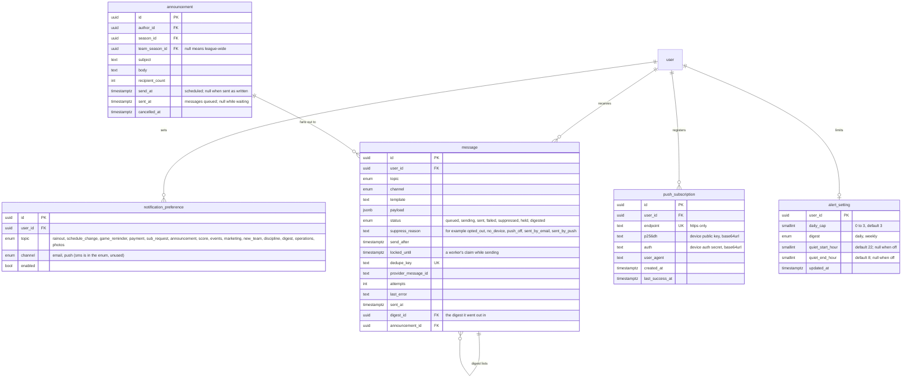

Notes:
- `message` is the outbox. Code that wants to notify someone inserts a row in the same transaction as the change that caused it; a worker sends it. See [architecture.md](architecture.md). It holds the template name and its payload, not the finished email, and looks up the address when sending.
- No text messages are sent, because every text is billed and the product runs on free services only ([ADR 0021](adr/0021-free-services-only.md)). The `sms` value of the `message_channel` enum stays in the schema unused, and an `sms_consent_event` table is **not planned**.
- Push is a channel like email: a person's push choices are `notification_preference` rows with channel `push`, off unless they turned the topic on. A notice about a push topic gets a second `message` row with channel `push` and dedupe key `push:<key>` for each person with a device and that topic on. `suppress_reason` adds `no_device` (every device gone) and `push_off` (no VAPID keys).
- Alert limits: `alert_setting` holds a person's daily cap on non-urgent messages (per channel), digest frequency and quiet hours, as whole hours in the league's time zone; no row means the defaults (3, daily, 10 pm to 8 am). A non-urgent message over the cap is `held` with `send_after` at the person's next digest; the digest job puts it in a `digest` message (topic `digest`, template `digest`) and marks it `digested` with `digest_id`. A non-urgent message in quiet hours stays `queued` with `send_after` moved to when they end. Which kinds are urgent is in [architecture.md](architecture.md), section 5. When the day's email quota runs out, an urgent email whose push copy was sent is `suppressed` (`sent_by_push`), and other email waits as `queued` with `send_after` at the next midnight UTC; the drain counts sent email with `message_email_sent_idx`. Topic `operations` carries notices to admins about the league's own running (today, the email quota), and is not on the settings page.
- An `announcement` is sent as written (`sent_at` = when it was written) or, for an admin, scheduled ([ADR 0058](adr/0058-scheduled-announcements-ride-the-daily-sweep.md)): `send_at` is the outbox sweep on the chosen day, and `sent_at` stays null until the sweep queues its messages, for the audience as it stands then, and sets `recipient_count`. Until then it can be edited, or cancelled (`cancelled_at`). A check constraint keeps a row either sent, or waiting or cancelled with a `send_at`; `announcement_due_idx` is the sweep's look for waiting rows.
- `push_subscription` is one browser or installed app. A browser has one endpoint, so the endpoint is unique and moves to whoever subscribed it last. The outbox deletes a row when its push service answers 404 or 410.

**Win-back emails** (issue #370). While a season's registration is open, admins can invite back players from the three seasons before it who haven't signed up.

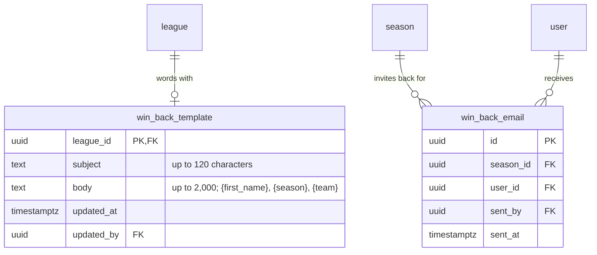

- `win_back_email` is unique on `(season_id, user_id)`: one email per player per season. Each row's `win_back` message (non-urgent, topic `announcement`) carries the wording already filled in, with dedupe key `win_back/<season>/<user>`. Someone who turned announcements off by email is shown as opted out and not emailed. Whether they came back is read from their registration in that season created after `sent_at`, never stored.
- With no `win_back_template` row the default wording in `src/domain/win-back/win-back.ts` is used.

### 2.5 Sponsors, events, community

```mermaid
erDiagram
  sponsor ||--o{ sponsorship : "signs"
  season ||--o{ sponsorship : "sold in"
  sponsor ||--o{ sponsor_member : "managed by"
  sponsor ||--o{ deal : offers
  sponsor ||--o{ checkin : receives
  deal ||--o{ deal_redemption : "redeemed as"
  checkin ||--o| deal_redemption : "may include"
  sponsor ||--o{ sponsor_stat_daily : "measured by"
  season ||--o{ team_of_week : names
  league ||--o{ event : hosts
  event ||--o{ event_rsvp : collects
  event ||--o{ event_ticket : sells
  purchase ||--o| event_ticket : "pays for"
  event ||--o{ event_audience_team : "is for"
  team ||--o{ event_audience_team : "is invited to"
  user ||--o| calendar_feed : "subscribes with"
  season ||--o{ award_poll : runs
  award_poll ||--o{ award_vote : collects
  game ||--o{ pickem_pick : "is picked in"
  user ||--o{ pickem_pick : picks
  user ||--o| pickem_hidden : "hides with"
  season ||--o{ season_card : "sums up"
  user ||--o{ season_card : "gets"
  season ||--o| stat_award_set : "works out"
  stat_award_set ||--o{ stat_award_place : lists
  user ||--o{ stat_award_place : "placed in"
  user ||--o| leaderboard_opt_out : "opts out with"
  league ||--o{ post : publishes
  league ||--o| social_account : connects
  social_account ||--o{ social_post : syncs
  social_post ||--o| social_image : "stored as"
  team ||--o{ social_post : "tagged in"
  event ||--o{ social_post : "tagged in"
  event ||--o| giveaway : "may hold"
  giveaway ||--o{ giveaway_entry : collects
  user ||--o{ giveaway_entry : enters
  giveaway_entry ||--o| giveaway_winner : "may win"
  season ||--o| signup_challenge : runs
  team_season ||--o| signup_challenge : wins
  season ||--o{ volunteer_shift : "needs on game days"
  event ||--o{ volunteer_shift : needs
  volunteer_shift ||--o{ volunteer_signup : fills
  user ||--o{ volunteer_signup : takes
  league ||--o{ checklist_template_task : "starts seasons with"
  season ||--o{ checklist_task : "runs on"
  checklist_template_task ||--o{ checklist_task : "copied to"
  user ||--o{ checklist_task : owns
  season ||--o| season_survey : asks
  season_survey ||--o{ survey_response : "answered by"
  user ||--o{ survey_response : answers
  season_survey ||--o{ survey_answer : "collects (no person)"
  league ||--o{ friend_league : "lists"
  friend_league ||--o| friend_logo : "shown with"
  user ||--o{ member_photo : uploads
  team ||--o{ member_photo : "tagged in"
  event ||--o{ member_photo : "tagged in"
  game ||--o{ member_photo : "tagged in"

  sponsor {
    uuid id PK
    uuid league_id FK
    text name
    text slug "unique in the league"
    enum kind "bar, restaurant, brand, other"
    bool is_home_bar "one per league"
    text blurb
    text address
    text url "https only"
    text checkin_secret "signs the rotating QR code"
    timestamptz deleted_at
  }
  sponsorship {
    uuid id PK
    uuid sponsor_id FK
    uuid season_id FK
    enum tier "home_bar, field, team, supporter"
    uuid team_season_id FK "for team sponsors"
    int amount_cents
    text in_kind_notes
  }
  sponsor_member {
    uuid id PK
    uuid sponsor_id FK
    uuid user_id FK
  }
  deal {
    uuid id PK
    uuid sponsor_id FK
    text title
    text terms
    smallint_array valid_days "ISO weekdays; empty is every day"
    time valid_from
    time valid_to "before valid_from runs past midnight"
    bool active
    timestamptz confirmed_at "last said still current"
  }
  checkin {
    uuid id PK
    uuid sponsor_id FK
    uuid user_id FK
    uuid team_season_id FK
    date on_date
    timestamptz checked_in_at
  }
  deal_redemption {
    uuid id PK
    uuid deal_id FK
    uuid checkin_id FK
    uuid user_id FK
    timestamptz redeemed_at
  }
  sponsor_stat_daily {
    uuid id PK
    uuid sponsor_id FK
    date on_date
    text placement "home strip, game page, sponsor page"
    int impressions
    int clicks
  }
  team_of_week {
    uuid id PK
    uuid season_id FK
    date week_of "the game day"
    uuid team_season_id FK
    uuid sponsor_id FK "who puts up the tab"
    int tab_cents
    text reason
  }
  event {
    uuid id PK
    uuid league_id FK
    enum kind "social, bar_night, bbq, tournament, theme_week, party"
    text title
    text slug UK "title and start date, set once"
    text place "null allowed for a theme week"
    text description
    timestamptz starts_at
    timestamptz ends_at
    int capacity "null: no limit"
    enum audience "public, members, teams"
    uuid audience_season_id FK "teams audience: null for any season"
    text invite_url "https://, shown and shared, never fetched"
    bool in_app_rsvp "false: RSVPs only on the invite"
    int ticket_price_cents "null: a free RSVP"
    int member_price_cents "null: members pay the ticket price"
    timestamptz cancelled_at
    timestamptz deleted_at
    uuid created_by FK
  }
  event_audience_team {
    uuid event_id PK,FK
    uuid team_id PK,FK
  }
  calendar_feed {
    uuid user_id PK,FK
    int version "the signed feed link's version; 1 until reset"
  }
  event_rsvp {
    uuid id PK
    uuid event_id FK
    uuid user_id FK
    enum status "going, waitlisted"
    timestamptz created_at "waitlist order"
  }
  event_ticket {
    uuid id PK
    uuid event_id FK
    uuid user_id FK
    uuid purchase_id FK,UK "null for an offer"
    enum status "offered, held, paid, refunded, released, cancelled"
    int price_cents "member or full price, before credit"
    text code "six characters, unique per event"
    timestamptz held_until "offered and held: when the spot is free again"
    timestamptz checked_in_at
  }
  award_poll {
    uuid id PK
    uuid season_id FK
    enum kind "weekly, season"
    enum category "mvp, best_play, best_sport, newcomer, team_spirit, best_dressed"
    text title
    date game_day "weekly polls only"
    timestamptz opens_at
    timestamptz closes_at
    uuid created_by FK
  }
  award_vote {
    uuid id PK
    uuid award_poll_id FK
    uuid voter_id FK
    uuid nominee_user_id FK "player awards"
    uuid nominee_team_season_id FK "team awards"
    timestamptz cast_at
  }
  pickem_pick {
    uuid id PK
    uuid game_id FK
    uuid user_id FK
    uuid team_season_id FK "the team picked to win"
    uuid slot_id FK "the game's slot when picked; null if the slot went"
    timestamptz created_at
    timestamptz updated_at
  }
  pickem_hidden {
    uuid user_id PK
    timestamptz created_at
  }
  season_card {
    uuid id PK "also the public link, so it cannot be guessed"
    uuid season_id FK
    uuid user_id FK
    jsonb stats "the card's numbers, stored when built"
    boolean is_public "false until the player shares the link"
    timestamptz created_at
    timestamptz built_at "last built or refreshed"
  }
  stat_award_set {
    uuid season_id PK
    jsonb weights "the MVP weights"
    text_array unused_parts "MVP parts nobody had data for"
    boolean votes_counted
    jsonb notes "an admin's note per award"
    timestamptz computed_at
    uuid computed_by FK
    timestamptz published_at "null until published"
    uuid published_by FK
  }
  stat_award_place {
    uuid id PK
    uuid season_id FK
    enum award "season_mvp, iron_kicker, golden_boot, best_teammate, rookie_of_the_year, sub_of_the_year"
    uuid user_id FK
    uuid team_season_id FK
    smallint place "1 is a winner; ties share"
    double value
    jsonb detail "games it was based on; MVP parts"
  }
  leaderboard_opt_out {
    uuid user_id PK
    timestamptz created_at
  }
  social_account {
    uuid id PK
    uuid league_id FK
    enum provider "instagram"
    text external_id "the account's ID at Instagram"
    text username
    enum status "active, needs_reconnect, disconnected"
    text token_ciphertext "AES-256-GCM; null once disconnected"
    timestamptz token_expires_at
    timestamptz token_refreshed_at
    bool show_newest "show posts without featuring each"
    timestamptz last_synced_at
    text last_error
    uuid connected_by FK
  }
  social_post {
    uuid id PK
    uuid account_id FK
    text external_id "unique per account"
    text permalink "the post on Instagram"
    text caption
    enum media_type "image, video, carousel"
    timestamptz taken_at
    bool featured
    bool hidden
    uuid team_id FK
    uuid event_id FK
    enum cover "home, team"
    text alt_text
  }
  social_image {
    uuid id PK
    uuid post_id FK "unique"
    text content_type "image/jpeg, image/png, image/webp"
    bytea bytes "our copy; up to 2 MB, 25 MB in all"
    int byte_size
    text sha256
  }
  rule_section {
    uuid id PK
    uuid league_id FK
    text slug "unique per league; kept when the title changes"
    text title "1 to 80"
    text body "plain text, up to 20000"
    smallint position
  }
  rule_change {
    uuid id PK
    uuid league_id FK
    text summary "1 to 200"
    jsonb changes "each section added, edited or removed, with text before and after"
    date effective_on "today or later; 3 days or more with a notice"
    boolean notice
    int notice_recipients
    uuid created_by FK
    timestamptz created_at "clock_timestamp()"
  }
  friend_league {
    uuid id PK
    uuid league_id FK
    text name "unique per league"
    enum activity "softball, soccer, pool, tabletop, ... other"
    text area "neighborhood or park"
    text description "up to 280"
    text url "https only"
    boolean links_back
    boolean run_by_player "listed under Run by our players"
    boolean featured "player-run only; on the events page"
    uuid created_by FK
  }
  friend_click {
    uuid friend_league_id PK "FK"
    date day PK "UTC"
    int clicks "counts only"
  }
  friend_logo {
    uuid id PK
    uuid friend_league_id FK "unique"
    text content_type "image/webp (seed: image/png)"
    bytea bytes "up to 100 KB, 5 MB in all"
    int byte_size
    int width "at most 192"
    int height "at most 192"
    text sha256
  }
  member_photo {
    uuid id PK
    uuid league_id FK
    uuid uploader_id FK "deleted with the account"
    enum status "pending, approved, rejected"
    uuid game_id FK "tag"
    uuid event_id FK "tag"
    uuid team_id FK "tag"
    text caption "up to 200 characters"
    timestamptz repost_consent_at "the uploader's OK to repost"
    text content_type "image/jpeg"
    bytea bytes "one copy up to 1 MB; null once rejected"
    int byte_size
    int width "at most 1440"
    int height "at most 1440"
    text sha256
    uuid reviewed_by FK
    timestamptz reviewed_at
    text review_note "admins only"
  }
  post {
    uuid id PK
    uuid league_id FK
    uuid season_id FK
    text slug UK
    text title
    text body_md
    uuid cover_asset_id FK
    timestamptz published_at
  }
  giveaway {
    uuid id PK
    uuid event_id FK "unique: one per event"
    text prize
    text donated_by
    smallint winner_count "1 to 20"
    timestamptz opens_at
    timestamptz closes_at "after opens_at"
    text official_rules "must say no purchase is necessary"
    text checkin_secret "signs the rotating entry code"
    timestamptz drawn_at
  }
  giveaway_entry {
    uuid id PK
    uuid giveaway_id FK
    uuid user_id FK
    timestamptz entered_at
  }
  giveaway_winner {
    uuid id PK
    uuid giveaway_id FK
    uuid entry_id FK "unique per giveaway: wins once"
    smallint round "1 = the draw, then each redraw"
    uuid drawn_by FK
    timestamptz replaced_at
    text replaced_reason "set together with replaced_at"
  }
  signup_challenge {
    uuid id PK
    uuid season_id FK "unique: one per season"
    text prize
    timestamptz deadline
    uuid winner_team_season_id FK "only once confirmed"
    timestamptz winner_completed_at
    timestamptz confirmed_at
    uuid confirmed_by FK
  }
  volunteer_shift {
    uuid id PK
    uuid league_id FK
    enum role "setup, teardown, check_in, ref_fill_in"
    uuid season_id FK "a game day; or"
    uuid event_id FK "an event; exactly one is set"
    timestamptz starts_at
    timestamptz ends_at "after starts_at"
    text place
    text notes
    smallint spots "1 to 50"
  }
  volunteer_signup {
    uuid id PK
    uuid shift_id FK "unique with user_id"
    uuid user_id FK
    timestamptz created_at
  }
  checklist_template_task {
    uuid id PK
    uuid league_id FK
    text title "1 to 120"
    text notes "up to 1000"
    smallint offset_days "days from the season's first day, -365 to 365"
    uuid owner_id FK "an owner or admin; null for nobody"
  }
  checklist_task {
    uuid id PK
    uuid season_id FK
    uuid template_task_id FK "unique with season_id; null when added by hand"
    text title "1 to 120"
    text notes "up to 1000"
    date due_on
    uuid owner_id FK "an owner or admin; null for nobody"
    timestamptz done_at
    uuid done_by FK
  }
  season_survey {
    uuid id PK
    uuid season_id FK "unique: one per season"
    timestamptz opened_at
    timestamptz closed_at
    uuid opened_by FK
  }
  survey_response {
    uuid id PK
    uuid survey_id FK "unique with user_id: one answer each"
    uuid user_id FK
  }
  survey_answer {
    uuid id PK
    uuid survey_id FK "no person, no time"
    smallint rating "1 to 5"
    enum would_return "yes, maybe, no"
    text best_part
    text one_change
    text comment
  }
```

Events, as built (`src/db/schema/event.ts`, `src/db/queries/events.ts`):

- A theme week has no capacity and nothing to RSVP to. It starts at midnight on its first day and ends at midnight after its last, in the league's time zone, and the public schedule marks every game day inside it.
- An RSVP is a spot (`going`) or a place in line (`waitlisted`); "can't make it" deletes the row. Every join, drop-out and capacity change locks the event row first, so two people can never take the last spot. A newcomer waits behind anyone already in line even when a spot is open.
- When a spot opens (someone drops out, the admin raises the capacity or removes it), the earliest waitlisted people move up and each gets an `event_notice` email through the outbox. A smaller capacity never takes a spot from anyone.
- Calling an event off sets `cancelled_at`, clears every RSVP and emails everyone who had one; the page stays up and says so. Deleting sets `deleted_at` and takes it off every page. Both, and every create and edit, write an audit row.
- Who an event is for (`audience`, `src/domain/events/audience.ts`): `public` (everyone; the only kind with a public page, a place in the public calendar feed and the sitemap), `members` (anyone with a registration that isn't cancelled or refunded, in any season), or `teams` (the active roster spots of the teams in `event_audience_team`, in `audience_season_id`, or in any season when it is null). Admins see every event. A theme week is always public, since it marks the public schedule (a check constraint). The signed-in app reads the league's events and the person in two queries and filters with the domain's rule; the recipients of an announcement are one query, tested against the same rule.
- `invite_url` is an external invite (Partiful has no public API, so it is shown and shared, not synced): https only, a host name with a dot, no user name or password, up to 500 characters. With `in_app_rsvp` off the app takes no RSVPs and points to the invite; it can be turned off only while no one has an RSVP.
- An admin can tell an event's audience when they create or change it: one `event_notice` per person through the outbox with the `events` topic (dedupe key `event_announced/<event>/new/<user>` once per event, or `event_updated/<event>/<time>/<user>` per change). A public event is announced to all members.
- `calendar_feed` holds the version of a person's private events calendar link. The link is the user id and an HMAC of the id and version with the server's secret, so nothing secret is stored; a reset (or deleting the account) moves the version on and the old link stops working.
- Paid tickets ([ADR 0027](adr/0027-event-tickets-hold-their-spot.md)): an event with a `ticket_price_cents` sells one `event_ticket` per person instead of free RSVPs; `member_price_cents` is what members (registered in any season) pay. A ticket is `held` from the moment its checkout starts until `held_until` (an hour past Stripe Checkout's 31-minute expiry), `paid` once the webhook or covering credit settles its purchase (a `purchase` with no season and one `event_ticket` item), and `refunded` when an admin refunds it. A paid ticket also gives its holder a `going` RSVP, so a spot taken is always going RSVPs plus holds and offers whose `held_until` is still ahead. A spot that opens on a ticketed event is `offered` to the earliest person on the waitlist (their waitlist row becomes the offer) for a day or until the event ends. An offer or hold that runs out is `released`; a paid ticket given up by deleting the account is `cancelled`. Every change locks the event row first. An event with paid tickets or open checkouts can't be called off, deleted or made free. Refunded credit comes back as a `released` ledger row.
- Planned later: a sponsor or venue link, a cover image, guests.

The sign-up drive, as built (`src/db/schema/drive.ts`, `src/db/queries/giveaways.ts`, `src/db/queries/challenges.ts`; [ADR 0035](adr/0035-free-giveaways-and-the-sign-up-challenge.md)):

- A `giveaway` belongs to one event (a unique constraint) and is free to enter. Nothing in the three giveaway tables can point at a purchase, payment, ticket or registration, and an event that sells tickets, or a theme week, can't hold one. The official rules are required and must say no purchase is necessary.
- A player enters by scanning the giveaway's rotating code at the event: the sponsors' check-in code ([ADR 0016](adr/0016-rotating-check-in-code.md)) under the giveaway's own `checkin_secret`, which no public query selects. The event's audience decides who may enter; admins see every event but enter only one that is for them. `giveaway_entry` is unique on `(giveaway_id, user_id)`, and an entry first takes a share lock on the giveaway row, so a draw (which takes an update lock) never misses an entry or lets one in after it starts.
- The draw happens once, after `closes_at`: every entry in the order people entered, through a partial Fisher-Yates shuffle over `crypto.randomInt`, with no seed kept. It writes the winners (`round` 1), sets `drawn_at` and writes a `giveaway.draw` audit row with the entry count, the method, the drawn positions and the winners' entry and account ids. After the draw the giveaway can't change.
- A redraw replaces one current winner: `replaced_at` and `replaced_reason` (5 to 300 characters) are set together, and one new winner is drawn from the entries that never won (`giveaway_winner` is unique on `(giveaway_id, entry_id)`), with the next `round`. It writes a `giveaway.redraw` audit row with the reason.
- Each new winner gets one `giveaway_win` message (non-urgent, topic `events`, dedupe key `giveaway_win/<giveaway>/<user>`) and sees the win on the app's home screen. The giveaway page never names a winner.
- Removing an event removes its giveaway, entries and winners. Deleting an account removes its entries in giveaways not drawn yet; a drawn giveaway keeps them, under the anonymized user, so its draw record still adds up.
- A `signup_challenge` belongs to one season (a unique constraint). A team's progress is never stored: one query reads every active roster spot with when the player joined and when they signed the season's waiver, and the domain counts players signed up (on the roster, waiver signed) out of the team's target roster size, or the season's minimum when it has none, or the roster when it is bigger. A team is complete when all of them are, at the moment its last player finished signing up. Withdrawn and waitlisted teams don't count.
- The leaderboard ranks teams complete by the deadline first, earliest completion first (so a tie on 100% goes to the team whose last player joined first), then everyone else by percent. An admin confirms the winner, a team at rank 1 that completed by the deadline: `winner_team_season_id`, `winner_completed_at`, `confirmed_at` and `confirmed_by` are set and a `challenge.confirm` audit row records the standings as team ids and counts. A confirmed challenge can't change.

Volunteer shifts, as built (`src/db/schema/volunteer.ts`, `src/db/queries/volunteer.ts`, `src/domain/volunteer/shifts.ts`):

- A `volunteer_shift` is a job (`role`: `setup`, `teardown`, `check_in`, `ref_fill_in`) on a season's game day (`season_id`) or at an event (`event_id`): a check keeps exactly one of them set. It has a start and end (the end after the start), an optional `place` (up to 120 characters), `notes` (up to 500) and `spots` (1 to 50). Removing a season or an event removes its shifts.
- `volunteer_signup` is one member's spot, unique on `(shift_id, user_id)`. A claim locks the shift row (`for update`) before it counts the spots taken, so when several people claim the last spot at once one gets it and the rest are told it's full. A claim or a drop is refused once the shift has started, and a shift on a called-off or removed event is hidden and can't be claimed.
- An admin can change a shift but not cut its spots below the people signed up, and can remove it with everyone's spot. Each change writes a `volunteer.*` audit row.
- A daily job queues one `volunteer_reminder` (non-urgent, topic `events`, dedupe key `volunteer_reminder/<shift>/<user>`) for each person on a shift that starts the next day in the league's time zone.
- Deleting an account gives back its spots on shifts that haven't started; spots on past shifts stay, under the anonymized user. The data export lists the person's shifts.

The season ops checklist, as built (`src/db/schema/checklist.ts`, `src/db/queries/checklist.ts`, `src/domain/checklist/tasks.ts`, [ADR 0061](adr/0061-season-ops-checklist-from-a-template.md)):

- A `checklist_template_task` is one of the league's recurring jobs: a title, notes, `offset_days` from a season's first day (negative is before it) and an optional usual owner. A league whose template is empty gets the starter tasks the first time the template or a season's checklist needs it; an advisory lock on the league keeps two first visits from adding them twice. Owners (and the platform operator) edit it.
- A `checklist_task` is one job on one season's checklist, seen by owners and admins only: a title, notes, `due_on`, an optional `owner_id` (an owner or admin), and `done_at`/`done_by` once it is ticked off. Starting a season's checklist copies each template task with `due_on` = the season's `starts_on` + `offset_days`. The unique `(season_id, template_task_id)` makes starting it again add only the template's new tasks. Tasks added by hand have no template task, and removing a template task leaves seasons' copies alone (`set null`). Removing a season removes its tasks. When a season's `starts_on` changes, its open tasks that came from the template move by the same number of days.
- Every change writes a `checklist.*` or `checklist_template.*` audit row.
- A daily job queues `checklist_reminder` (non-urgent, topic `operations`) for each open task due within 3 days, and once for a task that is overdue (up to 30 days). It goes to the task's owner, or to every owner of its league while nobody has the task or its owner is no longer an owner or admin. The dedupe key `checklist_reminder/<task>/<due_on>/<soon|overdue>/<user>` sends each once, and a new due date or owner sends afresh.

The end-of-season survey, as built (`src/db/schema/survey.ts`, `src/db/queries/surveys.ts`, `src/domain/survey/questions.ts`):

- A `season_survey` belongs to one season (a unique constraint) and opens only once the season is `completed`. Opening it queues one `survey_invite` (non-urgent, topic `announcement`, dedupe key `survey_invite/<survey>/<user>`) for each person with an active roster spot that season, and writes a `survey.open` audit row. `closed_at` ends it; closing writes `survey.close`.
- The questions are fixed in code: `rating` (1 to 5), `would_return` (`yes`, `maybe`, `no`), and three optional written answers, `best_part` and `one_change` (up to 500 characters) and `comment` (up to 1,000).
- Answers are anonymous by design. `survey_response` says only that a person answered (`survey_id`, `user_id`, unique together, so one answer per player). `survey_answer` holds the answer with no column that points at a person and no timestamp, written in the same transaction. The answer is written only when the response row is new, and the survey row is read under a share lock so an answer can't land after a close.
- Results read `survey_answer` alone: counts per rating and the average, counts per `would_return`, and each written question's answers as its own sorted list, so neither the order nor the grouping ties answers to one person. Only owners and admins see them (`survey.results`).
- Deleting an account keeps its anonymous answer (there is nothing to find it by); the response row stays under the anonymized user. The data export lists the seasons whose survey the person answered, never the answers.

Awards, as built (`src/db/schema/awards.ts`, `src/db/queries/awards.ts`):

- An admin opens an `award_poll` for one `game_day` (a weekly poll) or the whole season. Voting runs from `opens_at` until `closes_at`; closing early sets `closes_at` to now. The category decides whether a vote names a player (`nominee_user_id`) or a team (`nominee_team_season_id`), and a check keeps exactly one of them set. Anyone on an active roster that season may vote; a weekly ballot lists only the teams with a game that day (and their players). Totals are read only after `closes_at`, and who voted for whom is never shown to anyone but the voter.
- Deleting a poll deletes its votes; deleting a season deletes its polls.

Pick'em, as built ([ADR 0044](adr/0044-pickem-for-bragging-rights-scored-from-results.md); `src/db/schema/pickem.ts`, `src/db/queries/pickem.ts`), for bragging rights only: nothing in it holds money, a fee or a prize.

- A `pickem_pick` is one player's predicted winner for one game (unique `(game_id, user_id)`), saved or changed while the game is scheduled, its slot is open and its start is still ahead. `slot_id` is the game's slot when the pick was saved; a pick for a slot the game has since left (a rain-out move) or that was deleted is void.
- Results are never stored. A pick counts only when its game is `final` with a winner: right or wrong. A forfeit, a tie, a cancellation, a postponement or a called-off slot voids it. The game day and season leaderboards count right picks per player over the scored games in one grouped query; equal counts share a place.
- `pickem_hidden` holds the players who chose to stay off the leaderboards (one row each). `league.pickem_own_games` (an admin's choice, audited as `pickem.own_games`) decides whether players may pick their own team's games.
- Deleting a game, team entry or account deletes its picks; deleting a slot leaves the pick, void.

Stat awards, as built (`src/db/schema/stat-awards.ts`, `src/db/queries/stat-awards.ts`, [ADR 0046](adr/0046-stat-awards-and-the-season-mvp-formula.md)):

- Nothing is stored for player stats: games played, attendance, wins and runs while playing, sub appearances and awards are worked out when read, from final games, saved kicking orders, RSVPs, bar check-ins on game days, live `game_period` runs, `sportsmanship_rating`, approved `sub_claim` rows and closed polls (`gatherSeasons`, nine queries however many players).
- An admin works a season's awards out: one `stat_award_set` row per season holds the MVP `weights` used, which parts had no data, whether the MVP vote counted, and admins' `notes`; `stat_award_place` holds each award's top three places, ties included, with the number behind each and the games it was based on. Working them out again replaces the places and keeps the notes; a published set has to be taken down first. The public page reads only a set with `published_at`.
- A `leaderboard_opt_out` row keeps a player out of the computation and off every awards page and team-page badge, including sets published before they opted out. Deleting the account (which anonymizes it) deletes the opt-out and the person's places.

The rules page, as built (`src/db/schema/rules.ts`, `src/db/queries/rules.ts`, `src/domain/rules/rules.ts`, [ADR 0062](adr/0062-rules-page-with-a-dated-change-log.md)):

- `rule_section` holds the rules as they stand, one row per section in `position` order. Admins type all the text in the app; none of it is in the repository. A section keeps the `slug` it was created with, so `/rules#lineups` survives a new title. A new section's slug comes from its title, with a number added if another section has it.
- `rule_change` is the history. Rows are only added: each publish records a summary, the start date, and every section it added, edited or removed, with the text before and after. Admins change the rules only by publishing (`rules.manage`), and each publish writes a `rules.publish` audit row. `created_at` uses `clock_timestamp()`, so changes made one after another in a transaction still sort in order.
- A publish takes an advisory lock on the league and compares the newest change's id with the version the editor was opened at. One made over someone else's newer change is refused as stale, so two admins never overwrite each other. A form that leaves out a current section, or names one that no longer exists, is stale too.
- With `notice`, the start date must be at least 3 days after today in the league's time zone. One `rule_change` message (non-urgent, topic `announcement`) is queued for each person registered in a season that is open or under way, with dedupe key `rule_change/<change>/<user>`. A completed season's players and cancelled registrations aren't included.
- Rules belong to a league (`league_id` on both tables). The page is `/l/[league]/rules`, which the default league serves at `/rules`, and each league's admins edit their own.
- The page also lists the division rule sets (innings, time limit, bunting, stealing) of the season under way, or the latest season that isn't a draft. Changing a division refreshes the page through `refreshSeasonPages`.

Friends of the league, as built (`src/db/schema/friends.ts`, `src/db/queries/friends.ts`):

- `friend_league` is another local league in the public directory at `/friends`, grouped there by `activity`. Only admins add, change or remove entries (`friends.manage`), and each change writes an audit row. A removed entry is deleted with its logo; the audit row keeps what it said.
- `url` is checked by the form (`src/domain/friends/friend-form.ts`): https only, a host name with a dot that is not an IP address, no user name, password or port, up to 300 characters. The database holds it to https and the length.
- `links_back` is the admin's note that the league's site links to ours; the public page shows it as "Links to us".
- `run_by_player` marks a club or meetup one of our players runs. The public page lists these first, under "Run by our players", whatever their activity. `featured` also shows one as a small card on the public events page; only a player-run entry can be featured, and the database holds it to that (`friend_league_featured_player_run`).
- `friend_click` counts clicks out to an entry's site, one row per entry and UTC day. The entry's links on `/friends` and `/events` carry the HTML `ping` attribute, so the browser posts to `/api/friends/[friend]/click` as it follows the link, and that route adds one in a single statement. Nothing about who clicked is read or stored. Crawlers don't ping, and Firefox turns ping off by default, so the counts are a floor. Admins see each entry's clicks in the last 30 days and in all, to show a club what the league's promotion is worth; any cross-promotion or fee is agreed outside the app, and owners record income in the books. The counts go with their entry (`on delete cascade`).
- `friend_logo` is one small copy of the league's logo, made on the server with sharp (fits in 192 × 192, WebP, metadata dropped) and kept in Postgres like the Instagram photos ([ADR 0023](adr/0023-instagram-photos-stored-in-postgres.md)). Uploads are PNG, JPEG or WebP up to 800 KB. A new upload replaces the row, so its public address changes with the picture. All logos together stay under 5 MB: the save takes a transaction-scoped advisory lock and counts what is stored, minus the logo it replaces.
- Entries go with the league (`on delete cascade`), so the seed needs no clean-up step for them.

Member photos, as built (`src/db/schema/member-photo.ts`, `src/db/queries/member-photos.ts`, [ADR 0039](adr/0039-member-photos-in-postgres.md)):

- A member on an active roster (or an admin) uploads a photo with the required repost consent (`repost_consent_at`), an optional caption and at least one tag: one of their teams, a published game of one of their teams from the last 30 days through today, or a public event in the same window. A tag goes to null if what it names is deleted.
- Only one copy is stored: a JPEG at most 1440 px on its longest side and 1 MB, with no metadata, made on the server from a file checked by its bytes (`src/lib/member-photos/process-photo.ts`). Videos are not accepted.
- Limits: 10 uploads per person in any 24 hours, and 100 MB of stored photos for the league. Uploads for a league take turns under a transaction lock, so two can't both fit the last space.
- `pending` photos wait in the admins' review queue. `approved` ones show on the public pages of their tags. Rejecting deletes the bytes at once and keeps the row, with the admins' private `review_note`, so the uploader sees it wasn't used. Approving and rejecting each queue one `photo_review` message (topic `photos`, dedupe key `photo_review:<photo>`) that never carries the note.
- The uploader can delete their own photo at any time, and an admin any photo. Approve, reject and delete write audit rows (`member_photo.*`). Deleting an account deletes every photo the person uploaded.

Sponsors as built (roadmap Phase 2, item 9):

- `sponsor`, `sponsor_member`, `deal`, `checkin`, `deal_redemption` and `team_of_week` exist. `sponsorship` (tiers and amounts), `sponsor_stat_daily` (impressions and clicks) and the logo assets come later.
- `checkin_secret` is 32 random bytes as hex. It signs the rotating check-in code ([ADR 0016](adr/0016-rotating-check-in-code.md)) and no public query selects it.
- Sponsors are hidden with `deleted_at`, never deleted, so their check-ins keep counting and a team of the week keeps its tab sponsor (`team_of_week.sponsor_id` restricts deletes). Hiding a sponsor also clears its home-bar mark.
- `checkin.team_season_id` is the team the player was on in a season being played when they checked in, so the report can count teams.
- A check-in and a deal use name the player only for the player's own data export. Deleting an account removes sponsor access and keeps check-ins, under the anonymized user, in the sponsor's counts.

### 2.6 Referees

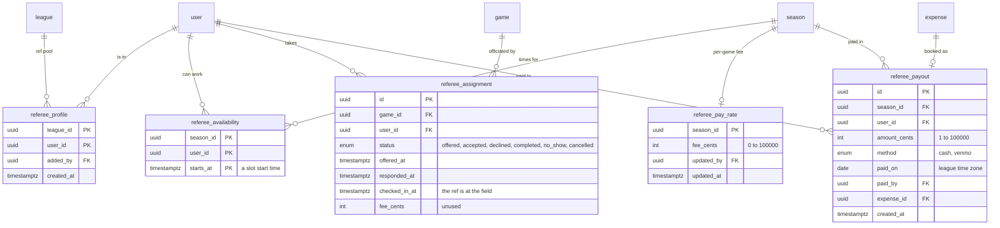

The ref pool, availability, assigner and pay sheet follow [ADR 0053](adr/0053-ref-assigner-and-pay-sheet.md).

- `referee_profile` is the league's ref pool. Being in it makes a person a ref (`Subject.isReferee`), as does having refereed a game. Removing someone keeps their games and pay.
- `referee_availability` has one row per slot start time a ref can work in a season, whatever the field. No row means they can't. A ref's own form never clears a time they already referee.
- `referee_assignment` is who refs a game: one live (`offered` or `accepted`) row per game, by a partial unique index. Admins make it by email or by accepting the assigner's proposal, both as `accepted`; neither ever puts a player on either team in the game (issue #296). Changing the ref cancels the old row.
- `referee_pay_rate` is the season's fee per game worked. A game is worked when its assignment is `accepted` or `completed` and the ref checked in or reported its score as its ref; owed is computed, never stored.
- `referee_payout` is money an owner or admin marked as paid. Recording one adds an `expense` in the `refs` category to the season's books, whose note names the method, not the ref. Payouts hold on to their season and ref (`restrict`); deleting an account keeps them, pointing at the anonymized user, and removes the person's pool row and times.

A ref drops a game they can't make until it starts: their assignment becomes `declined`, and the reason is in the `referee.drop` audit row. The first ref to take a game with no ref gets an `accepted` assignment they created themselves (`referee.take`); the one-live-assignment index means a second can't ([ADR 0054](adr/0054-first-ref-to-take-a-game-gets-it.md)).

`checked_in_at` is set when the ref taps "I'm at the field" on game day, which checks them in to every game they referee that day at once, or when an admin marks them as there (audited as `referee.check_in`). The first time stays; the game-day command center reads it.

### 2.7 Platform

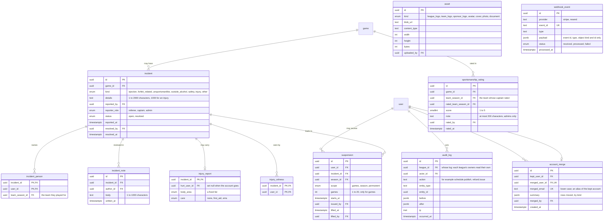

Notes:
- `account_merge` records an admin merging a duplicate account into another ([ADR 0041](adr/0041-merging-duplicate-accounts.md)). Every column that references `user.id` moves by the rule `src/domain/account-merge/rules.ts` gives it, in one transaction with both user rows locked, and a test fails if a person column has no rule. Clashes on unique keys are settled by fixed answers: the kept account's RSVP, vote, setting and membership win; the earliest waiver signature stays; an empty registration gives way to one with a payment, team spot or referral (two that both hold something refuse the merge); self-votes and uncredited self-referrals are removed. The merged-away user row stays, named "Merged account" with an address at `deleted.invalid`, with no sessions, sign-in methods or passkeys, so it cannot sign in. `merged_email` is the old address: a sign-in link asked for it goes to the kept account's address, a new account cannot be created with it, and admin lookups by it find the kept account.
- `concern` is something a person tells the league: a private concern from a signed-in player or a message from the public contact form ([ADR 0060](adr/0060-one-queue-for-concerns-and-public-contact.md)). Admins read both in one queue; no team or public page reads it. `reply_email` (public senders only) is cleared 12 months after `closed_at` by the daily outbox sweep, along with the messages queued to it. `first_replied_at` is the first reply (not a note) and gives the time to first reply. `concern_message` holds replies (emailed) and admin-only notes. `incident.park_rule` and `concern.park_rule` share one enum so a season's park issues count across both. A player's concern is limited to 5 a day (`ACTION_LIMITS.concern`) and is shown only to them and admins; when the player deletes their account the concern stays with no sender, as a league record. `message.user_id` is now nullable, with `recipient_email`, for mail to an address with no account.
- Injury reports ([ADR 0064](adr/0064-injury-reports.md)) are incidents whose `kind` is `injury`, filed by the same people (the game's ref, either captain, an admin) and listed in the same review queue. `injury_report` adds who was hurt, the body area and the care given; `injury_witness` adds the people who saw it; what happened is the incident's `details` (1,000 characters at most) and follow-up notes are `incident_note` rows. A report names no one in `incident_person`, so it can't lead to a suspension. Only owners and admins read it, and every view, export and deletion writes an audit row (`injury.view`, `injury.export`, `injury.delete`) that holds no health details. Three years after `reported_at` the daily job `/api/jobs/injury-retention` deletes the `injury_report`, its witnesses, the notes and the text (`details` becomes a fixed sentence), writing `injury.delete` with no actor; an admin can do the same at any time. The incident itself stays, with its game, date and status. A person's data export leaves injury reports out (owners and admins hold them for the league and the insurance carrier), and deleting an account clears `hurt_user_id` and drops the person as a witness.
- **Not planned:** an `ai_usage` table for AI provider spend and an answer cache. There are no AI features, because every AI provider bills per use ([ADR 0021](adr/0021-free-services-only.md)).

### 2.8 The owners' books and permits

Only owners and the platform operator read these, except a permit's document, which a game's referee and captains see at the field ([ADR 0034](adr/0034-owners-books-and-permits-in-postgres.md)). Income is not stored here: the ledger reads `payment`, `refund` and `purchase` (section 2.3). A payment counts toward the season of its purchase; a purchase with no season (an event ticket) counts toward the season running on the day it was paid.

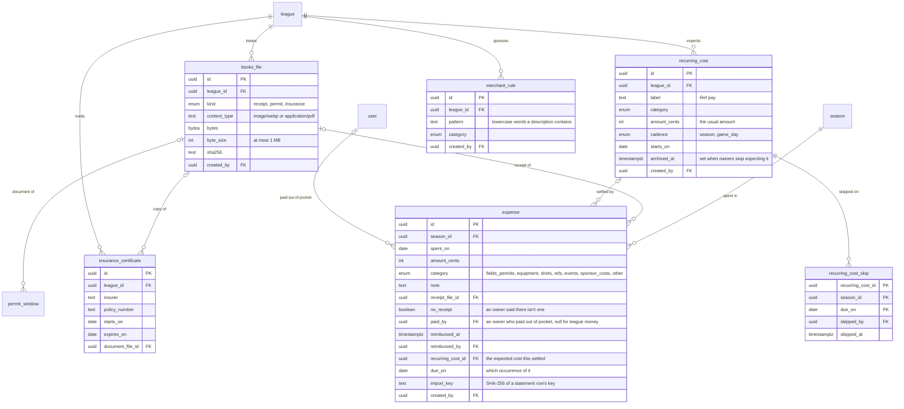

Notes:
- Windows added together under one permit number share its details. The owners enter the permit's total cost once and it is split across the windows, earliest first, so the shares add up to it exactly; the ledger counts each window's share under "Fields and permits".
- A photo is stored once, as WebP, at most 1,600 pixels on its longer side, without its metadata; a PDF is kept as uploaded. All of a league's files together are capped at 50 MB, checked under a lock so two uploads at once count each other. Removing an expense or certificate, or replacing a permit's document, deletes the file nothing else uses.
- Keeping up ([ADR 0059](adr/0059-expected-costs-and-statement-imports.md)):
  - **Receipts:** an expense waits on a receipt until one is attached or `no_receipt` is set. The check `expense_no_receipt` keeps the two apart. Imported rows and confirmed expected costs aren't counted as missing one.
  - **Expected costs:** occurrences are worked out, not stored. A season cost is due on the season's first day; a game-day cost on every local day with a game that isn't cancelled or postponed, from `starts_on`. Confirming one adds an expense with `recurring_cost_id` and `due_on`, unique with the season, so it is added once. Skipping one adds a `recurring_cost_skip` row for that season. Both belong to a season because seasons can overlap. A season cost confirmed or skipped once stays settled for that season if its first day moves. A moved game day is expected on its new day.
  - **Ref pay:** in a season with a `referee_pay_rate`, a game-day Refs expected cost isn't expected, because each `referee_payout` writes its own expense (section 2.6). An expense a payout points at never counts as missing a receipt.
  - **Out of pocket:** `paid_by` must be an owner when it is set. "Reimbursed" sets `reimbursed_at` on the expenses that were listed, so one added since stays owed.
  - **Statement imports:** only the date, amount and description of money-out rows are read. Digit runs of five or more are masked to their last two digits, the file is never stored, and `import_key` is a hash of the row's key, scoped to the league (unique per season). The statement's own ID is used when it has one; otherwise the key is the date, amount, description and position among identical rows. Money in (payments, refunds), Venmo transfers to a bank and $0 lines are left out.

### 2.9 The owner dashboard and the season money summary

The dashboard stores nothing: it adds up `registration`, `roster_membership`, `payment`, `purchase`, `expense`, `permit_window`, `event_rsvp`, `event_ticket` and `checkin` when it is read. A season's members are its registrations that are not cancelled, waitlisted or refunded. A member is new in the first season (by start date) they appear in; retention is the share of the season before's members who are members again. Money is counted as the books count it (section 2.8). Draft seasons are left out.

The one table is the money summary an owner chose to publish ([ADR 0038](adr/0038-season-money-summary.md)):

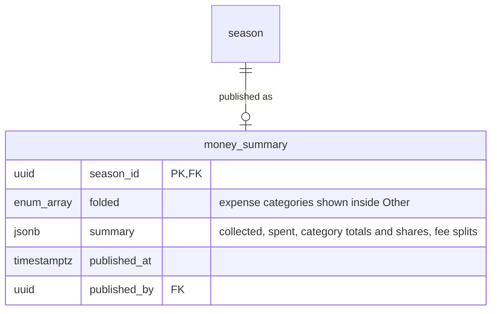

Notes:
- No row means nothing is published, the default. Publishing writes the row (again, to replace it); taking it down deletes it. Both are audited (`money_summary.publish`, `money_summary.unpublish`).
- `summary` is a copy of the numbers as previewed, worked out on the server when the owner publishes, so the public page shows exactly the preview and a later expense changes nothing until an owner publishes again. It holds category totals and fee splits only: no names, counts of people, notes or single payments.
- A season needs at least ten members before its summary can be published, so the money collected never stands for one person's payment. `folded` never contains `other` (a check).

### 2.10 League gear

The league's kits of ball bags, bases, pumps, cones and the first-aid kit (issue #286): who has each one right now, who brings it to which game, and every handoff in between. The rules are in `src/domain/equipment`; `src/db/queries/equipment.ts` reads and writes, locking the kit's row first.

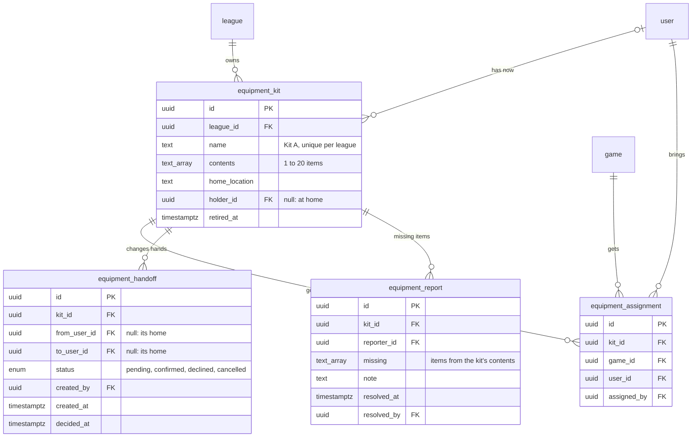

Notes:
- `equipment_kit.holder_id` is who has the kit right now, and changes only when a handoff is confirmed, the person bringing it picks it up from home, its holder returns it home, or an admin says where it really is. Each of those writes an `equipment_handoff` row, so the handoff table is the kit's history.
- An assignment names a game, and the game gives the field and the time: the person has the kit there 30 minutes before kickoff (`KIT_LEAD_MINUTES`). A kit goes to one game a day (league time), checked under the kit's lock. Who can be assigned: the game's ref, the captains and co-captains of both teams, and the league's admins.
- "I handed Kit A to Sam" writes a `pending` handoff to whoever brings the kit to its next game that hasn't ended; the kit stays with the giver until Sam confirms. Sam can say he doesn't have it (`declined`), and the giver can take it back first (`cancelled`). One handoff waits per kit.
- A report lists items from the kit's contents, a note, or both, and stays open until an admin marks it sorted. Retiring a kit needs it at home with nothing waiting; it removes the kit's assignments to games still to come and keeps its history.
- Every change writes an `equipment.*` audit row in the same transaction.

### 2.11 Several leagues

One deployment can run several leagues ([ADR 0048](adr/0048-several-leagues-on-one-deployment.md)). Every table holds either one league's data or the platform's and its people's: a league's table carries `league_id`, or a required foreign key to a table that does (a season, a team, a game, a sponsor, an event, a purchase). `src/db/schema/league-scope.test.ts` fails when a new table is neither. The platform's tables are a person's account and settings (`user`, `profile`, sessions, passkeys, notification choices, push devices, the private calendar link, the referral code), the outbox's `message`, `account_merge` and `webhook_event`.

- A person's role is per league, in `league_member`; everyone signed in is at least a player. Playing in a league (a registration) makes it one of theirs without a row.
- `league.is_default` marks the league at the site's own URLs (a partial unique index allows one). Until one is marked, the oldest league counts.
- League credit, purchases and the audit log each carry the league.

### 2.12 Private leagues and tournaments

An organization asks for a one-day tournament or a private league; an admin accepts it as a private season of the league ([ADR 0049](adr/0049-private-events-are-private-seasons.md)).

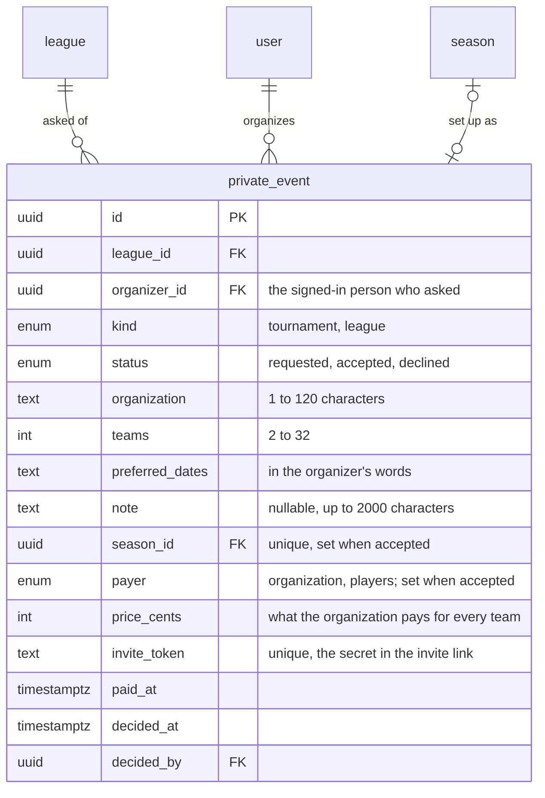

Notes:
- `season.visibility = 'private'` keeps a season off every public page and public query: they read seasons through `publicSeasons` or `leagueSeasons` in `src/db/queries/season-scope.ts`. Its players see their games on their home screen; the organizer and admins see the organizer page.
- An accepted request always has its season, payer and invite token (the `private_event_accepted_has_season` check), and an organization that pays always has a price. When the organization pays, the season's team fee is zero and the organizer pays `price_cents` once in a purchase with one `private_event` item; settling it sets `paid_at`. When players pay, the season is priced per player as usual.
- The organizer's name and email are their account's, not copied here. Deleting the account declines an open request; merging accounts moves the rows. Requests are rate-limited to three a day per person (`rate_limit` key `private-event:<user>`).
- Audited: `private_event.request`, `private_event.accept`, `private_event.decline`.

### 2.13 Weather readings

The rain-out decision card reads each park's National Weather Service data through the data cache. So it can show the last data while NWS is down, it keeps the last good answer for each part of a park's weather ([ADR 0057](adr/0057-owner-confirmed-rainouts.md)):

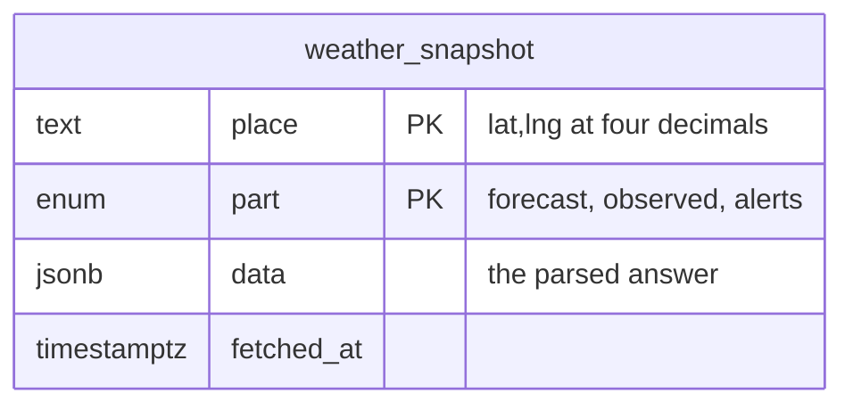

Notes:
- One row per park and part, replaced only by a newer answer (an upsert guarded on `fetched_at`). `forecast` holds the hourly forecast and the grid's rainfall and chance of thunder; `observed` the nearest station and its last two days of reports; `alerts` the alerts in effect.
- `data` is read back through a schema; a row in an older shape reads as nothing rather than as wrong numbers.
- Nothing personal is stored; a park's point is public, and every league with a park there shares its readings.
- Who may confirm a rain-out is `league.admins_confirm_rainouts`: each league's own, off by default, changed only by that league's owners and audited as `rainout.confirm_policy`. A rain-out sent to the owners is an audit row (`rainout.prepare`, with the date) and the owners' messages, not a table of its own.

## 3. Constraints and indexes

Integrity rules the database enforces, so application bugs cannot break them:

| Table | Constraint or index | Purpose |
|---|---|---|
| `registration` | unique `(season_id, user_id)` | One entry per person per season |
| `away_week` | unique `(registration_id, week_start)`; check `week_start` is a Monday | Each week once, named by its Monday |
| `roster_membership` | unique `(team_season_id, registration_id)` where `status <> 'removed'` | No duplicate roster spots |
| `roster_membership` | unique `(registration_id)` where `status = 'active'` | A player is active on one team per season |
| `roster_membership` | unique `(team_season_id)` where `role = 'captain' and status = 'active'` | Exactly one captain |
| `team_season` | unique `(team_id, season_id)` | One entry per team per season |
| `league`, `season` | check `minimum_age` between 18 and 99 (the season's may be null) | A minimum age that makes sense |
| `registration`, `waiver_signature` | check `age_confirmed_min` and `age_confirmed_at` are set together, the age between 18 and 99 | An age confirmation always says when |
| `captain_handoff` | unique `(team_season_id)` where `status = 'pending'`; check `from_user_id <> to_user_id`; check `decided_at` set exactly when not pending | One waiting offer per team; nobody offers it to themselves |
| `season_shirts` | primary key `season_id`; unique `expense_id`; check at least one size, `cost_cents` 1 to 10,000,000, `vendor` up to 80 characters, and `placed_at` and `received_at` set to match `status` | One order per season, booked at most once, never received before it is placed |
| `team_keep_off` | unique `(team_id, user_id)` and `(team_id, email)`; check a person or an address is set; check reason length 1 to 300; cascades from `team` and `user` | One entry per person or address per team; a deleted row takes its reason with it |
| `equipment_kit` | unique `(league_id, name)`; checks on the name (1 to 40), home (1 to 120) and contents (1 to 20 items) | Kits named once per league |
| `equipment_assignment` | unique `(kit_id, game_id)`; cascades from `equipment_kit`, `game` and `user` | One person brings a kit to a game |
| `equipment_handoff` | unique `(kit_id)` where `status = 'pending'`; check `decided_at` set exactly when not pending | One waiting handoff per kit |
| `equipment_report` | check it lists an item or has a note; note length 1 to 500 | A report says what is missing |
| `team_season` | foreign key `(division_id, season_id)` to `division (id, season_id)` | A team's division is in its own season |
| `division` | unique `(season_id, slug)`, unique `(season_id, name)`; check slug format | One division per name and public address in a season |
| `rule_set` | unique `(league_id, name)`; `options.permitEndRule` (`call_at_last_complete`, the default, or `last_inning_to_start`) says what happens when a game reaches its permit's end (#406); check innings 1 to 15 and time limit 10 to 240 | Rule sets are named once per league, with sane limits |
| `season` | check `crossover_games between 0 and 10` | A sane crossover count |
| `bracket` | unique `(season_id, division_id)` nulls not distinct | One season-wide bracket, or one per division |
| `slot` | unique `(field_id, starts_at)`; check `ends_at > starts_at` | No duplicate slots |
| `slot` | exclusion on `(field_id, tstzrange(starts_at, ends_at))` | No overlapping slots on a field |
| `game` | check `team_a_id <> team_b_id` | A team cannot play itself |
| `game_placement` | unique `(schedule_version_id, game_id)` | A game is placed once per version |
| `game_placement` | unique `(schedule_version_id, slot_id)` where `slot_id is not null` | A slot holds one game per version |
| `schedule_version` | unique `(season_id, version_no)`; unique `(season_id)` where `status = 'published'` | One published version at a time |
| `schedule_version` | check `version_no > 0`; check a non-draft version has `published_at` | Versions count from 1; publishing is timestamped |
| `game_placement` | check `locked` only with a `slot_id` | Only a placed game can be pinned |
| `permit_window` | check `ends_at > starts_at` | A permit has a length |
| `blackout` | unique `(season_id, on_date, field_id)`, nulls not distinct | One blackout per date for all fields, and one per field |
| `team_constraint` | check `on_date` or `time_index` is set; check `weight` between 1 and 10 | A constraint says when; weights stay comparable |
| `free_agent_profile` | check `skill_score` and `vibe_score` between 1 and 5; check `notes` at most 200 characters | Scores stay on their scale |
| `friend_group` | unique `(code)`; check `code` is 6 of `A-Z` and `2-9` | Codes are unambiguous |
| `audit_log` | check `action` matches `area.verb` | Actions stay searchable, such as every `schedule.*` |
| `waiver_signature` | unique `(waiver_id, user_id, season_id)` | One signature per waiver per season |
| `score_report` | unique `(client_id)` | Retried offline submissions are ignored |
| `score_confirmation` | unique `(game_id, team_season_id)` | One answer per team |
| `game_rsvp` | unique `(game_id, user_id)` | One RSVP per game |
| `game_attendance` | primary key `(game_id, user_id)` | One check-in per player per game, so a second scan changes nothing |
| `season` | check `playoff_min_games` null or 1 to 30 | The playoff minimum the season form accepts |
| `event` | unique `slug`; check `ends_at > starts_at`; check `capacity` is null or positive; check a theme week has no capacity and is public; check `audience_season_id` is set only for a teams audience; check `invite_url` starts with `https://` and is at most 500 characters | Stable links; an event has a length; theme weeks take no RSVPs and mark the public schedule; an invite link is never another scheme |
| `event_audience_team` | primary key `(event_id, team_id)` | A team is listed once per event |
| `event_rsvp` | unique `(event_id, user_id)` | One RSVP per person per event |
| `event` | check `ticket_price_cents` is null or $0.50 to $500; check `member_price_cents` is null or at most the ticket price, and $0 or at least $0.50; check a ticketed event takes RSVPs in the app and is not a theme week | Stripe can charge every price; tickets are sold in the app |
| `event_ticket` | unique `(event_id, code)`; unique `purchase_id`; check `code` is six of `A-H J-N P-Z 2-9`; check `held_until` is set exactly while offered or held; check a held, paid or refunded ticket has a purchase and a price | Codes can be read out at the door; a checkout pays for one ticket; a hold or offer always runs out |
| `merch_item` | check `name` is 1 to 80 characters; check `price_cents` is $0.50 to $500 and `member_price_cents` is null or between $0 and the price | Stripe can charge every price |
| `merch_item_size` | primary key `(item_id, size)`; check `stock` between 0 and 10,000 | One stock count per size |
| `merch_image` | unique `(item_id, position)`; check the type is WebP, `byte_size` matches the bytes and is at most 2 MB; check `alt` is 1 to 200 characters | Stored copies are small and described |
| `merch_order` | unique `purchase_id`; check `quantity` between 1 and 5; check `held_until` is set exactly while held; check a fulfilled order has `fulfilled_at`; check `color_hex` is `#RRGGBB` | A checkout pays for one order; a hold always runs out |
| `game_period` | unique `(game_id, period_no, half)` | One row per half-inning |
| `offline_receipt` | primary key `key`; index `game_id` | Each offline entry is taken once |
| `game_period` | check `period_no` between 1 and 20; check `runs` between 0 and 99 | Innings and runs stay in range |
| `game_lineup` | unique `(game_id, team_season_id)`; check `run_breaks` ≥ 0 | One kicking order per team per game |
| `game_lineup_spot` | unique `(lineup_id, position)`; unique `(lineup_id, user_id)`; check `position` between 1 and 40 | Each spot once, each kicker once |
| `game` | check `kicks_first` is null or one of `team_a_id`, `team_b_id` | Only a team in the game kicks first |
| `sub_claim` | unique `(sub_request_id, user_id)` | One claim per person |
| `sportsmanship_rating` | unique `(game_id, team_season_id)`; check `score` between 1 and 5; check the rated team is the other one; check `note` at most 200 characters | One rating per team per game, on the scale |
| `concern` | check `body` 1 to 2000 characters, `place` up to 80, `reply_email` 3 to 254, `outcome` up to 1000; `park_rule` only with category `park_rules`; check `closed_at` is set exactly when `status = 'closed'`; a public concern has no `sender_id` | A concern says something; a park rule belongs to the park category; closing is timestamped |
| `incident` | check `details` 1 to 2000 characters; check `resolved_at` is set exactly when `status = 'resolved'`; check `details` is at most 1000 characters when `kind` is `injury` | Reports say something; resolution is timestamped |
| `injury_report` | one row per incident (primary key `incident_id`); `body_area` and `care` are fixed lists | Minimum data: where and what care, never a diagnosis |
| `injury_witness` | primary key `(incident_id, user_id)` | A witness is named once per report |
| `incident_person` | primary key `(incident_id, user_id)` | A person is named once per report |
| `suspension` | unique `(incident_id, user_id)`; check `games` is set exactly for `scope = 'games'`, between 1 and 20 | One suspension per person per report; a games suspension says how many |
| `sub_request` | unique `(game_id, team_season_id)` where `status in ('open', 'filled')` | One live request per team per game |
| `sub_request` | check `needed` between 1 and 11; check `women_needed + men_needed <= needed` | Reserved spots fit in the request |
| `team_formation_request` | unique `(season_id, requested_by)` where `status = 'pending'` | One open new-team request per person per season |
| `private_event` | unique `season_id`, unique `invite_token`; index `(league_id, status, created_at)`, index `organizer_id` | One event per private season; invite links can't collide; the admins' queue and an organizer's list |
| `team_formation_request` | check `status in ('approved', 'declined')` exactly when `decided_at` is set; check `status = 'approved'` exactly when `team_season_id` is set | An answer is timestamped; an approval names its team |
| `team_formation_request` | check `expected_size` between 1 and 60; name 1 to 40 characters; note and reason at most 500 | Requests stay readable |
| `checkin` | unique `(sponsor_id, user_id, on_date)` | One check-in per bar per day |
| `award_vote` | unique `(award_poll_id, voter_id)`; check exactly one nominee; check `nominee_user_id <> voter_id` | One vote per player per poll, for one person or team, never yourself |
| `award_poll` | check `closes_at > opens_at`; check `game_day` is set exactly when `kind = 'weekly'` | A poll has a voting window; weekly polls name their game day |
| `pickem_pick` | unique `(game_id, user_id)` | One pick per player per game; saving again replaces it |
| `season_card` | unique `(season_id, user_id)` | One card per player per season, so refreshing updates it in place |
| `stat_award_place` | unique `(season_id, award, user_id)`; check `place` between 1 and 99 | One place per person per award |
| `stat_award_set` | check `published_at` is null or not before `computed_at` | A set is published after it is worked out |
| `deal_redemption` | unique `(deal_id, checkin_id)` | A deal once per visit |
| `giveaway` | unique `(event_id)`; check `closes_at > opens_at`; check `winner_count` between 1 and 20; check the rules' length | One giveaway per event, with a real entry window |
| `giveaway_entry` | unique `(giveaway_id, user_id)` | One entry per person, even when the same check-in lands twice at once |
| `giveaway_winner` | unique `(giveaway_id, entry_id)`; check `replaced_at` and `replaced_reason` are set together | An entry wins once, so a replaced winner is never drawn again; every redraw has a reason |
| `signup_challenge` | unique `(season_id)`; check a winner only once confirmed | One challenge per season; a winner is always confirmed |
| `sponsor` | unique `(league_id, slug)`; unique `league_id` where `is_home_bar and deleted_at is null`; check `url` starts with `https://` | One page address each, one home bar |
| `deal` | check `valid_days <@ {1..7}`; check `valid_from` and `valid_to` both set or both null | Days and hours make sense |
| `team_of_week` | unique `(season_id, week_of)`; check a tab has a sponsor and is $0.01 to $1,000 | One team per game day |
| `social_account` | unique `(league_id, provider)`; check `token_ciphertext` is null exactly when `status = 'disconnected'` | One connection per league; disconnecting always deletes the token |
| `social_post` | unique `(account_id, external_id)`; check `permalink` starts `https://www.instagram.com/` | A post is stored once, and links only to Instagram |
| `social_post` | check a hidden post is neither featured nor a cover; check a team cover has a team | Hiding always wins |
| `social_post` | unique `(account_id)` where `cover = 'home'`; unique `(team_id)` where `cover = 'team'` | One cover per page |
| `social_image` | check type is JPEG, PNG or WebP and `byte_size = octet_length(bytes)` up to 2 MB | Only images are stored and served; the 25 MB total is enforced by the sync |
| `books_file` | check type is WebP or PDF and `byte_size = octet_length(bytes)` up to 1 MB | Only resized photos and small PDFs are stored; the 50 MB total is enforced when a file is added |
| `expense` | unique `(recurring_cost_id, season_id, due_on)`; unique `(season_id, import_key)`; check not both `no_receipt` and a receipt | An expected cost is confirmed once; a statement row is imported once; "no receipt" never sits beside one |
| `recurring_cost` | check `amount_cents > 0` and a label of 1 to 80 characters | |
| `recurring_cost_skip` | primary key `(recurring_cost_id, season_id, due_on)` | An occurrence is skipped once per season |
| `merchant_rule` | unique `(league_id, pattern)`; check a pattern of 2 to 60 characters | One category per pattern |
| `expense` | check `amount_cents > 0`; index `(season_id, spent_on)` | The ledger reads one season's expenses in date order |
| `expense` | index `(paid_by)` where `reimbursed_at` is null | "Owed to owners" reads only what is still owed |
| `permit_window` | check `cost_cents` is null or at least 0; check the application window closes on or after it opens | A permit's details make sense |
| `insurance_certificate` | check `expires_on > starts_on` | A certificate covers a period |
| `friend_league` | unique `(league_id, name)`; check `url` starts with `https://` and is at most 300 characters; checks on name, area and description lengths | One entry per league name; only https links reach the page |
| `friend_logo` | unique `friend_league_id`; check type is WebP or PNG, `byte_size = octet_length(bytes)` up to 100 KB, and both sides at most 192 px | One small logo per entry; the 5 MB total is enforced by the save |
| `member_photo` | check type is JPEG; `bytes` and `byte_size` are null exactly when `status = 'rejected'`; `byte_size = octet_length(bytes)` up to 1 MB; width and height 1 to 1440; caption up to 200 and note up to 500 characters; `reviewed_at` is null exactly while pending | One small stored copy per photo, none kept once rejected; the 100 MB total and the daily limit are enforced on upload |
| `message` | unique `(dedupe_key)`; index `(dedupe_key text_pattern_ops)` | The same notice is never sent twice; a prefix match (a game's score reminders, a day's rain alerts) uses an index under any collation |
| `alert_setting` | check `daily_cap` between 0 and 3; check quiet hours are both null or two different hours from 0 to 23 | A member can only lower the cap, and quiet hours are never empty |
| `push_subscription` | unique `(endpoint)`; check it starts with `https://` and is at most 2,048 characters; check the key lengths | A device is stored once, and the outbox only ever posts to https |
| `webhook_event` | unique `(provider, event_id)` | Webhooks are processed once |
| `payment`, `refund`, `purchase` | unique on each Stripe ID | Stripe retries cannot double-record |
| `payment` | check `0 <= refunded_cents <= amount_cents` | Never refund more than was paid |
| `refund` | check `amount_cents > 0` | A refund returns money |
| `promo_code` | unique `(season_id, code)`; check `code = upper(code)`; check a percent is 1 to 100 and an amount is above 0 | Codes match without regard to case and never take off more than the price |
| `account_merge` | unique `merged_user_id` and `merged_email`; check the two accounts differ and the address is lower case | An account is merged away once, and an address is an alias of one account |
| `credit_entry` | check that `spent` rows are negative and every other row positive; that `spent` and `released` rows have a purchase, `rainout_rebate` rows a rebate and `referral` rows a referral; unique (`purchase_id`, `reason`), (`rebate_id`, `user_id`) and `referral_id` | A checkout spends and gives back once; a rebate or referral pays once |
| `season_rebate` | unique `team_season_id`; check `games_lost` between 1 and `games_count` and `rebate_cents` within `paid_cents` | One rebate per team, never more than was paid |
| `saved_payment_method` | partial unique index on `team_season_id` where `removed_at` is null; unique `stripe_setup_session_id` | One live guarantee per team; a replayed webhook saves once |
| `waitlist_entry` | partial unique index on (`season_id`, `user_id`) where status is `waiting` or `offered`; check that an offer has its times | One place in line per person |
| `referral` | unique `referred_user_id`; check the referrer is not the referred | A person is referred once, never by themselves |
| `purchase` | unique `stripe_payment_intent_id` | A deadline charge is settled once |

Indexes for the common reads:

| Table | Index | Serves |
|---|---|---|
| `game` | `(season_id, status)`, `(team_a_id)`, `(team_b_id)`, `(slot_id)` | Schedule, team pages, standings |
| `slot` | `(season_id, starts_at)` | Schedule by date |
| `game_placement` | `(schedule_version_id)` | Loading a version |
| `roster_membership` | `(team_season_id, status)`, `(registration_id)` | Rosters, "my team" |
| `registration` | `(season_id, status)`, `(user_id)`, `(friend_group_id)` | Admin lists, "my seasons", a friend group's members |
| `friend_group` | `(season_id)` | A season's groups |
| `purchase_item` | `(team_season_id)`, `(registration_id)` | Team balance, who has paid |
| `message` | `(status, send_after)` where `status = 'queued'` | The outbox worker |
| `message` | `(user_id, created_at desc)` | Delivery history |
| `message` | `(status, send_after)` | The digest job, finding held messages that are due (not partial: a migration cannot use the `held` value it adds) |
| `message` | `(user_id, sent_at)` where `status = 'sent'` | Counting a person's non-urgent messages today, for the cap |
| `message` | `(sent_at)` where `status = 'sent'` and `channel = 'email'` | Counting the emails sent today and this month, for the provider's quota |
| `message` | `(digest_id)` | The messages a digest listed |
| `push_subscription` | `(user_id)` | A person's devices, when the outbox sends |
| `audit_log` | `(entity_type, entity_id, occurred_at desc)`, `(actor_id, occurred_at desc)` | History of a record, history of a person |
| `checkin` | `(sponsor_id, on_date)` | Sponsor report |
| `game_rsvp` | `(game_id, team_season_id)` | Captain's RSVP board |
| `game_attendance` | `(team_season_id, game_id)`; `(user_id)`; `(recorded_by)` | A team's attendance; a player's games played; who recorded check-ins |
| `sub_request` | `(team_season_id, status)`; `(closes_at)` where `status = 'open'` | A team's requests; open requests for the sub page |
| `sub_claim` | `(user_id, status)` | A player's offers |
| `team_formation_request` | `(season_id, status, created_at)`; `(requested_by)` | The admin's waiting list; a player's requests |
| `event` | `(league_id, starts_at)` | Calendar |
| `event_rsvp` | `(event_id, status, created_at)`; `(user_id)` | Counts and the waitlist in order; a person's RSVPs |
| `event_ticket` | `(event_id, status)`; `(user_id)` | Held spots and the admin's ticket list; a person's tickets |
| `event_audience_team` | `(team_id)` | Team events for a team |
| `merch_item` | `(league_id)` | The shop |
| `merch_order` | `(item_id, status)`; `(user_id)` | Stock left and the admin's order list; a person's orders |
| `award_poll` | `(season_id, closes_at)` | Open and closed polls of a season |
| `award_vote` | `(voter_id)` | A player's own votes |
| `pickem_pick` | `(user_id)` | A player's own picks, for the page, the export and account deletion |
| `season_card` | `(user_id)` | A player's own cards, for home and the export |
| `stat_award_place` | `(user_id)` | A player's awards, for their stats page and team-page badges |
| `social_post` | `(account_id, taken_at desc)`, `(team_id)`, `(event_id)` | Newest photos for the home page and the admin screen; a team's or an event's photos |
| `concern` | `(league_id, status, created_at)`; `(sender_id)`; `(game_id)`; `(closed_at)` where `reply_email` is set | The admin queue; a person's own concerns; a game's; the daily clearing of old addresses |
| `concern_message` | `(concern_id, created_at)` | A concern's thread in order |
| `member_photo` | `(league_id, status, created_at desc)`; `(uploader_id, created_at desc)`; `(team_id, created_at desc)`, `(event_id, …)` and `(game_id, …)` where approved | The review queue and the storage total; a person's photos and daily count; each public page's photos |
| `sportsmanship_rating` | `(rated_team_season_id)`; `(rated_by)` | A team's ratings; a person's own ratings |
| `incident` | `(status, reported_at)`; `(game_id)` | The review queue; a game's reports |
| `incident_person` | `(user_id)` | Reports about a person, for the ladder and their export |
| `incident_note` | `(incident_id, written_at)`; `(author_id)` | A report's notes in order; a person's notes, removed with their account |
| `suspension` | `(user_id)` | Is this player suspended? |
| `weather_snapshot` | `(venue_id, for_date, fetched_at desc)` | Latest forecast |
| `giveaway_entry` | `(user_id)` | A person's entries, for the export and account deletion |
| `giveaway_winner` | `(entry_id)` | Removing an entry removes its win |
| `equipment_kit` | `(holder_id)` | The kits a person has, for their home screen |
| `equipment_assignment` | `(game_id)`, `(user_id)` | A game day's gear; a person's games with gear |
| `equipment_handoff` | `(kit_id, created_at)`, `(to_user_id)`, `(from_user_id)` | A kit's history; handoffs waiting for a person |
| `equipment_report` | `(kit_id, created_at)`, `(reporter_id)`, `(resolved_by)` | A kit's reports; a person's reports |

## 4. Personal data

| Data | Where | Who can read it |
|---|---|---|
| Email, name | `user`, `profile` | The person, their captain, admins |
| Phone | `profile` | The person, admins, their captain; teammates only if `shares_contact` |
| Birth date | `profile` | The person and owners. Everyone else sees only "18+ confirmed" |
| Age confirmation | `registration`, `waiver_signature` (`age_confirmed_min`, `age_confirmed_at`) | The person, admins and owners. Only the age confirmed and when, never a birth date; the person's export lists it |
| Gender and lineup gender | `profile` | The person, their captain (for lineups), admins. A sub's lineup gender is copied to `sub_claim`, which the asking team's captains see. The kicking-order builder shows each player's lineup gender to their team's captains and admins only |
| Away weeks | `away_week` | The person, their team's captains (who is away, for planning a lineup), admins. Teammates see only how many players are available each week |
| Kicking order | `game_lineup`, `game_lineup_spot` | The team's captains and admins; from game day, the other team's captains and the game's ref, as names in order with no genders. Each player sees only their own spot |
| Game attendance | `game_attendance` | The player (in their export), the game's captains and ref on its check-in screen, the team's captains (games played), admins. A captain's or ref's tick in or out writes an `attendance.mark` audit row with the ids added and removed. Deleted with the account; a merge keeps one row per game |
| Sub claims | `sub_claim` | The player, the asking team's captains and admins. Approved subs appear as first name and last initial to both captains and the game's ref |
| New-team requests, with the player's note | `team_formation_request` | The player and admins |
| Private league and tournament requests, with the organizer's note | `private_event` | The organizer and admins. The organizer's contact details stay on their account |
| Captaincy offers | `captain_handoff` | The captain who offered, the teammate offered it, and admins; both people find the offers in their own export |
| "Not on my team" entries, with the private reason | `team_keep_off` | The team's captains and admins. The person listed never sees them anywhere; their own export lists them only if the owners turn on `league.export_keep_off_entries`. The captain or admin who added an entry finds it in their own export |
| Sportsmanship ratings | `sportsmanship_rating` | Admins see each team's average and the notes, never which game or team they came from; a captain sees their own team's average over whole blocks of 3 ratings. The captain who rated sees their team's rating |
| Incident reports | `incident`, `incident_person`, `incident_note` | Admins. The person filing sees what they filed in their export; a person named sees the reports about them in their export, without the other people named or the admins' notes |
| Suspensions | `suspension` | The player and admins see the length and why; the player's captains see only that they are suspended and for how long still |
| Giveaway entries and wins | `giveaway_entry`, `giveaway_winner` | The player and admins. Admins see winners' names to hand over the prize; the giveaway page shows only counts. The audit log holds entry and account ids, no names |
| Win-back emails | `win_back_email` | Admins and owners see who was emailed this season, while registration is open. Deleting an account deletes the person's rows |
| Award votes | `award_vote` | The voter alone sees whom they picked; everyone sees only the totals after a poll closes. Deleting an account withdraws votes in polls still open |
| Pick'em picks | `pickem_pick`, `pickem_hidden` | The player sees their picks. Signed-in players see each player's count of right picks on the leaderboards (first name and last initial), never the picks themselves, unless the player hid from them. The export lists every pick; deleting an account deletes them |
| Season cards | `season_card` | The player. Anyone with the link while the player keeps it public, as first name and last initial, their team and their own numbers; never another player's name, and votes only as a count. Admins see how many cards exist and how many are shared. The card is in the player's export and is deleted with their account |
| Player stats and stat award places | worked out on read; `stat_award_place`, `leaderboard_opt_out` | The player sees their own stats. Admins see the draft places. Everyone sees published places by first name and last initial, unless the player opted out |
| Emergency contact (name, relationship, phone) and first-aid note | `emergency_contact`, sealed: AES-256-GCM with a key derived from the server's auth secret, bound to the player's id ([ADR 0043](adr/0043-emergency-contacts-sealed-and-shown-on-game-day.md)) | The person. On the day of a game they play in (league time zone), that game's captains and co-captains and its ref; each read writes an `emergency_contact.view` audit row with the reader and the game, never the contact. Admins and owners don't see it. A database copy alone reads nothing. When two accounts are merged, the merged-away account's contact is sealed again for the kept one only if that one has none, and deleted either way |
| League gear: who has a kit, who brings it to which game, handoffs and missing-items reports | `equipment_kit.holder_id`, `equipment_assignment`, `equipment_handoff`, `equipment_report` | The person sees the kits they have, are handed or bring; admins see everything, including who filed each report. Their own export lists it all |
| Free-agent quiz answers and note | `free_agent_profile` | The person and admins |
| Friend group | `friend_group`, `registration.friend_group_id` | The person; others in the group see first name and last initial; admins |
| A published season money summary | `money_summary` | Everyone, once an owner publishes it. It holds category totals and how each fee divides, never a person's amount, name, birth date or contact details; owners can fold a category into "Other" when its total would point at one person |
| Waiver signature, IP address | `waiver_signature` | The person, owners |
| Sign-in rate-limit counters, by IP address | `rate_limit` | Nobody: only Better Auth reads them, linked to no account, and they are deleted within a day of the last request |
| Payment card | Never stored. Stripe holds it; we keep brand and last four digits | The person |
| Push devices | `push_subscription` (endpoint, keys, browser) | Only the outbox. The person's export lists their devices by browser and date, without the endpoint or keys |
| Photos and captions from the league's Instagram, which may show players | `social_post`, `social_image` | Admins; everyone once an admin features a photo. Any player can ask for a photo of them to be hidden, and hiding takes it off public pages on their next render |
| Expenses, receipts, permit costs and documents, the insurance certificate | `expense`, `books_file`, `permit_window`, `insurance_certificate` | Owners and the platform operator. A game's referee and both captains see that game's permit number and document. The tax CSV names no player |
| Who paid out of pocket and was reimbursed; expected costs; merchant rules; imported statement rows | `expense.paid_by`, `recurring_cost`, `merchant_rule`, `expense.import_key` | Owners and the platform operator. A statement file is read and dropped; account and card numbers are never stored, and descriptions are masked. An account merge moves `paid_by` to the kept account |
| The Instagram access token | `social_account.token_ciphertext`, encrypted | Nobody: only the sync jobs decrypt it, and disconnecting deletes it |
| Photos members upload, which may show players, with captions | `member_photo` | The uploader and admins; everyone once an admin approves one. The uploader can delete theirs at any time, and deleting their account deletes them all. Metadata such as a phone's location is never stored. Rejected photos' bytes are deleted at once |
| Why an admin rejected a photo | `member_photo.review_note` | Admins only, never the uploader |

Deleting an account removes the profile and anonymizes the user row. Signatures, payments, consent events and audit rows are kept because the league may need them for legal or accounting reasons; the privacy policy says so.

In detail (`deleteAccount` in `src/db/queries/account.ts`):

- **Removed:** the `profile` row; every `session`, `passkey` and `account` (sign-in method) row; unused sign-in links in `verification` for the address; `game_rsvp`, their spots in saved kicking orders (`game_lineup_spot`), their away weeks (`away_week`, which would otherwise stay with the kept registration), their place in any ref pool and the game times they said they can ref (`referee_profile`, `referee_availability`), `event_rsvp` (a spot at an upcoming event is given up first, so the waitlist moves up; a paid event ticket is `cancelled` and an offer released, and the ticket rows stay as a record of money paid), `notification_preference`, `alert_setting`, `push_subscription`, `offline_receipt`, `message` and `win_back_email` rows; entries in giveaways not drawn yet; free-agent quiz answers (`free_agent_profile`), and their place in any friend group; the address on any `invite` (open ones are revoked). Pending or approved `sub_claim`s for games still to come are withdrawn, which reopens the spot and tells the captains, and every claim loses its copied lineup gender. A `pending` new-team request is withdrawn. Addresses that were merged into the account stop being aliases. Their place on any waitlist is given up, any guarantee card is retired, and their referral link stops working. The private events calendar link stops working (`calendar_feed` moves to a new version). Their `emergency_contact` is deleted. The notes the person wrote come out: their `incident_note`s, and the note on any `sportsmanship_rating` they gave. Every `team_keep_off` row about them, and every one they added, is deleted. A captaincy offer waiting for or from them is cancelled. They stop bringing league gear to games still to come, and a gear handoff waiting from or to them is cancelled; a kit they hold stays shown with "Deleted account" until an admin says where it is.
- **Removed:** the `profile` row; every `session`, `passkey` and `account` (sign-in method) row; unused sign-in links in `verification` for the address; `game_rsvp`, their check-ins (`game_attendance`), their spots in saved kicking orders (`game_lineup_spot`), their away weeks (`away_week`, which would otherwise stay with the kept registration), `event_rsvp` (a spot at an upcoming event is given up first, so the waitlist moves up; a paid event ticket is `cancelled` and an offer released, and the ticket rows stay as a record of money paid), `notification_preference`, `alert_setting`, `push_subscription`, `offline_receipt` and `message` rows; entries in giveaways not drawn yet; free-agent quiz answers (`free_agent_profile`), and their place in any friend group; the address on any `invite` (open ones are revoked). Pending or approved `sub_claim`s for games still to come are withdrawn, which reopens the spot and tells the captains, and every claim loses its copied lineup gender. A `pending` new-team request is withdrawn. Addresses that were merged into the account stop being aliases. Their place on any waitlist is given up, any guarantee card is retired, and their referral link stops working. The private events calendar link stops working (`calendar_feed` moves to a new version). Their `emergency_contact` is deleted. The notes the person wrote come out: their `incident_note`s, and the note on any `sportsmanship_rating` they gave. Every `team_keep_off` row about them, and every one they added, is deleted. A captaincy offer waiting for or from them is cancelled.
- **Anonymized:** `user.name` becomes "Deleted account", `user.email` becomes `deleted-<id>@deleted.invalid` (a reserved domain that cannot receive mail), and `image` is cleared. Roster memberships stop sharing contact details.
- **Kept, pointing at the anonymized row:** registrations and roster memberships (so rosters, standings and history stay correct), purchases and payments, the league credit ledger, referrals, waiver signatures (with the typed name, IP and browser), score reports and responses, referee assignments and payouts, past sub claims, sub requests posted, new-team requests, entries and wins in drawn giveaways, announcements, incident reports (filed by or about them), the people named on them, suspensions and sportsmanship scores, and the audit log.
- **Refused** while the person is the active captain of a team in a season that is not completed, or is the only owner.

Every deletion writes an `account.delete` audit row with no personal data in it. The person's own export (`personalData`) returns all of the above as JSON, including their emergency contact and first-aid note (opened for them) and each passkey's name, type and date, without session tokens, sign-in tokens, provider tokens or passkey key material.
