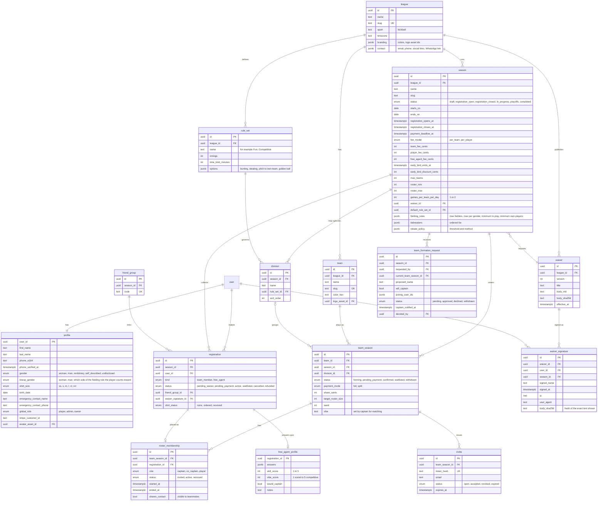
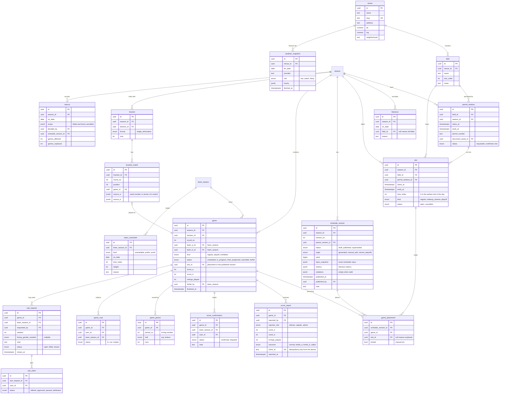
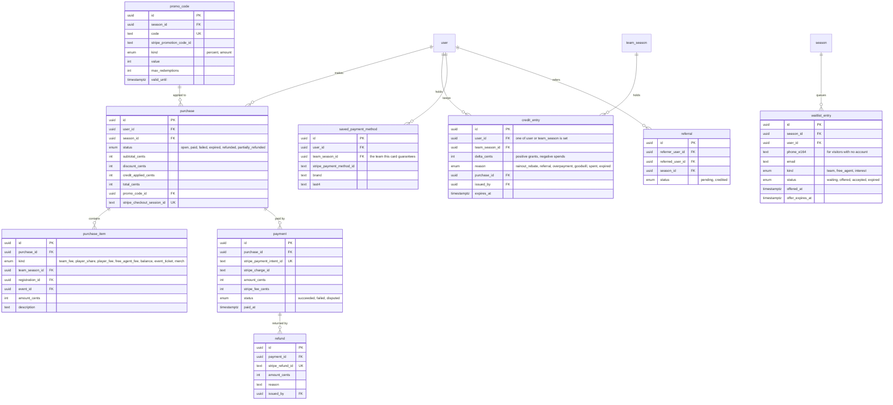
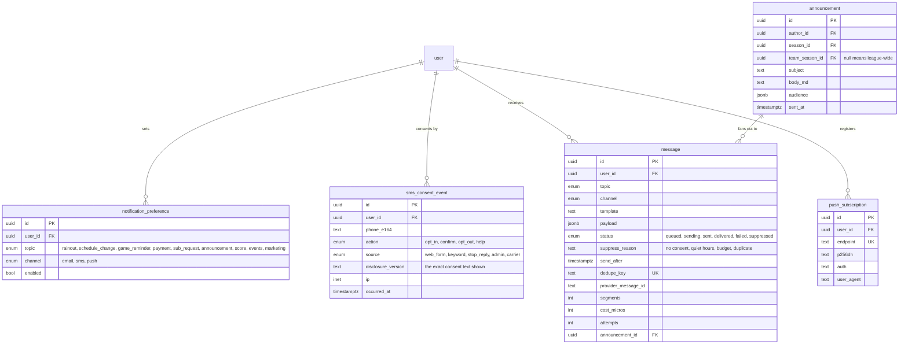
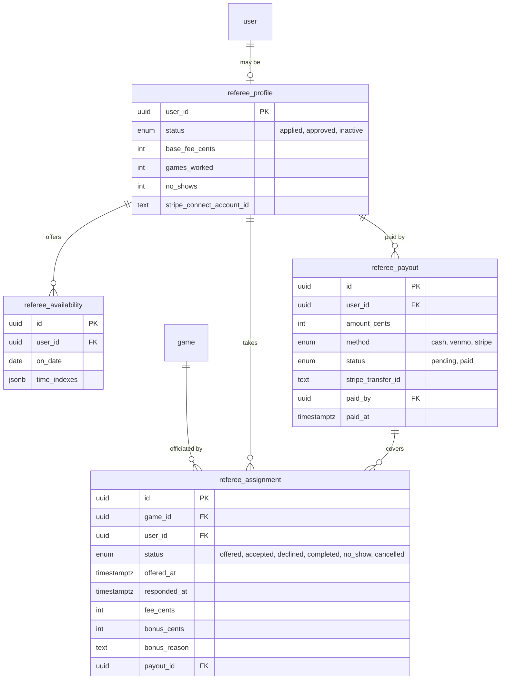
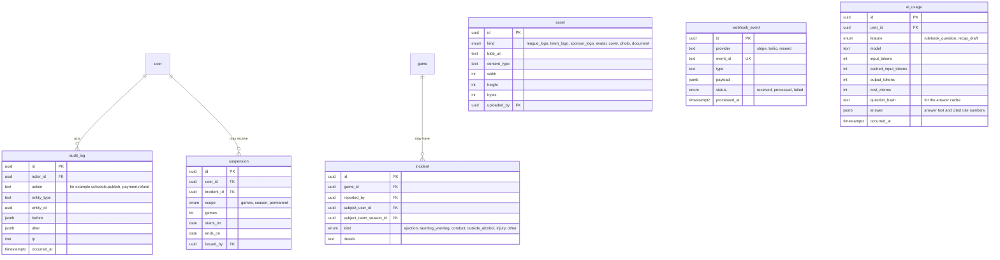

# Data model

Status: draft v1, 2026-11-11. Postgres on Neon, schema defined in Drizzle. Table and column names are final enough to build from; types are Postgres types.

## 1. Conventions

| Rule | Detail |
|---|---|
| Primary keys | `id uuid` default `gen_random_uuid()` |
| Audit fields on every table | `created_at timestamptz not null default now()`, `updated_at timestamptz not null`, `created_by uuid null` referencing `user` |
| Soft delete | `deleted_at timestamptz null` on teams, events, sponsors, posts and assets. Money, signatures, consent and audit rows are never deleted |
| Money | Integer cents in `*_cents` columns; currency is USD |
| Time | `timestamptz` in UTC. The league's time zone (`America/New_York`) lives on `league` and is applied when rendering and when generating slots |
| Enums | Postgres enums, named `<table>_<column>` |
| Flexible settings | `jsonb` with a Zod schema in code; nothing queried often lives in JSON |
| Names | Tables singular, snake_case |

The four tables Better Auth owns (`user`, `session`, `account`, `verification`) keep its names and shapes. Everything about a person that the league cares about is in `profile`.

A change history is kept two ways: `audit_log` records who changed what for admin-visible actions, and append-only tables (`waiver_signature`, `sms_consent_event`, `credit_entry`, `score_report`, `schedule_version`) are their own history.

## 2. Entity diagrams

One diagram per domain keeps them readable. Columns shown are the important ones; audit fields are omitted.

### 2.1 People, league, seasons, teams

Notes:
- `team` is the lasting identity (name, colors, logo, history). `team_season` is that team's entry in one season; rosters, payments and games hang off it.
- `registration` is one person's entry in one season and carries the waiver and payment state. `roster_membership` puts a registration on a team and keeps history when someone moves teams mid-season.
- `profile.lineup_gender` exists because the fielding rule counts two groups. How nonbinary players are counted is the league's call; the default is that the player chooses **(A)**.
- A captain is a `roster_membership` with `role = captain`. There is no captain column on `team_season`, so there is one source of truth.
- A team has one main captain, who makes final decisions and handles payment, and commonly one to three co-captains (`role = co_captain`, no limit in the schema). How much say co-captains have varies by team, so it is a per-team permission setting chosen by the main captain (Phase 1), not a schema rule. Paying for and withdrawing the team stay with the main captain.

### 2.2 Fields, schedule, games, scores

Notes:
- A `game` is a matchup and keeps its identity for the whole season. Where it is played is a `game_placement` inside a `schedule_version`. Generating, editing or rescheduling creates a new version with its own placements, so any two versions can be compared row by row and nothing is overwritten.
- `game.slot_id` copies the placement from the published version so public pages need one join. It is written only when a version is published, inside the same transaction.
- Team A and team B are neutral names because home and away are decided at the field.
- `game_period` is named for periods, not innings, so a second sport can reuse it.
- Standings are computed from `game` rows on demand and cached (see [architecture.md](architecture.md)). There is no standings table to drift out of date.

### 2.3 Money

Notes:
- `purchase` is our record of what was bought; `payment` mirrors what Stripe says happened. A purchase is marked paid only by the Stripe webhook, never by the browser returning from Checkout.
- A team's balance is its fee minus the sum of paid `purchase_item` rows for that `team_season_id`. It is computed, not stored.
- `credit_entry` is an append-only ledger. A balance is the sum of the deltas. Spending credit writes a negative row tied to the purchase.

### 2.4 Notifications and consent

Notes:
- `message` is the outbox. Code that wants to notify someone inserts a row in the same transaction as the change that caused it; a worker sends it. See [architecture.md](architecture.md).
- Current SMS consent is the latest `sms_consent_event` for a phone number. The log is append-only so the league can show when and how someone agreed.

### 2.5 Sponsors, events, community

```mermaid
erDiagram
  sponsor ||--o{ sponsorship : "signs"
  season ||--o{ sponsorship : "sold in"
  sponsor ||--o{ sponsor_member : "managed by"
  sponsor ||--o{ deal : offers
  sponsor ||--o{ checkin : receives
  deal ||--o{ deal_redemption : "redeemed as"
  checkin ||--o| deal_redemption : "may include"
  sponsor ||--o{ sponsor_stat_daily : "measured by"
  season ||--o{ team_of_week : names
  league ||--o{ event : hosts
  event ||--o{ event_rsvp : collects
  season ||--o{ award_poll : runs
  award_poll ||--o{ award_vote : collects
  league ||--o{ post : publishes

  sponsor {
    uuid id PK
    uuid league_id FK
    text name
    text slug UK
    enum kind "bar, restaurant, brand, other"
    bool is_home_bar
    text address
    numeric lat
    numeric lng
    text url
    uuid logo_asset_id FK
    uuid logo_square_asset_id FK
    text checkin_secret "signs the rotating QR code"
  }
  sponsorship {
    uuid id PK
    uuid sponsor_id FK
    uuid season_id FK
    enum tier "home_bar, field, team, supporter"
    uuid team_season_id FK "for team sponsors"
    int amount_cents
    text in_kind_notes
  }
  sponsor_member {
    uuid id PK
    uuid sponsor_id FK
    uuid user_id FK
  }
  deal {
    uuid id PK
    uuid sponsor_id FK
    text title
    text terms
    jsonb valid_days
    time valid_from
    time valid_to
    bool active
  }
  checkin {
    uuid id PK
    uuid sponsor_id FK
    uuid user_id FK
    uuid team_season_id FK
    date on_date
    timestamptz checked_in_at
  }
  deal_redemption {
    uuid id PK
    uuid deal_id FK
    uuid checkin_id FK
    uuid user_id FK
    timestamptz redeemed_at
  }
  sponsor_stat_daily {
    uuid id PK
    uuid sponsor_id FK
    date on_date
    text placement "home strip, game page, sponsor page"
    int impressions
    int clicks
  }
  team_of_week {
    uuid id PK
    uuid season_id FK
    date week_of
    uuid team_season_id FK
    uuid sponsor_id FK
    int tab_cents
    text reason
  }
  event {
    uuid id PK
    uuid league_id FK
    uuid season_id FK
    enum kind "bar_night, bbq, tournament, theme_week, social"
    text title
    text slug UK
    text description_md
    timestamptz starts_at
    timestamptz ends_at
    uuid venue_id FK
    uuid sponsor_id FK
    int capacity
    int ticket_price_cents
    uuid cover_asset_id FK
  }
  event_rsvp {
    uuid id PK
    uuid event_id FK
    uuid user_id FK
    enum status "going, maybe, not_going, waitlisted"
    int guests
    uuid purchase_item_id FK
  }
  award_poll {
    uuid id PK
    uuid season_id FK
    enum kind "weekly_mvp, season_mvp, best_team_name, sportsmanship, custom"
    text title
    timestamptz opens_at
    timestamptz closes_at
  }
  award_vote {
    uuid id PK
    uuid award_poll_id FK
    uuid voter_id FK
    uuid nominee_user_id FK
    uuid nominee_team_season_id FK
  }
  social_account {
    uuid id PK
    uuid league_id FK
    enum provider "instagram"
    text account_name
    text access_token_encrypted
    timestamptz token_expires_at
    enum status "connected, needs_reconnect, disconnected"
    timestamptz last_synced_at
  }
  social_post {
    uuid id PK
    uuid social_account_id FK
    text provider_post_id UK
    text permalink
    text caption
    enum media_type "image, video, carousel"
    uuid asset_id FK "our stored copy"
    timestamptz taken_at
    bool featured
    bool hidden
    uuid team_id FK
    uuid event_id FK
    uuid season_id FK
  }
  post {
    uuid id PK
    uuid league_id FK
    uuid season_id FK
    text slug UK
    text title
    text body_md
    uuid cover_asset_id FK
    timestamptz published_at
  }
```

### 2.6 Referees (pending owner approval)

The MVP uses only `referee_assignment` with `status = accepted`, created by an admin, so score entry can be tied to it. The rest waits for approval.

### 2.7 Platform

## 3. Constraints and indexes

Integrity rules the database enforces, so application bugs cannot break them:

| Table | Constraint or index | Purpose |
|---|---|---|
| `registration` | unique `(season_id, user_id)` | One entry per person per season |
| `roster_membership` | unique `(team_season_id, registration_id)` where `status <> 'removed'` | No duplicate roster spots |
| `roster_membership` | unique `(registration_id)` where `status = 'active'` | A player is active on one team per season |
| `roster_membership` | unique `(team_season_id)` where `role = 'captain' and status = 'active'` | Exactly one captain |
| `team_season` | unique `(team_id, season_id)` | One entry per team per season |
| `slot` | unique `(field_id, starts_at)`; check `ends_at > starts_at` | No duplicate slots |
| `slot` | exclusion on `(field_id, tstzrange(starts_at, ends_at))` | No overlapping slots on a field |
| `game` | check `team_a_id <> team_b_id` | A team cannot play itself |
| `game_placement` | unique `(schedule_version_id, game_id)` | A game is placed once per version |
| `game_placement` | unique `(schedule_version_id, slot_id)` where `slot_id is not null` | A slot holds one game per version |
| `schedule_version` | unique `(season_id, version_no)`; unique `(season_id)` where `status = 'published'` | One published version at a time |
| `schedule_version` | check `version_no > 0`; check a non-draft version has `published_at` | Versions count from 1; publishing is timestamped |
| `game_placement` | check `locked` only with a `slot_id` | Only a placed game can be pinned |
| `permit_window` | check `ends_at > starts_at` | A permit has a length |
| `blackout` | unique `(season_id, on_date, field_id)`, nulls not distinct | One blackout per date for all fields, and one per field |
| `team_constraint` | check `on_date` or `time_index` is set; check `weight` between 1 and 10 | A constraint says when; weights stay comparable |
| `audit_log` | check `action` matches `area.verb` | Actions stay searchable, such as every `schedule.*` |
| `waiver_signature` | unique `(waiver_id, user_id, season_id)` | One signature per waiver per season |
| `score_report` | unique `(client_id)` | Retried offline submissions are ignored |
| `score_confirmation` | unique `(game_id, team_season_id)` | One answer per team |
| `game_rsvp` | unique `(game_id, user_id)` | One RSVP per game |
| `game_period` | unique `(game_id, period_no, half)` | One row per half-inning |
| `sub_claim` | unique `(sub_request_id, user_id)` | One claim per person |
| `checkin` | unique `(sponsor_id, user_id, on_date)` | One check-in per bar per day |
| `award_vote` | unique `(award_poll_id, voter_id)` | One vote per poll |
| `message` | unique `(dedupe_key)` | The same notice is never sent twice |
| `webhook_event` | unique `(provider, event_id)` | Webhooks are processed once |
| `payment`, `refund`, `purchase` | unique on each Stripe ID | Stripe retries cannot double-record |
| `credit_entry` | check that exactly one of `user_id`, `team_season_id` is set | Credit has one owner |

Indexes for the common reads:

| Table | Index | Serves |
|---|---|---|
| `game` | `(season_id, status)`, `(team_a_id)`, `(team_b_id)`, `(slot_id)` | Schedule, team pages, standings |
| `slot` | `(season_id, starts_at)` | Schedule by date |
| `game_placement` | `(schedule_version_id)` | Loading a version |
| `roster_membership` | `(team_season_id, status)`, `(registration_id)` | Rosters, "my team" |
| `registration` | `(season_id, status)`, `(user_id)` | Admin lists, "my seasons" |
| `purchase_item` | `(team_season_id)`, `(registration_id)` | Team balance, who has paid |
| `message` | `(status, send_after)` where `status = 'queued'` | The outbox worker |
| `message` | `(user_id, created_at desc)` | Delivery history |
| `audit_log` | `(entity_type, entity_id, occurred_at desc)`, `(actor_id, occurred_at desc)` | History of a record, history of a person |
| `checkin` | `(sponsor_id, on_date)` | Sponsor report |
| `sms_consent_event` | `(phone_e164, occurred_at desc)` | Current consent |
| `game_rsvp` | `(game_id, team_season_id)` | Captain's RSVP board |
| `event` | `(league_id, starts_at)` | Calendar |
| `weather_snapshot` | `(venue_id, for_date, fetched_at desc)` | Latest forecast |

## 4. Personal data

| Data | Where | Who can read it |
|---|---|---|
| Email, name | `user`, `profile` | The person, their captain, admins |
| Phone | `profile`, `sms_consent_event` | The person, admins, their captain; teammates only if `shares_contact` |
| Birth date | `profile` | The person and owners. Everyone else sees only "18+ confirmed" |
| Gender and lineup gender | `profile` | The person, their captain (for lineups), admins |
| Emergency contact | `profile` | The person, their captain, admins |
| Waiver signature, IP address | `waiver_signature` | The person, owners |
| Payment card | Never stored. Stripe holds it; we keep brand and last four digits | The person |

Deleting an account removes the profile and anonymizes the user row. Signatures, payments, consent events and audit rows are kept because the league may need them for legal or accounting reasons; the privacy policy says so.
