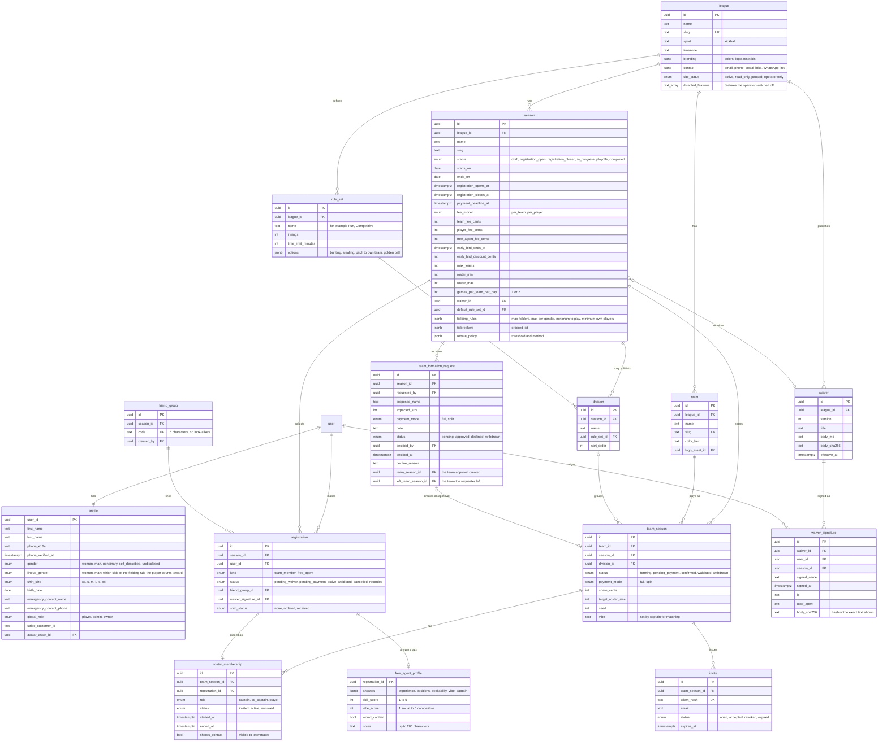
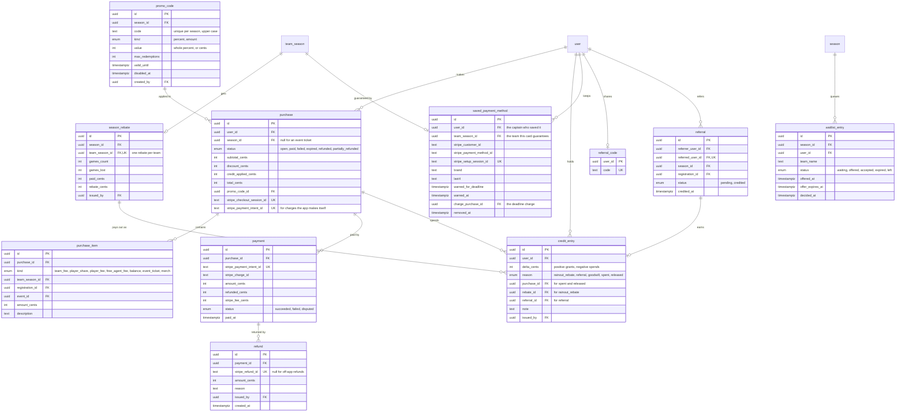
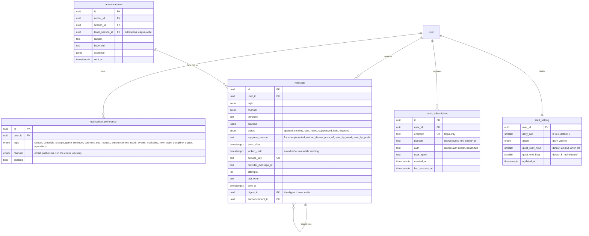
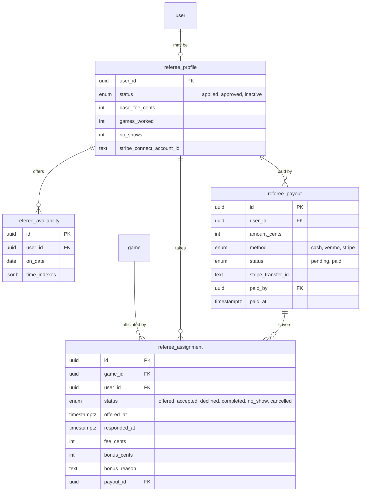
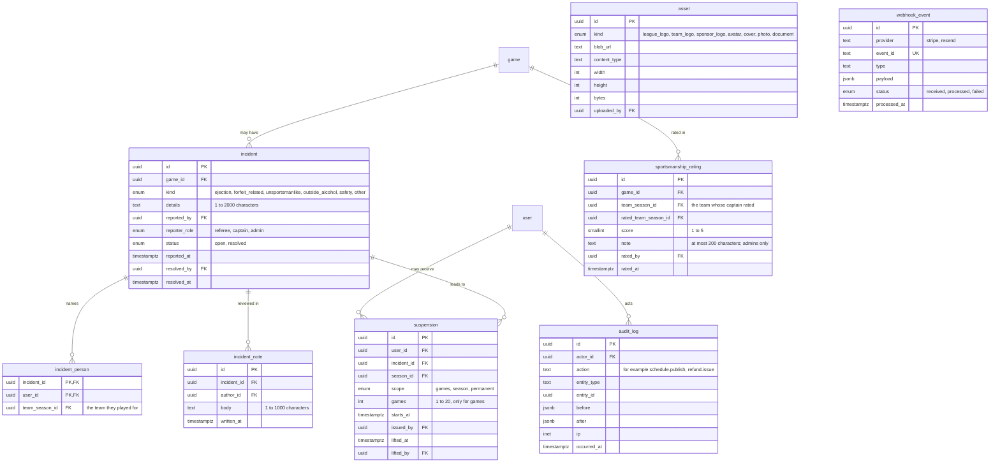
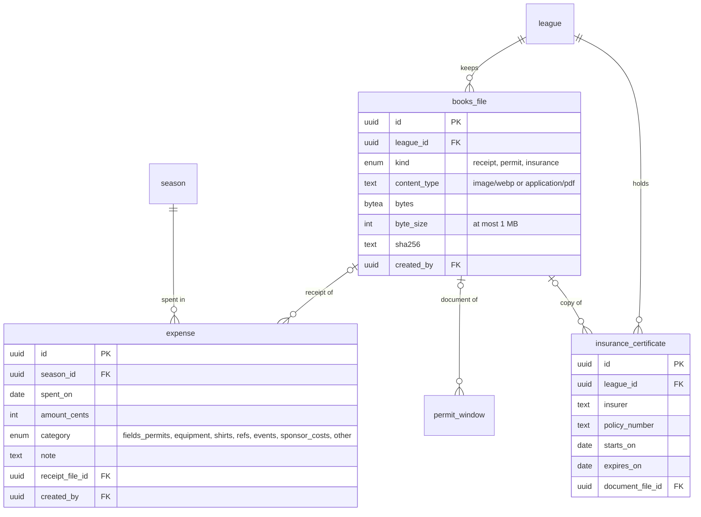

# Data model

Status: draft v1, 2026-11-11. Postgres on Neon, schema defined in Drizzle. Table and column names are final enough to build from; types are Postgres types.

## 1. Conventions

| Rule | Detail |
|---|---|
| Primary keys | `id uuid` default `gen_random_uuid()` |
| Audit fields on every table | `created_at timestamptz not null default now()`, `updated_at timestamptz not null`, `created_by uuid null` referencing `user` |
| Soft delete | `deleted_at timestamptz null` on teams, events, sponsors, posts and assets. Money, signatures, consent and audit rows are never deleted |
| Money | Integer cents in `*_cents` columns; currency is USD |
| Time | `timestamptz` in UTC. The league's time zone (`America/New_York`) lives on `league` and is applied when rendering and when generating slots |
| Enums | Postgres enums, named `<table>_<column>` |
| Flexible settings | `jsonb` with a Zod schema in code; nothing queried often lives in JSON |
| Names | Tables singular, snake_case |

The tables Better Auth owns (`user`, `session`, `account`, `verification`, and `passkey` from its passkey plugin) keep its names and shapes. Everything about a person that the league cares about is in `profile`.

- `session` is one signed-in browser. The account page lists a person's live sessions as their signed-in devices (named from `user_agent`) and deletes one to sign that device out. Signing in again on a browser that already holds a session for the same account ends the old session, so each browser appears once.
- `passkey` holds a person's passkeys: the public key, the WebAuthn credential id (indexed, for sign-in), a signature counter, `device_type` (`singleDevice` or `multiDevice`), `backed_up`, `transports`, the authenticator model (`aaguid`) and a `name` the person can change. Deleting the user cascades to it.

A change history is kept two ways: `audit_log` records who changed what for admin-visible actions, and append-only tables (`waiver_signature`, `credit_entry`, `score_report`, `schedule_version`) are their own history.

## 2. Entity diagrams

One diagram per domain keeps them readable. Columns shown are the important ones; audit fields are omitted.

### 2.1 People, league, seasons, teams

Notes:
- `team` is the lasting identity (name, colors, logo, history). `team_season` is that team's entry in one season; rosters, payments and games hang off it.
- `registration` is one person's entry in one season and carries the waiver and payment state. `roster_membership` puts a registration on a team and keeps history when someone moves teams mid-season.
- `profile.lineup_gender` exists because the fielding rule counts two groups. How nonbinary players are counted is the league's call; the default is that the player chooses **(A)**. The kicking-order rule uses the same answer, and a player who has not chosen counts toward neither side ([ADR 0030](adr/0030-kicking-order-sides.md)).
- A captain is a `roster_membership` with `role = captain`. There is no captain column on `team_season`, so there is one source of truth.
- `free_agent_profile` holds a free agent's quiz answers. The scores are worked out from the answers when they are saved, so admins can sort the pool and the matcher (`src/domain/matcher`) reads them without parsing JSON. The row stays after the player is placed, so the matcher can describe a team's vibe and experience.
- `friend_group` keeps a few free agents who signed up together on the same team: one starts it and shares the code, the others enter it in their quiz. A group holds up to 4 registrations (`registration.friend_group_id`), checked when someone joins. The code is unique across seasons, so a typo never lands in another season's group.
- Players on a team built from the free-agent pool keep `registration.kind = free_agent` and pay the free-agent fee; per team, the new team's fixed share is that fee, for anyone the captain invites later ([ADR 0012](adr/0012-free-agent-matching.md)).
- A team has one main captain, who makes final decisions and handles payment, and commonly one to three co-captains (`role = co_captain`, no limit in the schema). How much say co-captains have varies by team, so it is a per-team permission setting chosen by the main captain (Phase 1), not a schema rule. Paying for and withdrawing the team stay with the main captain.
- `team_formation_request` is a player's ask to start a team ([information architecture, 2.7](information-architecture.md#27-start-a-new-team-p2)). A person has at most one `pending` request per season. Approval creates the `team` and its `team_season` in `forming` status, priced as of the day they asked, and makes the requester its captain: their registration is reused (a free agent becomes a team member) or created, and any active spot on another team is ended, with `left_team_season_id` recording which captain was told. A requester who paid for their own spot keeps it as their share, so the team splits its fee; one whose spot was covered by their old captain's team fee owes again ([ADR 0013](adr/0013-new-team-approval-moves-the-player.md)). The request row is locked while an admin answers it, so two admins cannot both decide it.

### 2.2 Fields, schedule, games, scores

```mermaid
erDiagram
  venue ||--o{ field : contains
  field ||--o{ permit_window : "permitted for"
  season ||--o{ permit_window : uses
  season ||--o{ blackout : excludes
  season ||--o{ slot : offers
  field ||--o{ slot : hosts
  permit_window ||--o{ slot : "cut into"
  season ||--o{ schedule_version : has
  season ||--o{ game : contains
  schedule_version ||--o{ game_placement : places
  game ||--o{ game_placement : "placed by"
  slot ||--o{ game_placement : holds
  team_season ||--o{ game : plays
  team_season ||--o{ team_constraint : states
  game ||--o{ score_report : receives
  game ||--o{ score_confirmation : needs
  game ||--o{ game_period : "scored by"
  game ||--o{ offline_receipt : "sent offline"
  game ||--o{ game_rsvp : collects
  game ||--o{ game_lineup : "kicks in"
  game_lineup ||--o{ game_lineup_spot : holds
  game ||--o{ sub_request : "may need"
  sub_request ||--o{ sub_claim : gets
  season ||--o{ bracket : "ends with"
  bracket ||--o{ bracket_match : has
  bracket_match |o--|| game : "played as"
  venue ||--o{ weather_snapshot : "forecast for"
  season ||--o{ rainout : records

  venue {
    uuid id PK
    text name
    text slug UK
    text address
    numeric lat
    numeric lng
    text neighborhood
  }
  field {
    uuid id PK
    uuid venue_id FK
    text name
    int sort_order
    text notes
  }
  permit_window {
    uuid id PK
    uuid field_id FK
    uuid season_id FK
    timestamptz starts_at
    timestamptz ends_at
    text permit_number
    enum status "requested, confirmed, lost"
    int cost_cents "this window's share of the permit's cost"
    uuid document_file_id FK "books_file, section 2.8"
    date application_opens_on
    date application_closes_on
    date renews_on
  }
  blackout {
    uuid id PK
    uuid season_id FK
    date on_date
    uuid field_id FK "null means all fields"
    text reason
  }
  slot {
    uuid id PK
    uuid season_id FK
    uuid field_id FK
    uuid permit_window_id FK
    timestamptz starts_at
    timestamptz ends_at
    int time_index "0 is the earliest slot of the day"
    enum kind "regular, makeup_reserve, playoff"
    enum status "open, cancelled"
  }
  schedule_version {
    uuid id PK
    uuid season_id FK
    int version_no
    uuid parent_version_id FK
    enum status "draft, published, superseded"
    enum origin "generated, manual_edit, rainout, playoffs"
    bigint seed
    jsonb input_snapshot "exact scheduler input"
    jsonb metrics "fairness metrics"
    jsonb violations "empty when valid"
    timestamptz published_at
    uuid published_by FK
    text note
  }
  game {
    uuid id PK
    uuid season_id FK
    uuid division_id FK
    int round_no
    uuid team_a_id FK "team_season"
    uuid team_b_id FK "team_season"
    enum kind "regular, playoff, exhibition"
    enum status "scheduled, in_progress, final, postponed, cancelled, forfeit"
    uuid slot_id FK "placement in the published version"
    int score_a
    int score_b
    int innings_played
    uuid forfeit_by FK "team_season"
    timestamptz finalized_at
    uuid kicks_first FK "team_season kicking in the top of each inning"
  }
  game_placement {
    uuid id PK
    uuid schedule_version_id FK
    uuid game_id FK
    uuid slot_id FK "null means unplaced"
    bool locked "manual pin"
  }
  team_constraint {
    uuid id PK
    uuid team_season_id FK
    enum kind "unavailable, prefer, avoid"
    date on_date
    int time_index
    int weight
    text reason
  }
  score_report {
    uuid id PK
    uuid game_id FK
    uuid reported_by FK
    enum reporter_role "referee, captain, admin"
    int score_a
    int score_b
    int innings_played
    enum outcome "normal, forfeit_a, forfeit_b, called"
    text client_id UK "idempotency key from the device"
    timestamptz reported_at
  }
  score_confirmation {
    uuid id PK
    uuid game_id FK
    uuid team_season_id FK
    uuid user_id FK
    enum status "confirmed, disputed"
    text note
  }
  game_period {
    uuid id PK
    uuid game_id FK
    int period_no "inning number, 1 to 20"
    enum half "top, bottom"
    int runs "0 to 99"
    uuid entered_by FK "who entered or last corrected it"
    timestamptz entered_at
  }
  game_lineup {
    uuid id PK
    uuid game_id FK
    uuid team_season_id FK
    int run_breaks "runs of 3 or more of one side when saved"
    uuid updated_by FK "who saved it last"
  }
  game_lineup_spot {
    uuid id PK
    uuid lineup_id FK
    int position "1 to 40"
    uuid user_id FK
    bool pickup "an approved sub, who kicks last"
  }
  offline_receipt {
    uuid key PK "made on the phone"
    uuid user_id FK "who saved it"
    uuid game_id FK
    enum kind "score, half, end"
    jsonb result "the answer the phone got"
    timestamptz entered_at "by the phone's clock"
    timestamptz received_at
  }
  game_rsvp {
    uuid id PK
    uuid game_id FK
    uuid user_id FK
    uuid team_season_id FK
    enum status "in, out, maybe"
  }
  sub_request {
    uuid id PK
    uuid game_id FK
    uuid team_season_id FK "the team asking"
    uuid requested_by FK
    int needed "1 to 11"
    int women_needed "spots only a woman can take"
    int men_needed "spots only a man can take"
    text note
    enum status "open, filled, cancelled"
    timestamptz closes_at "game time"
  }
  sub_claim {
    uuid id PK
    uuid sub_request_id FK
    uuid user_id FK
    enum status "pending, approved, declined, withdrawn"
    enum lineup_gender "copied from the profile when claimed"
    timestamptz claimed_at
    timestamptz decided_at
    uuid decided_by FK
  }
  bracket {
    uuid id PK
    uuid season_id FK "one per season"
    enum format "single_elimination"
    enum status "draft, published, complete"
    int size "teams, 2 to 32"
    jsonb seeds "seed number and team entry, frozen from the standings"
    uuid schedule_version_id FK "the version that placed it"
    uuid champion_id FK
    jsonb diagnostics
  }
  bracket_match {
    uuid id PK
    uuid bracket_id FK
    text code UK "r{round}m{position}"
    int round_no
    int position
    jsonb source_a "seed number or winner of a match"
    jsonb source_b
    uuid team_a_id FK "null until known"
    uuid team_b_id FK
    uuid slot_id FK "reserved by the bracket placement"
    uuid game_id FK "set once both teams are known"
    uuid winner_id FK
  }
  weather_snapshot {
    uuid id PK
    uuid venue_id FK
    date for_date
    text provider
    enum risk "low, watch, likely"
    jsonb hourly
    timestamptz fetched_at
  }
  rainout {
    uuid id PK
    uuid season_id FK
    date on_date
    jsonb scope "fields and times cancelled"
    uuid decided_by FK
    uuid schedule_version_id FK
    int games_affected
    int games_unplaced
  }
```

Notes:
- A `game` is a matchup and keeps its identity for the whole season. Where it is played is a `game_placement` inside a `schedule_version`. Generating, editing or rescheduling creates a new version with its own placements, so any two versions can be compared row by row and nothing is overwritten.
- `game.slot_id` copies the placement from the published version so public pages need one join. It is written only when a version is published, inside the same transaction.
- Slots are cut from requested and confirmed permit windows, minus blackouts, when an admin asks (the fields screen). Cutting again keeps a slot's id when its field and start are unchanged, so versions that use it stay intact. A slot no permit covers any more is deleted, or set to `cancelled` when a version uses it. Slots entered without a permit are left alone. A cancelled slot stays cancelled, because a rain-out cancels slots the same way.
- Team A and team B are neutral names because home and away are decided at the field.
- `game_period` is named for periods, not innings, so a second sport can reuse it. It holds live scoring ([ADR 0011](adr/0011-live-scores-by-polling.md)): one row per half-inning, entered in order and corrected in place. The line score and the score at the last complete inning are worked out from these rows, never stored. Which team kicks in the top half is on the game (`kicks_first`, one of its two teams), set when live scoring starts. The final score still comes from a `score_report`, so a game scored live is confirmed like any other.
- Kicking orders ([ADR 0030](adr/0030-kicking-order-sides.md)): a team has at most one `game_lineup` per game, and saving again replaces its `game_lineup_spot` rows in one transaction. Only players who said they're in, and approved pickups, can be saved into it. Players' lineup genders are never copied into it; they are read from `profile` (or `sub_claim` for a pickup) when the team's captains open the builder. `run_breaks` records how many runs of more than two of one side the order had when saved, so the ref and the other captain see that the order breaks the rule without seeing anyone's side. A saved order is never blocked for breaking the rule.
- `offline_receipt` holds one row per score entry made on a phone with no signal and sent later ([ADR 0025](adr/0025-offline-scores-keep-the-servers-version.md)): a final score (`score`), a half-inning (`half`) or ending a live-scored game (`end`). It is written before the entry is applied, in the same transaction, and keeps the answer the phone got, so a resend of the same key gets that answer again and changes nothing. A final score from the phone also uses the key as its report's `client_id`. Rows go with their game, and deleting an account deletes its rows, since an answer can name the other captain.
- Standings are computed from `game` rows on demand and cached (see [architecture.md](architecture.md)). There is no standings table to drift out of date.
- A playoff `game` (`kind = playoff`, `round_no` null) exists only once both its teams are known, so a game never has an empty side. Until then its `bracket_match` holds the slot the bracket placement reserved, and that slot's kind becomes `playoff` so rain-out makeups and new regular-season schedules leave it alone. Divisions, when they arrive, add a `division_id` to `bracket`.
- Schedule versions keep playoff placements apart from the round robin: the round-robin rules never judge a bracket, and a version made from another (an edit or a rain-out) carries the parent's playoff placements over. When a result fills both sides of the next match, its game is created and a new `playoffs` version with it is published by the league itself (`published_by` null).
- `team_season.seed` is written when the bracket is made, from the standings with the season's tiebreakers.
- Sub requests ([ADR 0006](adr/0006-sub-claims-hold-spots.md)): a team has at most one live (`open` or `filled`) request per game, and none for playoff games. `women_needed` and `men_needed` reserve spots for the fielding rule; the rest of `needed` is open to anyone eligible. A `pending` or `approved` claim holds a spot, so a request never has more of those than `needed`; the request is `filled` once approved claims take every spot, and opens again if an approved sub withdraws. A request past `closes_at` (the game's start) is closed whatever its status, so no job sweeps it. Claims are written under a lock on the request row, which is what stops two players taking the last spot.
- League history is computed on demand like the standings: a completed season's champion is its complete bracket's `champion_id`, or the top of its final standings when it had no bracket, and a team's all-time record adds up its seasons' regular-season standings. Nothing about history is stored.

### 2.3 Money

Notes:
- `purchase` is our record of what was bought; `payment` mirrors what Stripe says happened. A purchase is marked paid only by the Stripe webhook, never by the browser returning from Checkout.
- A team's balance is its fee minus the sum of paid `purchase_item` rows for that `team_season_id`. It is computed, not stored.
- When a captain pays the whole team fee, every teammate who has signed the waiver is paid up: their registration becomes active when the fee is paid, or when they sign or join later.
- Pressing "Pay" again expires the earlier Checkout session first, so one registration cannot be paid twice.
- `credit_entry` is an append-only ledger per player. A balance is the sum of the deltas. Checkout locks the player's user row, applies credit after any promo code (never leaving a charge under 50 cents) and writes a negative `spent` row tied to the purchase; if that purchase expires or fails, a `released` row gives it back. Each purchase spends and releases at most once. Credit covering the whole price settles the purchase with no payment, like a promo code. Credit does not expire.
- A split-pay team's balance is its whole-team fee on the day it registered (an early-bird team keeps its early-bird price) minus the `team_fee`, `player_share` and `balance` items of its paid purchases. Refunds do not reopen it. When the balance reaches zero the team is confirmed.
- `saved_payment_method` is the captain guarantee ([ADR 0022](adr/0022-captain-guarantee-and-league-credit.md)): one live card per team, saved by Checkout in setup mode. The daily job warns the captain once per deadline (`warned_for_deadline`, `warned_at`) and makes one `balance` purchase for the deadline charge (`charge_purchase_id`), never sooner than 72 hours after the warning. That purchase carries the PaymentIntent; `payment_intent.succeeded` settles it and `payment_intent.payment_failed` fails it.
- `season_rebate` records how a team's rain-out rebate was worked out. A game is lost when it was cancelled or postponed, or sits in the published schedule with no slot or a cancelled one. A team that lost more than the season's `rebate_policy.thresholdPct` (25% by default) gets that share of what was paid for it, split among the people who paid in proportion to what they paid (promo discounts and refunds taken off), as `rainout_rebate` credit rows.
- `waitlist_entry` is the team line for a full season. An offer holds a spot until `offer_expires_at` (48 hours, never past registration closing) and counts as expired the moment that passes. While anyone waits or holds a live offer, registering a team takes a lock on the season row and only the offer's holder may take the spot.
- A `referral` is made when someone registers for the first time after arriving through `/r/<code>` (a 30-day cookie). It is credited once, with $10 of `referral` credit to the referrer, when that registration is paid.
- Promo codes are applied by the app, not by Stripe ([ADR 0010](adr/0010-promo-codes-applied-in-app.md)). Checkout locks the code's row, counts its uses and writes the purchase with `discount_cents` and `promo_code_id`; Stripe is sent the discounted line items. A use is a purchase that is open, paid or refunded, so an abandoned or failed checkout gives its use back. A code that covers the whole price settles the purchase at once with no `payment` row. A percentage rounds down to the cent, and a code never leaves a charge under Stripe's 50-cent minimum. Turning a code off sets `disabled_at`; purchases that used it keep their discount.
- A refund never cancels a registration; an admin removes a player separately. `payment.refunded_cents` is what has gone back. For Stripe payments only the `charge.refunded` webhook moves it, to Stripe's running total (never lower, so replays and late events are harmless), and refunds made in Stripe's dashboard count too. An admin's Stripe refund writes its `refund` row first, under a lock on the payment, then calls Stripe with the row's id as the idempotency key and stores `stripe_refund_id`; if Stripe refuses, the row is deleted. Off-app refunds (cash or Venmo handed back) add to `refunded_cents` at once. The purchase then becomes `partially_refunded` or `refunded`. Every refund writes an audit row (`refund.issue`).

### 2.4 Notifications and consent

Notes:
- `message` is the outbox. Code that wants to notify someone inserts a row in the same transaction as the change that caused it; a worker sends it. See [architecture.md](architecture.md). It holds the template name and its payload, not the finished email, and looks up the address when sending.
- No text messages are sent, because every text is billed and the product runs on free services only ([ADR 0021](adr/0021-free-services-only.md)). The `sms` value of the `message_channel` enum stays in the schema unused, and an `sms_consent_event` table is **not planned**.
- Push is a channel like email: a person's push choices are `notification_preference` rows with channel `push`, off unless they turned the topic on. A notice about a push topic gets a second `message` row with channel `push` and dedupe key `push:<key>` for each person with a device and that topic on. `suppress_reason` adds `no_device` (every device gone) and `push_off` (no VAPID keys).
- Alert limits: `alert_setting` holds a person's daily cap on non-urgent messages (per channel), digest frequency and quiet hours, as whole hours in the league's time zone; no row means the defaults (3, daily, 10 pm to 8 am). A non-urgent message over the cap is `held` with `send_after` at the person's next digest; the digest job puts it in a `digest` message (topic `digest`, template `digest`) and marks it `digested` with `digest_id`. A non-urgent message in quiet hours stays `queued` with `send_after` moved to when they end. Which kinds are urgent is in [architecture.md](architecture.md), section 5. When the day's email quota runs out, an urgent email whose push copy was sent is `suppressed` (`sent_by_push`), and other email waits as `queued` with `send_after` at the next midnight UTC; the drain counts sent email with `message_email_sent_idx`. Topic `operations` carries notices to admins about the league's own running (today, the email quota), and is not on the settings page.
- `push_subscription` is one browser or installed app. A browser has one endpoint, so the endpoint is unique and moves to whoever subscribed it last. The outbox deletes a row when its push service answers 404 or 410.

### 2.5 Sponsors, events, community

```mermaid
erDiagram
  sponsor ||--o{ sponsorship : "signs"
  season ||--o{ sponsorship : "sold in"
  sponsor ||--o{ sponsor_member : "managed by"
  sponsor ||--o{ deal : offers
  sponsor ||--o{ checkin : receives
  deal ||--o{ deal_redemption : "redeemed as"
  checkin ||--o| deal_redemption : "may include"
  sponsor ||--o{ sponsor_stat_daily : "measured by"
  season ||--o{ team_of_week : names
  league ||--o{ event : hosts
  event ||--o{ event_rsvp : collects
  event ||--o{ event_ticket : sells
  purchase ||--o| event_ticket : "pays for"
  event ||--o{ event_audience_team : "is for"
  team ||--o{ event_audience_team : "is invited to"
  user ||--o| calendar_feed : "subscribes with"
  season ||--o{ award_poll : runs
  award_poll ||--o{ award_vote : collects
  league ||--o{ post : publishes
  league ||--o| social_account : connects
  social_account ||--o{ social_post : syncs
  social_post ||--o| social_image : "stored as"
  team ||--o{ social_post : "tagged in"
  event ||--o{ social_post : "tagged in"

  sponsor {
    uuid id PK
    uuid league_id FK
    text name
    text slug "unique in the league"
    enum kind "bar, restaurant, brand, other"
    bool is_home_bar "one per league"
    text blurb
    text address
    text url "https only"
    text checkin_secret "signs the rotating QR code"
    timestamptz deleted_at
  }
  sponsorship {
    uuid id PK
    uuid sponsor_id FK
    uuid season_id FK
    enum tier "home_bar, field, team, supporter"
    uuid team_season_id FK "for team sponsors"
    int amount_cents
    text in_kind_notes
  }
  sponsor_member {
    uuid id PK
    uuid sponsor_id FK
    uuid user_id FK
  }
  deal {
    uuid id PK
    uuid sponsor_id FK
    text title
    text terms
    smallint_array valid_days "ISO weekdays; empty is every day"
    time valid_from
    time valid_to "before valid_from runs past midnight"
    bool active
    timestamptz confirmed_at "last said still current"
  }
  checkin {
    uuid id PK
    uuid sponsor_id FK
    uuid user_id FK
    uuid team_season_id FK
    date on_date
    timestamptz checked_in_at
  }
  deal_redemption {
    uuid id PK
    uuid deal_id FK
    uuid checkin_id FK
    uuid user_id FK
    timestamptz redeemed_at
  }
  sponsor_stat_daily {
    uuid id PK
    uuid sponsor_id FK
    date on_date
    text placement "home strip, game page, sponsor page"
    int impressions
    int clicks
  }
  team_of_week {
    uuid id PK
    uuid season_id FK
    date week_of "the game day"
    uuid team_season_id FK
    uuid sponsor_id FK "who puts up the tab"
    int tab_cents
    text reason
  }
  event {
    uuid id PK
    uuid league_id FK
    enum kind "social, bar_night, bbq, tournament, theme_week, party"
    text title
    text slug UK "title and start date, set once"
    text place "null allowed for a theme week"
    text description
    timestamptz starts_at
    timestamptz ends_at
    int capacity "null: no limit"
    enum audience "public, members, teams"
    uuid audience_season_id FK "teams audience: null for any season"
    text invite_url "https://, shown and shared, never fetched"
    bool in_app_rsvp "false: RSVPs only on the invite"
    int ticket_price_cents "null: a free RSVP"
    int member_price_cents "null: members pay the ticket price"
    timestamptz cancelled_at
    timestamptz deleted_at
    uuid created_by FK
  }
  event_audience_team {
    uuid event_id PK,FK
    uuid team_id PK,FK
  }
  calendar_feed {
    uuid user_id PK,FK
    int version "the signed feed link's version; 1 until reset"
  }
  event_rsvp {
    uuid id PK
    uuid event_id FK
    uuid user_id FK
    enum status "going, waitlisted"
    timestamptz created_at "waitlist order"
  }
  event_ticket {
    uuid id PK
    uuid event_id FK
    uuid user_id FK
    uuid purchase_id FK,UK "null for an offer"
    enum status "offered, held, paid, refunded, released, cancelled"
    int price_cents "member or full price, before credit"
    text code "six characters, unique per event"
    timestamptz held_until "offered and held: when the spot is free again"
    timestamptz checked_in_at
  }
  award_poll {
    uuid id PK
    uuid season_id FK
    enum kind "weekly, season"
    enum category "mvp, best_play, best_sport, newcomer, team_spirit, best_dressed"
    text title
    date game_day "weekly polls only"
    timestamptz opens_at
    timestamptz closes_at
    uuid created_by FK
  }
  award_vote {
    uuid id PK
    uuid award_poll_id FK
    uuid voter_id FK
    uuid nominee_user_id FK "player awards"
    uuid nominee_team_season_id FK "team awards"
    timestamptz cast_at
  }
  social_account {
    uuid id PK
    uuid league_id FK
    enum provider "instagram"
    text external_id "the account's ID at Instagram"
    text username
    enum status "active, needs_reconnect, disconnected"
    text token_ciphertext "AES-256-GCM; null once disconnected"
    timestamptz token_expires_at
    timestamptz token_refreshed_at
    bool show_newest "show posts without featuring each"
    timestamptz last_synced_at
    text last_error
    uuid connected_by FK
  }
  social_post {
    uuid id PK
    uuid account_id FK
    text external_id "unique per account"
    text permalink "the post on Instagram"
    text caption
    enum media_type "image, video, carousel"
    timestamptz taken_at
    bool featured
    bool hidden
    uuid team_id FK
    uuid event_id FK
    enum cover "home, team"
    text alt_text
  }
  social_image {
    uuid id PK
    uuid post_id FK "unique"
    text content_type "image/jpeg, image/png, image/webp"
    bytea bytes "our copy; up to 2 MB, 25 MB in all"
    int byte_size
    text sha256
  }
  post {
    uuid id PK
    uuid league_id FK
    uuid season_id FK
    text slug UK
    text title
    text body_md
    uuid cover_asset_id FK
    timestamptz published_at
  }
```

Events, as built (`src/db/schema/event.ts`, `src/db/queries/events.ts`):

- A theme week has no capacity and nothing to RSVP to. It starts at midnight on its first day and ends at midnight after its last, in the league's time zone, and the public schedule marks every game day inside it.
- An RSVP is a spot (`going`) or a place in line (`waitlisted`); "can't make it" deletes the row. Every join, drop-out and capacity change locks the event row first, so two people can never take the last spot. A newcomer waits behind anyone already in line even when a spot is open.
- When a spot opens (someone drops out, the admin raises the capacity or removes it), the earliest waitlisted people move up and each gets an `event_notice` email through the outbox. A smaller capacity never takes a spot from anyone.
- Calling an event off sets `cancelled_at`, clears every RSVP and emails everyone who had one; the page stays up and says so. Deleting sets `deleted_at` and takes it off every page. Both, and every create and edit, write an audit row.
- Who an event is for (`audience`, `src/domain/events/audience.ts`): `public` (everyone; the only kind with a public page, a place in the public calendar feed and the sitemap), `members` (anyone with a registration that isn't cancelled or refunded, in any season), or `teams` (the active roster spots of the teams in `event_audience_team`, in `audience_season_id`, or in any season when it is null). Admins see every event. A theme week is always public, since it marks the public schedule (a check constraint). The signed-in app reads the league's events and the person in two queries and filters with the domain's rule; the recipients of an announcement are one query, tested against the same rule.
- `invite_url` is an external invite (Partiful has no public API, so it is shown and shared, not synced): https only, a host name with a dot, no user name or password, up to 500 characters. With `in_app_rsvp` off the app takes no RSVPs and points to the invite; it can be turned off only while no one has an RSVP.
- An admin can tell an event's audience when they create or change it: one `event_notice` per person through the outbox with the `events` topic (dedupe key `event_announced/<event>/new/<user>` once per event, or `event_updated/<event>/<time>/<user>` per change). A public event is announced to all members.
- `calendar_feed` holds the version of a person's private events calendar link. The link is the user id and an HMAC of the id and version with the server's secret, so nothing secret is stored; a reset (or deleting the account) moves the version on and the old link stops working.
- Paid tickets ([ADR 0027](adr/0027-event-tickets-hold-their-spot.md)): an event with a `ticket_price_cents` sells one `event_ticket` per person instead of free RSVPs; `member_price_cents` is what members (registered in any season) pay. A ticket is `held` from the moment its checkout starts until `held_until` (an hour past Stripe Checkout's 31-minute expiry), `paid` once the webhook or covering credit settles its purchase (a `purchase` with no season and one `event_ticket` item), and `refunded` when an admin refunds it. A paid ticket also gives its holder a `going` RSVP, so a spot taken is always going RSVPs plus holds and offers whose `held_until` is still ahead. A spot that opens on a ticketed event is `offered` to the earliest person on the waitlist (their waitlist row becomes the offer) for a day or until the event ends. An offer or hold that runs out is `released`; a paid ticket given up by deleting the account is `cancelled`. Every change locks the event row first. An event with paid tickets or open checkouts can't be called off, deleted or made free. Refunded credit comes back as a `released` ledger row.
- Planned later: a sponsor or venue link, a cover image, guests.

Awards, as built (`src/db/schema/awards.ts`, `src/db/queries/awards.ts`):

- An admin opens an `award_poll` for one `game_day` (a weekly poll) or the whole season. Voting runs from `opens_at` until `closes_at`; closing early sets `closes_at` to now. The category decides whether a vote names a player (`nominee_user_id`) or a team (`nominee_team_season_id`), and a check keeps exactly one of them set. Anyone on an active roster that season may vote; a weekly ballot lists only the teams with a game that day (and their players). Totals are read only after `closes_at`, and who voted for whom is never shown to anyone but the voter.
- Deleting a poll deletes its votes; deleting a season deletes its polls.

Sponsors as built (roadmap Phase 2, item 9):

- `sponsor`, `sponsor_member`, `deal`, `checkin`, `deal_redemption` and `team_of_week` exist. `sponsorship` (tiers and amounts), `sponsor_stat_daily` (impressions and clicks) and the logo assets come later.
- `checkin_secret` is 32 random bytes as hex. It signs the rotating check-in code ([ADR 0016](adr/0016-rotating-check-in-code.md)) and no public query selects it.
- Sponsors are hidden with `deleted_at`, never deleted, so their check-ins keep counting and a team of the week keeps its tab sponsor (`team_of_week.sponsor_id` restricts deletes). Hiding a sponsor also clears its home-bar mark.
- `checkin.team_season_id` is the team the player was on in a season being played when they checked in, so the report can count teams.
- A check-in and a deal use name the player only for the player's own data export. Deleting an account removes sponsor access and keeps check-ins, under the anonymized user, in the sponsor's counts.

### 2.6 Referees (pending owner approval)

The MVP uses only `referee_assignment` with `status = accepted`, created by an admin, so score entry can be tied to it. The rest waits for approval.

### 2.7 Platform

Notes:
- **Not planned:** an `ai_usage` table for AI provider spend and an answer cache. There are no AI features, because every AI provider bills per use ([ADR 0021](adr/0021-free-services-only.md)).

### 2.8 The owners' books and permits

Only owners and the platform operator read these, except a permit's document, which a game's referee and captains see at the field ([ADR 0034](adr/0034-owners-books-and-permits-in-postgres.md)). Income is not stored here: the ledger reads `payment`, `refund` and `purchase` (section 2.3). A payment counts toward the season of its purchase; a purchase with no season (an event ticket) counts toward the season running on the day it was paid.

Notes:
- Windows added together under one permit number share its details. The owners enter the permit's total cost once and it is split across the windows, earliest first, so the shares add up to it exactly; the ledger counts each window's share under "Fields and permits".
- A photo is stored once, as WebP, at most 1,600 pixels on its longer side, without its metadata; a PDF is kept as uploaded. All of a league's files together are capped at 50 MB, checked under a lock so two uploads at once count each other. Removing an expense or certificate, or replacing a permit's document, deletes the file nothing else uses.

## 3. Constraints and indexes

Integrity rules the database enforces, so application bugs cannot break them:

| Table | Constraint or index | Purpose |
|---|---|---|
| `registration` | unique `(season_id, user_id)` | One entry per person per season |
| `roster_membership` | unique `(team_season_id, registration_id)` where `status <> 'removed'` | No duplicate roster spots |
| `roster_membership` | unique `(registration_id)` where `status = 'active'` | A player is active on one team per season |
| `roster_membership` | unique `(team_season_id)` where `role = 'captain' and status = 'active'` | Exactly one captain |
| `team_season` | unique `(team_id, season_id)` | One entry per team per season |
| `slot` | unique `(field_id, starts_at)`; check `ends_at > starts_at` | No duplicate slots |
| `slot` | exclusion on `(field_id, tstzrange(starts_at, ends_at))` | No overlapping slots on a field |
| `game` | check `team_a_id <> team_b_id` | A team cannot play itself |
| `game_placement` | unique `(schedule_version_id, game_id)` | A game is placed once per version |
| `game_placement` | unique `(schedule_version_id, slot_id)` where `slot_id is not null` | A slot holds one game per version |
| `schedule_version` | unique `(season_id, version_no)`; unique `(season_id)` where `status = 'published'` | One published version at a time |
| `schedule_version` | check `version_no > 0`; check a non-draft version has `published_at` | Versions count from 1; publishing is timestamped |
| `game_placement` | check `locked` only with a `slot_id` | Only a placed game can be pinned |
| `permit_window` | check `ends_at > starts_at` | A permit has a length |
| `blackout` | unique `(season_id, on_date, field_id)`, nulls not distinct | One blackout per date for all fields, and one per field |
| `team_constraint` | check `on_date` or `time_index` is set; check `weight` between 1 and 10 | A constraint says when; weights stay comparable |
| `free_agent_profile` | check `skill_score` and `vibe_score` between 1 and 5; check `notes` at most 200 characters | Scores stay on their scale |
| `friend_group` | unique `(code)`; check `code` is 6 of `A-Z` and `2-9` | Codes are unambiguous |
| `audit_log` | check `action` matches `area.verb` | Actions stay searchable, such as every `schedule.*` |
| `waiver_signature` | unique `(waiver_id, user_id, season_id)` | One signature per waiver per season |
| `score_report` | unique `(client_id)` | Retried offline submissions are ignored |
| `score_confirmation` | unique `(game_id, team_season_id)` | One answer per team |
| `game_rsvp` | unique `(game_id, user_id)` | One RSVP per game |
| `event` | unique `slug`; check `ends_at > starts_at`; check `capacity` is null or positive; check a theme week has no capacity and is public; check `audience_season_id` is set only for a teams audience; check `invite_url` starts with `https://` and is at most 500 characters | Stable links; an event has a length; theme weeks take no RSVPs and mark the public schedule; an invite link is never another scheme |
| `event_audience_team` | primary key `(event_id, team_id)` | A team is listed once per event |
| `event_rsvp` | unique `(event_id, user_id)` | One RSVP per person per event |
| `event` | check `ticket_price_cents` is null or $0.50 to $500; check `member_price_cents` is null or at most the ticket price, and $0 or at least $0.50; check a ticketed event takes RSVPs in the app and is not a theme week | Stripe can charge every price; tickets are sold in the app |
| `event_ticket` | unique `(event_id, code)`; unique `purchase_id`; check `code` is six of `A-H J-N P-Z 2-9`; check `held_until` is set exactly while offered or held; check a held, paid or refunded ticket has a purchase and a price | Codes can be read out at the door; a checkout pays for one ticket; a hold or offer always runs out |
| `game_period` | unique `(game_id, period_no, half)` | One row per half-inning |
| `offline_receipt` | primary key `key`; index `game_id` | Each offline entry is taken once |
| `game_period` | check `period_no` between 1 and 20; check `runs` between 0 and 99 | Innings and runs stay in range |
| `game_lineup` | unique `(game_id, team_season_id)`; check `run_breaks` ≥ 0 | One kicking order per team per game |
| `game_lineup_spot` | unique `(lineup_id, position)`; unique `(lineup_id, user_id)`; check `position` between 1 and 40 | Each spot once, each kicker once |
| `game` | check `kicks_first` is null or one of `team_a_id`, `team_b_id` | Only a team in the game kicks first |
| `sub_claim` | unique `(sub_request_id, user_id)` | One claim per person |
| `sportsmanship_rating` | unique `(game_id, team_season_id)`; check `score` between 1 and 5; check the rated team is the other one; check `note` at most 200 characters | One rating per team per game, on the scale |
| `incident` | check `details` 1 to 2000 characters; check `resolved_at` is set exactly when `status = 'resolved'` | Reports say something; resolution is timestamped |
| `incident_person` | primary key `(incident_id, user_id)` | A person is named once per report |
| `suspension` | unique `(incident_id, user_id)`; check `games` is set exactly for `scope = 'games'`, between 1 and 20 | One suspension per person per report; a games suspension says how many |
| `sub_request` | unique `(game_id, team_season_id)` where `status in ('open', 'filled')` | One live request per team per game |
| `sub_request` | check `needed` between 1 and 11; check `women_needed + men_needed <= needed` | Reserved spots fit in the request |
| `team_formation_request` | unique `(season_id, requested_by)` where `status = 'pending'` | One open new-team request per person per season |
| `team_formation_request` | check `status in ('approved', 'declined')` exactly when `decided_at` is set; check `status = 'approved'` exactly when `team_season_id` is set | An answer is timestamped; an approval names its team |
| `team_formation_request` | check `expected_size` between 1 and 60; name 1 to 40 characters; note and reason at most 500 | Requests stay readable |
| `checkin` | unique `(sponsor_id, user_id, on_date)` | One check-in per bar per day |
| `award_vote` | unique `(award_poll_id, voter_id)`; check exactly one nominee; check `nominee_user_id <> voter_id` | One vote per player per poll, for one person or team, never yourself |
| `award_poll` | check `closes_at > opens_at`; check `game_day` is set exactly when `kind = 'weekly'` | A poll has a voting window; weekly polls name their game day |
| `deal_redemption` | unique `(deal_id, checkin_id)` | A deal once per visit |
| `sponsor` | unique `(league_id, slug)`; unique `league_id` where `is_home_bar and deleted_at is null`; check `url` starts with `https://` | One page address each, one home bar |
| `deal` | check `valid_days <@ {1..7}`; check `valid_from` and `valid_to` both set or both null | Days and hours make sense |
| `team_of_week` | unique `(season_id, week_of)`; check a tab has a sponsor and is $0.01 to $1,000 | One team per game day |
| `social_account` | unique `(league_id, provider)`; check `token_ciphertext` is null exactly when `status = 'disconnected'` | One connection per league; disconnecting always deletes the token |
| `social_post` | unique `(account_id, external_id)`; check `permalink` starts `https://www.instagram.com/` | A post is stored once, and links only to Instagram |
| `social_post` | check a hidden post is neither featured nor a cover; check a team cover has a team | Hiding always wins |
| `social_post` | unique `(account_id)` where `cover = 'home'`; unique `(team_id)` where `cover = 'team'` | One cover per page |
| `social_image` | check type is JPEG, PNG or WebP and `byte_size = octet_length(bytes)` up to 2 MB | Only images are stored and served; the 25 MB total is enforced by the sync |
| `books_file` | check type is WebP or PDF and `byte_size = octet_length(bytes)` up to 1 MB | Only resized photos and small PDFs are stored; the 50 MB total is enforced when a file is added |
| `expense` | check `amount_cents > 0`; index `(season_id, spent_on)` | The ledger reads one season's expenses in date order |
| `permit_window` | check `cost_cents` is null or at least 0; check the application window closes on or after it opens | A permit's details make sense |
| `insurance_certificate` | check `expires_on > starts_on` | A certificate covers a period |
| `message` | unique `(dedupe_key)` | The same notice is never sent twice |
| `alert_setting` | check `daily_cap` between 0 and 3; check quiet hours are both null or two different hours from 0 to 23 | A member can only lower the cap, and quiet hours are never empty |
| `push_subscription` | unique `(endpoint)`; check it starts with `https://` and is at most 2,048 characters; check the key lengths | A device is stored once, and the outbox only ever posts to https |
| `webhook_event` | unique `(provider, event_id)` | Webhooks are processed once |
| `payment`, `refund`, `purchase` | unique on each Stripe ID | Stripe retries cannot double-record |
| `payment` | check `0 <= refunded_cents <= amount_cents` | Never refund more than was paid |
| `refund` | check `amount_cents > 0` | A refund returns money |
| `promo_code` | unique `(season_id, code)`; check `code = upper(code)`; check a percent is 1 to 100 and an amount is above 0 | Codes match without regard to case and never take off more than the price |
| `credit_entry` | check that `spent` rows are negative and every other row positive; that `spent` and `released` rows have a purchase, `rainout_rebate` rows a rebate and `referral` rows a referral; unique (`purchase_id`, `reason`), (`rebate_id`, `user_id`) and `referral_id` | A checkout spends and gives back once; a rebate or referral pays once |
| `season_rebate` | unique `team_season_id`; check `games_lost` between 1 and `games_count` and `rebate_cents` within `paid_cents` | One rebate per team, never more than was paid |
| `saved_payment_method` | partial unique index on `team_season_id` where `removed_at` is null; unique `stripe_setup_session_id` | One live guarantee per team; a replayed webhook saves once |
| `waitlist_entry` | partial unique index on (`season_id`, `user_id`) where status is `waiting` or `offered`; check that an offer has its times | One place in line per person |
| `referral` | unique `referred_user_id`; check the referrer is not the referred | A person is referred once, never by themselves |
| `purchase` | unique `stripe_payment_intent_id` | A deadline charge is settled once |

Indexes for the common reads:

| Table | Index | Serves |
|---|---|---|
| `game` | `(season_id, status)`, `(team_a_id)`, `(team_b_id)`, `(slot_id)` | Schedule, team pages, standings |
| `slot` | `(season_id, starts_at)` | Schedule by date |
| `game_placement` | `(schedule_version_id)` | Loading a version |
| `roster_membership` | `(team_season_id, status)`, `(registration_id)` | Rosters, "my team" |
| `registration` | `(season_id, status)`, `(user_id)`, `(friend_group_id)` | Admin lists, "my seasons", a friend group's members |
| `friend_group` | `(season_id)` | A season's groups |
| `purchase_item` | `(team_season_id)`, `(registration_id)` | Team balance, who has paid |
| `message` | `(status, send_after)` where `status = 'queued'` | The outbox worker |
| `message` | `(user_id, created_at desc)` | Delivery history |
| `message` | `(status, send_after)` | The digest job, finding held messages that are due (not partial: a migration cannot use the `held` value it adds) |
| `message` | `(user_id, sent_at)` where `status = 'sent'` | Counting a person's non-urgent messages today, for the cap |
| `message` | `(sent_at)` where `status = 'sent'` and `channel = 'email'` | Counting the emails sent today and this month, for the provider's quota |
| `message` | `(digest_id)` | The messages a digest listed |
| `push_subscription` | `(user_id)` | A person's devices, when the outbox sends |
| `audit_log` | `(entity_type, entity_id, occurred_at desc)`, `(actor_id, occurred_at desc)` | History of a record, history of a person |
| `checkin` | `(sponsor_id, on_date)` | Sponsor report |
| `game_rsvp` | `(game_id, team_season_id)` | Captain's RSVP board |
| `sub_request` | `(team_season_id, status)`; `(closes_at)` where `status = 'open'` | A team's requests; open requests for the sub page |
| `sub_claim` | `(user_id, status)` | A player's offers |
| `team_formation_request` | `(season_id, status, created_at)`; `(requested_by)` | The admin's waiting list; a player's requests |
| `event` | `(league_id, starts_at)` | Calendar |
| `event_rsvp` | `(event_id, status, created_at)`; `(user_id)` | Counts and the waitlist in order; a person's RSVPs |
| `event_ticket` | `(event_id, status)`; `(user_id)` | Held spots and the admin's ticket list; a person's tickets |
| `event_audience_team` | `(team_id)` | Team events for a team |
| `award_poll` | `(season_id, closes_at)` | Open and closed polls of a season |
| `award_vote` | `(voter_id)` | A player's own votes |
| `social_post` | `(account_id, taken_at desc)`, `(team_id)`, `(event_id)` | Newest photos for the home page and the admin screen; a team's or an event's photos |
| `sportsmanship_rating` | `(rated_team_season_id)`; `(rated_by)` | A team's ratings; a person's own ratings |
| `incident` | `(status, reported_at)`; `(game_id)` | The review queue; a game's reports |
| `incident_person` | `(user_id)` | Reports about a person, for the ladder and their export |
| `incident_note` | `(incident_id, written_at)`; `(author_id)` | A report's notes in order; a person's notes, removed with their account |
| `suspension` | `(user_id)` | Is this player suspended? |
| `weather_snapshot` | `(venue_id, for_date, fetched_at desc)` | Latest forecast |

## 4. Personal data

| Data | Where | Who can read it |
|---|---|---|
| Email, name | `user`, `profile` | The person, their captain, admins |
| Phone | `profile` | The person, admins, their captain; teammates only if `shares_contact` |
| Birth date | `profile` | The person and owners. Everyone else sees only "18+ confirmed" |
| Gender and lineup gender | `profile` | The person, their captain (for lineups), admins. A sub's lineup gender is copied to `sub_claim`, which the asking team's captains see. The kicking-order builder shows each player's lineup gender to their team's captains and admins only |
| Kicking order | `game_lineup`, `game_lineup_spot` | The team's captains and admins; from game day, the other team's captains and the game's ref, as names in order with no genders. Each player sees only their own spot |
| Sub claims | `sub_claim` | The player, the asking team's captains and admins. Approved subs appear as first name and last initial to both captains and the game's ref |
| New-team requests, with the player's note | `team_formation_request` | The player and admins |
| Sportsmanship ratings | `sportsmanship_rating` | Admins see each team's average and the notes, never which game or team they came from; a captain sees their own team's average over whole blocks of 3 ratings. The captain who rated sees their team's rating |
| Incident reports | `incident`, `incident_person`, `incident_note` | Admins. The person filing sees what they filed in their export; a person named sees the reports about them in their export, without the other people named or the admins' notes |
| Suspensions | `suspension` | The player and admins see the length and why; the player's captains see only that they are suspended and for how long still |
| Award votes | `award_vote` | The voter alone sees whom they picked; everyone sees only the totals after a poll closes. Deleting an account withdraws votes in polls still open |
| Emergency contact | `profile` | The person, their captain, admins |
| Free-agent quiz answers and note | `free_agent_profile` | The person and admins |
| Friend group | `friend_group`, `registration.friend_group_id` | The person; others in the group see first name and last initial; admins |
| Waiver signature, IP address | `waiver_signature` | The person, owners |
| Payment card | Never stored. Stripe holds it; we keep brand and last four digits | The person |
| Push devices | `push_subscription` (endpoint, keys, browser) | Only the outbox. The person's export lists their devices by browser and date, without the endpoint or keys |
| Photos and captions from the league's Instagram, which may show players | `social_post`, `social_image` | Admins; everyone once an admin features a photo. Any player can ask for a photo of them to be hidden, and hiding takes it off public pages on their next render |
| Expenses, receipts, permit costs and documents, the insurance certificate | `expense`, `books_file`, `permit_window`, `insurance_certificate` | Owners and the platform operator. A game's referee and both captains see that game's permit number and document. The tax CSV names no player |
| The Instagram access token | `social_account.token_ciphertext`, encrypted | Nobody: only the sync jobs decrypt it, and disconnecting deletes it |

Deleting an account removes the profile and anonymizes the user row. Signatures, payments, consent events and audit rows are kept because the league may need them for legal or accounting reasons; the privacy policy says so.

In detail (`deleteAccount` in `src/db/queries/account.ts`):

- **Removed:** the `profile` row; every `session`, `passkey` and `account` (sign-in method) row; unused sign-in links in `verification` for the address; `game_rsvp`, their spots in saved kicking orders (`game_lineup_spot`), `event_rsvp` (a spot at an upcoming event is given up first, so the waitlist moves up; a paid event ticket is `cancelled` and an offer released, and the ticket rows stay as a record of money paid), `notification_preference`, `alert_setting`, `push_subscription`, `offline_receipt` and `message` rows; free-agent quiz answers (`free_agent_profile`), and their place in any friend group; the address on any `invite` (open ones are revoked). Pending or approved `sub_claim`s for games still to come are withdrawn, which reopens the spot and tells the captains, and every claim loses its copied lineup gender. A `pending` new-team request is withdrawn. Their place on any waitlist is given up, any guarantee card is retired, and their referral link stops working. The private events calendar link stops working (`calendar_feed` moves to a new version). The notes the person wrote come out: their `incident_note`s, and the note on any `sportsmanship_rating` they gave.
- **Anonymized:** `user.name` becomes "Deleted account", `user.email` becomes `deleted-<id>@deleted.invalid` (a reserved domain that cannot receive mail), and `image` is cleared. Roster memberships stop sharing contact details.
- **Kept, pointing at the anonymized row:** registrations and roster memberships (so rosters, standings and history stay correct), purchases and payments, the league credit ledger, referrals, waiver signatures (with the typed name, IP and browser), score reports and responses, referee assignments, past sub claims, sub requests posted, new-team requests, announcements, incident reports (filed by or about them), the people named on them, suspensions and sportsmanship scores, and the audit log.
- **Refused** while the person is the active captain of a team in a season that is not completed, or is the only owner.

Every deletion writes an `account.delete` audit row with no personal data in it. The person's own export (`personalData`) returns all of the above as JSON, including each passkey's name, type and date, without session tokens, sign-in tokens, provider tokens or passkey key material.
