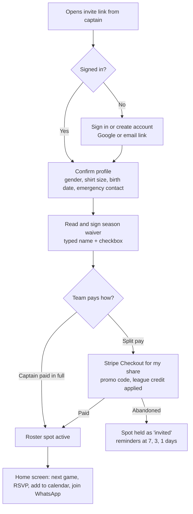
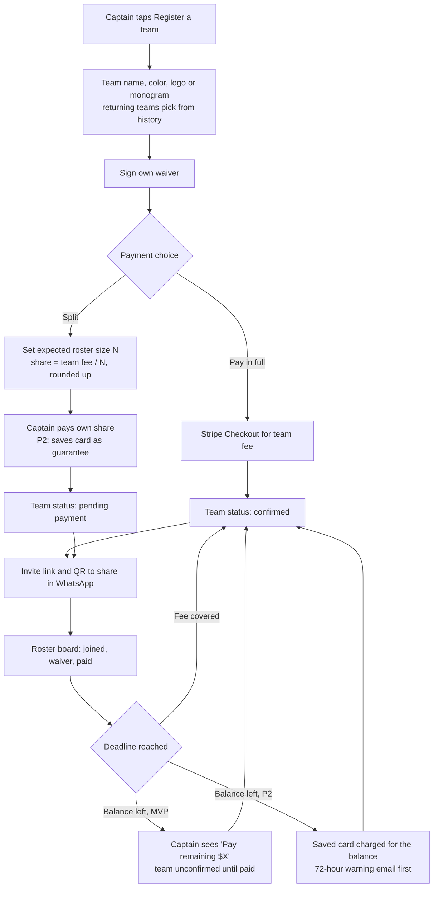
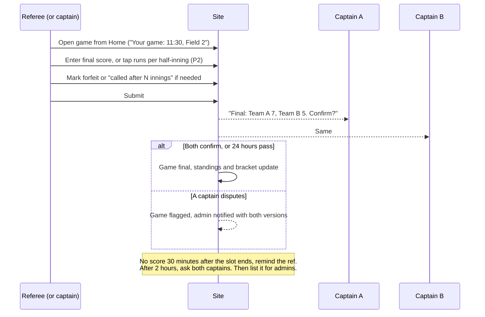
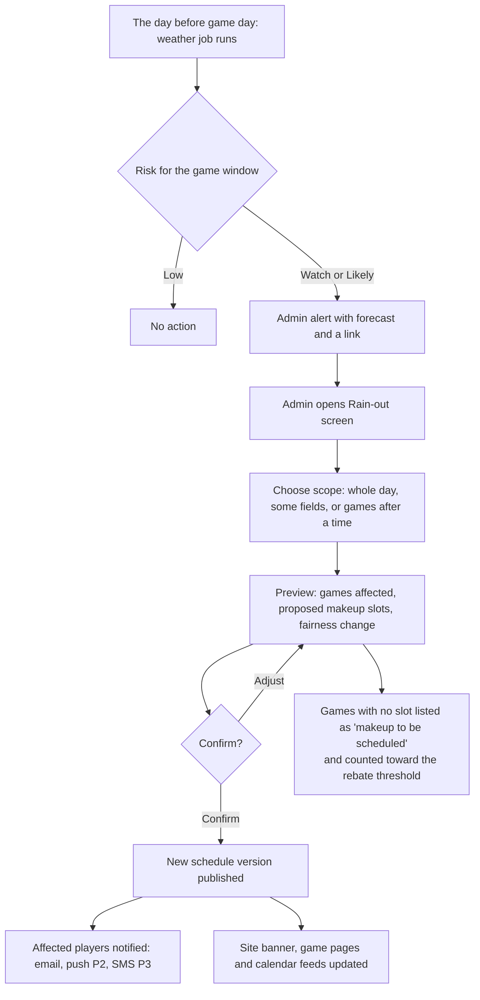

# Information architecture

Status: draft v1, 2026-11-11. Phase tags match [product-spec.md](product-spec.md).

## 1. Sitemap

Public pages are indexable and need no sign-in. App pages sit behind sign-in and are not indexed.

```
/                                   Home: what, where, when, price, join
├── seasons/                        Open and upcoming seasons
│   └── [season]/                   Season overview and register button
│       ├── schedule                Full schedule, filter by team or date
│       ├── standings               Standings, tiebreaker notes, power rankings and the game of the week
│       ├── bracket                 Playoff bracket, as a board or a plain list (?view=list)
│       └── register                Register a team, join by invite, or free agent
├── teams/[team]                    Team page: roster (first name, last initial), results, next game, streaks, rivalries
│   ├── calendar.ics                Team calendar feed: every published game, in the league's time zone
│   └── share.png                   Team share image: record, place, last five results
├── games/[game]                    Game page: time, field, weather, score, head-to-head history, share buttons
│   └── share.png                   Game share image: score on a final, or the matchup and its state
├── records                         League records across every season: most runs, biggest win, longest streaks
├── rules/                          Searchable rulebook with a link for every rule number
├── parks/[park]                    Park page: map, fields, directions, nearby home bar
├── events/                         Calendar of social events (P2)
│   └── [event]                     Event page with RSVP
├── sponsors/                       Sponsor list (logo slots)
│   └── [sponsor]                   Sponsor page with deals (P2)
├── free-agents                     How solo signup works (P2: quiz)
├── history/                        Past seasons, champions, records (P2)
│   └── [season]
├── news/[post]                     Season recaps and announcements (P2)
├── nyc-kickball-league             City-wide landing page (see seo-plan.md)
├── refs                            Become a referee
├── faq
├── about                           The league, the commissioners, contact
├── join                            Landing page for the text-to-join keyword and QR codes (P3)
├── legal/terms, legal/privacy, legal/sms-terms
└── sign-in, sign-up

/app                                Signed-in home: next game, RSVP, what you owe, alerts
├── account                         Profile, notification settings, waivers, payments, credit
├── team/[teamSeason]               Roster, RSVPs, payments, invites, subs, announcements (captain view adds controls)
├── subs                            Open sub requests I can claim (P2)
├── vote                            Awards voting (P2)
├── check-in/[code]                 Bar check-in landing from a QR code (P2)
├── games/[game]/score              Score entry (ref, captain, admin)
├── ref/                            Assignments, availability, earnings
├── sponsor/                        Sponsor portal: page editor, deals, report (P3)
└── admin/
    ├── (dashboard)                 Next game day: weather, games, missing scores, alerts
    ├── seasons/[season]/           Setup, pricing, divisions, rule set, waiver
    │   ├── registrations           Teams, players, payments, waivers
    │   ├── free-agents             Pool and matcher (P2)
    │   ├── fields                  Fields, permit windows, blackout dates, slots
    │   ├── schedule                Generate, metrics, edit, versions, publish
    │   ├── rainout                 Call a rain-out and review makeups
    │   ├── announcements           Email the season or one team
    │   ├── recap                   Weekly recap drafted from the scores; edit, then send as an announcement
    │   └── playoffs                Seed from standings, place on fields, publish the bracket
    ├── games                       Scores, forfeits, corrections
    ├── people                      Players, roles, suspensions
    ├── refs                        Referee pool and assignments
    ├── events, sponsors, news
    ├── messages                    Announcements and delivery log
    ├── money                       Payments, refunds, credit, promo codes
    ├── audit                       Audit log
    └── settings                    League name, branding, contacts, Stripe (owner)
```

### Navigation

- **Phone, public:** top bar with the league badge and a Join button; a menu sheet for the rest.
- **Phone, signed in:** bottom tab bar with four tabs: Home, Schedule, Team, More. Captains, refs and admins see their tools on Home and under More, not as extra tabs.
- **Desktop:** top navigation for public pages; a left sidebar inside `/app/admin`.

## 2. Primary flows

### 2.1 Player joins a team and pays



Rules:
- The waiver comes before payment so nobody pays and then refuses to sign.
- A profile the player already filled in for an earlier season is shown for confirmation, not asked again.
- A roster spot is "active" only when the waiver is signed and the share is paid or covered.

### 2.2 Free agent signs up

1. Player taps "Join solo" on the season page and signs in.
2. Confirms profile and signs the waiver.
3. P2: takes the quiz (about 8 questions, under 2 minutes) and can enter a friend code or create one to share.
4. Pays the free-agent fee through Stripe Checkout. If the season is full, joins the waitlist without paying.
5. Sees "You're in the pool. Placements go out by [date]."
6. Admin places them (with matcher suggestions in P2). The player and the receiving captain are notified.
7. If no team can be found, the admin refunds in full.

### 2.3 Captain registers a team with split payment



Rules:
- The share is fixed when the team registers. If more players pay than the fee needs, the surplus becomes team credit (see the credit ledger in [data-model.md](data-model.md)).
- With per-player pricing the flow is the same without the share calculation: each player pays the player fee, and the team is confirmed when it reaches the minimum paid roster.
- The roster board has one "Remind unpaid" button that emails everyone outstanding and offers a ready-made WhatsApp message.

### 2.4 Game-day score entry



Rules:
- If a ref and a captain both submit, the ref's report wins and the captain's is kept as a note.
- If only captains submit and their scores match, the game is final at once.
- Score entry is one screen with large plus and minus controls; nothing smaller than 44 by 44 points.
- P3: entries made offline are stored on the device with a unique ID and sent when the connection returns; the server ignores duplicates.

### 2.5 Rain-out



Rules:
- The decision is always a person's. The system recommends and prepares; it never cancels on its own.
- Only people on affected teams are notified, each with their own game's new time.
- The admin can also call a rain-out with no forecast warning, including mid-day for the remaining slots.

### 2.6 Sub request (P2)

1. On the team page the captain sees "Tuesday: 8 in, 3 out, 5 no reply. You can field 8. You have 3 women in; you need 4 to field 9."
2. Captain taps "Find subs", picks how many and whether a specific gender is needed, and adds a note.
3. Eligible players are notified: registered this season, waiver signed, not suspended, not playing at that time, and opted in to sub alerts. Free agents in the pool come first.
4. A player taps "I'm in". The captain approves or passes. First approved claims fill the request.
5. The sub sees game details. The opposing captain and ref see that the team has pickups, as the rulebook requires.
6. The request closes when filled or at game time. Sub requests are not offered for playoff games.

### 2.7 Start a new team (P2)

1. A rostered player opens "Start a new team" and reads how it works, including that their current captain will be told once the league approves.
2. They enter a proposed name, whether they will captain, and who is coming with them.
3. Admins review. On approval the current captain is notified, a team is created in "forming" status, and the founder gets an invite link.
4. The team becomes "confirmed" when it meets the roster minimum and the fee is covered. Admins can fill it from the free-agent pool.

### 2.8 Playoffs

1. When the regular season is done, an admin opens the season's Playoffs screen. It shows the standings with the season's tiebreakers applied and the seeds they give.
2. The admin picks how many teams make it (default: the top 8, or every team if fewer) and the playoff day (dates with free slots after the last regular-season game).
3. The app seeds the bracket, gives the top seeds byes when the field is not a power of two, and places every match on fields and times with the scheduler's bracket placement. It is saved as a draft schedule version; the admin checks it and publishes it like the regular season. The season moves to "playoffs".
4. As each playoff score becomes final, the winner moves on. When both teams of the next match are known, its game is put on the published schedule in the slot reserved for it. A corrected score swaps the team in the next game while that game is still to be played.
5. A playoff game cannot end in a tie; the score screen says so. The final's winner is shown as champion on the bracket page.

## 3. Key screens

| Screen | Phone | Desktop |
|---|---|---|
| Home (public) | Hero with next-season dates and a Join button; the next game day's games; standings preview; home-bar strip | Same content in two columns; larger hero with motion |
| Season page | Price, dates, format, what's included, three join choices as cards | Cards in a row; schedule preview beside them |
| Schedule | List grouped by date and time; team filter sticks to the top; "my team" highlighted | Grid of fields across and times down, one date per section |
| Standings | Compact table: rank, team, W-L-T, run difference; tap a row for the rest. Below it, the game of the week and the power rankings with movement since the last game day | Full table with streak, last five, runs for and against |
| Bracket | Board scrolls sideways inside the page, later rounds slide in as they scroll into view; a List view reads the same bracket round by round | Whole board at once; winners' lines draw out round by round. Motion is off under reduced motion |
| Team page | Badge, record, next game card, results list, power rank and streaks, rivalries, roster | Two columns: results and stats left, roster right |
| Game page | Teams and score large; time, field, map link, weather; share button | Same, with the inning line score across the full width |
| Rulebook | Search box at top; collapsible sections; each rule has a copy-link button | Section list in a sticky side column |
| Signed-in Home | Next game card with RSVP buttons; "you owe" card; alerts; quick links by role | Dashboard grid of the same cards |
| Team (captain) | Tabs: Roster, RSVPs, Payments, Subs. Remind and invite buttons pinned to the bottom | All four as panels on one screen |
| Score entry | One screen; two large counters; inning stepper (P2); submit pinned to the bottom | Same layout, centered, no wider than a phone |
| Checkout | Stripe's hosted page | Stripe's hosted page |
| Admin: next game day | Weather risk, game list with status dots, missing scores, rain-out button | Same with the field grid |
| Admin: schedule | Read-only list, metrics, and move-by-form; full editing is a desktop job | Board: fields by time per date, drag to move, metrics panel, version list, violations list |
| Admin: registrations | Team list with paid and waiver counts; tap for roster | Table with filters and CSV export |
| Admin: rain-out | Three steps: scope, preview, confirm | Same on one screen |
| Admin: playoffs | Draft or published bracket first; then teams, playoff day and the seeding table | Same, with the whole board |
| Ref home | Today's assignments with accept and decline; "enter score" on each | Same |
| Sponsor report (P3) | Three numbers and a weekly bar chart | Adds a table by week and deal |

### Empty, loading and error states

Every list screen defines all three. Examples of the copy style:

- Schedule before publishing: "The schedule comes out about a week before opening day. Register now and we'll email you when it's up."
- Standings before any game: "No games played yet. First pitch is Monday, April 12."
- No open sub requests: "Nobody needs a sub right now. Turn on sub alerts to hear first."
- Payment failed: "Your card was declined, so your spot isn't confirmed yet. Try again or use a different card."
