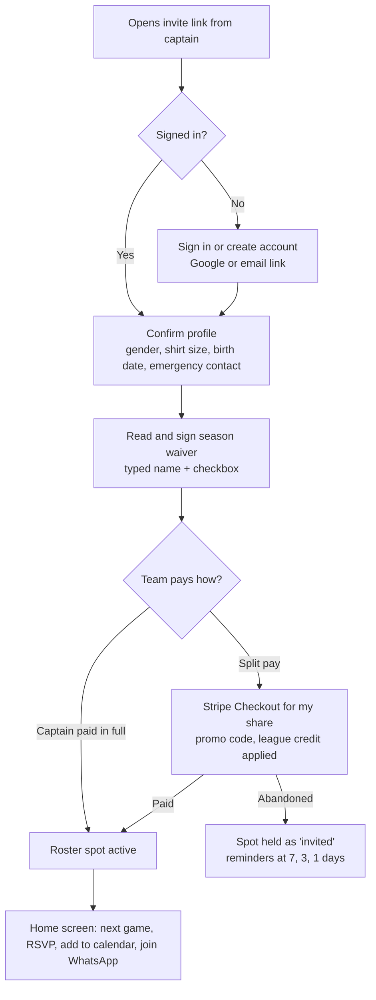
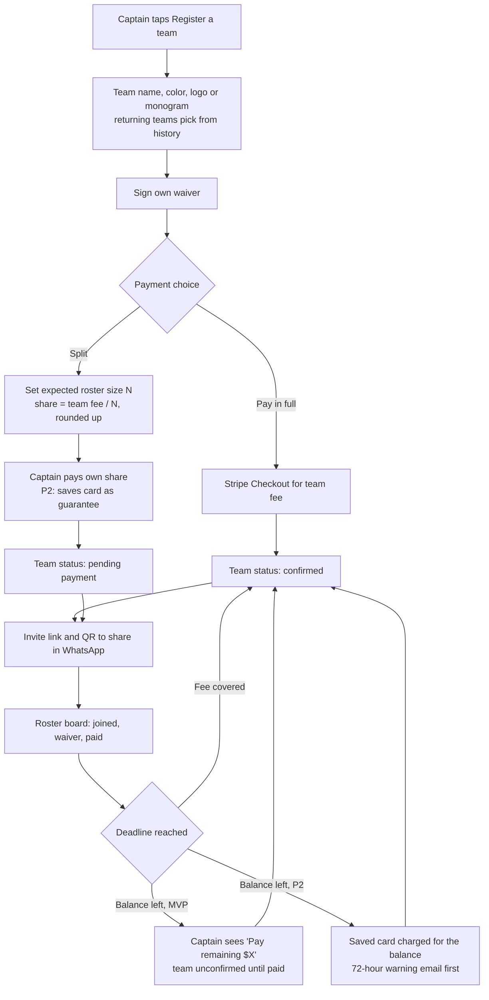
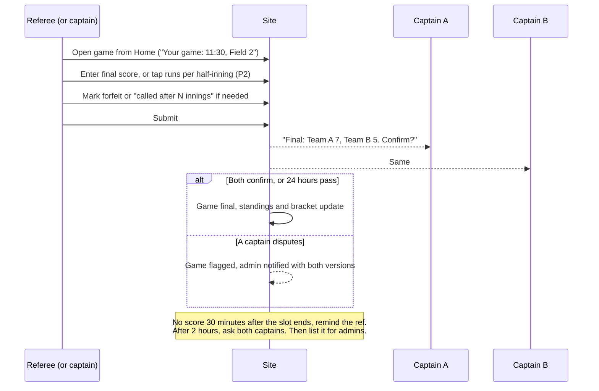
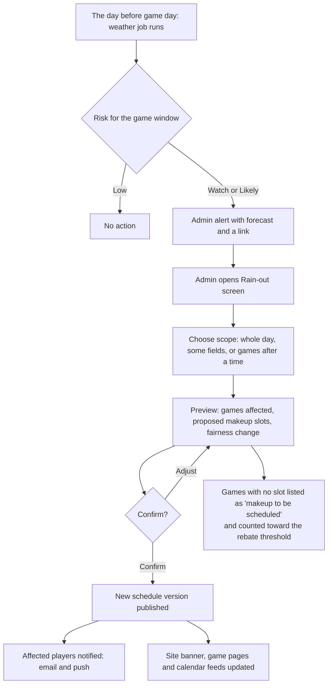

# Information architecture

Status: draft v1, 2026-11-11. Phase tags match [product-spec.md](product-spec.md).

## 1. Sitemap

Public pages are indexable and need no sign-in. App pages sit behind sign-in and are not indexed.

One deployment can run several leagues ([ADR 0048](adr/0048-several-leagues-on-one-deployment.md)). The tree below is the default league's, at the site's own URLs. Every other league's pages are the same tree under `/l/<league>`: `/l/<league>` is its home (name, sport, a sign-up button and its seasons), then `/l/<league>/seasons/...`, `/teams/...`, `/games/...`, `/events/...`, `/sponsors/...`, `/history`, `/records`, `/friends` and `/fields/<park>`. The default league's own content pages (about, FAQ, the park, the search landing pages) have no copy under `/l/`. `/l/<default league>/...` redirects to the plain address.

```
/                                   Home: what, where, when, price, join; featured Instagram photos and the home cover
├── seasons/                        Every public season, newest first: status, dates, schedule and standings links (a sign-up link while registration is open); linked from the home page and the footer
│   └── [season]/                   Season overview and register button
│       ├── schedule                Full schedule, filter by team or date; theme weeks marked on their game days; crossover games marked
│       │   └── division/[division] One division's games and its crossovers, picked by the path; its rule set
│       ├── standings               Standings (a table per division when the season has divisions), tiebreaker notes, power rankings and the game of the week
│       ├── bracket                 Playoff bracket, as a board or a plain list (?view=list, served as /bracket/list)
│       ├── awards                  Stat awards (Season MVP, Iron Kicker, Golden Boot, Best Teammate, Rookie of the Year, Sub of the Year): winners, the top three with the numbers behind them and the games they're based on, admins' notes, and each formula with the MVP weights, only once an admin publishes them (404 until then); players who opted out never appear
│       ├── money                   Where the money goes: the season's spending by category and how each fee divides, only once an owner publishes it (404 until then)
│       ├── card/[card]             A player's season card, only while its player keeps the link public (404 otherwise, never indexed): their games, team runs, record and finish, awards, streak, best game, league superlatives and a sportsmanship shout-out, with share buttons
│       │   └── share.png           The card's share image: name, team badge and four big numbers (404 while private)
│       └── register                Register a team, join by invite, or free agent; each asks the player to confirm the season's minimum age
├── teams/[team]                    Team page: roster (first name, last initial, and any published stat award as a badge, with a link to the season's awards), results, next game, streaks, rivalries, all-time record and titles, tagged Instagram photos and the team's cover, and players' approved photos with a link to share one
│   ├── calendar.ics                Team calendar feed: every published game, in the league's time zone
│   └── share.png                   Team share image: record, place, last five results
├── games/[game]                    Game page: time, field, weather, score, the live line score while it is played, head-to-head history, share buttons; from kickoff, players' approved photos and a link to share one
│   └── share.png                   Game share image: score on a final, or the matchup and its state
├── records                         League records across every season: most runs, biggest win, longest streaks
├── rules/                          Searchable rulebook with a link for every rule number
│   └── search                      JSON for the page's search box: sections that match every word, and the numbered rules in each; answers only for who may read the rulebook (not a page)
├── parks/[park]                    Park page: map, fields, directions, nearby home bar
├── events/                         Upcoming and recent public events, featured clubs run by our players, and calendar subscribe links (members' and team events never appear here)
│   ├── calendar.ics                Events calendar feed: every public event, theme weeks as all-day entries
│   ├── personal/[token]/calendar.ics  A member's private feed: every event they can see; the signed link is the key, reset from /app/events
│   └── [event]                     Public event page: when, where, the ticket price, spots left or the waitlist. A tournament adds its charity link and goal, the partner league, the guest teams' names, a guest sign-up form and the bracket, an RSVP or "Get a ticket" button or the invite ("RSVP on partiful.com"), share and save-the-date links, tagged Instagram photos; once it has started, players' approved photos and a link to share one
│       └── calendar.ics            One public event as a calendar file
├── sponsors/                       Sponsors, home bar first, with the team of the week
│   └── [sponsor]                   Sponsor page: deals with when they were confirmed, the team of the week, how to check in
├── friends                         Friends of the league: clubs run by our players first, then other local leagues grouped by activity, each linking to its own site (clicks counted, never who), and a "Link to us" snippet
├── rules                           The league's rules, only when the owners made them public: a search box (results jump to the rule and highlight the words), a contents list, the sections by number with an anchor on each section and each numbered rule (#lineups, #rule-lineups--1-2), the league's code of conduct (#code-of-conduct), each division's game settings from its rule set, and "What changed": every change newest first with its publish date, start date and the sections it touched; a section changing soon says "New wording from" its date. Static HTML
├── fields/[park]                   Who has this field: the fields the league holds at a park under a confirmed permit, by day, with permit number, "Permitted by NYC Parks", today's line worked out in the browser, and short house rules
├── help/                           Help center: short how-tos by role and a search box that filters them as you type (every how-to is listed without JavaScript too)
│   └── [role]                      One role's how-tos (player, captain, ref, admin, owner), each under its own anchor; the matching screens link here with "Help"
├── widget                          Get the schedule widget: the iframe snippet for the league and for each team, with a live preview
├── embed/schedule                  The schedule widget: the league's next game day as one small page with no script, for other sites to frame (the only route that may be framed)
│   └── [team]                      One team's next three games
├── free-agents                     How solo signup works, with FAQ structured data (P2: quiz)
├── private-events                  Book a private league or tournament: the formats, what's included, how it works and a "Request a booking" button (static; private seasons themselves never appear on public pages)
├── history                         Past seasons: champions, final standings and the all-time table, and the shirt archive (each season's teams with the shirt they described or "own shirts"); each season links to its standings and schedule
├── news/
│   ├── how-to-play-kickball        Evergreen guide to the basics, with Article structured data
│   └── [post]                      Season recaps and announcements (P2)
├── nyc-kickball-league             City-wide landing page: subway routes and travel times by borough (see seo-plan.md)
├── refs                            Become a referee
├── faq
├── contact                         Public contact form (a question, a problem at the field, park rules): no account, honeypot and rate limits, static page with a server action
├── interest                        Would you play a new night, park or format? The league's open interest form (an option for each, each with No, Not sure or Yes, friends who might join, an email to tell when one goes ahead): no account, honeypot and rate limits, static page with a server action; another league's is at `/l/<slug>/interest`
├── about                           The league, the commissioners, contact
├── join                            Landing page for the QR codes on field signs and at the bar (P3)
├── r/[code]                        A player's referral link: remembers who sent the visitor for 30 days, then opens the home page
├── legal/terms, legal/privacy
├── account-deleted                 Shown after a person deletes their account: what was removed and what the league keeps
├── guest/[token]                   A guest team's waiver link: the league's waiver and a name field, so a player from another league signs without an account; the secret in the link is the key, not indexed, its own team's name and a head count are all it shows
├── unsubscribe/[token]             An email's "Stop emails about …" link: asks, then turns that topic's email off; the signed link is the key, no sign-in (its one-click POST is /api/unsubscribe/[token])
├── media/instagram/[image]         Our copy of a featured Instagram photo (404 once hidden)
├── media/friends/[logo]            A friend league's logo, as stored (404 once removed or replaced)
├── media/photos/[photo]            A member's approved photo (404 while waiting, once rejected or deleted)
├── (not found)                     Any address that doesn't exist, and pages a visitor may not see: "We can't find that page" with links on, never saying which
├── (error)                         A page that fails to load: "That didn't load", not the player's fault, "Try again" (never by itself) and a way home
├── offline                         Shown by the service worker when a page needs the network; links the saved next game
├── paused                          Neutral notice while the site is paused or read-only (operator setting)
└── sign-in, sign-up                Email link, passkey (button and email-field autofill) or Google

/operator                           Platform operator console (404 for everyone else): leagues (list and start one: name, sport, address, colors, time zone, minimum age, first rule set), owners and admins per league, site status, feature switches, league export

/app                                Signed-in home, a dashboard of cards rather than a list of links: the next game (with today's emergency contacts, checklist and permit when they apply), "Needs you" (award votes, captains' polls, season surveys, open registration), your team for each current season and your season card, any giveaway you won, the games you referee, and the league gear you have or bring ("You have Kit A: bring it to McCarren Park, Field 2 by 6:30 PM") with one-tap "I picked it up", "I handed Kit A to Sam", "Got it" or "It's back home", and the league switcher for anyone in more than one league
├── league/[league]                 Shows that league in the app, then goes on to ?next= (the switcher, and the way in from a league's public pages)
├── rules                           The rulebook inside the app, with the same search, contents and rule anchors: for owners while it is owners only, for anyone with an account while it is members only; never cached. Others see that the league hasn't shared it
├── referee                         Refs: tick the game times you can work for each season (a time you already ref is fixed), and your games worked, what you've earned, payments and the balance; "Can't make it?" drops a game still to come, with a reason
│   └── take/[game]                 "Take it": a game with no ref, from the message refs get; the first ref to tap gets it, anyone after sees it's taken
├── account                         Profile, weeks you'll miss for each season still to come, email, push and message-limit settings, waivers, payments, league credit and its history, the referral link, and any yellow or red cards a ref gave you, visible only to you (built at /app/profile)
│   ├── security                    Passkeys and devices: add, rename and remove passkeys; list signed-in devices and sign one or all others out
│   ├── export                      Download your data: everything the league holds about you, as JSON
│   └── delete                      Delete your account: what is deleted, what the league keeps; a fresh sign-in (passkey or email link) and your typed email address confirm it
├── stats                           Your stats in the selected league: career and each season's games played, attendance, team wins and runs while playing, sub appearances and awards won, each with "based on N of M games"; your stat awards; stay off or come back on public leaderboards
├── seasons/[season]/export/        CSV downloads: roster.csv (with shirt sizes) and payments.csv; the whole season for admins, ?team= for one team (its captains too)
├── team/[teamSeason]               Roster, RSVPs, how many are available each game week after away weeks (captains also see who is away and a prompt to ask for a sub when a week is short), payments, invites, subs, announcements (captain view adds controls and roster and payment CSV downloads)
├── subs                            Sub requests I can claim, and games I'm subbing in
├── events/                         Upcoming events I can see (public, members-only and my teams'), my RSVP or my ticket's check-in code, and my private calendar link with a reset
│   └── [event]                     RSVP, join the waitlist and see my place in line, or drop out; for a members' or team event also its details, who it's for, the invite, Google Calendar and "Copy for WhatsApp". A ticketed event instead shows my price (member or full), buys a ticket through Stripe Checkout with league credit, takes me back to an open checkout, shows a spot offered to me from the waitlist (buy it or pass), and once paid shows my ticket and check-in code; a box for the event's free giveaway when it has one
│       └── giveaway/               The event's free giveaway: prize, "no purchase necessary", how to enter, my entry or my win, entry and winner counts (never names), and the official rules
│           └── enter/[code]        Where the giveaway's QR code at the event lands: one tap to enter, once (an expired code says so)
├── shop/                           League shop: what's for sale with photos, price (member or full), stock and order deadline; my orders and whether each is ordered, ready or refunded
│   └── [item]                      Photos and details; pick a size (my profile's size first) and how many; a replacement jersey also picks my team (my newest first) and is made in its color; order through Stripe Checkout with league credit, or straight away when credit covers it
├── photos/                         Share a photo: choose it, tag a recent game day, public event or your team, an optional caption, and the required "The league may repost this on its socials"; your photos with what the league decided, each with Delete
│   └── [photo]                     The stored copy, waiting ones included, for its uploader and admins; ?download saves it as a file
├── lost-and-found/                 Lost and found: found items and lost notes, each newest first on one screen, with a thumbnail, where, who (first name) and days left; "I found something" and "I lost something"
│   ├── new                         Post it: what it is, where (a park, the home bar or elsewhere), where it is now (found items), an optional photo
│   └── [item]                      The post; "That's mine" or "I found it" with an optional message; the conversation with the poster (or, for the poster, with each answer) to write back, hand over, take an answer back or close the post; admins take it down
│       └── photo                   The photo (?size=thumb for the small copy), members only, while the post is open
├── volunteer                       Volunteer shifts coming up (game days and events): the job, when and where, spots left; sign up or drop a shift until it starts; my shifts at the top, a set-up lead shift linking to the set-up checklist
├── vote                            Awards: open ballots (one vote each, never for yourself or your own team; a season MVP, best-sport or best-newcomer ballot lists the stat leaders first) and closed polls
│   └── [poll]                      Results after voting closes, ties sharing a place; until then, only when it closes
├── polls                           Captains' polls (captains, and co-captains when a poll includes them): one vote for each team you answer for, changeable until it closes; totals once your team has voted or at close, as the admin chose
├── pickem                          Pick'em, for bragging rights only (no money, no fee, no prizes): pick each game's winner on the coming game day until it starts, my season record, hide or show me, and the season and game-day leaderboards (?day= picks a scored day)
├── check-in/[sponsor]/[code]       Where the bar's QR code lands: one tap to check in (an expired code says so)
├── check-in/[sponsor]              Today's visit: checked in or not, today's deals and "Use this deal"
├── seasons/[season]/team/subs      Captain: ask for subs for a game, approve or decline claims
├── seasons/[season]/team/attendance Captain: each player's games played this season against the playoff minimum, subs and pickups who played for the team, and each game's check-in count with a link to it
├── seasons/[season]/team/requests  Captain: dates the team can't play and times it would rather have or avoid, until registration closes
├── seasons/[season]/new-team       Ask the league to start a new team; see the answer or withdraw while it waits
├── seasons/[season]/card           Your season in kickball: my end-of-season card, private until I make its link public; then the link, share buttons and "Make my card private"; "Copy for WhatsApp" either way. Linked from home
├── seasons/[season]/register       Register a team or join as a free agent, confirming the season's minimum age ("I'm 18 or older" by default); a player the profile shows as too young sees why instead of the forms; when the season is full, the team waitlist: join, see your place, leave, or take a held spot
├── private-events/                 An organizer's requests for private leagues and tournaments, and the ones set up
│   ├── new                         Request a booking: tournament or league, organization, teams, dates, note (signed in)
│   ├── [season]                    Organizer page, for the organizer and admins: invite link, payment (the organization pays once, or players pay), teams, schedule, results; admins get links to the season's fields, schedule and bracket screens
│   └── join/[token]                A private event's invite link: remembers the invite and opens the season's registration (an old link lands on join/expired)
├── seasons/[season]/team (challenge) The season's sign-up challenge on the team page: "9 of 12 signed up", a bar, the prize and a link to the leaderboard
├── seasons/[season]/challenge      The sign-up challenge leaderboard: teams by the share of their roster with an account and a signed waiver (team names and counts only), my team marked, the winner once confirmed
├── seasons/[season]/team (fee)     Split-pay captains: the team fee, what is paid and left, pay the rest, and the card that guarantees it
├── seasons/[season]/team (roles)   Captain and co-captains: the captain makes or unmakes co-captains and offers the captaincy to a teammate (withdraw while it waits); a co-captain can step down; the teammate offered it accepts or declines at the top of the page
├── seasons/[season]/team/leadership Everyone on the team, once a season-end check-in is open (ADR 0090): check in privately (volunteer, suggest a teammate, or say things are good), answer a suggestion, cast a secret vote, and see the outcome; the captain sees a ballot's result first and chooses to hand over now or have the teammate co-captain until next season. A card on the team page links here while it is open
├── seasons/[season]/team (list)    Captains: the team's private "not on my team" list, folded away: add a league member by email with an optional reason, or take them off
├── seasons/[season]/team (recruiting) Captains of a team entered for a season still open for registration: how many players are quietly open to a new team (never anyone who has played for the team), one invite for all of them with an optional pitch, and the name, email and note of each who said yes
├── change-team                     Looking for a change: quietly say you're open to a new team next season, pick who can see it (recruiting captains as a count, admins, or both), an optional note, when it clears, take it back; team invites with yes or no, and a heads-up when a captain of the inviting team plays with you (linked from the profile)
├── seasons/[season]/survey         The end-of-season survey for a player who was on a roster: five questions (rating 1 to 5, play again, best part, one change, comment), answered once, anonymous; a prompt on the home screen while it waits
├── seasons/[season]/quiz           Free agent: the team-fit quiz (five taps: kicking, fielding and running self-ratings, competitive or fun, and game nights; plus an optional note) and a friend code to start, join, switch or leave
├── games/[game]/score              Score entry (ref, captain, admin), with each team's pickups; with no signal, saved on the phone and sent later; an admin's forfeit, settled dispute, correction or reversal asks for a written reason, which both captains and the ref see here with the ruling; once final, a captain rates the other team's sportsmanship; a link to report an incident; for the game's ref and admins, a Cards section to give a yellow or red card and undo one within minutes
├── seasons/[season]/quiz           Free agent: the team-fit quiz (five taps and an optional note) and a friend code to start, join, switch or leave
├── games/[game]/score              Score entry (ref, captain, admin), with each team's pickups; with no signal, saved on the phone and sent later; once final, a captain rates the other team's sportsmanship; a link to report an incident; from game day, a link to check-in; until a score is in, the game clock
├── games/[game]/attendance         Check-in (the game's captains, its ref, admins): who has checked in, anyone checked in without this season's waiver flagged at the top, and boxes to tick players in or out, from game day until 7 days after (admins any time); every change audited
│   └── code                        The game's rotating check-in code as a QR code, on game day, refreshed as it turns over, for a phone held up at the field
├── games/[game]/check-in/[code]    Where the code lands: a player on either roster or approved to sub taps Check in (the code is checked again on the server); "You're checked in" after
├── games/[game]/incident           Report an incident: kind, the people involved from either team, what happened (the game's ref, either captain, an admin; from kickoff on); a link to report an injury
├── games/[game]/incident/injury    Report an injury: who was hurt, where, what care, what happened, witnesses (same people, same rules; only owners and admins read it)
├── games/[game]/live               Live scoring: runs per half-inning, corrections, then end or call the game (the ref, or a captain when there is no ref); works with no signal. Above it, the end-of-play clock (when play must end, sunset or the field time, and a countdown to first pitch and then to that end) and a one-tap "First pitch" that asks who held up a late start. A called game says whether daylight or field time ran out. The ref can eject a player here, which takes them out of the kicking order for the rest of the game
├── games/[game]/lineup             Both teams' kicking orders: a team's captains any time, the other captain and the ref from game day (names only); each player sees their own spot
│   └── [team]                      Captain: who is away that week and whether the team is short, then the kicking-order builder from the players who are in, with drag, keyboard and button moves, live two-in-a-row checks, auto-arrange and copy from the last game
├── games/[game]/emergency          Emergency contacts and first-aid notes of everyone playing (both rosters and approved subs), for the game's two captains and its ref, on game day only; every load audited; kept on the phone with the next game until midnight
├── games/[game]/checklist          Game-day checklist, on game day only: each team's captains tick the season's before and after items for their team (ticks made with no signal send when it is back); after the last game on the field, its ref, a captain, the set-up lead or an admin confirms "Field left clean" or notes a problem, with an optional photo; for the set-up lead and admins, the next handover at the game's field (who comes next, when, a countdown in the last 30 minutes; never a contact); kept on the phone with the next game until midnight, like the emergency contacts
├── setup-lead                      The day's set-up lead (whoever claimed the season's "Set-up lead" shift): the script for asking park users to move, the checklist items, and each field that day with its permit, a set-up check, one tap for "asked a group to move" and how it went (with an optional note), and the end-of-day check; later shifts listed below
├── equipment/[kit]/missing         Report what's missing from a kit you have, are handed or bring: tick its items and add a note
├── games/[game]/permit             The park permit at the field: number, field, hours and document, and the field's layout image and note, for the game's ref and both captains (and owners); kept on the phone with the next game
│   ├── document                    The permit document itself, for the same people, never cached by a CDN
│   └── layout                      The field's layout file (see below), for the same people, never cached by a CDN; saved on the phone with the permit
├── fields/[field]/layout           A field's layout: where the permitted area ends and where each diamond and spectator area goes, with a short note; for admins and members on a set-up shift (its file at `/layout/file`)
├── books/                          Owners and the platform operator only (404 for everyone else); opens on the newest season
│   ├── [season]                    Quick add (amount, category, done; date, note, receipt and who paid folded away), expected costs to confirm or skip, who is owed what with "Reimbursed", the ledger (money in, money out by category, net), the season's expenses with "Add a receipt" or "There isn't one"
│   │   ├── expected                Expected costs: set a cost once, each season or each game day, and stop expecting it
│   │   ├── import                  Import a Venmo or bank CSV: preview the money-out rows with guessed categories, skip ones already in, import the ticked ones; the owners' category rules
│   │   ├── ledger.csv              Every transaction for taxes, no player names
│   │   └── permits                 Permits (cost or fee estimate, document, dates), every upcoming game or event at a park that no permit covers and why (none, lost, no document, or the hours fall short), fees due and the season's hours against the 50-hour line, field time to give back, "What to request" and its copy button, "How NYC Parks permits work", the insurance certificate
│   │       ├── capacity            Capacity planner: teams the field time fits, the gap to teams wanting in, options with the teams each adds and links to the request sheet, nearby NYC Parks fields
│   │       ├── renewal             Renew for next year: NYC Parks' renewal and new-request dates, the draft renewal from this season's permits, the owners' changes with warnings, the renewal and any separate new request to copy
│   │       └── packet              Application packet: the league and its website, schedule and roster counts (names only if chosen), applications by borough from the request sheet, the insurance certificate; copy or download as text (packet/packet.txt)
│   │       └── request.csv         The request sheet as a CSV, with the screen's choices
│   ├── permits                     Opens the newest season's permits (where the reminder emails point)
│   └── files/[file]                A receipt, permit document or certificate, for owners and the operator
├── owner/                          Owner dashboard: owners and the platform operator only (404 for everyone else); opens on the newest season past draft
│   └── [season]                    Membership by season (new, returning, retention), money in and out by season, the season's teams (roster against target, waivers, payments), event turnout and sponsor check-ins by week; "Refresh now"
│       ├── dashboard.csv           The same numbers, one per line: counts and totals only
│       ├── report                  Season report card (running or finished seasons; others 404): charts of players, games and money for this season and the one before, then People, Money, Games and Community tables with both numbers and the change in words
│       │   └── share               The version for sponsors: the same without money or anything about one person, to print or save as a PDF
│       ├── report.csv              The report card's lines: section, measure, unit, both seasons and the change
│       └── summary                 The season money summary: fold categories into Other, preview exactly what goes public, publish, publish again or take it down
├── demo/checkout/[session]         Local demo only ([ADR 0052](adr/0052-local-demo-runs-offline.md)): what is being paid for and "Pay (demo)", which confirms it through the signed webhook; 404 everywhere else
├── ref/                            Assignments, availability, earnings
├── sponsor/                        The sponsors a person manages (admins: every sponsor, and add one)
│   └── [sponsor]/                  Sponsor portal: deals, "still current", details; admins also page address, home bar and people
│       ├── code                    The rotating check-in code, full screen, for a screen at the bar
│       └── report                  Weekly numbers: check-ins, players, teams and deals used by week
└── admin/
    ├── (dashboard)                 Next game day: weather, games, missing scores, alerts; sign-up rate per team, lowest first, with how many players each still needs; the next three open tasks on the season checklist
    ├── today                       Game-day command center, phone first (each game being played also shows the minutes left in its permit, and a game still going after the permit ended is listed at the top): today (or the next game day, or ?date=) with every game's field, ref and check-in, score state (not started, playing, live with runs and inning, reported, final, called off, missing), the weather and, today or ahead, the rain-out decision card, and one tap to the day's status, a rain-out, the game-day checklist, an announcement, ref assignments or the printable pack; each field's set-up and end-of-day checks (with the photo, if any); above the games, every game starting within a day with no ref, each linking to the assigner; above the games, the next handover at each field in use (who comes next, when, and a countdown in the last 30 minutes), any recorded overlap with the borough permit office's number, the groups' contacts, and a link that opens the incident form on the park rule "Sharing the space"; the games refresh themselves every 10 seconds
    │   ├── state.json              The same state as JSON for the screen to poll; admins only, never cached
    │   └── print                   Printable game-day pack for a day (?date=, else the screen's day): a US Letter sheet per field with its games, blank line scores, captains' initials, the permit and a QR code to each game's score page; ?rosters=1 adds a check-in sheet per team (first name and last initial)
    │                               Below the games, the day's league gear: each kit, who brings it to which field by when, and whether they have it yet
    ├── equipment/                  League gear: where every kit is right now (with whom, on its way, or at home), its next game and open missing-items reports; add a kit
    │   └── [kit]                   One kit: open reports to mark sorted, the games it goes to (assign a game's ref, captain or an admin; take one off), "Where is it really?" to correct it, its name, contents and home, retire it, and its history
    ├── seasons/[season]/           Setup, pricing, divisions, rule set, waiver, and the season's own minimum age (empty uses the league's 21)
    │   ├── registrations           Teams, players, payments, waivers, full or partial refunds; roster and payment CSV downloads; each team's captain and co-captains, folded away, with the captain's controls
    │   ├── promo-codes             The season's promo codes: add one, see its uses, turn it off
    │   ├── waitlist                The team waitlist in order: who waits, who holds an offer and until when; offer free spots now
    │   ├── rebates                 Rain-out rebates: each team's games lost and money paid; issue the pro-rata rebate as league credit
    │   ├── shirts                  Shirt sizes by team, what is still to order, and each player's shirt: not ordered, ordered or received
    │   ├── shirt-order             The season's shirt order: counts by size for the league and each team (with its color), who has no size and a one-time reminder, replacement jerseys to make, the sizes sign-up forms offer, and the order placed, received and added to the books
    │   │   └── order.csv           The vendor's CSV: sizes and counts by team and color; player names only when the admin ticks "include names for team packing"
    │   ├── awards                  Open a game-day or season poll, close one early, remove one; results after close
    │   │   └── stats               Stat awards: set the Season MVP weights, work the awards out (a draft only admins see), review the leaders, add a note to any award, publish or take down
    │   ├── captain-polls           Captains' polls: ask a question with two to five options, a closing time, who votes (captains, or co-captains too) and when captains see results; live totals and each team's answer, close early, remind teams that haven't voted, remove
    │   ├── cards                   Season cards: once the season is completed, build every rostered player's card (and tell each once), or refresh them; how many are shared
    │   ├── attendance              Every team's players with their games played and who is short of the season's playoff minimum
    │   ├── starts                  Start times: per team, recorded first pitches, the late starts it held up and the minutes they cost; then every late start and who held it up
    │   ├── sportsmanship           Each team's average sportsmanship rating and the notes left for admins, lowest first, never saying who rated
    │   ├── free-agents             Matcher: suggested placements with reasons (apply one or all), the pool with quiz answers and friend groups, and building a new team from the pool
    │   ├── leadership              Leadership check-ins (ADR 0090): open them for every team once the regular season is over, set the league's quorum, and each team's step, how many took part, deadline and, once the team has heard, the outcome; pause, resume or close one with no change. Never who chose what
    │   ├── rollover                Start the next season from this one: name, first day and teams to bring, a preview of what the new draft gets and what starts fresh, then create it (and, ticked by default, start its season checklist)
    │   ├── checklist               Owners and admins: the season's ops checklist. Open tasks by due date with how far off each is and who owns it; mark done, edit (title, due date, owner, notes) or remove; add a task; start from the template or add the template's new tasks; done tasks, each with "Open again"
    │   ├── divisions               Divisions and their rule sets (including how long before sunset play ends on fields without lights), each team's division, crossover games per team, whether crossovers count in standings, and the combined final
    │   ├── fields                  Fields (and which have lights), permit windows, blackout dates, slots; the other groups that use each field (name, usual days and hours, a contact only admins see); a warning for each coming day two groups hold the same time, with the borough permit office's number, and a form to record an overlap
    │   ├── requests                Every team's conflicts and preferences, read before generating
    │   ├── new-teams               Players' requests to start a team: approve or decline with a reason
    │   ├── schedule                Generate, metrics, versions, publish; a warning for games in slots that run past daylight on fields without lights (a draft outside a documented permit lists each gap; when only documents are missing, "Publish anyway" with a typed reason); board (desktop) and move-or-swap form
    │   ├── rainout                 Call a rain-out: pick a date (?date=), the decision card for each park (game-hour rain chance, rainfall and thunder, rain already fallen, alerts, one-sentence call, when each was fetched), the makeups; owners confirm, admins send it to the owners (unless the owners let them confirm); who sent it and when; the owners' "who confirms" setting
    │   ├── game-day-checklist      The season's game-day checklist: the before and after items (one per line) and the set-up lead's script for asking park users to move
    │   ├── status                  Game-day status for a day (?date=): On, Watching with a decision time, Delayed with new starts for ticked games, or Off for ticked games or all, with a reason; what's showing now and when it was set; a warning when a decision time has passed; after Off, a link to the rain-out screen
    │   ├── announcements           Email the season or one team
    │   ├── recap                   Weekly recap drafted from the scores; edit, then send as an announcement
    │   ├── team-of-the-week        The game day's best wins; name a team with an optional tab at a sponsor
    │   ├── survey                  End-of-season survey: open it once the season is completed (one invite per rostered player), close it, and the results for owners and admins: turnout, rating counts and average, play-again counts, and each question's written answers as a sorted, anonymous list
    │   ├── win-back                While registration is open: players from the last three seasons who haven't signed up, most loyal first, with their last team, seasons played and whether they were emailed or opted out of league news; one-click "Email" per player, "Email all not emailed yet", the league's editable wording, and emailed and came-back counts
    │   ├── challenge               Team sign-up challenge: start it (prize, deadline) or change it, every team's progress with who needs a nudge, and confirm the winner (pick between teams in a dead heat)
    │   └── playoffs                Seed from standings, place on fields, publish the bracket
    ├── games                       Scores, forfeits, corrections
    ├── conduct/                    The code of conduct: who on each team has accepted the current version, every version, and a form to publish the next (starting from default sections)
    ├── incidents/                  Concerns and public messages waiting (with the share answered within a day), park users asked to move who refused or complained (last 30 days), then the review queue (open reports oldest first), everyone suspended now, recently resolved
    │   ├── cards               Players with yellow or red cards, newest first, with a gentle pattern note after several cards across different games (never a suspension prompt)
    │   └── [incident]              What happened and who; notes; the cards each person named has; suspend someone named (the outside-alcohol ladder suggested) or lift a suspension; resolve or reopen. An injury report shows who was hurt, where, the care and the witnesses (each opening audited), a download for the insurance carrier (`/injury.csv`, with the insurance certificate's dates) and a button that deletes the injury details now
    ├── concerns/
    │   └── [concern]               A private concern or public contact message: what was said, the sender (an address is shown to admins only and each view is audited), the thread of replies and notes; reply by email, add a note, close with what was done, reopen
    ├── concerns/ (player) Your concerns and the league's replies; /new raises a private concern (category, optional park rule and game link); /[concern] shows one of your own with replies and what was done, never admin notes
    ├── pickem                      Pick'em settings: whether players may pick their own team's games
    ├── team-changes                Players looking for a change who let admins see it: name, email, note, since when, current teams and teams they said yes to
    ├── team-lists                  Every team's "not on my team" list with reasons and who added each entry; teams listing 5 or more people and anyone on several lists; add or remove an entry; owners choose whether a person's own export lists entries about them
    ├── people                      Players, roles
    ├── refs                        Referee pool (add by email, remove) and assignments by email
    │   ├── assign                  Assign refs: the proposal for a game day or the whole season, with why a game has nobody; accept all, accept one, or pick another ref; games each ref would have
    │   └── pay                     Ref pay sheet: the season's per-game fee, each ref's games worked, owed, paid and balance, and "Mark paid" (cash or Venmo) into the books
    ├── rules/rulebook              Owners and the operator: choose who can read the rulebook (owners only, members only, public), and import it: paste the text, review it split into numbered sections and rules, save as a dated change
    ├── rules                       Edit the rules: every section's title and text, remove a section, add one (with suggested titles), then publish with a one-line summary, a start date and an optional email notice to every player in the active seasons; recent changes. Refused with everything kept if someone else published first
    ├── events/                     Every event with who it's for, going and waitlist counts. A tournament's page adds guest sign-up settings, the charity link and goal, the partner league, each guest team with its captain and waiver count, and the bracket with scores, fields and times
    ├── private-events              Requests for private leagues and tournaments: accept one as an invite-only private season (name, dates, games per day, who pays, amount) or decline it with a reason
    │   ├── new                     Create an event or theme week, pickup game or practice (a league field, checked against its permits, or open play with no reserved field; with a typed reason when the permit's document isn't uploaded yet): who it's for (everyone, all members, or teams from a season or any), an invite link, RSVPs in the app or not, and an optional email to everyone it's for
    │   └── [event]                 Edit (and optionally email the change, including the ticket and member prices), who's coming and the waitlist in order, "Copy for WhatsApp", call off or delete. A ticketed event adds its ticket list: holders with their code and what they paid on card and in credit, checkouts and offers open now, a check-in box for the door, and a full refund per ticket
    │       └── giveaway/           Add or change the event's free giveaway (prize, donor, winners, entry window, official rules), entry count, draw the winners once entry closes, and replace a winner with a reason; refused for a ticketed event or a theme week
    │           └── code            The giveaway's rotating entry code, full screen, for a phone or screen at the event
    ├── checklist-template          Owners: the tasks every season checklist starts with, each due a number of days before or after the season's first day, with a usual owner; add, edit or remove one
    ├── interest                    Interest sign-ups: open a form with options (a night, a park, a format), see each option's yes and not-sure totals against the target (default 8 teams) with an "enough to run" marker, change the target, add or remove options, delete an answer on request, close the form, and tell everyone who picked an option that it is going ahead
    ├── volunteer/                  Volunteer shifts coming up, each with its spots and who signed up
    │   ├── new                     Post a shift: the job, a season's game day or an event, date and times, spots, place, notes
    │   └── [shift]                 Edit a shift (never below the people signed up) or remove it
    ├── news
    ├── messages                    Announcements and delivery log
    ├── shirt-waiting               Late-joiner shirts: players who joined after their season's order, across teams, by size; the batch-reorder readiness; spare stock to log and hand out; mark the batch ordered and received
    ├── shirt-makers                Shirt makers directory: add, change or remove local custom jersey and t-shirt makers (https links, free to list)
    ├── merch/                      The shop's items: price, in the shop or hidden, orders still to make; a new item; the printer's CSV; how much photo storage is used
    │   ├── new                     Add an item: league item or replacement team jersey, name, description, price and member price, made to order or stock per size, order deadline
    │   ├── [item]                  Orders to make by size, each with the buyer, team and color and what they paid on card and in credit; mark one or all fulfilled; a full refund per order; photos (add up to four, remove); edit the details; hide from the shop or put back
    │   ├── orders.csv              Every paid order not yet fulfilled, for the printer: item, size, quantity, team and color, name and email
    │   └── photos/[image]          Any merch photo, a hidden item's included, for admins
    ├── credit                      League credit: give goodwill credit, who holds credit, what was given lately
    ├── money                       Payments, refunds, credit, promo codes
    ├── accounts                    Merge duplicate accounts: look up both by email, preview what moves and how clashes are settled, confirm it's you and merge; recent merges
    ├── acting-admins               Owners only: handovers running, coming and recently ended; name a player acting admin (first and last day, powers) or end a handover now
    ├── audit                       Audit log in plain words, newest first; filter for the platform operator's actions
    ├── demo-mail                   Demo only: every email the league would have sent, newest first, each opened as the person would get it; 404 outside demo mode
    ├── photos                      Member photos: the review queue (approve, download, or reject with a note only admins see), approved photos to download or take down, recent rejections, and storage used against the cap
    ├── instagram                   Connect, sync, disconnect (keep or remove photos); feature, hide, tag to a team or event, set a cover, describe each post
    │   ├── callback                Where Instagram's sign-in returns; checks the state, saves the token encrypted, runs the first sync
    │   └── photos/[image]          Any synced photo, hidden ones included, for admins
    ├── league.json                 The whole league as JSON, for owners and the operator
    └── settings                    League name, branding, contacts, Stripe (owner)
```

### Navigation

- **Phone, public:** top bar with the league badge and a Join button; a menu sheet for the rest.
- **Phone, signed in:** a bottom tab bar on every `/app` screen: Home, Schedule, Team and Menu, clear of the home indicator, with room left below the page so it never covers anything. Someone with no team gets Admin (admins) or Reffing (refs) in Team's place, or no third tab. Menu opens a sheet from the bottom with grouped links: My season (your team, schedule, standings, your stats), Game day (pick'em, award votes, sub for a team), League life (events, volunteer, shop, photos), Help (help center, league rules, raise a concern, lost and found) and Account (profile, sponsor page, sign out).
- **Roles add groups, never views:** a captain also sees Captain (roster and payments, message your team, attendance, find subs, scheduling requests), a ref sees Referee, admins see League admin and owners see Owner. Someone with several roles sees each group; an admin or ref with no team sees no player groups. Every link is one the person's role may open (`src/domain/nav/app-nav.ts`).
- **The menu is a native popover:** a non-modal dialog that Escape, a tap outside, Close or following a link closes. No script opens it.
- **Desktop:** top navigation for public pages; inside `/app`, the same tabs sit in a bar under the header and Menu opens a panel from the right. League admin's home keeps its six everyday tools in sight and folds the rest into "All admin tools", grouped by job.

## 2. Primary flows

### 2.1 Player joins a team and pays



Rules:
- The waiver comes before payment so nobody pays and then refuses to sign.
- A profile the player already filled in for an earlier season is shown for confirmation, not asked again.
- A roster spot is "active" only when the waiver is signed and the share is paid or covered.

### 2.2 Free agent signs up

1. Player taps "Join solo" on the season page and signs in.
2. Confirms profile and signs the waiver.
3. Takes the quiz (five one-tap questions and an optional note, about a minute) and can start a friend code to share or enter a friend's. Up to 4 people share a code and stay together.
4. Pays the free-agent fee through Stripe Checkout. If the season is full, joins the waitlist without paying.
5. Sees "You're in the pool. Placements go out by [date]."
6. Admin places them, by hand or by applying the matcher's suggestions, or builds a new team from the pool with a volunteer captain. The player and the receiving captain are notified.
7. If no team can be found, the admin refunds in full.

### 2.3 Captain registers a team with split payment



Rules:
- The share is fixed when the team registers. If more players pay than the fee needs, the surplus becomes team credit (see the credit ledger in [data-model.md](data-model.md)).
- With per-player pricing the flow is the same without the share calculation: each player pays the player fee, and the team is confirmed when it reaches the minimum paid roster.
- The roster board has one "Remind unpaid" button that emails everyone outstanding and offers a ready-made WhatsApp message.

### 2.4 Game-day score entry



Rules:
- If a ref and a captain both submit, the ref's report wins and the captain's is kept as a note.
- If only captains submit and their scores match, the game is final at once.
- Score entry is one screen with large plus and minus controls; nothing smaller than 44 by 44 points.
- Live scoring: the ref, or a captain when the game has no ref, says who kicks first, then taps a big "+1 run" for each run and "End half" after each half-inning (or types a number). The count is kept on the phone until End half saves it. Undo takes back the last run, or reopens the half just ended with its runs. Any half can be corrected. It is optional: the ref's home screen offers "Keep score live" once the slot starts, and the score screen's form is filled in from the innings. "Game over" reports every run; "Called after the Nth" reports the score at the last complete inning and needs at least 4. Either becomes an ordinary report that the captains confirm. The public game page shows the line score and updates within 15 seconds ([ADR 0011](adr/0011-live-scores-by-polling.md)).
- P3: entries made offline are stored on the device with a unique ID and sent when the connection returns; the server ignores duplicates.

### 2.5 Rain-out



Rules:
- The decision is always a person's. The system recommends and prepares; it never cancels on its own.
- Only people on affected teams are notified, each with their own game's new time.
- The admin can also call a rain-out with no forecast warning, including mid-day for the remaining slots.

### 2.6 Sub request (P2)

1. On the team page the captain sees "Tuesday: 8 in, 3 out, 5 no reply. You can field 8. You have 3 women in; you need 4 to field 9."
2. Captain taps "Find subs", picks how many and whether a specific gender is needed, and adds a note.
3. Eligible players are notified by email: registered this season, waiver signed, not on either team in the game, not playing or refereeing at that time, and with sub alerts on (the default). Free agents in the pool come first. When every spot is reserved for one fielding group, only players in it are told. (Suspensions are not modelled yet.)
4. A player taps "I'm in" on the sub page, which holds a spot; the captain is emailed. A spot reserved for women or men can only be held by a player in that group. When every spot is held, others see "full".
5. The captain approves (the player is emailed that they're playing) or declines (the spot opens again). The request is filled when approved subs take every spot. A sub can drop out until game time, which reopens it.
6. The sub sees game details on the sub page. Both captains and the ref see each team's pickups, by first name and last initial, on the team page, the score page and the ref's home, as the rulebook requires.
7. The request closes at game time, or when the captain takes it down (anyone holding a spot is told). Sub requests are not offered for playoff games.

### 2.6b Captain handoff and co-captains

1. On the team page, the captain opens "Captain and co-captains": everyone on the roster with their role. "Make co-captain" gives a teammate the team's tools (kicking orders, sub requests, scores, who has paid, the private list); "Make a player" takes them back. Each change emails the teammate.
2. To hand the team over, the captain picks a teammate and taps "Offer the captaincy". The teammate is emailed and sees the offer at the top of their team page. Until they answer, nothing changes; the captain can withdraw it, quietly.
3. "Become captain" swaps the roles at once: the teammate leads the team and the old captain stays on as a co-captain, who can step down. "No thanks" changes nothing. The old captain is emailed the answer either way.
4. While a team-fee checkout is open, the captaincy doesn't change hands. An offer stops working if the captain changed by other means or the teammate left.
5. Admins do the same from the season's registrations screen, under each team. Every change is in the audit log. See [ADR 0042](adr/0042-captain-handoff-and-co-captains.md).

### 2.6a Not on my team (private list)

1. On the team page, a captain or co-captain opens "Not on my team (private)", types a league member's email address and, if they want, a reason only the team's captains and the league's admins will read. A teammate on this season's roster can't be added; the league moves them first.
2. Nobody tells the person. If they open the team's invite link they see "This link has expired. Ask your captain for a new one.", the same words anyone sees for an expired link, and joining fails the same way.
3. The free-agent matcher never suggests the team for them, or for a friend group they are in. An admin placing them by hand on the registrations screen sees a warning naming the team and the person, and can place them anyway; the override is in the audit log.
4. They never hear about, see or claim the team's sub requests. Every other team's requests, their registration, other teams' links and their RSVPs work as before. Anything unsafe goes through an incident report instead.
5. Admins and owners see every list on the admin "Not-on-my-team lists" screen, with long lists and people listed by several teams pointed out, and can take an entry off. See [ADR 0036](adr/0036-not-on-my-team-list.md).

### 2.6b Looking for a change (quietly open to a new team)

1. From their profile, a player opens "Looking for a change", picks who can see it (captains recruiting for next season, league admins, or both), adds a note if they like, such as a night that suits them, and saves. The app never asks why.
2. Their current team never sees it: no team they have played on, in any season, counts it, reads it or hears of it, and nothing public shows it.
3. A captain or co-captain of a team entered for a season still open for registration sees, on the team page, "3 players open to a new team haven't had an invite from Cats yet", and can invite them all at once with an optional pitch. They never see who. The team's "not on my team" list keeps those people out of the count.
4. Each player gets the invite by email and on their page, where they say yes or no. A heads-up shows when a captain of the inviting team plays with them this season. A yes shows that team's captains their name, email and note, and emails the captains; a no, or no answer, tells nobody.
5. Admins see the players who let them on the admin "Looking for a change" screen, and the free-agent matcher suggests a different team for them when one has room.
6. The flag clears itself when next season's registration closes, and the player can take it back at any time, which withdraws every invite and tells nobody. See [ADR 0089](adr/0089-looking-for-a-change.md).

### 2.7 Start a new team (P2)

1. A signed-in player opens "Start a new team" from their season page and reads how it works, including that, if they play on a team, they will leave it and its captain will be told once the league approves. A captain must hand their team over first; someone not yet registered is pointed to registering a team directly, which needs no approval.
2. They enter the team's name, how many players they expect, how the team will pay (split or in full; split only if they have already paid for their own spot) and a note for the league. One request at a time, while registration is open; they can withdraw it until it is answered.
3. Admins see waiting requests on the dashboard and review them on the season's New-team requests screen, with where each requester stands (their team, whether they have paid).
4. On approval the team is created in "forming" status with the requester as captain and the fee priced as of the day they asked; they leave any team they were on, and that team's captain is emailed. The requester is emailed a link to the team page, where the invite link is. A decline emails them the league's reason, if one was given, and they may ask again.
5. The team becomes "confirmed" when it meets the roster minimum and the fee is covered. Admins can fill it from the free-agent pool.

### 2.8 Playoffs

1. When the regular season is done, an admin opens the season's Playoffs screen. It shows the standings with the season's tiebreakers applied and the seeds they give.
2. The admin picks how many teams make it (default: the top 8, or every team if fewer) and the playoff day (dates with free slots after the last regular-season game).
3. The app seeds the bracket, gives the top seeds byes when the field is not a power of two, and places every match on fields and times with the scheduler's bracket placement. It is saved as a draft schedule version; the admin checks it and publishes it like the regular season. The season moves to "playoffs".
4. As each playoff score becomes final, the winner moves on. When both teams of the next match are known, its game is put on the published schedule in the slot reserved for it. A corrected score swaps the team in the next game while that game is still to be played.
5. A playoff game cannot end in a tie; the score screen says so. The final's winner is shown as champion on the bracket page.
6. With divisions, the number of teams is per division, and each division's standings give its seeds ([ADR 0040](adr/0040-divisions-and-crossover-games.md)). Two divisions with a combined final share one bracket, each in its own half, so their champions meet in the final. Without one, or with more than two divisions, each division gets its own bracket and champion; the brackets are drafted and published together.

### 2.9 Kicking order (P3)

1. From the team page, a captain taps "Set kicking order" on a game not yet played. The builder lists the players who said they're in, then any approved pickups, with the side each one counts toward for the gender rules. Players who have not chosen a side are named, so the captain can ask them to finish their profile; the fielding-rule warning from the RSVPs is shown too.
2. The captain drags rows by their handle, picks one up with Space and moves it with the arrow keys, or taps the up and down buttons. Each change is announced to screen readers and checked against the two-in-a-row rule, counting from the last kicker back to the first; every break is explained by name.
3. "Auto-arrange" fixes the order moving as few people as it can, or says why no order works. "Copy last game" starts from the team's previous saved order, leaving out who isn't coming and adding new players at the end.
4. Saving keeps the order even if it still breaks the rule, and says so. Each player in it sees "You kick 4th of 12" on the team page. On game day, the ref (from their home screen or the score screen) and the other captain see the order as names, with whether it keeps to the rule.

### 2.10 Away weeks

1. A player opens "Away some weeks? Mark them" on the team page, or the profile directly, and ticks the weeks they'll miss in each season still to come. Weeks already gone are not offered.
2. On the team page, each game still to come shows how many players are available that week. Captains also see who is away, and, when the players left can't field a full lineup under the fielding rule, a prompt with an "Ask for a sub" link to the sub request form for that game. The kicking-order builder shows the same for its game.
3. The first time a player's change leaves a week short, the team's other captains get one email about that week, with the same link. It is a non-urgent message, so it respects their daily limit and quiet hours.

### 2.11 League gear

1. An admin adds each kit on the League gear screen: a name, what's in it (one item per line) and where it lives between game days.
2. For a game day, the admin opens the kit, picks a game and who brings it: the game's ref, one of its captains or co-captains, or an admin. A kit goes to one game a day.
3. That person sees the kit on their home screen next to the game: "Kit A is yours tomorrow: get it from Jo S., then bring it to McCarren Park, Field 2 by 6:30 PM", and the evening before they get a reminder (non-urgent, under "League gear" in their email settings).
4. If the kit is at home, they tap "I picked up Kit A". Once they have it, the line reads "You have Kit A: bring it to McCarren Park, Field 2 by 6:30 PM". After the game, "I handed Kit A to Sam" names whoever brings it next; the kit is Sam's only when Sam taps "Got it" ("I don't have it" leaves it with the giver, and the giver can take a handoff back while it waits). With nobody next, "It's back home".
5. "Something missing from Kit A?" lets anyone with the kit tick the missing items and add a note. Admins see open reports on the League gear screen and the kit's page, and mark them sorted once restocked.
6. On game day the command center lists each kit, who brings it where and whether they have it yet. The kit's page has its whole history, and admins can correct where a kit really is. Every change is in the audit log.

## 3. Key screens

| Screen | Phone | Desktop |
|---|---|---|
| Home (public) | Hero with next-season dates and a Join button; the next game day's games; standings preview; home-bar strip | Same content in two columns; larger hero with motion |
| Season page | Price, dates, format, what's included, three join choices as cards | Cards in a row; schedule preview beside them |
| Schedule | List grouped by date and time; team filter sticks to the top; "my team" highlighted | Grid of fields across and times down, one date per section |
| Standings | Compact table: rank, team, W-L-T, run difference; tap a row for the rest. Below it, the game of the week and the power rankings with movement since the last game day | Full table with streak, last five, runs for and against |
| Bracket | Board scrolls sideways inside the page, later rounds slide in as they scroll into view; a List view reads the same bracket round by round | Whole board at once; winners' lines draw out round by round. Motion is off under reduced motion |
| Team page | Badge, record, next game card, results list, power rank and streaks, rivalries, roster | Two columns: results and stats left, roster right |
| Game page | Teams and score large; time, field, map link, weather; share button | Same, with the inning line score across the full width |
| Rulebook | Search box at top; collapsible sections; each rule has a copy-link button | Section list in a sticky side column |
| Signed-in Home | "Hi, name"; next game card; "Needs you" list; your season list; gear; games you referee; Running the league for admins. Everything else is in the tab bar and Menu | Same cards, one column no wider than 576px |
| Team (captain) | Tabs: Roster, RSVPs, Payments, Subs. Remind and invite buttons pinned to the bottom | All four as panels on one screen |
| Score entry | One screen; two large counters; inning stepper (P2); submit pinned to the bottom | Same layout, centered, no wider than a phone |
| Incident report | Kind, a checkbox list of each team's players, what happened, one send button | Same, no wider than a phone |
| Incident review (admin) | What happened and who, suspensions with a lift button, a suspend form per person with the ladder's suggestion, notes, resolve | Same, one column |
| Checkout | Stripe's hosted page | Stripe's hosted page |
| Admin: game day (command center) | Four counts (games, refs at the field, playing now, scores missing), then one card per game in kickoff order: time and field, score state, both teams with runs, the ref with a dot for checked in, late or missing, and "Mark here" and "Score". The weather chip and the rain-out, announcement and refs buttons sit at the top | Same, no wider than 768px |
| Admin: game-day pack | Day picker, "Add a check-in sheet per team", Print and Back to game day; then one card per field (on paper, one US Letter page each, black on white, no site header or footer): the permit lines, then each game with its time, teams, ref and a QR code, a ruled line score (1 to 7, X, R) and lines for the final score and both captains' initials; then the check-in sheets | Same, no wider than 768px |
| Admin: next game day | Weather risk, game list with status dots, missing scores, rain-out button | Same with the field grid |
| Admin: schedule | Read-only list, metrics, and move-by-form; full editing is a desktop job | Board from 1024px wide: one row per date and time, one column per field. Drag a game to move or swap it, or use the arrow keys, Enter and Escape; a side panel shows the new hard-rule problems and metric changes for the slot under the pointer or focus, then the unsaved changes with Undo, Discard and Save as one new draft. The board's code loads only at that width; the move-or-swap form stays below it |
| Admin: registrations | Team list with paid and waiver counts; tap for roster | Table with filters and CSV export |
| Admin: rain-out | Three steps: scope, preview, confirm | Same on one screen |
| Admin: playoffs | Draft or published bracket first; then teams, playoff day and the seeding table | Same, with the whole board |
| Awards (player) | One card per open poll: the award, when it closes, and a team-grouped picker with one Cast vote button; after voting, your pick and "results when voting closes". Closed polls link to results | Same, picker and button on one line |
| Pick'em | The "just for bragging rights" note; the coming game day as one card per game with two big team choices (or "Locked at 8:00 PM" and my pick) and one Save picks button; my season record with Hide or Show me; the season leaderboard, then the game day's, top 25 plus me, ties marked T-2nd; links to other scored days | Same, the two team choices side by side |
| Award results | The winner (or everyone tied) in a highlighted box, then every nominee with place, votes and a bar | Same |
| Ref home | Today's assignments with accept and decline; "enter score" on each | Same |
| Season report card (owners) | Three small charts (players, games, money) with each season's numbers beside its bars, then one table per section; each measure's change sits under its name in words, with an arrow, and the season before's column shows from 640px | Same, no wider than 768px; the shareable version drops the money chart and section |
| Owner dashboard | Four headline numbers per section, then one table per chart: each row's bar sits under its label so nothing scrolls sideways; the week chart with its table in a fold-out | Same, no wider than 896px |
| Money summary (owners) | What it is and whether it is published, the fold-into-Other checkboxes, the preview in a dashed box, then Publish and Take it down | Same, no wider than 768px |
| Where the money goes (public) | Collected and spent, a table of categories with a bar and share each, then each fee split into the same lines | Same, no wider than 768px |
| Books (owners) | The ledger as a two-column table, then "Add an expense" (date, amount, category, note, a receipt photo from the camera or saved photos), then the season's expenses with their receipts | Same, no wider than 768px |
| Permits (owners) | A red box listing every upcoming game or event a permit doesn't cover, each linking to where it is fixed, with its time, field and the gap in one sentence; a button to the capacity planner; "Fees and hours" (hours against the 50-hour line, fees due, expected fees), bordered amber or red as the line nears or passes; "Give back field time" with each window's office number and the cancellation form's answers to copy; one card per permit with an Edit fold-out; the request form, sheet and copy button; "How NYC Parks permits work" as fold-outs with links and the last-checked date; the insurance certificate | Same |
| Book a private league (public) | Sticker, heading and the request button, then the two formats as cards, what's included, numbered steps and a closing box with the button again | Formats side by side |
| Organizer page | Invite link in a read-only field, payment with a Pay button when the organization pays, teams with player counts, upcoming games, results; admin links last | Same |
| Private events (admins) | Waiting requests as cards with Accept and Decline fold-outs, then answered ones as a list | Same |
| Capacity planner (owners) | Game length, games per team and teams wanting in as a small form; the teams that fit and the gap in a status box; one card per option with its extra teams and a button to the request sheet; nearby fields as a list with distance | Same |
| Park permit (ref and captains) | The permit number large, the field and hours, then the permit's photo full width (or a button to open its PDF); a saved copy when offline | Same, no wider than a phone |
| Sponsor report | Three numbers for this week, a weekly bar chart and a table by week, then deals used and the teams that came by most | Same, wider |
| Check-in code (bar screen) | The QR code as large as fits, the code in text, and how often it changes | Same, centered |
| Check-in and visit | One Check in button; then today's deals, each with "Use this deal" or when it was used | Same, no wider than a phone |

### Empty, loading and error states

Every list screen defines all three. Examples of the copy style:

- Schedule before publishing: "The schedule comes out about a week before opening day. Register now and we'll email you when it's up."
- Standings before any game: "No games played yet. First pitch is Monday, April 12."
- No open sub requests: "Nobody needs a sub right now. Turn on sub alerts to hear first."
- Payment failed: "Your card was declined, so your spot isn't confirmed yet. Try again or use a different card."
