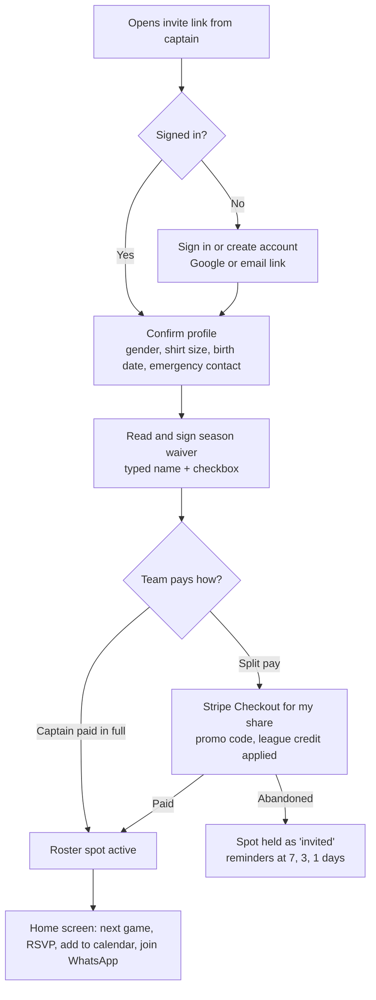
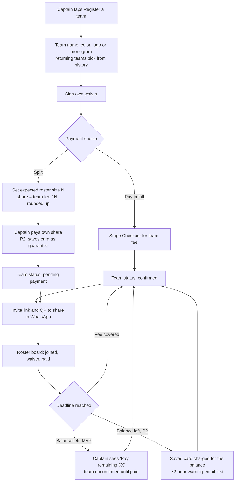
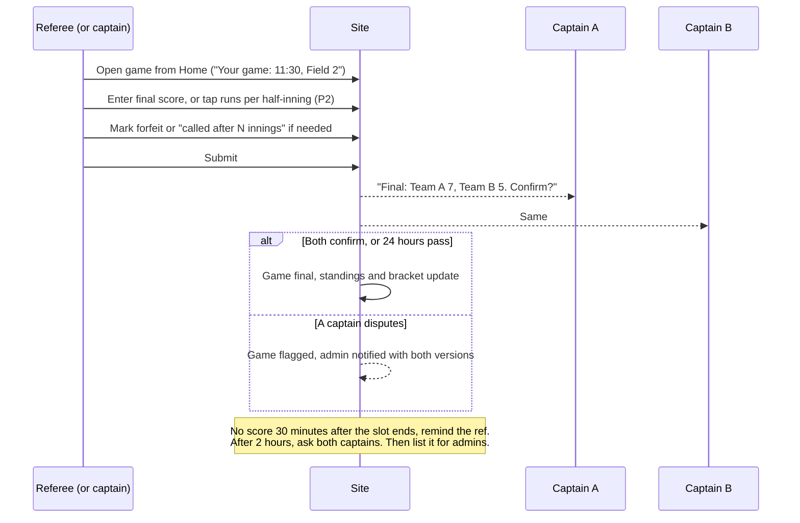

# Information architecture

Status: draft v1, 2026-11-11. Phase tags match [product-spec.md](product-spec.md).

## 1. Sitemap

Public pages are indexable and need no sign-in. App pages sit behind sign-in and are not indexed.

```
/                                   Home: what, where, when, price, join; featured Instagram photos and the home cover
├── seasons/                        Open and upcoming seasons
│   └── [season]/                   Season overview and register button
│       ├── schedule                Full schedule, filter by team or date; theme weeks marked on their game days
│       ├── standings               Standings, tiebreaker notes, power rankings and the game of the week
│       ├── bracket                 Playoff bracket, as a board or a plain list (?view=list)
│       └── register                Register a team, join by invite, or free agent
├── teams/[team]                    Team page: roster (first name, last initial), results, next game, streaks, rivalries, all-time record and titles, tagged Instagram photos and the team's cover
│   ├── calendar.ics                Team calendar feed: every published game, in the league's time zone
│   └── share.png                   Team share image: record, place, last five results
├── games/[game]                    Game page: time, field, weather, score, the live line score while it is played, head-to-head history, share buttons
│   └── share.png                   Game share image: score on a final, or the matchup and its state
├── records                         League records across every season: most runs, biggest win, longest streaks
├── rules/                          Searchable rulebook with a link for every rule number
├── parks/[park]                    Park page: map, fields, directions, nearby home bar
├── events/                         Upcoming and recent public events, and calendar subscribe links (members' and team events never appear here)
│   ├── calendar.ics                Events calendar feed: every public event, theme weeks as all-day entries
│   ├── personal/[token]/calendar.ics  A member's private feed: every event they can see; the signed link is the key, reset from /app/events
│   └── [event]                     Public event page: when, where, the ticket price, spots left or the waitlist, an RSVP or "Get a ticket" button or the invite ("RSVP on partiful.com"), share and save-the-date links, tagged Instagram photos
│       └── calendar.ics            One public event as a calendar file
├── sponsors/                       Sponsors, home bar first, with the team of the week
│   └── [sponsor]                   Sponsor page: deals with when they were confirmed, the team of the week, how to check in
├── free-agents                     How solo signup works, with FAQ structured data (P2: quiz)
├── history                         Past seasons: champions, final standings and the all-time table; each season links to its standings and schedule
├── news/
│   ├── how-to-play-kickball        Evergreen guide to the basics, with Article structured data
│   └── [post]                      Season recaps and announcements (P2)
├── nyc-kickball-league             City-wide landing page: subway routes and travel times by borough (see seo-plan.md)
├── refs                            Become a referee
├── faq
├── about                           The league, the commissioners, contact
├── join                            Landing page for the QR codes on field signs and at the bar (P3)
├── r/[code]                        A player's referral link: remembers who sent the visitor for 30 days, then opens the home page
├── legal/terms, legal/privacy
├── account-deleted                 Shown after a person deletes their account: what was removed and what the league keeps
├── media/instagram/[image]         Our copy of a featured Instagram photo (404 once hidden)
├── offline                         Shown by the service worker when a page needs the network; links the saved next game
├── paused                          Neutral notice while the site is paused or read-only (operator setting)
└── sign-in, sign-up                Email link, passkey (button and email-field autofill) or Google

/operator                           Platform operator console (404 for everyone else): owners and admins, site status, feature switches, league export

/app                                Signed-in home: next game, RSVP, what you owe, alerts
├── account                         Profile, email, push and message-limit settings, waivers, payments, league credit and its history, and the referral link (built at /app/profile)
│   ├── security                    Passkeys and devices: add, rename and remove passkeys; list signed-in devices and sign one or all others out
│   ├── export                      Download your data: everything the league holds about you, as JSON
│   └── delete                      Delete your account: what is deleted, what the league keeps; a fresh sign-in (passkey or email link) and your typed email address confirm it
├── seasons/[season]/export/        CSV downloads: roster.csv (with shirt sizes) and payments.csv; the whole season for admins, ?team= for one team (its captains too)
├── team/[teamSeason]               Roster, RSVPs, payments, invites, subs, announcements (captain view adds controls and roster and payment CSV downloads)
├── subs                            Sub requests I can claim, and games I'm subbing in
├── events/                         Upcoming events I can see (public, members-only and my teams'), my RSVP or my ticket's check-in code, and my private calendar link with a reset
│   └── [event]                     RSVP, join the waitlist and see my place in line, or drop out; for a members' or team event also its details, who it's for, the invite, Google Calendar and "Copy for WhatsApp". A ticketed event instead shows my price (member or full), buys a ticket through Stripe Checkout with league credit, takes me back to an open checkout, shows a spot offered to me from the waitlist (buy it or pass), and once paid shows my ticket and check-in code
├── vote                            Awards: open ballots (one vote each, never for yourself or your own team) and closed polls
│   └── [poll]                      Results after voting closes, ties sharing a place; until then, only when it closes
├── check-in/[sponsor]/[code]       Where the bar's QR code lands: one tap to check in (an expired code says so)
├── check-in/[sponsor]              Today's visit: checked in or not, today's deals and "Use this deal"
├── seasons/[season]/team/subs      Captain: ask for subs for a game, approve or decline claims
├── seasons/[season]/team/requests  Captain: dates the team can't play and times it would rather have or avoid, until registration closes
├── seasons/[season]/new-team       Ask the league to start a new team; see the answer or withdraw while it waits
├── seasons/[season]/register       Register a team or join as a free agent; when the season is full, the team waitlist: join, see your place, leave, or take a held spot
├── seasons/[season]/team (fee)     Split-pay captains: the team fee, what is paid and left, pay the rest, and the card that guarantees it
├── seasons/[season]/quiz           Free agent: the team-fit quiz (five taps and an optional note) and a friend code to start, join, switch or leave
├── games/[game]/score              Score entry (ref, captain, admin), with each team's pickups; with no signal, saved on the phone and sent later; once final, a captain rates the other team's sportsmanship; a link to report an incident
├── games/[game]/incident           Report an incident: kind, the people involved from either team, what happened (the game's ref, either captain, an admin; from kickoff on)
├── games/[game]/live               Live scoring: runs per half-inning, corrections, then end or call the game (the ref, or a captain when there is no ref); works with no signal
├── games/[game]/lineup             Both teams' kicking orders: a team's captains any time, the other captain and the ref from game day (names only); each player sees their own spot
│   └── [team]                      Captain: kicking-order builder from the players who are in, with drag, keyboard and button moves, live two-in-a-row checks, auto-arrange and copy from the last game
├── ref/                            Assignments, availability, earnings
├── sponsor/                        The sponsors a person manages (admins: every sponsor, and add one)
│   └── [sponsor]/                  Sponsor portal: deals, "still current", details; admins also page address, home bar and people
│       ├── code                    The rotating check-in code, full screen, for a screen at the bar
│       └── report                  Weekly numbers: check-ins, players, teams and deals used by week
└── admin/
    ├── (dashboard)                 Next game day: weather, games, missing scores, alerts
    ├── seasons/[season]/           Setup, pricing, divisions, rule set, waiver
    │   ├── registrations           Teams, players, payments, waivers, full or partial refunds; roster and payment CSV downloads
    │   ├── promo-codes             The season's promo codes: add one, see its uses, turn it off
    │   ├── waitlist                The team waitlist in order: who waits, who holds an offer and until when; offer free spots now
    │   ├── rebates                 Rain-out rebates: each team's games lost and money paid; issue the pro-rata rebate as league credit
    │   ├── shirts                  Shirt sizes by team, what is still to order, and each player's shirt: not ordered, ordered or received
    │   ├── awards                  Open a game-day or season poll, close one early, remove one; results after close
    │   ├── sportsmanship           Each team's average sportsmanship rating and the notes left for admins, lowest first, never saying who rated
    │   ├── free-agents             Matcher: suggested placements with reasons (apply one or all), the pool with quiz answers and friend groups, and building a new team from the pool
    │   ├── fields                  Fields, permit windows, blackout dates, slots
    │   ├── requests                Every team's conflicts and preferences, read before generating
    │   ├── new-teams               Players' requests to start a team: approve or decline with a reason
    │   ├── schedule                Generate, metrics, versions, publish; board (desktop) and move-or-swap form
    │   ├── rainout                 Call a rain-out and review makeups
    │   ├── announcements           Email the season or one team
    │   ├── recap                   Weekly recap drafted from the scores; edit, then send as an announcement
    │   ├── team-of-the-week        The game day's best wins; name a team with an optional tab at a sponsor
    │   └── playoffs                Seed from standings, place on fields, publish the bracket
    ├── games                       Scores, forfeits, corrections
    ├── incidents/                  Review queue (open reports oldest first), everyone suspended now, recently resolved
    │   └── [incident]              What happened and who; notes; suspend someone named (the outside-alcohol ladder suggested) or lift a suspension; resolve or reopen
    ├── people                      Players, roles
    ├── refs                        Referee pool and assignments
    ├── events/                     Every event with who it's for, going and waitlist counts
    │   ├── new                     Create an event or theme week: who it's for (everyone, all members, or teams from a season or any), an invite link, RSVPs in the app or not, and an optional email to everyone it's for
    │   └── [event]                 Edit (and optionally email the change, including the ticket and member prices), who's coming and the waitlist in order, "Copy for WhatsApp", call off or delete. A ticketed event adds its ticket list: holders with their code and what they paid on card and in credit, checkouts and offers open now, a check-in box for the door, and a full refund per ticket
    ├── news
    ├── messages                    Announcements and delivery log
    ├── credit                      League credit: give goodwill credit, who holds credit, what was given lately
    ├── money                       Payments, refunds, credit, promo codes
    ├── audit                       Audit log in plain words, newest first; filter for the platform operator's actions
    ├── instagram                   Connect, sync, disconnect (keep or remove photos); feature, hide, tag to a team or event, set a cover, describe each post
    │   ├── callback                Where Instagram's sign-in returns; checks the state, saves the token encrypted, runs the first sync
    │   └── photos/[image]          Any synced photo, hidden ones included, for admins
    ├── league.json                 The whole league as JSON, for owners and the operator
    └── settings                    League name, branding, contacts, Stripe (owner)
```

### Navigation

- **Phone, public:** top bar with the league badge and a Join button; a menu sheet for the rest.
- **Phone, signed in:** bottom tab bar with four tabs: Home, Schedule, Team, More. Captains, refs and admins see their tools on Home and under More, not as extra tabs.
- **Desktop:** top navigation for public pages; a left sidebar inside `/app/admin`.

## 2. Primary flows

### 2.1 Player joins a team and pays



Rules:
- The waiver comes before payment so nobody pays and then refuses to sign.
- A profile the player already filled in for an earlier season is shown for confirmation, not asked again.
- A roster spot is "active" only when the waiver is signed and the share is paid or covered.

### 2.2 Free agent signs up

1. Player taps "Join solo" on the season page and signs in.
2. Confirms profile and signs the waiver.
3. Takes the quiz (five one-tap questions and an optional note, about a minute) and can start a friend code to share or enter a friend's. Up to 4 people share a code and stay together.
4. Pays the free-agent fee through Stripe Checkout. If the season is full, joins the waitlist without paying.
5. Sees "You're in the pool. Placements go out by [date]."
6. Admin places them, by hand or by applying the matcher's suggestions, or builds a new team from the pool with a volunteer captain. The player and the receiving captain are notified.
7. If no team can be found, the admin refunds in full.

### 2.3 Captain registers a team with split payment



Rules:
- The share is fixed when the team registers. If more players pay than the fee needs, the surplus becomes team credit (see the credit ledger in [data-model.md](data-model.md)).
- With per-player pricing the flow is the same without the share calculation: each player pays the player fee, and the team is confirmed when it reaches the minimum paid roster.
- The roster board has one "Remind unpaid" button that emails everyone outstanding and offers a ready-made WhatsApp message.

### 2.4 Game-day score entry



Rules:
- If a ref and a captain both submit, the ref's report wins and the captain's is kept as a note.
- If only captains submit and their scores match, the game is final at once.
- Score entry is one screen with large plus and minus controls; nothing smaller than 44 by 44 points.
- Live scoring: the ref, or a captain when the game has no ref, says who kicks first, then taps the runs after each half-inning (0 to 7 in one tap, or a typed number). Any half can be corrected and the last one taken back. "Game over" reports every run; "Called after the Nth" reports the score at the last complete inning and needs at least 4. Either becomes an ordinary report that the captains confirm. The public game page shows the line score and updates within 15 seconds ([ADR 0011](adr/0011-live-scores-by-polling.md)).
- P3: entries made offline are stored on the device with a unique ID and sent when the connection returns; the server ignores duplicates.

### 2.5 Rain-out


Rules:
- The decision is always a person's. The system recommends and prepares; it never cancels on its own.
- Only people on affected teams are notified, each with their own game's new time.
- The admin can also call a rain-out with no forecast warning, including mid-day for the remaining slots.

### 2.6 Sub request (P2)

1. On the team page the captain sees "Tuesday: 8 in, 3 out, 5 no reply. You can field 8. You have 3 women in; you need 4 to field 9."
2. Captain taps "Find subs", picks how many and whether a specific gender is needed, and adds a note.
3. Eligible players are notified by email: registered this season, waiver signed, not on either team in the game, not playing or refereeing at that time, and with sub alerts on (the default). Free agents in the pool come first. When every spot is reserved for one fielding group, only players in it are told. (Suspensions are not modelled yet.)
4. A player taps "I'm in" on the sub page, which holds a spot; the captain is emailed. A spot reserved for women or men can only be held by a player in that group. When every spot is held, others see "full".
5. The captain approves (the player is emailed that they're playing) or declines (the spot opens again). The request is filled when approved subs take every spot. A sub can drop out until game time, which reopens it.
6. The sub sees game details on the sub page. Both captains and the ref see each team's pickups, by first name and last initial, on the team page, the score page and the ref's home, as the rulebook requires.
7. The request closes at game time, or when the captain takes it down (anyone holding a spot is told). Sub requests are not offered for playoff games.

### 2.7 Start a new team (P2)

1. A signed-in player opens "Start a new team" from their season page and reads how it works, including that, if they play on a team, they will leave it and its captain will be told once the league approves. A captain must hand their team over first; someone not yet registered is pointed to registering a team directly, which needs no approval.
2. They enter the team's name, how many players they expect, how the team will pay (split or in full; split only if they have already paid for their own spot) and a note for the league. One request at a time, while registration is open; they can withdraw it until it is answered.
3. Admins see waiting requests on the dashboard and review them on the season's New-team requests screen, with where each requester stands (their team, whether they have paid).
4. On approval the team is created in "forming" status with the requester as captain and the fee priced as of the day they asked; they leave any team they were on, and that team's captain is emailed. The requester is emailed a link to the team page, where the invite link is. A decline emails them the league's reason, if one was given, and they may ask again.
5. The team becomes "confirmed" when it meets the roster minimum and the fee is covered. Admins can fill it from the free-agent pool.

### 2.8 Playoffs

1. When the regular season is done, an admin opens the season's Playoffs screen. It shows the standings with the season's tiebreakers applied and the seeds they give.
2. The admin picks how many teams make it (default: the top 8, or every team if fewer) and the playoff day (dates with free slots after the last regular-season game).
3. The app seeds the bracket, gives the top seeds byes when the field is not a power of two, and places every match on fields and times with the scheduler's bracket placement. It is saved as a draft schedule version; the admin checks it and publishes it like the regular season. The season moves to "playoffs".
4. As each playoff score becomes final, the winner moves on. When both teams of the next match are known, its game is put on the published schedule in the slot reserved for it. A corrected score swaps the team in the next game while that game is still to be played.
5. A playoff game cannot end in a tie; the score screen says so. The final's winner is shown as champion on the bracket page.

### 2.9 Kicking order (P3)

1. From the team page, a captain taps "Set kicking order" on a game not yet played. The builder lists the players who said they're in, then any approved pickups, with the side each one counts toward for the gender rules. Players who have not chosen a side are named, so the captain can ask them to finish their profile; the fielding-rule warning from the RSVPs is shown too.
2. The captain drags rows by their handle, picks one up with Space and moves it with the arrow keys, or taps the up and down buttons. Each change is announced to screen readers and checked against the two-in-a-row rule, counting from the last kicker back to the first; every break is explained by name.
3. "Auto-arrange" fixes the order moving as few people as it can, or says why no order works. "Copy last game" starts from the team's previous saved order, leaving out who isn't coming and adding new players at the end.
4. Saving keeps the order even if it still breaks the rule, and says so. Each player in it sees "You kick 4th of 12" on the team page. On game day, the ref (from their home screen or the score screen) and the other captain see the order as names, with whether it keeps to the rule.

## 3. Key screens

| Screen | Phone | Desktop |
|---|---|---|
| Home (public) | Hero with next-season dates and a Join button; the next game day's games; standings preview; home-bar strip | Same content in two columns; larger hero with motion |
| Season page | Price, dates, format, what's included, three join choices as cards | Cards in a row; schedule preview beside them |
| Schedule | List grouped by date and time; team filter sticks to the top; "my team" highlighted | Grid of fields across and times down, one date per section |
| Standings | Compact table: rank, team, W-L-T, run difference; tap a row for the rest. Below it, the game of the week and the power rankings with movement since the last game day | Full table with streak, last five, runs for and against |
| Bracket | Board scrolls sideways inside the page, later rounds slide in as they scroll into view; a List view reads the same bracket round by round | Whole board at once; winners' lines draw out round by round. Motion is off under reduced motion |
| Team page | Badge, record, next game card, results list, power rank and streaks, rivalries, roster | Two columns: results and stats left, roster right |
| Game page | Teams and score large; time, field, map link, weather; share button | Same, with the inning line score across the full width |
| Rulebook | Search box at top; collapsible sections; each rule has a copy-link button | Section list in a sticky side column |
| Signed-in Home | Next game card with RSVP buttons; "you owe" card; alerts; quick links by role | Dashboard grid of the same cards |
| Team (captain) | Tabs: Roster, RSVPs, Payments, Subs. Remind and invite buttons pinned to the bottom | All four as panels on one screen |
| Score entry | One screen; two large counters; inning stepper (P2); submit pinned to the bottom | Same layout, centered, no wider than a phone |
| Incident report | Kind, a checkbox list of each team's players, what happened, one send button | Same, no wider than a phone |
| Incident review (admin) | What happened and who, suspensions with a lift button, a suspend form per person with the ladder's suggestion, notes, resolve | Same, one column |
| Checkout | Stripe's hosted page | Stripe's hosted page |
| Admin: next game day | Weather risk, game list with status dots, missing scores, rain-out button | Same with the field grid |
| Admin: schedule | Read-only list, metrics, and move-by-form; full editing is a desktop job | Board from 1024px wide: one row per date and time, one column per field. Drag a game to move or swap it, or use the arrow keys, Enter and Escape; a side panel shows the new hard-rule problems and metric changes for the slot under the pointer or focus, then the unsaved changes with Undo, Discard and Save as one new draft. The board's code loads only at that width; the move-or-swap form stays below it |
| Admin: registrations | Team list with paid and waiver counts; tap for roster | Table with filters and CSV export |
| Admin: rain-out | Three steps: scope, preview, confirm | Same on one screen |
| Admin: playoffs | Draft or published bracket first; then teams, playoff day and the seeding table | Same, with the whole board |
| Awards (player) | One card per open poll: the award, when it closes, and a team-grouped picker with one Cast vote button; after voting, your pick and "results when voting closes". Closed polls link to results | Same, picker and button on one line |
| Award results | The winner (or everyone tied) in a highlighted box, then every nominee with place, votes and a bar | Same |
| Ref home | Today's assignments with accept and decline; "enter score" on each | Same |
| Sponsor report | Three numbers for this week, a weekly bar chart and a table by week, then deals used and the teams that came by most | Same, wider |
| Check-in code (bar screen) | The QR code as large as fits, the code in text, and how often it changes | Same, centered |
| Check-in and visit | One Check in button; then today's deals, each with "Use this deal" or when it was used | Same, no wider than a phone |

### Empty, loading and error states

Every list screen defines all three. Examples of the copy style:

- Schedule before publishing: "The schedule comes out about a week before opening day. Register now and we'll email you when it's up."
- Standings before any game: "No games played yet. First pitch is Monday, April 12."
- No open sub requests: "Nobody needs a sub right now. Turn on sub alerts to hear first."
- Payment failed: "Your card was declined, so your spot isn't confirmed yet. Try again or use a different card."
